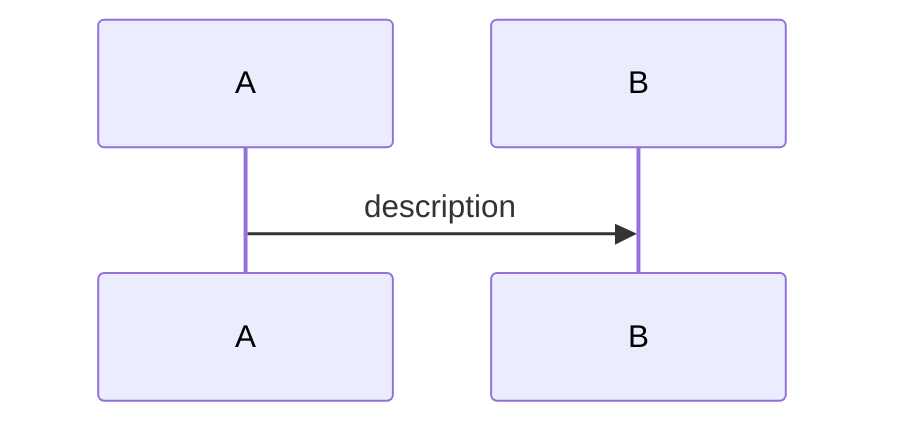

# {title}

<!--
- Author: Document creator (e.g., git config user.name).
-->

| Metadata      | Value                             |
| ------------- | --------------------------------- |
| Author        | {doc_author1}, {doc_author2}, ... |
| Creation Date | {Jan 2, 2006}                     |
| Last Updated  | {Jan 2, 2006}                     |

## References

<!--
- Web documents.
- Then code and other related docs, each with what it covers.
-->

- [{Web document}]({URL}): {what it covers}
- [{Code filename}]({path}): {what it covers}
- [{Doc title}]({path}): {what it covers}

## Description

<!--
- 1–2 sentences: what the concept is and the problem it solves.
-->

{simple_description}

## Concepts

<!--
- One `###` per building block, ordered so each builds on the one before; the title is its one-line takeaway.
- Bullets for how it works, trade-offs, limits, and gotchas; a table for options or comparisons.
- Add a code block (`sql`, `shell`, `yaml`) with the commands, queries, or config to copy.
- `#### Interaction`: `sequenceDiagram` when components talk to each other, `flowchart` for a decision or lifecycle. Drop it when nothing interacts.
-->

### 1. {concept_1_title}

{simple_concept_description}

#### Interaction

#### a. {subconcept_1_title}

<!--
- Add subconcepts as appropriate when a concept breaks down into distinct parts, variants, or strategies; omit when not needed.
-->

{simple_subconcept_description}

##### Interaction

