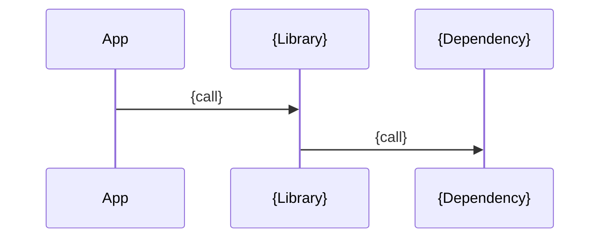

# {Library Name}

| Metadata      | Value                                         |
| ------------- | --------------------------------------------- |
| Author        | {author1}, {author2}, ...                     |
| Creation Date | {Jan 2, 2006}                                 |
| Last Updated  | {Jan 2, 2006}                                 |
| Repositories  | [{repo path}]({repo path}) ({commit hash}), … |

## References

<!--
- Web documents.
- Then code and other related docs, each with what it covers.
-->

- [{Web document}]({URL}) — {what it covers}
- [{Code filename}]({path}) — {what it covers}
- [{Doc title}]({path}) — {what it covers}

## Description

<!--
- 1–2 sentences: what it is (with the code module path for a repo), what it wraps, why it exists, and who uses it.
- Then one `###` per responsibility, such as Bootstrap, Authentication, Rate Limiting, Configuration; entry points (main, module, public interface) come first.
  - Open with a simple description of the responsibility: what it does and its main abstractions.
  - Then its related files, each with ` — what it holds`. A file serving several responsibilities goes under its main one.
-->

{description}

### {Responsibility}

{what this responsibility does}

- [{path}]({path}) — {what it holds}

## Features

<!--
- One `###` per feature, as `### Feature N: {Title}`.
- Bullets for behaviour, config keys, defaults, and gotchas; a table for enumerable options.
- `#### Interaction`: `sequenceDiagram` between components, or `flowchart` for decision logic.
- For a package people call directly, add a short code snippet of the canonical usage.
-->

### 1. {feature_1_title}

{description}

#### Interaction

