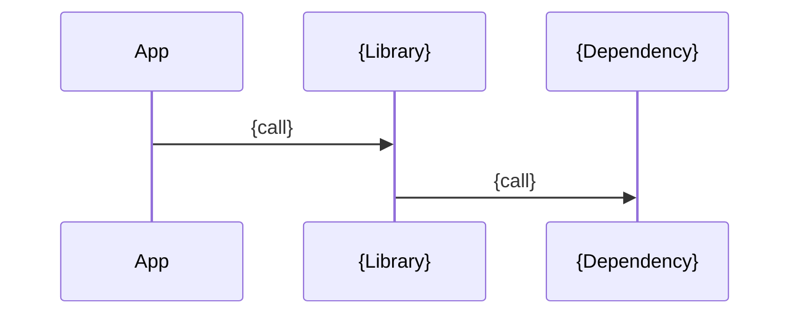
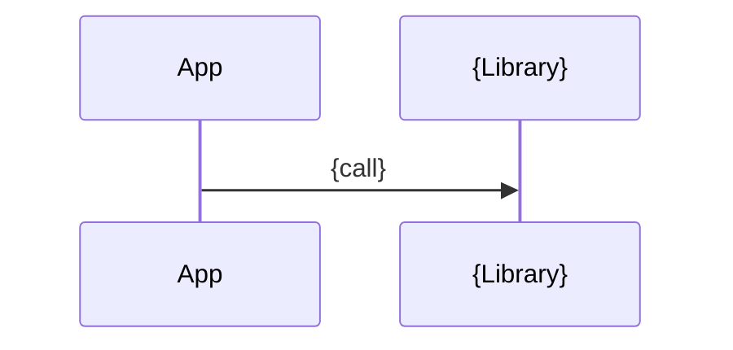

# {Library Name}

<!--
- Author: Document creator (e.g., git config user.name), NOT the library author/creator.
-->

| Metadata      | Value                                         |
| ------------- | --------------------------------------------- |
| Author        | {doc_author1}, {doc_author2}, ...             |
| Creation Date | {Jan 2, 2006}                                 |
| Last Updated  | {Jan 2, 2006}                                 |
| Repositories  | [{repo path}]({repo path}) ({commit hash}), … |

## References

<!--
- Web documents, codes and other related docs, each with what it covers.
- Follow the above order when adding references.
- When adding related docs, make sure to update other related docs' references too.
-->

- [{Web document}]({URL}): {what it covers}
- [{Code filename}]({URL}): {what it covers}
- [{Doc title}]({path}): {what it covers}

## Description

<!--
- 1–2 sentences: what it is (with the code module path for a repo), what it wraps, why it exists, and who uses it.
- Then one `###` per responsibility, such as Bootstrap, Authentication, Rate Limiting, Configuration; entry points (main, module, public interface) come first.
  - Open with a simple description of the responsibility: what it does and its main abstractions.
  - Then its related files, each with "what it holds". A file serving several responsibilities goes under its main one.
-->

{description}

### {Responsibility}

{what this responsibility does}

- [{path}]({path}): {what it holds}

## Features

<!--
- One `###` per feature, ordered so each builds on the one before; the title is its one-line takeaway.
- Bullets for behaviour, config keys, defaults, trade-offs, and gotchas; a table for options or comparisons.
- Add a code block for canonical usage or for anything easier to describe with code.
- `#### Interaction`: `sequenceDiagram` when components talk to each other, `flowchart` for a decision or lifecycle. Drop it when nothing interacts.
-->

### 1. {feature_1_title}

{simple_feature_description}

#### Interaction

#### a. {subfeature_1_title}

<!--
- Add subfeatures as appropriate when a feature breaks down into distinct parts, variants, or strategies; omit when not needed.
-->

{simple_subfeature_description}

##### Interaction

