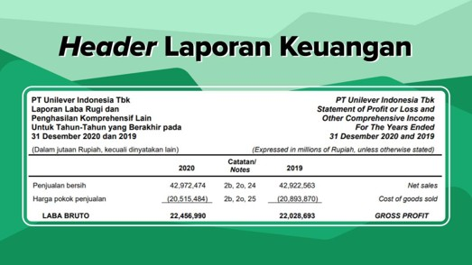

# Memahami Laporan Keuangan

Sumber: [Stockbit Academy - Memahami Laporan Keuangan](https://stockbit.com/academy/modules/2)

---

## 1. Pengantar Laporan Keuangan

### Apa Itu Laporan Keuangan?

- **Definisi:** Laporan keuangan (_financial statement_) adalah catatan informasi keuangan perusahaan dalam suatu periode akuntansi yang menggambarkan kinerja dan kondisi kesehatan finansial perusahaan tersebut.
- **Pentingnya bagi Investor:** Menilai baik atau buruknya kondisi fundamental perusahaan untuk menentukan kelayakan investasi.
- **Kewajiban Emiten:** Seluruh perusahaan terbuka (emiten) yang terdaftar di Bursa Efek Indonesia (BEI) wajib mempublikasikan laporan keuangannya secara berkala sesuai tenggat waktu regulasi.

### Periode Rilis Laporan Keuangan

Berdasarkan frekuensi dan periode rilisnya, laporan keuangan dibagi menjadi dua jenis:

1. **Laporan Keuangan Kuartalan (Triwulanan):**

   - Dipublikasikan sebanyak **4 kali dalam setahun** (masing-masing mencakup periode 3 bulan).
   - Umumnya dirilis **1 bulan setelah akhir kuartal**.
   - _Contoh:_ Kuartal I (Januari–Maret) wajib diterbitkan paling lambat tanggal **30 April**.

1. **Laporan Keuangan Tahunan (_Full Year_ / Kuartal IV):**

   - Merupakan laporan kinerja kumulatif selama satu tahun penuh (berakhir per 31 Desember).
   - Biasanya dipublikasikan emiten paling lambat **2 bulan setelah akhir tahun** buku.

### Mengapa Harus Menganalisis Laporan Keuangan Secara Mandiri?

Membeli saham pada hakikatnya adalah membeli kepemilikan bisnis riil. Sebagai pemilik modal, investor harus mampu menilai kinerja bisnis secara mandiri dan objektif, bukan sekadar mengikuti rekomendasi orang lain atau promosi figur publik/artis.

**Pertanyaan Kunci Sebelum Membeli Saham:**

- Apa model dan jenis bisnis yang dijalankan perusahaan?
- Bagaimana cara perusahaan menghasilkan pendapatan (_revenue_)?
- Apa saja beban dan pos pengeluaran operasional perusahaan?
- Apakah operasional bisnis mampu menghasilkan laba bersih secara konsisten?
- Bagaimana komposisi aset, liabilitas (utang), dan ekuitas (modal) perusahaan?
- Seberapa efektif kemampuan perusahaan dalam menghasilkan arus kas (_cash flow_) riil?

---

## 2. Komponen Utama Laporan Keuangan

Laporan keuangan lengkap terdiri atas 4 komponen utama:

### 1. Laporan Posisi Keuangan (_Balance Sheet_)

- **Fungsi:** Menunjukkan saldo aset, liabilitas (utang), dan ekuitas (modal) perusahaan pada **satu titik waktu tertentu** (misal: per 31 Desember 2020, per 31 Maret 2020, atau per 30 Juni 2020).
- **Karakteristik:** Bekerja layaknya sebuah foto (_snapshot_)—hanya memotret kondisi keuangan pada tanggal pelaporan.
- Menunjukkan total kekayaan bersih (_net worth_) perusahaan.

### 2. Laporan Laba Rugi (_Income Statement_)

- **Fungsi:** Menunjukkan performa dan hasil operasional perusahaan selama **rentang periode waktu tertentu** (misal: sepanjang tahun 2020, semester I 2020, atau kuartal I 2020).
- Mengakumulasikan seluruh pendapatan operasional serta beban usaha untuk menghitung laba atau rugi bersih.

### 3. Laporan Arus Kas (_Cash Flow Statement_)

- **Fungsi:** Mencatat penerimaan dan pengeluaran kas riil selama periode pelaporan tertentu.
- **Perbedaan dengan Income Statement:**
  - _Income Statement_ mencatat seluruh transaksi penjualan dan beban berdasarkan basis akrual (mencakup transaksi tunai maupun kredit/piutang).
  - _Cash Flow Statement_ murni mencatat pergerakan transaksi yang melibatkan penerimaan dan pengeluaran uang kas secara riil.

### 4. Catatan Atas Laporan Keuangan (CALK / _Notes to Financial Statements_)

- **Fungsi:** Memberikan rincian mendalam dan penjelasan naratif atas akun-akun di _balance sheet_ dan _income statement_.
- **Isi Catatan:** Standar akuntansi yang digunakan, metode perhitungan/pengukuran, rincian per segmen bisnis, asal dan tujuan transaksi, rincian negara tujuan ekspor, serta pengungkapan penting lainnya sesuai regulasi pasar modal.

---

## 3. Ketentuan Penyajian & Validitas Laporan Keuangan

### Cara Membaca Satuan Nominal dan Angka

- Pada bagian judul laporan selalu dicantumkan **satuan angka** (misal: disajikan dalam ribuan, jutaan, atau miliaran) dan **mata uang pelaporan** (Rupiah, USD, dsb.) agar penyajian angka lebih ringkas.
- _Contoh Kasus:_
  Penjualan bersih PT Unilever Indonesia Tbk tahun 2020 tertulis `42.972.474` dengan keterangan disajikan dalam **jutaan Rupiah**.

  $$
  \text{Nilai Riil} = 42.972.474 \times \text{Rp}1.000.000 = \text{Rp}42.972.474.000.000 \text{ (Rp42,972 triliun)}
  $$

- Nomor referensi pada tabel (misal: catatan 2B, 2O, 24) mengarahkan pembaca ke lembar Catatan Atas Laporan Keuangan (CALK) untuk melihat rincian pos tersebut.

### Peran Auditor & Pentingnya Opini Audit

- **Tujuan Audit:** Mencegah manipulasi pelaporan (seperti memoles/menggelembungkan laba, menyembunyikan biaya, atau mencatat aset fiktif).
- **Auditor Independen:** Pihak profesional eksternal yang bertugas menguji kepatuhan, keabsahan data, serta memberikan opini objektif atas laporan keuangan.
- **Kantor Akuntan Publik "The Big Four" di Indonesia:**

  1. **PwC** (_PricewaterhouseCoopers_)
  2. **EY** (_Ernst & Young_)
  3. **Deloitte**
  4. **KPMG**

- **Opini Audit yang Diharapkan:**
  Investor sebaiknya memprioritaskan perusahaan dengan opini **Wajar Tanpa Pengecualian (WTP / _Unqualified Opinion_)**, yang menunjukkan bahwa laporan keuangan disajikan secara wajar dalam semua hal yang material tanpa indikasi manipulasi.

---

## 4. Dokumen Pendukung Bagi Investor

### 1. Laporan Tahunan (_Annual Report_)

Dokumen laporan komprehensif yang dirilis setahun sekali mengenai seluruh aktivitas dan dinamika operasional emiten, memuat:

- Analisis dan pembahasan manajemen atas kinerja perusahaan (_MD&A_).
- Tinjauan kondisi makroekonomi dan tren industri.
- Struktur kepemilikan dan profil dewan manajemen (Direksi & Komisaris).
- Implementasi tata kelola perusahaan yang baik (_Good Corporate Governance_).
- Laporan kinerja operasional dan strategi rencana ekspansi bisnis ke depan.
- Laporan keuangan auditan lengkap.

### 2. Paparan Publik (_Public Expose_)

- **Pengertian:** Agenda resmi tempat manajemen emiten menyampaikan rangkuman kinerja terkini dan prospek bisnis langsung kepada publik serta investor.
- **Kewajiban:** BEI mewajibkan emiten menyelenggarakan _Public Expose_ minimal **1 kali dalam setahun**.
- **Isi Dokumen Paparan Publik:**
  - Profil dan rekam jejak bisnis emiten.
  - Produk dan portofolio layanan andalan.
  - Posisi dan peta persaingan industri.
  - Rencana kerja, target, dan prospek bisnis mendatang.
  - **Transkrip sesi tanya jawab (Q&A):** Memuat jawaban langsung manajemen atas pertanyaan krusial dari para investor/analis.
- **Akses Dokumen:** Dapat diakses lewat aplikasi Stockbit (menu Reports), situs web [BEI / IDX Tab Pengumuman](https://idx.co.id/berita/pengumuman/), atau menu _Investor Relations_ pada laman resmi emiten.

---
