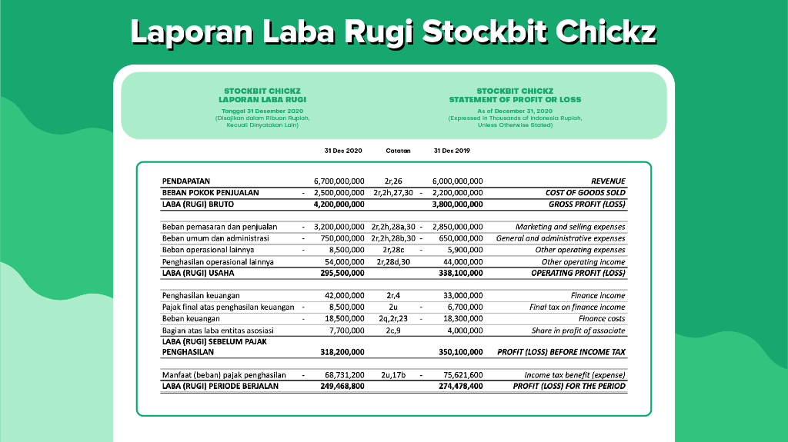
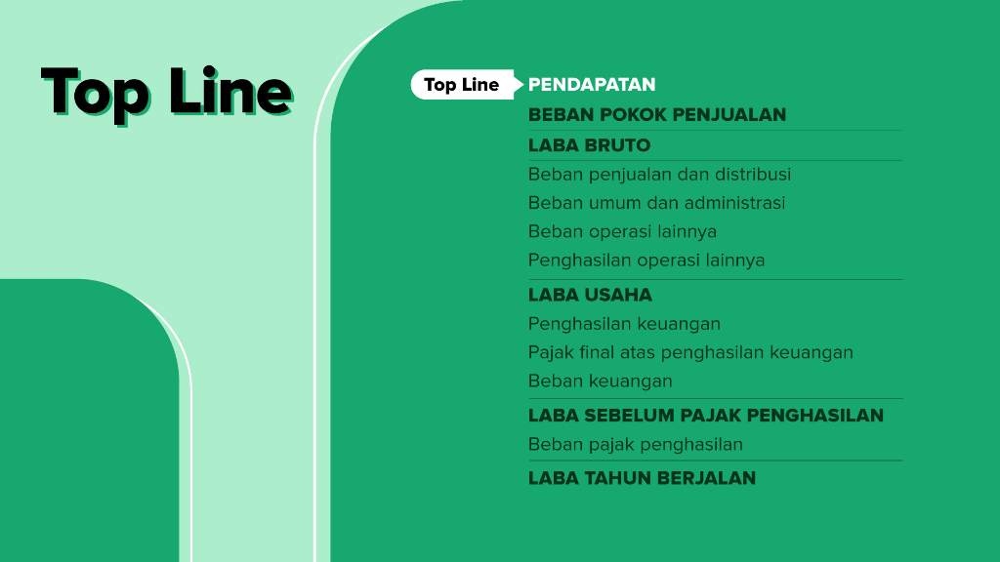
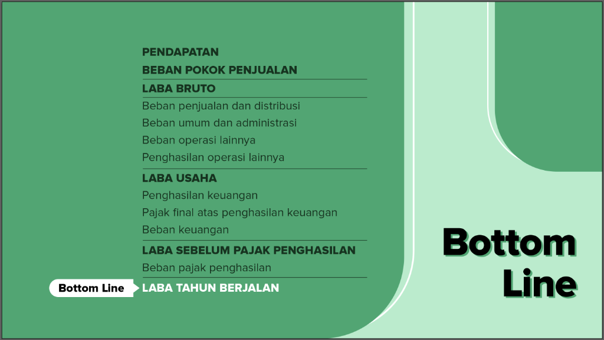
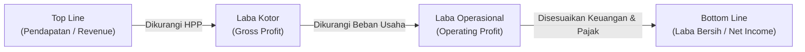
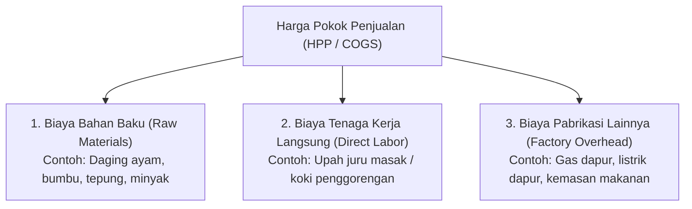
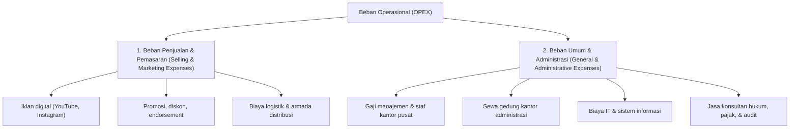
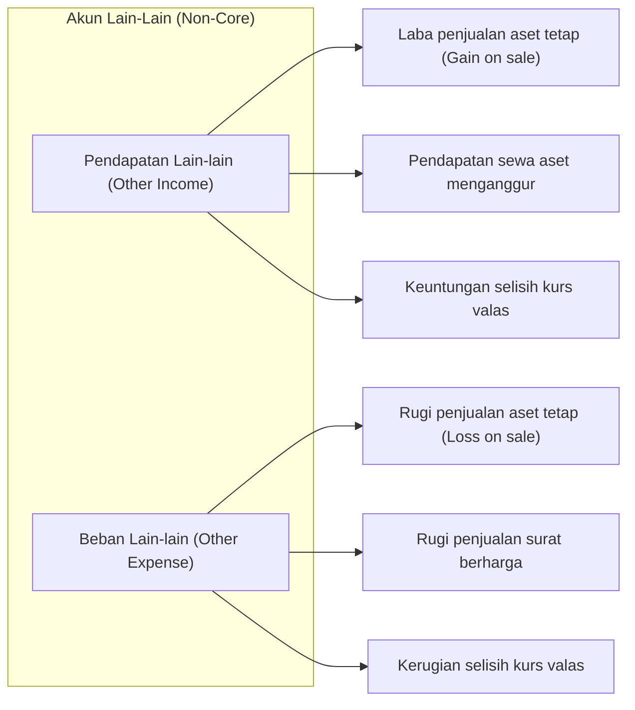
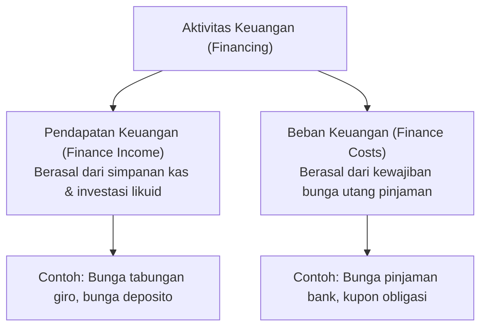
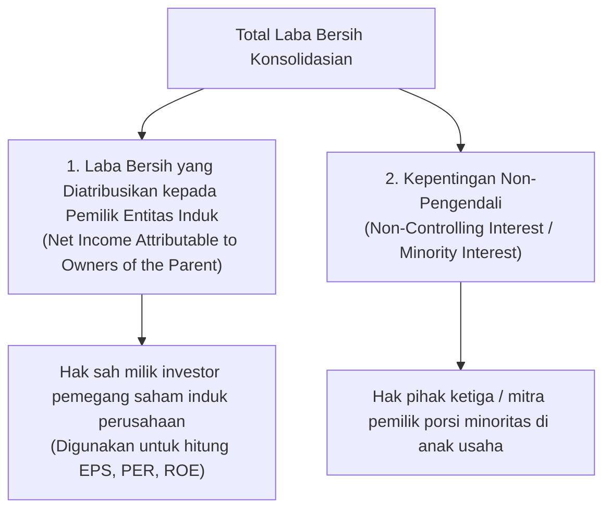

# Income Statement (Laporan Laba Rugi)

Sumber: [Stockbit Academy - Mengenal Income Statement](https://stockbit.com/academy/modules/2)

---

## 1. Pengantar Income Statement

### Apa Itu Income Statement?

**Laporan Laba Rugi** (_Income Statement_), atau dikenal juga sebagai _Profit and Loss Statement_ (P&L), adalah laporan keuangan yang menggambarkan performa dan hasil kinerja operasional perusahaan selama **satu rentang periode akuntansi tertentu** (misalnya kuartalan, semesteran, atau satu tahun buku penuh).

Berbeda dengan _Balance Sheet_ yang memotret saldo kekayaan pada satu titik tanggal tertentu (_snapshot_), _Income Statement_ merekam akumulasi perputaran aktivitas bisnis selama kurun waktu berjalan.

> [!NOTE]
> **Makna Simbol Operasi Perhitungan:**
>
> - **`(+)` Penambah:** Pos pemasukan/pendapatan yang menambah nilai keuntungan.
> - **`(-)` Pengurang:** Pos biaya, beban, atau pengeluaran yang memotong nilai pendapatan.
> - **`(=)` Hasil / Subtotal:** Tingkat laba yang diperoleh setelah kalkulasi pada tahapan tersebut.
> - **`(+/-)` Penyesuaian Fleksibel:** Pos yang bisa menambah (jika untung/pendapatan) atau mengurangi (jika rugi/beban).

- **(+) Pendapatan (_Revenue / Top Line_):** Total penjualan produk atau jasa kepada pelanggan dalam satu periode.
- **(-) Harga Pokok Penjualan (_HPP / COGS_):** Biaya produksi langsung (bahan baku, upah tenaga kerja langsung, dan overhead pabrik).
- **(=) Laba Kotor (_Gross Profit_):** Keuntungan kotor awal setelah pendapatan dikurangi HPP.
- **(-) Beban Operasional (_OPEX_):** Biaya operasional rutin di luar produksi, seperti beban penjualan, pemasaran, umum, dan administrasi (G&A).
- **(+/-) Pendapatan / Beban Lain-lain:** Transaksi non-operasional yang bersifat insidental atau jarang terjadi (misal: laba/rugi pelepasan aset tetap, selisih kurs).
- **(=) Laba Operasional (_Operating Profit / EBIT_):** Laba murni dari aktivitas bisnis inti sebelum memperhitungkan beban bunga dan pajak.
- **(+/-) Pendapatan / Beban Keuangan:** Pendapatan dari bunga simpanan kas atau beban bunga utang pinjaman/obligasi.
- **(=) Laba Sebelum Pajak (_EBT_):** Laba operasional setelah memperhitungkan hasil keuangan; menjadi dasar perhitungan pajak penghasilan.
- **(-) Beban Pajak Penghasilan (_Tax_):** Kewajiban pajak atas laba kena pajak yang disetorkan ke kas negara.
- **(=) Laba Bersih (_Net Income / Bottom Line_):** Sisa keuntungan akhir perusahaan setelah seluruh pos beban dikurangkan.
- **Pembagian Atribusi Laba:** Alokasi laba bersih untuk pemilik entitas induk (pemegang saham) vs kepentingan non-pengendali (mitra minoritas).

### Fungsi Utama bagi Investor

Dari _Income Statement_, investor dapat mengevaluasi kesehatan operasional perusahaan melalui:

1. **Skala Bisnis:** Mengetahui seberapa besar pendapatan kotor (_revenue_) yang berhasil dibukukan.
2. **Struktur Biaya:** Mengamati besaran biaya produksi, biaya promosi, gaji, hingga beban utang bunga.
3. **Efisiensi & Profitabilitas:** Mengukur apakah kegiatan operasional menghasilkan laba (_profit_) yang bertumbuh atau justru mengalami kerugian (_loss_).
4. **Kualitas Laba:** Menilai apakah laba murni berasal dari bisnis inti atau sekadar ditopang pendapatan sampingan insidental.

---

## 2. Struktur Alur Laba Rugi: Dari Top Line ke Bottom Line

Dalam dunia pasar modal dan analisis fundamental, dikenal dua istilah penting:

- **Top Line:** Mengacu pada **Pendapatan (_Revenue_)**, yaitu pos teratas yang mencerminkan total penjualan kotor.

- **Bottom Line:** Mengacu pada **Laba Bersih (_Net Income_)**, yaitu baris paling bawah yang mencerminkan keuntungan murni yang tersisa bagi pemegang saham setelah dikurangi seluruh biaya.

---

## 3. Pendapatan (Revenue / Top Line)

### Pengertian Pendapatan

**Pendapatan** (_Revenue_ atau _Sales_) adalah total nilai moneter yang diterima atau diakui perusahaan dari hasil penjualan barang dagangan ataupun jasa kepada para pelanggan dalam satu periode berjalan.

- **Posisi:** Akun pertama yang dicantumkan di urutan teratas _income statement_ (**_Top Line_**).
- **Karakteristik:** Menjadi motor utama pertumbuhan bisnis. Pertumbuhan laba bersih yang berkelanjutan jangka panjang hampir selalu didahului oleh kenaikan pendapatan (_revenue growth_).

> **Contoh Kasus (Stockbit Chickz):**  
> Sebagai jaringan restoran ayam goreng, _Stockbit Chickz_ memperoleh pendapatan utama dari penjualan paket menu ayam goreng ke pelanggan. Semakin banyak porsi ayam goreng yang terjual dan semakin optimal harga jual per porsi, semakin besar total pendapatan yang dibukukan.

---

## 4. Harga Pokok Penjualan (HPP / COGS)

### Pengertian HPP

**Harga Pokok Penjualan** (HPP) atau _Cost of Goods Sold_ (COGS) adalah seluruh komponen biaya yang berkaitan langsung (_direct costs_) dengan proses produksi barang atau penyediaan jasa yang dijual perusahaan.

### 3 Komponen Utama HPP:

1. **Biaya Bahan Baku (_Raw Materials_):** Bahan mentah yang diolah menjadi produk jadi (misal: ayam segar, minyak goreng, tepung, bumbu).
2. **Biaya Tenaga Kerja Langsung (_Direct Labor_):** Upah pekerja yang terlibat langsung dalam proses pengolahan barang (misal: pekerja dapur pembuat ayam goreng).
3. **Biaya Pabrikasi / Overhead (_Manufacturing Overhead_):** Biaya penunjang produksi langsung lainnya seperti kemasan makanan (_packaging_), gas penggorengan, dan listrik dapur produksi.

---

## 5. Laba Kotor (Gross Profit)

### Pengertian Laba Kotor

**Laba Kotor** (_Gross Profit_) atau laba bruto adalah laba yang diperoleh setelah pendapatan penjualan dikurangi seluruh biaya produksi langsung (HPP).

### Rumus Laba Kotor:

$$
\text{Laba Kotor} = \text{Pendapatan} - \text{Harga Pokok Penjualan (HPP)}
$$

$$
\text{Gross Profit Margin (GPM)} = \frac{\text{Laba Kotor}}{\text{Pendapatan}} \times 100\%
$$

> [!TIP]
> **Pentingnya Efisiensi HPP:**  
> Semakin hemat dan efisien perusahaan dalam mengendalikan biaya bahan baku dan proses produksi langsung, semakin besar margin laba kotor (_Gross Profit Margin_) yang didapatkan. Hal ini memberikan bantalan yang lebih tebal untuk menutup beban-beban operasional berikutnya.

> **Contoh Kasus (Stockbit Chickz - Q4 2020):**  
> Pada kuartal IV tahun 2020, _Stockbit Chickz_ mencatatkan pendapatan sebesar **Rp150 miliar**.  
> Biaya produksi (HPP) yang dihabiskan untuk membeli ayam, minyak, kemasan, dan upah koki adalah sebesar **Rp50 miliar**.
>
> $$
> \text{Laba Kotor} = \text{Rp150 Miliar} - \text{Rp50 Miliar} = \text{Rp100 Miliar}
> $$
>
> Maka, laba kotor _Stockbit Chickz_ pada periode tersebut adalah **Rp100 miliar** (dengan margin laba kotor sebesar 66,7%).

---

## 6. Beban Operasional (Operating Expenses / OPEX)

### Pengertian Beban Operasional

**Beban Operasional** atau beban usaha (_Operating Expenses_ / OPEX) adalah biaya-biaya rutin yang dikeluarkan perusahaan untuk menjalankan seluruh kegiatan bisnis harian di luar proses manufaktur/produksi langsung.

### Klasifikasi Beban Operasional:

#### 1. Beban Penjualan dan Pemasaran (_Selling and Marketing Expenses_)

Pengeluaran yang dialokasikan untuk aktivitas pemasaran dan penjualan setelah produk selesai diproduksi dan siap disalurkan ke konsumen:

- Belanja iklan media cetak, televisi, YouTube, dan Instagram.
- Biaya promosi, event, dan endorsement.
- Biaya distribusi, kurir, dan pengangkutan barang ke gerai-gerai.

> _Contoh:_ Untuk mempromosikan varian ayam krispi pedas terbarunya, _Stockbit Chickz_ memasang kampanye iklan di media sosial. Biaya pembuatan konten dan penayangan iklan tersebut dicatat ke pos **Beban Penjualan dan Pemasaran**.

#### 2. Beban Umum dan Administrasi (_General and Administrative Expenses / G&A_)

Biaya kantor pusat dan fasilitas penunjang manajemen perusahaan:

- Gaji dan tunjangan direksi, staf akuntansi, HRD, dan legal.
- Biaya lisensi merek dagang dan software kantor.
- Jasa audit akuntan independen dan penasihat hukum.
- Program pelatihan dan pengembangan karyawan (_training_).
- Perlengkapan kantor dan infrastruktur teknologi informasi (IT).

> _Contoh:_ Pembayaran gaji bulanan bagi karyawan divisi keuangan dan HRD _Stockbit Chickz_ dicatat pada pos **Beban Umum dan Administrasi**.

---

## 7. Pendapatan dan Beban Lain-Lain (Other Income & Expenses)

### Karakteristik Akun Lain-Lain

Pos pendapatan dan beban lain-lain (_Other Income / Expenses_) mencatat transaksi yang:

1. **Bukan berasal dari kegiatan bisnis inti** (_non-core business_).
2. Bersifat **tidak rutin / insidental / jarang terjadi**.
3. Memiliki transaksi nominal yang terpisah dari kategori operasional utama.

### Studi Kasus: Pelepasan Aset Truk Distribusi (_Stockbit Chickz_)

Sebagai bisnis restoran ayam goreng, jual-beli kendaraan bukan merupakan kegiatan bisnis inti _Stockbit Chickz_.

Truk operasional tercatat memiliki nilai buku (_book value_) sebesar **Rp80 juta** di neraca.

- **Kondisi Rugi (Loss on Sale of Fixed Asset):**  
  Truk dijual dengan harga **Rp70 juta**.

  $$
  \text{Selisih} = \text{Rp70 Juta} - \text{Rp80 Juta} = -\text{Rp10 Juta (Rugi)}
  $$

  Kerugian Rp10 juta ini dicatat sebagai **Beban Lain-lain** (_Other Expense_).

- **Kondisi Untung (Gain on Sale of Fixed Asset):**  
  Truk berhasil dijual dengan harga **Rp100 juta**.

  $$
  \text{Selisih} = \text{Rp100 Juta} - \text{Rp80 Juta} = +\text{Rp20 Juta (Untung)}
  $$

  Keuntungan Rp20 juta ini dicatat sebagai **Pendapatan Lain-lain** (_Other Income_).

---

## 8. Laba Operasional (Operating Profit / EBIT)

### Pengertian Laba Operasional

**Laba Operasional** (_Operating Profit_ atau _Operating Income_) adalah laba murni yang berhasil diraup perusahaan dari seluruh aktivitas operasional bisnis inti pada periode tertentu, sebelum memperhitungkan beban bunga pinjaman dan pajak penghasilan (_Earnings Before Interest and Taxes_ / EBIT).

### Rumus Laba Operasional:

$$
\text{Laba Operasional} = \text{Laba Kotor} - \text{Total Beban Operasional} \pm \text{Hasil Lain-Lain}
$$

$$
\text{Laba Operasional} = \text{Laba Kotor} - (\text{Beban Penjualan} + \text{Beban G\&A} + \text{Beban Lain-Lain})
$$

### Makna Laba Operasional bagi Analisis Saham:

- **Tingkat Efisiensi Bisnis:** Laba operasional berbanding lurus dengan efisiensi pengelolaan usaha. Semakin tinggi margin laba operasional, semakin ramping dan efektif struktur operasional perusahaan.
- **Kemandirian Bisnis Inti:** Laba operasional mengisolasi hasil bisnis riil tanpa terdistorsi oleh struktur utang perbankan maupun insentif pajak.

> **Contoh Kasus (Stockbit Chickz - Kuartal IV 2020):**
>
> - Laba Kotor (_Gross Profit_) = **Rp4.200 miliar**
> - Beban Operasional = **Rp3.904,5 miliar**
>
> $$
> \text{Laba Operasional} = \text{Rp4.200 Miliar} - \text{Rp3.904,5 Miliar} = \text{Rp295,5 Miliar}
> $$

---

## 9. Pendapatan dan Beban Keuangan (Finance Income & Costs)

Komponen ini mencatat hasil dari transaksi keuangan, permodalan, dan pendanaan perusahaan yang terpisah dari aktivitas operasional harian.

### 1. Pendapatan Keuangan (_Finance Income_)

Berasal dari penempatan dana kas perusahaan pada instrumen perbankan atau pasar uang.

- _Contoh:_ _Stockbit Chickz_ menyimpan dana menganggur sebesar **Rp10 miliar** di bank dengan bunga **4% per tahun**.

  $$
  \text{Pendapatan Keuangan} = \text{Rp10 Miliar} \times 4\% = \text{Rp400 Juta/tahun}
  $$

#### 2. Beban Keuangan (_Finance Costs / Interest Expense_)

Beban bunga yang timbul akibat pinjaman kredit perbankan atau penerbitan obligasi perusahaan di masa lalu.

- _Contoh:_ _Stockbit Chickz_ memiliki pinjaman bank sebesar **Rp10 miliar** dengan suku bunga pinjaman **12% per tahun**.

  $$
  \text{Beban Keuangan} = \text{Rp10 Miliar} \times 12\% = \text{Rp1,2 Miliar/tahun}
  $$

---

## 10. Laba Sebelum Pajak Penghasilan (Profit Before Tax / EBT)

Dengan memperhitungkan pendapatan dan beban keuangan ke dalam laba operasional, diperoleh nominal **Laba Sebelum Pajak** (_Earnings Before Tax_ / EBT).

### Rumus Laba Sebelum Pajak:

$$
\text{Laba Sebelum Pajak} = \text{Laba Operasional} + \text{Pendapatan Keuangan} - \text{Beban Keuangan}
$$

Nilai ini menjadi dasar resmi pengenaan tarif pajak penghasilan badan usaha.

---

## 11. Beban Pajak Penghasilan (Income Tax Expense)

### Pengertian Beban Pajak

**Beban Pajak Penghasilan** adalah jumlah gabungan kewajiban pajak kini (_current tax_) dan pajak tangguhan (_deferred tax_) yang dihitung sesuai regulasi perpajakan yang berlaku.

### Mekanisme Perhitungan Pajak:

$$
\text{Beban Pajak Penghasilan} = \text{Persentase Pajak Efektif} \times \text{Laba Sebelum Pajak}
$$

> [!NOTE]
> Pajak penghasilan badan **hanya dikenakan apabila perusahaan membukukan laba positif**. Apabila pada periode tersebut perusahaan mencatatkan rugi sebelum pajak, maka perusahaan tidak dikenakan beban pajak penghasilan periode berjalan.

---

## 12. Laba Bersih (Net Income / Bottom Line)

### Pengertian Laba Bersih

**Laba Bersih** (_Net Income_ atau _Net Profit_) adalah sisa keuntungan akhir perusahaan setelah seluruh pos pendapatan dikurangi seluruh pengeluaran, biaya produksi, beban usaha operasional, beban bunga keuangan, hingga beban pajak penghasilan.

### Rumus Laba Bersih:

$$
\text{Laba Bersih} = \text{Laba Sebelum Pajak} - \text{Beban Pajak Penghasilan}
$$

- **Posisi:** Merupakan akun paling akhir di dasar laporan laba rugi, sehingga secara universal dijuluki sebagai **_Bottom Line_**.
- **Signifikansi:** Semakin tinggi laba bersih, semakin besar imbal hasil yang berpotensi dinikmati pemegang saham dalam bentuk dividen maupun kenaikan nilai ekuitas perusahaan.

---

## 13. Atribusi Laba Bersih: Pemilik Entitas Induk vs Kepentingan Non-Pengendali

Pada perusahaan publik (emiten), laporan laba rugi yang disajikan umumnya berbentuk **Laporan Konsolidasian**, yang menggabungkan kinerja induk usaha beserta seluruh anak perusahaannya.

Ketika induk usaha tidak memiliki 100% kepemilikan pada anak usahanya, laba bersih total harus dibagi secara adil:

### Rumus Atribusi Laba Bersih:

$$
\text{Laba Pemilik Entitas Induk} = \text{Laba Bersih Konsolidasian} - \text{Kepentingan Non-Pengendali}
$$

### Studi Kasus: Konsolidasi Saham Anak Perusahaan

> _Stockbit Chickz_ mendirikan anak perusahaan bernama **Bibit Chickz** dengan porsi kepemilikan **51% saham**. Sisa **49% saham** lainnya dimiliki oleh investor mitra eksternal.
>
> Pada akhir tahun buku, _Bibit Chickz_ mencatatkan laba bersih sebesar **Rp100 juta**.
>
> 1. **Pencatatan Konsolidasi Total:**  
>    Laporan keuangan gabungan akan menampilkan total laba bersih sebesar **Rp100 juta**.
> 2. **Alokasi Hak Pemilik:**
>    - **Kepentingan Non-Pengendali (49%):** $49\% \times \text{Rp100 Juta} = \text{Rp49 Juta}$ (menjadi hak mitra luar).
>    - **Pemilik Entitas Induk (51%):** $51\% \times \text{Rp100 Juta} = \text{Rp51 Juta}$ (hak murni _Stockbit Chickz_).

> [!IMPORTANT]
> **Pedoman Investor:**  
> Selalu gunakan pos **Laba Bersih yang Diatribusikan kepada Pemilik Entitas Induk** saat menghitung rasio-rasio valuasi penting seperti _Earnings Per Share_ (EPS), _Price to Earnings Ratio_ (PER), dan _Return on Equity_ (ROE), karena pos inilah yang mencerminkan hak riil pemegang saham perusahaan induk.

---

## 14. Ringkasan Format Laporan Laba Rugi

Berikut gambaran format komprehensif susunan _Income Statement_ beserta cara perhitungannya secara berurutan:

|   No   | Pos Akun Keuangan                                 | Keterangan / Formula                                                           | Posisi / Istilah |
| :----: | :------------------------------------------------ | :----------------------------------------------------------------------------- | :--------------: |
| **1**  | **Pendapatan Bersih (_Revenue_)**                 | Total penjualan produk / jasa ke pelanggan                                     |   **Top Line**   |
|   2    | Beban Pokok Penjualan (_HPP / COGS_)              | Biaya bahan baku, tenaga kerja langsung, & overhead                            |    Pengurang     |
| **3**  | **Laba Kotor (_Gross Profit_)**                   | $\text{Pendapatan} - \text{HPP}$                                               |     Subtotal     |
|   4    | Beban Penjualan & Pemasaran                       | Iklan, promosi, endorsement, distribusi                                        |    Pengurang     |
|   5    | Beban Umum & Administrasi                         | Gaji kantor, sewa kantor, IT, konsultan                                        |    Pengurang     |
|   6    | Pendapatan / (Beban) Lain-lain                    | Penjualan aset tetap, selisih kurs                                             |   Penyesuaian    |
| **7**  | **Laba Operasional (_Operating Profit / EBIT_)**  | $\text{Laba Kotor} - \text{Total Beban Operasional}$                           |     Subtotal     |
|   8    | Pendapatan Keuangan                               | Bunga simpanan bank, deposito                                                  |     Penambah     |
|   9    | Beban Keuangan                                    | Bunga pinjaman bank, kupon obligasi                                            |    Pengurang     |
| **10** | **Laba Sebelum Pajak (_EBT_)**                    | $\text{Laba Operasional} + \text{Pendapatan Keuangan} - \text{Beban Keuangan}$ |     Subtotal     |
|   11   | Beban Pajak Penghasilan                           | $\text{Tarif Pajak} \times \text{EBT}$                                         |    Pengurang     |
| **12** | **Laba Bersih Tahun Berjalan (_Net Income_)**     | $\text{EBT} - \text{Beban Pajak}$                                              | **Bottom Line**  |
|   13   | _Diatribusikan kepada Kepentingan Non-Pengendali_ | Porsi hak milik pemegang saham minoritas anak usaha                            |    Pengurang     |
| **14** | **Laba Bersih Pemilik Entitas Induk**             | Hak mutlak pemegang saham induk                                                |  **Dasar EPS**   |
