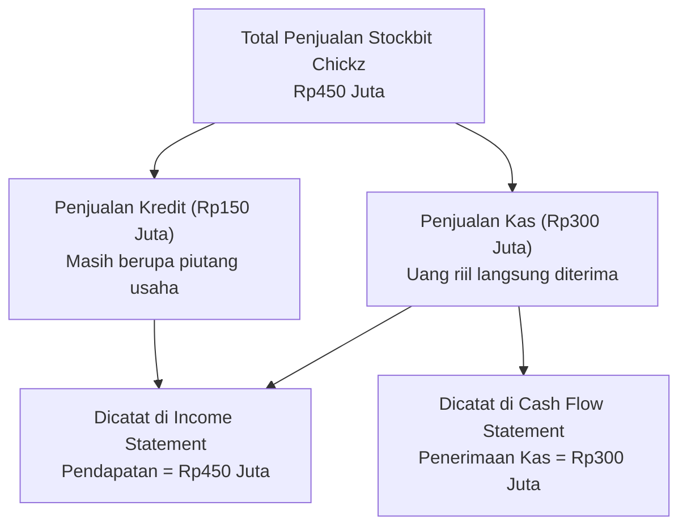
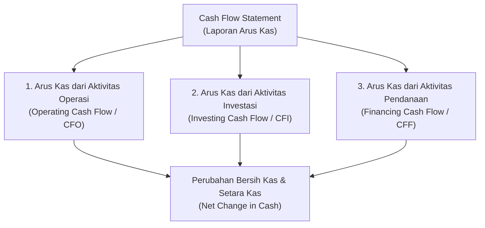
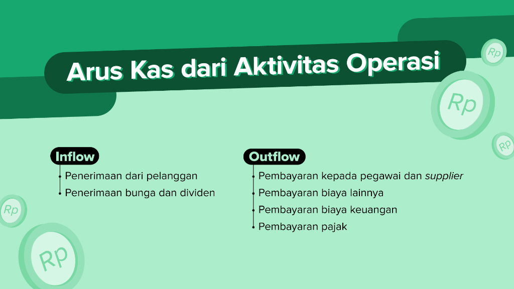
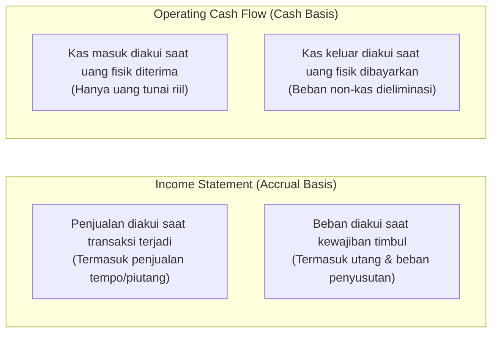
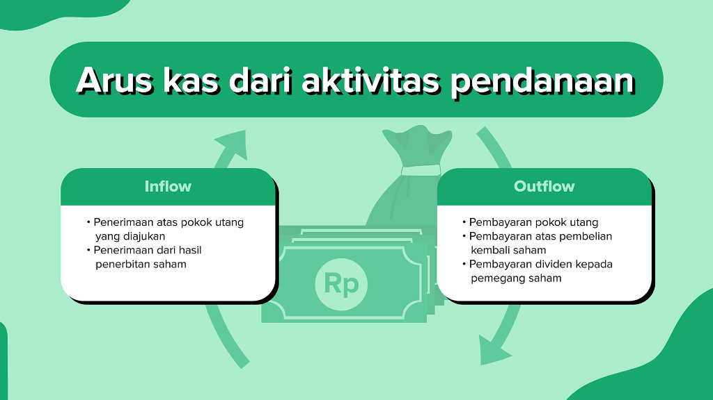
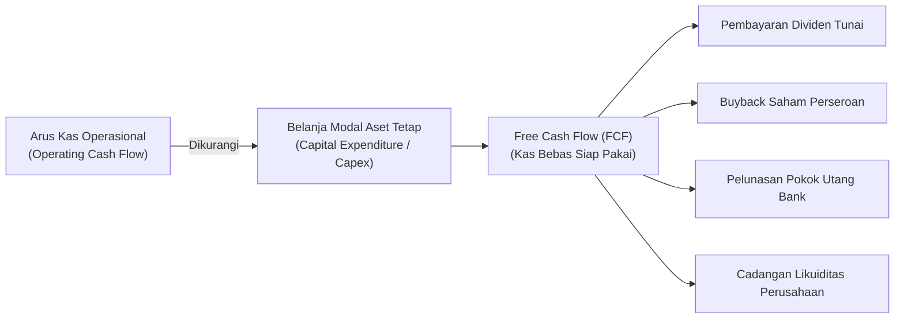

# Cash Flow Statement (Laporan Arus Kas)

Sumber: [Stockbit Academy - Cash Flow Statement](https://stockbit.com/academy/modules/2/chapters/12)

---

## 1. Pengantar Cash Flow Statement

### Apa Itu Cash Flow Statement?

> [!QUOTE]
> _"Income Statement is an opinion, Cash Flow Statement is a fact."_

Berbeda dengan _income statement_, laporan arus kas atau **Cash Flow Statement** dapat memberikan gambaran objektif mengenai apa yang terjadi di perusahaan tanpa dipengaruhi oleh distorsi peraturan akuntansi (_accrual accounting_).

Berdasarkan definisinya, **Cash Flow Statement** adalah laporan keuangan yang menyajikan informasi mengenai jumlah kas yang diterima (_cash inflow_) dan dikeluarkan (_cash outflow_) oleh sebuah perusahaan selama periode tertentu.

### Studi Kasus: Mengapa Kas Berbeda dengan Laba? (Stockbit Chickz)

> **Contoh Ilustrasi (Stockbit Chickz):**  
> Selama bulan Januari 2021, _Stockbit Chickz_ menjual ayam secara kas sebesar **Rp300 juta** dan secara kredit (tempo) sebesar **Rp150 juta**. Maka, uang riil yang diterima _Stockbit Chickz_ hanya sebesar **Rp300 juta**.
>
> 1. **Pencatatan di Income Statement:**  
>    Pendapatan bulan tersebut akan dicatat sebesar **Rp450 juta** ($\text{Rp300 Juta} + \text{Rp150 Juta}$).  
>    _Alasan:_ Pendapatan di _income statement_ diakui saat penyerahan barang/jasa sudah dilakukan (_accrual basis_), meskipun uang kas fisik belum diterima oleh perusahaan.
>
> 2. **Pencatatan di Cash Flow Statement:**  
>    Penerimaan dari pelanggan bulan Januari 2021 akan dicatat sebesar **Rp300 juta**.  
>    _Alasan:_ _Stockbit Chickz_ baru menerima uang kas fisik sebesar Rp300 juta. Sisa Rp150 juta masih berupa piutang usaha (_accounts receivable_).

---

## 2. Tiga Pilar Aktivitas Cash Flow Statement

Cash Flow Statement disusun dari tiga aktivitas bisnis utama yang mencerminkan perputaran dana perusahaan:

1. **Arus Kas dari Aktivitas Operasi (_Cash Flow from Operating Activities / CFO_)**
2. **Arus Kas dari Aktivitas Investasi (_Cash Flow from Investing Activities / CFI_)**
3. **Arus Kas dari Aktivitas Pendanaan (_Cash Flow from Financing Activities / CFF_)**

---

## 3. Mengenal Arus Kas dari Aktivitas Operasi (Operating Cash Flow)

### Pengertian Arus Kas Operasi

**Arus kas dari aktivitas operasi** (_cash flow from operating activities_) adalah arus kas yang berasal dari aktivitas yang berhubungan langsung dengan operasi bisnis utama yang dijalankan perusahaan.

Transaksi ini berupa pos pemasukan atau pengeluaran rutin operasional perusahaan, seperti:

- Penjualan produk/jasa ke pelanggan
- Pembayaran biaya pemasaran dan produksi
- Pembayaran upah dan gaji karyawan
- Pelunasan beban pajak penghasilan
- Pembayaran bunga utang usaha/operasional

> [!NOTE]
> **Makna Finansial Aktivitas Operasi:**  
> Sederhananya, arus kas dari aktivitas operasi menunjukkan kemampuan perusahaan untuk menghasilkan dan meningkatkan kas dari bisnis intinya.  
> Apabila sebuah perusahaan tidak dapat menghasilkan arus kas operasi positif secara konsisten, maka dapat dikatakan bahwa perusahaan hanya bergantung pada pendanaan baru (utang atau modal baru) untuk melanjutkan usahanya.

### Komponen Inflow & Outflow Aktivitas Operasi

| Kategori        | Pos Transaksi                              | Keterangan                                                                           |
| :-------------- | :----------------------------------------- | :----------------------------------------------------------------------------------- |
| **Inflow (+)**  | **Penerimaan dari pelanggan**              | Kas tunai hasil penjualan barang/jasa serta pelunasan piutang pelanggan              |
|                 | **Penerimaan bunga dan dividen**           | Kas masuk dari hasil bunga deposito/rekening atau dividen dari investasi operasional |
| **Outflow (-)** | **Pembayaran kepada pegawai dan supplier** | Gaji/tunjangan karyawan serta pembayaran pembelian bahan baku ke pemasok             |
|                 | **Pembayaran biaya lainnya**               | Biaya operasional harian, pemasaran, listrik, sewa, dan beban administrasi           |
|                 | **Pembayaran biaya keuangan**              | Beban bunga atas pinjaman dana atau fasilitas kredit operasional                     |
|                 | **Pembayaran pajak**                       | Pembayaran pajak penghasilan badan (PPh) ke kas negara                               |

---

## 4. Operating Cash Flow vs. Income Statement

Meskipun terlihat serupa, arus kas dari aktivitas operasi (_operating cash flow_) dan laporan laba rugi (_income statement_) memiliki beberapa perbedaan mendasar:

### Perbedaan Mendasar:

1. **Penjualan (_Revenue_ vs _Cash Inflow_):**
   - Transaksi yang telah diakui sebagai penjualan di _income statement_ belum tentu sudah menghasilkan kas bagi perusahaan.
   - Oleh karena itu, penjualan tempo/kredit masih berupa **piutang usaha** dan belum dihitung sebagai penambah kas di _cash flow statement_ sampai uangnya benar-benar dilunasi oleh pelanggan.

2. **Pembelian dan Penyusutan (_Expense_ vs _Cash Outflow_):**
   - Transaksi berupa pembelian barang atau jasa yang diakui sebagai beban di _income statement_ belum tentu sudah dilunasi oleh perusahaan (masih berupa **utang usaha**).
   - Beban non-kas seperti **penyusutan (depresiasi) dan amortisasi** memotong laba di _income statement_, padahal tidak ada uang kas fisik yang keluar pada periode tersebut. Di _cash flow statement_, biaya penyusutan ditambahkan kembali (_add back_).

| Parameter                | Income Statement                            | Operating Cash Flow (CFS)                              |
| :----------------------- | :------------------------------------------ | :----------------------------------------------------- |
| **Basis Pencatatan**     | **Akrual (_Accrual Basis_)**                | **Kas (_Cash Basis_)**                                 |
| **Pengakuan Pendapatan** | Saat barang/jasa diserahkan ke pembeli      | Saat uang kas riil masuk ke rekening perusahaan        |
| **Pengakuan Beban**      | Saat timbul kewajiban biaya                 | Saat uang kas riil dibayarkan ke luar                  |
| **Beban Depresiasi**     | Diakui sebagai pengurang laba bersih        | Diabaikan / ditambahkan kembali (tidak ada kas keluar) |
| **Fokus Penilaian**      | Mengukur profitabilitas kinerja operasional | Mengukur kemampuan likuiditas dan daya tahan kas       |

---

## 5. Mengenal Arus Kas dari Aktivitas Investasi (Investing Cash Flow)

### Pengertian Arus Kas Investasi

**Arus kas dari aktivitas investasi** (_cash flow from investing activities_) adalah arus kas yang berasal dari aktivitas berkaitan dengan investasi serta penjualan atau pembelian dari aset jangka panjang perusahaan.

Pengeluaran kas dari aktivitas investasi biasanya digunakan untuk kegiatan ekspansi perusahaan (_Capital Expenditure / Capex_), seperti:

- Pembelian mesin-mesin pabrik baru
- Pembangunan pabrik atau gedung kantor baru
- Pembukaan cabang atau outlet gerai baru

> **Contoh Kasus (Stockbit Chickz):**
>
> - Ketika _Stockbit Chickz_ membeli _kitchen set_ baru atau membuka outlet baru, pengeluaran uang tersebut akan tercatat dalam **arus kas investasi keluar (_investing outflow_)**.
> - Sebaliknya, jika _Stockbit Chickz_ menjual aset tetap (seperti menjual kendaraan operasional bekas) atau menjual instrumen investasi (deposito/obligasi), kas yang masuk akan tercatat dalam **arus kas investasi masuk (_investing inflow_)**.

### Komponen Inflow & Outflow Aktivitas Investasi

| Kategori        | Pos Transaksi                                     | Keterangan                                                                       |
| :-------------- | :------------------------------------------------ | :------------------------------------------------------------------------------- |
| **Inflow (+)**  | **Penerimaan dari penjualan aset tetap**          | Kas dari pelepasan/penjualan properti, tanah, mesin, peralatan, atau kendaraan   |
|                 | **Penerimaan dari penjualan instrumen investasi** | Hasil penjualan surat berharga, saham anak usaha, obligasi, atau reksa dana      |
|                 | **Penerimaan pokok piutang**                      | Pelunasan pokok pinjaman yang pernah diberikan perusahaan kepada pihak ketiga    |
| **Outflow (-)** | **Pembelian aset tetap (_Capex_)**                | Belanja modal untuk membeli aset tetap, mesin pabrik, renovasi, atau buka cabang |
|                 | **Pembelian instrument investasi**                | Penempatan dana kas pada instrumen keuangan jangka panjang atau akuisisi bisnis  |
|                 | **Pinjaman kepada pihak lain**                    | Penyaluran pinjaman modal kepada pihak ketiga atau entitas asosiasi              |

> [!TIP]
> **Catatan Analisis untuk Investor:**  
> Arus kas investasi yang bernilai **negatif** (_net outflow_) tidak selalu berarti buruk. Bagi perusahaan yang sedang bertumbuh (_growth company_), arus kas investasi negatif justru merupakan tanda positif bahwa manajemen aktif menanamkan modal (_capex_) untuk memperluas skala bisnis demi meningkatkan laba di masa depan.

---

## 6. Mengenal Arus Kas dari Aktivitas Pendanaan (Financing Cash Flow)

### Pengertian Arus Kas Pendanaan

**Arus kas dari aktivitas pendanaan** (_cash flow from financing activities_) adalah arus kas yang berasal dari aktivitas yang berhubungan dengan struktur permodalan perusahaan, penarikan utang, dan pembayaran imbal hasil kepada pemegang saham (dividen).

Pemasukan kas dari aktivitas pendanaan biasanya dilakukan melalui penarikan utang baru (pinjaman bank atau obligasi) ataupun penjualan/penerbitan saham baru (_rights issue / private placement_).

Perusahaan umumnya mencari pendanaan dari luar saat:

- Kerap mengalami kerugian atau gagal menghasilkan arus kas yang cukup dari operasional bisnisnya.
- Memerlukan modal segar untuk membantu menjalankan bisnis, melunasi utang jatuh tempo, atau membiayai ekspansi skala besar.

Sebaliknya, pengeluaran kas dari aktivitas pendanaan dilakukan melalui pembayaran dividen kas, pembayaran cicilan pokok pinjaman utang, ataupun pembelian kembali (_buyback_) saham perusahaan.

> **Contoh Kasus (Stockbit Chickz):**
>
> 1. _Stockbit Chickz_ mengajukan pinjaman kepada bank senilai **Rp20 miliar**. Ketika pinjaman tersebut disetujui dan dananya diterima, transaksi akan tercatat sebagai **_Financing Inflow_**.
> 2. Jika pada akhir tahun manajemen dan RUPS memutuskan untuk membagikan dividen kas kepada pemegang saham, maka nominal yang dibayarkan akan tercatat sebagai **_Financing Outflow_**.

### Komponen Inflow & Outflow Aktivitas Pendanaan

| Kategori        | Pos Transaksi                                 | Keterangan                                                                                 |
| :-------------- | :-------------------------------------------- | :----------------------------------------------------------------------------------------- |
| **Inflow (+)**  | **Penerimaan atas pokok utang yang diajukan** | Pencairan fasilitas pinjaman bank, kreditur, atau penerbitan surat utang (obligasi)        |
|                 | **Penerimaan dari hasil penerbitan saham**    | Kas masuk dari penerbitan saham baru melalui IPO, _rights issue_, atau _private placement_ |
| **Outflow (-)** | **Pembayaran pokok utang**                    | Pelunasan cicilan pokok utang bank atau penarikan obligasi yang jatuh tempo                |
|                 | **Pembayaran atas pembelian kembali saham**   | Pengeluaran kas untuk melakukan aksi korporasi pembelian saham di bursa (_share buyback_)  |
|                 | **Pembayaran dividen kepada pemegang saham**  | Pembagian dividen tunai dari laba ditahan kepada para pemegang saham                       |

---

## 7. Mengenal Free Cash Flow (FCF)

### Pengertian Free Cash Flow

Selain ketiga arus kas di atas, _cash flow statement_ juga dapat membantu investor mengetahui jumlah **Free Cash Flow** yang dihasilkan perusahaan.

> [!IMPORTANT]
> **Karakteristik Free Cash Flow:**  
> Berbeda dengan tiga arus kas sebelumnya, nilai **_Free Cash Flow_ tidak dicantumkan secara eksplisit** dalam laporan keuangan resmi. Investor perlu menghitungnya secara mandiri menggunakan data dari _Operating Cash Flow_ dan pos belanja modal pada _Investing Cash Flow_.

**Free Cash Flow** adalah jumlah kas bersih yang tersisa dari aktivitas operasional perusahaan setelah dikurangi pengeluaran pembelian aset tetap atau belanja modal (_capital expenditure / capex_).

### Rumus Free Cash Flow

$$
\text{Free Cash Flow} = \text{Operating Cash Flow} - \text{Capital Expenditure (Capex)}
$$

### Mengapa Free Cash Flow Sangat Penting bagi Investor?

_Free cash flow_ sangat penting karena menunjukkan **uang kas riil yang benar-benar tersisa** dan dimiliki perusahaan setelah membayar seluruh biaya operasional serta membeli aset untuk investasi dan ekspansi.

Perusahaan yang secara konsisten menghasilkan _Free Cash Flow_ positif yang tinggi memiliki fleksibilitas finansial yang luar biasa untuk:

1. Membagikan dividen kas secara teratur dan bertumbuh kepada pemegang saham.
2. Melakukan _share buyback_ yang mendongkrak nilai intrinsik per lembar saham.
3. Melunasi kewajiban utang berbunga untuk memperkuat posisi neraca keuangan.
4. Menghadapi masa krisis ekonomi tanpa perlu berutang baru atau mendilusi kepemilikan investor.

---

## 8. Ringkasan Format Komprehensif Cash Flow Statement

Berikut ringkasan keterkaitan antar komponen dalam _Cash Flow Statement_:

|   No    | Pos Laporan Arus Kas                                 | Formula / Sumber Perhitungan                         | Makna bagi Investor                                |
| :-----: | :--------------------------------------------------- | :--------------------------------------------------- | :------------------------------------------------- |
|  **1**  | **Arus Kas Bersih dari Aktivitas Operasi (_CFO_)**   | $\text{Inflow Operasi} - \text{Outflow Operasi}$     | Mengukur kesehatan dan kemandirian bisnis inti     |
|  **2**  | **Arus Kas Bersih dari Aktivitas Investasi (_CFI_)** | $\text{Inflow Investasi} - \text{Outflow Investasi}$ | Mengukur laju dan komitmen ekspansi jangka panjang |
|  **3**  | **Arus Kas Bersih dari Aktivitas Pendanaan (_CFF_)** | $\text{Inflow Pendanaan} - \text{Outflow Pendanaan}$ | Mengukur kebijakan permodalan, utang, dan dividen  |
| **(=)** | **Kenaikan / (Penurunan) Bersih Kas & Setara Kas**   | $\text{CFO} + \text{CFI} + \text{CFF}$               | Perubahan riil saldo kas perusahaan selama periode |
| **(+)** | **Kas dan Setara Kas pada Awal Periode**             | Saldo kas penutup periode sebelumnya                 | Saldo kas pembuka di awal tahun/kuartal            |
| **(=)** | **Kas dan Setara Kas pada Akhir Periode**            | $\text{Saldo Awal} + \text{Perubahan Kas Bersih}$    | **Harus sama dengan pos Kas di Balance Sheet**     |
| **⭐**  | **Free Cash Flow (_FCF_)**                           | $\text{CFO} - \text{Belanja Modal (Capex)}$          | Arus kas murni yang bebas dialokasikan             |
