# Rasio Laporan Keuangan (Financial Ratios)

Sumber: [Stockbit Academy - Rasio Laporan Keuangan](https://stockbit.com/academy/modules/2)

---

## 1. Pengantar Rasio Laporan Keuangan

Setelah mempelajari isi, alur logika, komponen penyusun berbagai laporan keuangan (_Balance Sheet_, _Income Statement_, dan _Cash Flow Statement_), serta prinsip akrual dalam pencatatannya, langkah selanjutnya adalah **menerapkan pengetahuan tersebut untuk menganalisis performa perusahaan secara riil**.

Analisis performa dilakukan dengan menghitung berbagai **rasio keuangan penting**. Rasio-rasio ini berfungsi untuk:

1. **Menganalisis Performa Komprehensif:** Membaca kesehatan operasional, likuiditas, solvabilitas, dan efisiensi perusahaan dari berbagai sudut pandang.
2. **Analisis Kuantitatif:** Mengubah angka mentah laporan keuangan menjadi indikator proporsional yang objektif dan terukur.
3. **Komparasi Kualitas Antar-Perusahaan (_Benchmarking_):** Membandingkan kualitas fundamental satu emiten dengan kompetitor sejenis di industrinya, meskipun memiliki skala nominal modal yang berbeda.
4. **Analisis Tren dan Pertumbuhan (_Trend Analysis_):** Mengamati arah perkembangan performa perusahaan dari tahun ke tahun (_historis_).

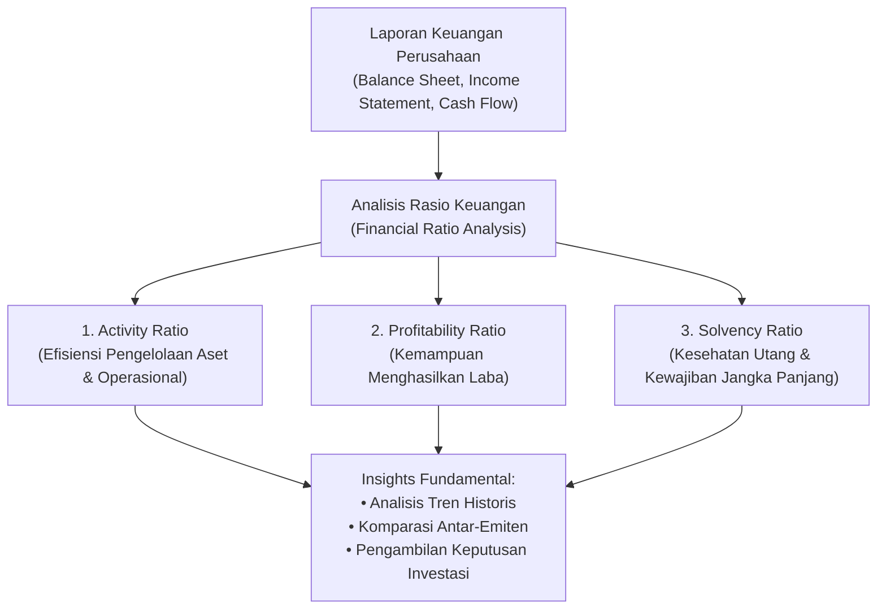

---

## 2. Mengenal Activity Ratio (Rasio Aktivitas)

### Apa Itu Activity Ratio?

> [!NOTE]
> **Definisi:**  
> **Activity Ratio** adalah rasio yang mengukur efisiensi perusahaan dalam mengelola dan mendayagunakan aset-aset yang dimilikinya. Rasio ini menggambarkan seberapa efektif performa operasional perusahaan dalam memutar modal kerja dan aset untuk menghasilkan penjualan (_revenue_).

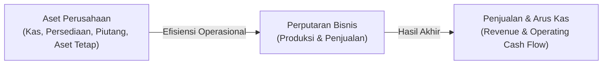

Lima rasio penting yang termasuk ke dalam **Activity Ratio** adalah:

1. **Current Ratio**
2. **Asset Turnover Ratio**
3. **Days in Inventory (DII)**
4. **Days in Receivable (DIR)**
5. **Days in Payable (DIP)**

---

## 3. Pembahasan Lengkap 5 Activity Ratio

### 1. Current Ratio (Rasio Lancar)

Rasio yang bertujuan untuk mengukur kemampuan perusahaan dalam membayar kewajiban jangka pendeknya (liabilitas lancar) yang jatuh tempo dalam waktu kurang dari 1 tahun menggunakan aset lancar yang dimilikinya.

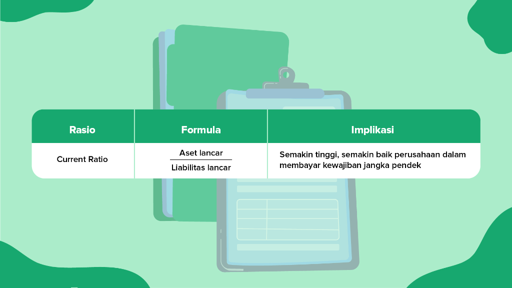

#### Formula Perhitungan:

$$
\text{Current Ratio} = \frac{\text{Aset Lancar}}{\text{Liabilitas Lancar}}
$$

#### Interpretasi & Tolok Ukur:

- **Current Ratio $\ge 1$:** Perusahaan berada dalam posisi aman (_liquid_), karena nilai aset lancar cukup atau lebih dari cukup untuk melunasi seluruh kewajiban jangka pendeknya.
- **Current Ratio $< 1$:** Menandakan potensi risiko likuiditas jangka pendek, karena aset lancar tidak mencukupi untuk menutup liabilitas yang segera jatuh tempo.

| Metrik            | Formula                                                | Implikasi                                                                       |
| :---------------- | :----------------------------------------------------- | :------------------------------------------------------------------------------ |
| **Current Ratio** | $\dfrac{\text{Aset Lancar}}{\text{Liabilitas Lancar}}$ | Semakin tinggi, semakin baik perusahaan dalam membayar kewajiban jangka pendek. |

#### Contoh Studi Kasus:

Misalkan terdapat dua emiten, **Perusahaan A** dan **Perusahaan B**, yang sama-sama memiliki kewajiban liabilitas lancar sebesar **Rp1 Miliar**:

- **Perusahaan A:** Memiliki aset lancar sebesar **Rp1,2 Miliar**.
  $$
  \text{Current Ratio}_A = \frac{\text{Rp1.200.000.000}}{\text{Rp1.000.000.000}} = \mathbf{1{,}2}
  $$
- **Perusahaan B:** Memiliki aset lancar sebesar **Rp400 Juta**.
  $$
  \text{Current Ratio}_B = \frac{\text{Rp400.000.000}}{\text{Rp1.000.000.000}} = \mathbf{0{,}4}
  $$

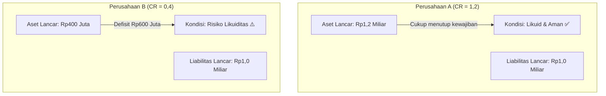

> [!WARNING]
> **Dampak Rasio Lancar di Bawah 1:**  
> Aset lancar Perusahaan A cukup untuk membayar seluruh utang jangka pendeknya karena memiliki rasio 1,2. Sebaliknya, Perusahaan B akan kesulitan membayar kewajiban jangka pendeknya.  
> Untuk menutupi defisit likuiditas tersebut, Perusahaan B berpotensi terpaksa:
>
> 1. Menjual aset tetap yang dimiliki (_fire sale_ aset operasional).
> 2. Mencari pinjaman baru (_refinancing/gali lubang tutup lubang_).
> 3. Menerbitkan saham baru (_rights issue_ / _private placement_) yang dapat mendilusi pemegang saham lama.

---

### 2. Asset Turnover Ratio (Rasio Perputaran Aset)

Rasio yang menunjukkan tingkat efisiensi aset yang dimiliki perusahaan dalam menghasilkan pendapatan (_sales/revenue_). Rasio ini mengukur berapa rupiah penjualan yang berhasil diciptakan dari setiap rupiah aset yang diinvestasikan.

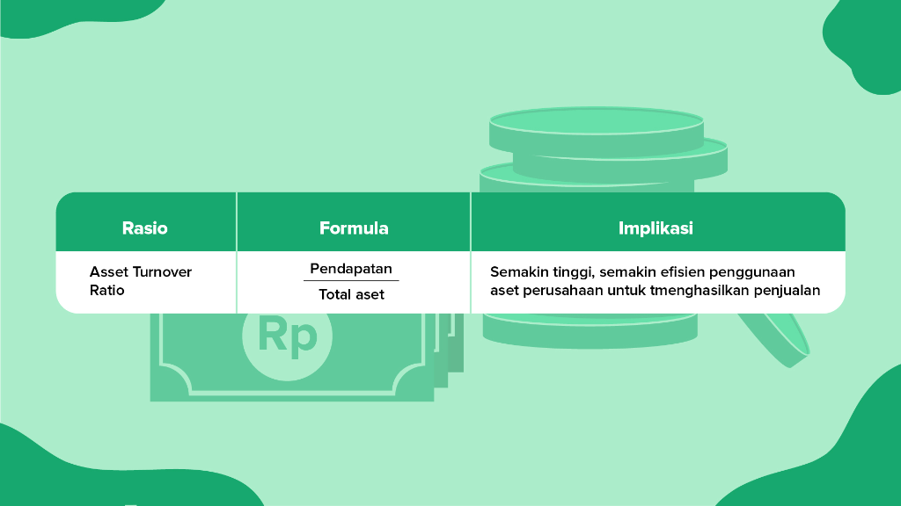

#### Formula Perhitungan:

$$
\text{Asset Turnover Ratio} = \frac{\text{Pendapatan (Revenue)}}{\text{Total Aset}}
$$

#### Interpretasi:

Semakin besar rasio _Asset Turnover_, semakin tinggi efisiensi manajemen perusahaan dalam mendayagunakan asetnya untuk mendatangkan penjualan.

| Metrik                   | Formula                                        | Implikasi                                                                                |
| :----------------------- | :--------------------------------------------- | :--------------------------------------------------------------------------------------- |
| **Asset Turnover Ratio** | $\dfrac{\text{Pendapatan}}{\text{Total Aset}}$ | Semakin tinggi, semakin efisien penggunaan aset perusahaan untuk menghasilkan penjualan. |

#### Contoh Studi Kasus:

**Perusahaan A** dan **Perusahaan B** sama-sama memiliki total aset sebesar **Rp1 Miliar**:

- **Perusahaan A:** Menghasilkan pendapatan sebesar **Rp1,5 Miliar** dalam setahun.
  $$
  \text{Asset Turnover}_A = \frac{\text{Rp1.500.000.000}}{\text{Rp1.000.000.000}} = \mathbf{1{,}5\times}
  $$
- **Perusahaan B:** Menghasilkan pendapatan sebesar **Rp600 Juta** dalam setahun.
  $$
  \text{Asset Turnover}_B = \frac{\text{Rp600.000.000}}{\text{Rp1.000.000.000}} = \mathbf{0{,}6\times}
  $$

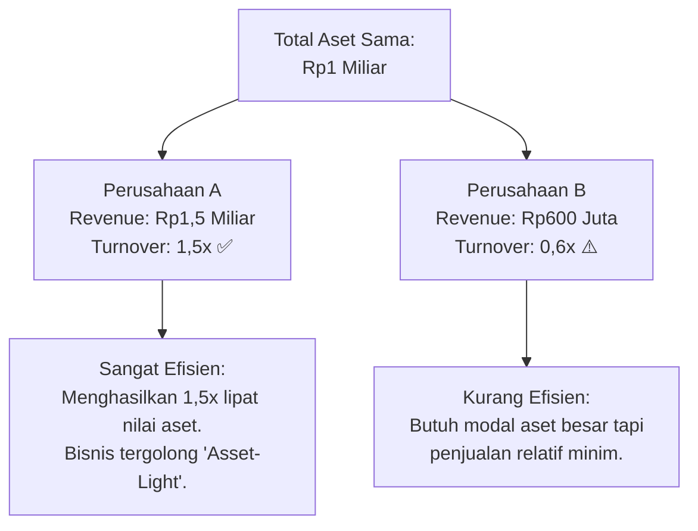

> [!TIP]
> **Kesimpulan Analisis:**  
> Perusahaan A jauh lebih efisien karena dapat menghasilkan pendapatan 2,5 kali lebih besar daripada Perusahaan B dengan modal basis aset yang sama. Ini juga menandakan model bisnis Perusahaan A tidak memerlukan terlalu banyak modal aset (_capital-light_) untuk melakukan ekspansi bisnis.

---

### 3. Days in Inventory (DII / Days Sales of Inventory)

Rasio yang menunjukkan rata-rata jumlah hari yang dibutuhkan oleh perusahaan untuk menjual habis persediaan barangnya (_inventory_).

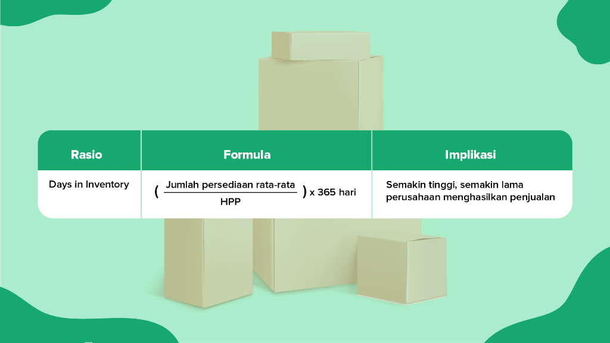

#### Formula Perhitungan:

$$
\text{Days in Inventory (DII)} = \left(\frac{\text{Jumlah Persediaan Rata-rata}}{\text{Harga Pokok Penjualan (HPP)}}\right) \times 365\text{ hari}
$$

#### Interpretasi:

Produk jadi yang belum terjual akan tertahan di gudang sebagai _inventory_.

- **DII Rendah / Cepat:** Barang dagangan cepat laku terjual, perputaran kas cepat, dan efisiensi pergudangan optimal.
- **DII Tinggi / Lama:** Barang mengendap lama di gudang, mengindikasikan perusahaan mengalami kesulitan atau perlambatan dalam memasarkan produknya.

| Metrik                | Formula                                                                                      | Implikasi                                                                       |
| :-------------------- | :------------------------------------------------------------------------------------------- | :------------------------------------------------------------------------------ |
| **Days in Inventory** | $\left(\dfrac{\text{Jumlah Persediaan Rata-rata}}{\text{HPP}}\right) \times 365\text{ hari}$ | Semakin tinggi, semakin lama perusahaan menghasilkan penjualan dari persediaan. |

#### Contoh Studi Kasus:

- **Perusahaan A:** Memiliki _Days in Inventory_ selama **45 hari**.
- **Perusahaan B:** Memiliki _Days in Inventory_ selama **105 hari**.

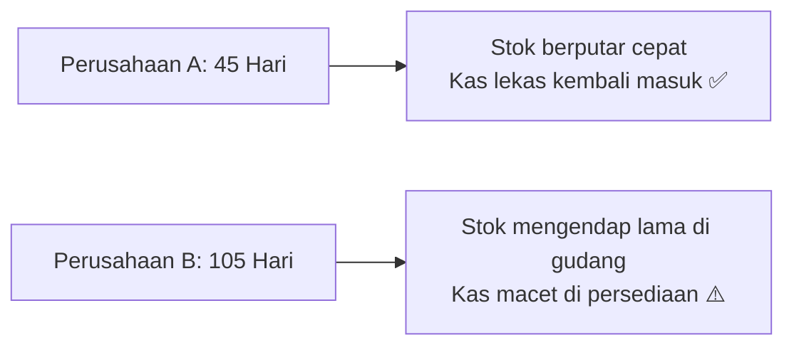

> [!IMPORTANT]
> **Risiko Persediaan yang Mengendap Terlalu Lama:**
>
> 1. **Biaya Penyimpanan Meningkat (_Holding Cost_):** Biaya sewa gudang, listrik, pendingin, dan asuransi membengkak.
> 2. **Risiko Kerusakan & Kadaluarsa (_Obsolescence / Spoilage_):** Barang terancam basi, lewat masa tren, atau rusak sehingga harus mengalami _write-off_ (penurunan nilai persediaan).
> 3. **Modal Kerja Tertahan:** Dana tunai terikat dalam bentuk barang fisik dan tidak dapat dipakai untuk ekspansi operasional lainnya.

---

### 4. Days in Receivable (DIR / Days Sales Outstanding)

Rasio yang menunjukkan rata-rata jumlah hari yang dibutuhkan oleh perusahaan untuk menagih piutang dagang (_accounts receivable_) dari pelanggan sejak tagihan (_invoice_) diterbitkan.

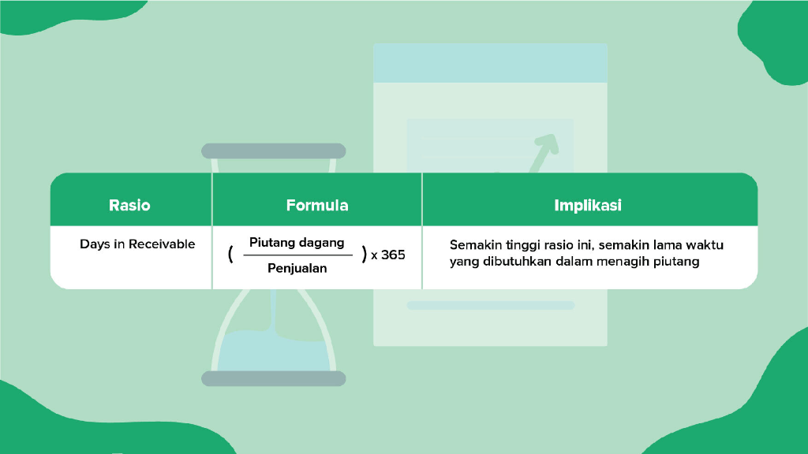

#### Formula Perhitungan:

$$
\text{Days in Receivable (DIR)} = \left(\frac{\text{Piutang Dagang}}{\text{Penjualan}}\right) \times 365\text{ hari}
$$

#### Interpretasi:

- **DIR Semakin Rendah (Singkat):** Pelanggan membayar tagihan dengan cepat. Arus kas operasi lancar dan risiko kredit macet rendah.
- **DIR Semakin Tinggi (Lama):** Perusahaan membutuhkan waktu lama untuk menagih uangnya. Piutang yang kerap terlambat dilunasi akan menyumbat kelancaran arus kas perusahaan.

| Metrik                 | Formula                                                                               | Implikasi                                                                           |
| :--------------------- | :------------------------------------------------------------------------------------ | :---------------------------------------------------------------------------------- |
| **Days in Receivable** | $\left(\dfrac{\text{Piutang Dagang}}{\text{Penjualan}}\right) \times 365\text{ hari}$ | Semakin tinggi rasio ini, semakin lama waktu yang dibutuhkan dalam menagih piutang. |

#### Contoh Studi Kasus:

- **Perusahaan A:** Memiliki _Days in Receivable_ selama **45 hari**.
- **Perusahaan B:** Memiliki _Days in Receivable_ selama **105 hari**.

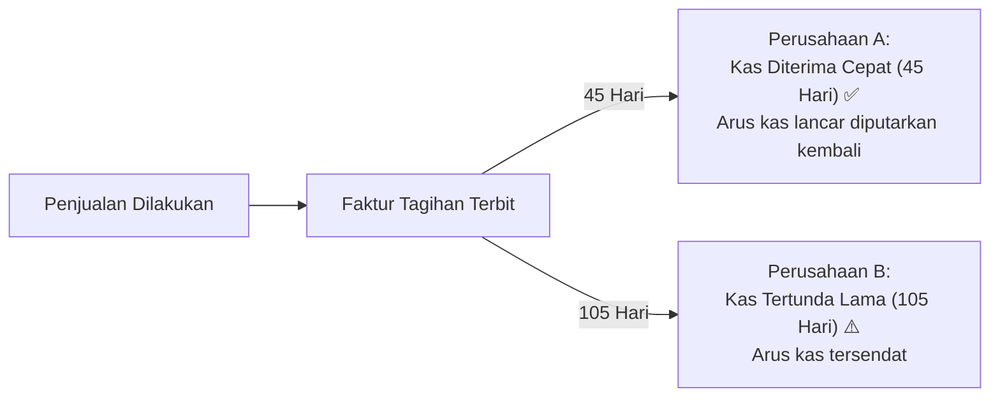

> [!NOTE]
> **Dampak Likuiditas:**  
> Perusahaan A mampu menagih piutang dagang jauh lebih cepat (45 hari vs 105 hari). Uang kas yang diterima tersebut dapat langsung diputar kembali untuk membeli bahan baku baru, membayar gaji karyawan, atau ekspansi, tanpa perlu meminjam utang jangka pendek berbunga.

---

### 5. Days in Payable (DIP / Days Payable Outstanding)

Rasio yang menunjukkan rata-rata jumlah hari yang dibutuhkan oleh perusahaan untuk melunasi utang dagang (_accounts payable_) kepada pemasok (_supplier_) atau pihak ketiga.

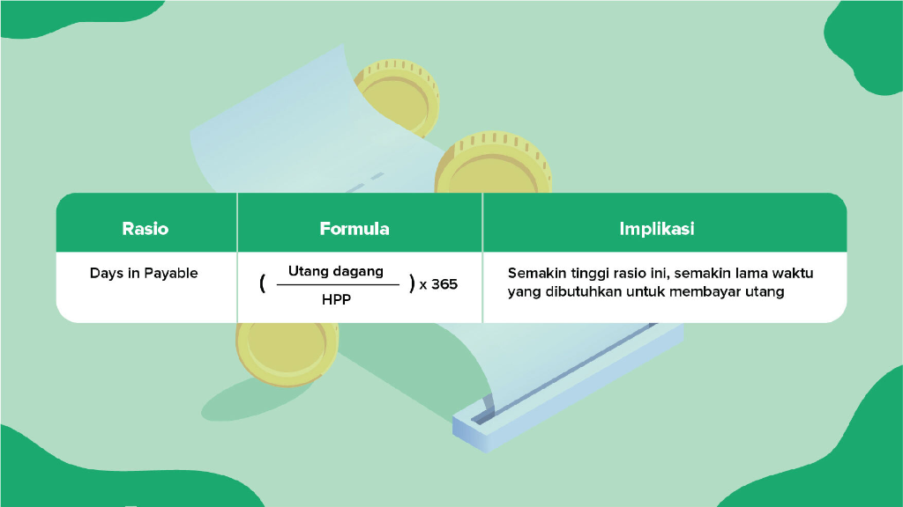

#### Formula Perhitungan:

$$
\text{Days in Payable (DIP)} = \left(\frac{\text{Utang Dagang}}{\text{Harga Pokok Penjualan (HPP)}}\right) \times 365\text{ hari}
$$

#### Interpretasi:

Rasio ini mencerminkan berapa lama perusahaan menahan uang kasnya sebelum melunasi kewajiban pembayaran kepada _supplier_.

| Metrik              | Formula                                                                       | Implikasi                                                                                         |
| :------------------ | :---------------------------------------------------------------------------- | :------------------------------------------------------------------------------------------------ |
| **Days in Payable** | $\left(\dfrac{\text{Utang Dagang}}{\text{HPP}}\right) \times 365\text{ hari}$ | Semakin tinggi rasio ini, semakin lama waktu yang dibutuhkan untuk membayar utang kepada pemasok. |

#### Contoh Studi Kasus:

- **Perusahaan A:** Memiliki _Days in Payable_ sebesar **70 hari**.
- **Perusahaan B:** Memiliki _Days in Payable_ sebesar **250 hari**.

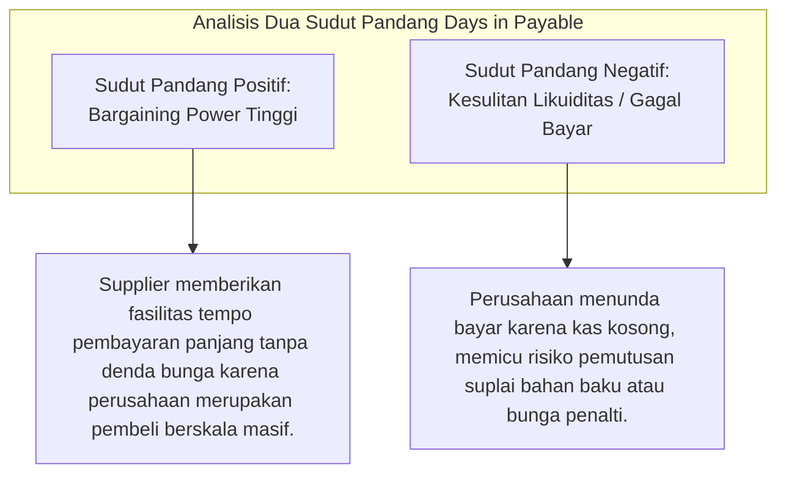

> [!WARNING]
> **Membedakan 'Kekuatan Tawar' vs 'Masalah Likuiditas':**
>
> - Perusahaan B membutuhkan waktu 250 hari untuk membayar utangnya. Jika ini terjadi karena perusahaan memiliki _bargaining power_ yang kuat terhadap supplier (misalnya emiten ritel raksasa yang mendapat konsinyasi tempo panjang), maka ini menguntungkan kas operasional perusahaan.
> - Namun, **apabila perusahaan menunda pelunasan karena memang tidak memiliki uang kas yang cukup**, ini merupakan indikasi kuat bahwa performa perusahaan memburuk dan kredibilitasnya di mata mitra bisnis terancam.

---

## 4. Rangkuman Komprehensif & Siklus Konversi Kas

### Tabel Perbandingan 5 Activity Ratio

|  No   | Nama Rasio                   | Formula                                                                   |           Standar / Target Ideal            | Makna bagi Investor                                              |
| :---: | :--------------------------- | :------------------------------------------------------------------------ | :-----------------------------------------: | :--------------------------------------------------------------- |
| **1** | **Current Ratio**            | $\dfrac{\text{Aset Lancar}}{\text{Liabilitas Lancar}}$                    | $\ge 1{,}0\times$ (lebih tinggi lebih baik) | Mengukur keamanan likuiditas jangka pendek perusahaan.           |
| **2** | **Asset Turnover Ratio**     | $\dfrac{\text{Pendapatan}}{\text{Total Aset}}$                            |           Lebih tinggi lebih baik           | Mengukur produktivitas aset dalam menghasilkan omzet penjualan.  |
| **3** | **Days in Inventory (DII)**  | $\left(\dfrac{\text{Persediaan Rata-rata}}{\text{HPP}}\right) \times 365$ |           Lebih rendah lebih baik           | Mengukur kecepatan barang terjual dan keluar dari gudang.        |
| **4** | **Days in Receivable (DIR)** | $\left(\dfrac{\text{Piutang Dagang}}{\text{Penjualan}}\right) \times 365$ |           Lebih rendah lebih baik           | Mengukur kecepatan penagihan pembayaran dari pelanggan.          |
| **5** | **Days in Payable (DIP)**    | $\left(\dfrac{\text{Utang Dagang}}{\text{HPP}}\right) \times 365$         |          Tergantung konteks bisnis          | Mengukur durasi penahanan kas sebelum melunasi tagihan supplier. |

### Keterkaitan DII, DIR, dan DIP: Siklus Konversi Kas (Cash Conversion Cycle)

Ketiga rasio hari (_Days in Inventory_, _Days in Receivable_, dan _Days in Payable_) saling terintegrasi dalam mengukur efisiensi modal kerja perusahaan melalui **Cash Conversion Cycle (CCC)**:

$$
\text{Cash Conversion Cycle (CCC)} = \text{Days in Inventory (DII)} + \text{Days in Receivable (DIR)} - \text{Days in Payable (DIP)}
$$

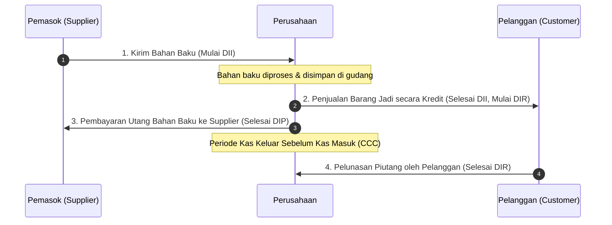

> [!TIP]
> **Kunci Efisiensi Operasional:**  
> Perusahaan yang unggul secara operasional adalah perusahaan yang mampu:
>
> 1. Menjual persediaannya secepat mungkin (**DII rendah**).
> 2. Menagih uang dari pembeli secepat mungkin (**DIR rendah**).
> 3. Mendapatkan fasilitas penundaan pembayaran dari pemasok dengan tempo wajar tanpa bunga (**DIP optimal**).
>
> Kombinasi ini menciptakan perputaran arus kas yang sehat, mengurangi ketergantungan pada utang bank, dan memaksimalkan _Return on Capital_.

---

## 5. Mengenal Profitability Ratio (Rasio Profitabilitas)

### Apa Itu Profitability Ratio?

> [!NOTE]
> **Definisi:**  
> **Profitability Ratio** adalah kelompok rasio keuangan yang membantu kita dalam mengukur efisiensi operasional dan tingkat profitabilitas dari sebuah perusahaan. Rasio ini memberikan gambaran jelas mengenai kemampuan manajemen dalam mengubah aktivitas bisnis menjadi keuntungan bersih.

Rasio profitabilitas terbagi ke dalam dua pilar utama:

1. **Rasio Margin Penjualan (_Profit Margins_):** Mengukur porsi laba yang berhasil diamankan dari total omzet pendapatan.
   - **Gross Profit Margin (GPM)**
   - **Net Profit Margin (NPM)**
2. **Rasio Imbal Hasil Investasi Modal (_Returns on Capital_):** Mengukur produktivitas aset dan modal ekuitas dalam mendatangkan laba bersih.
   - **Return on Asset (ROA)**
   - **Return on Equity (ROE)**

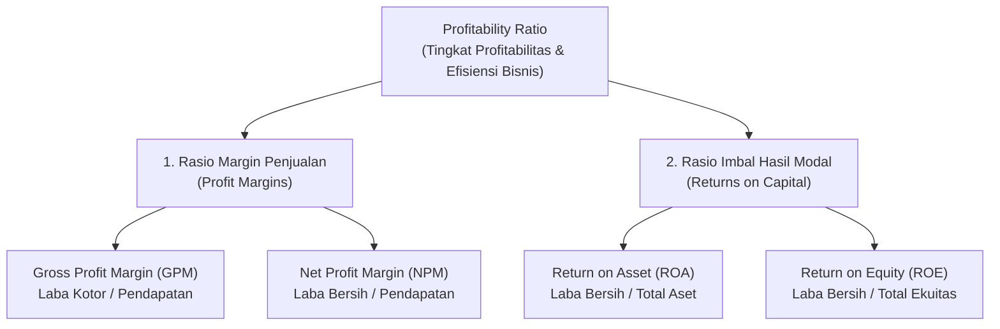

---

## 6. Pembahasan Lengkap Rasio Profitabilitas

### 1. Margin Keuntungan: Gross Profit Margin (GPM) & Net Profit Margin (NPM)

Rasio margin mengukur efisiensi konversi omzet pendapatan menjadi keuntungan pada berbagai lapisan laporan laba rugi.

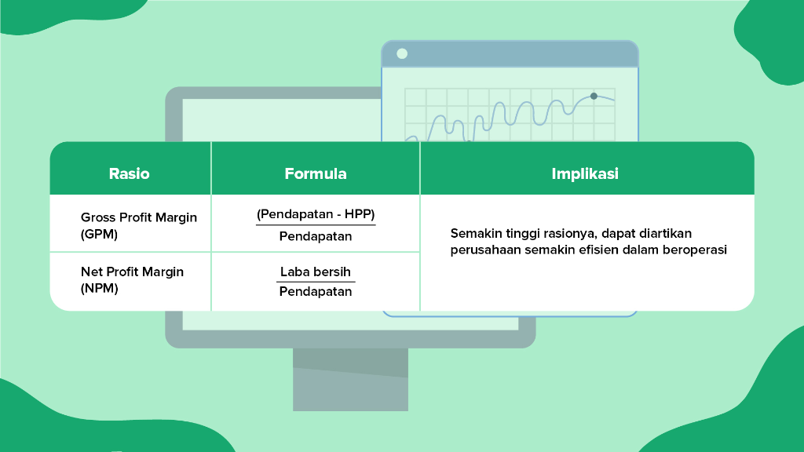

#### Definisi & Formula:

1. **Gross Profit Margin (GPM):**
   Rasio yang menunjukkan persentase laba kotor yang diperoleh dari total penjualan setelah memperhitungkan beban langsung produksi (Harga Pokok Penjualan / HPP).

   $$
   \text{Gross Profit Margin (GPM)} = \frac{\text{Pendapatan} - \text{HPP}}{\text{Pendapatan}} = \frac{\text{Laba Kotor}}{\text{Pendapatan}}
   $$

2. **Net Profit Margin (NPM):**
   Rasio yang menunjukkan keuntungan murni dari operasi bisnis dengan membandingkan laba bersih akhir (_bottom line_) yang dihasilkan terhadap total penjualan.
   $$
   \text{Net Profit Margin (NPM)} = \frac{\text{Laba Bersih}}{\text{Pendapatan}}
   $$

| Metrik                        | Formula                                                     | Implikasi                                                                                                                 |
| :---------------------------- | :---------------------------------------------------------- | :------------------------------------------------------------------------------------------------------------------------ |
| **Gross Profit Margin (GPM)** | $\dfrac{\text{Pendapatan} - \text{HPP}}{\text{Pendapatan}}$ | Semakin tinggi rasionya, dapat diartikan perusahaan semakin efisien dalam beroperasi dan menekan biaya produksi langsung. |
| **Net Profit Margin (NPM)**   | $\dfrac{\text{Laba Bersih}}{\text{Pendapatan}}$             | Semakin tinggi rasionya, semakin efisien perusahaan dalam mengendalikan seluruh beban operasional, bunga, dan pajak.      |

#### Contoh Studi Kasus Margin (Perusahaan A vs Perusahaan B):

Sebagai contoh, **Perusahaan A** dan **Perusahaan B** masing-masing memiliki pendapatan penjualan sebesar **Rp1 Miliar**:

- **Perusahaan A:**
  - Setelah dikurangi berbagai pengeluaran, mencatatkan laba kotor sebesar **Rp450 Juta** dan laba bersih sebesar **Rp200 Juta**.
- **Perusahaan B:**
  - Mencatatkan laba kotor sebesar **Rp320 Juta** dan laba bersih sebesar **Rp100 Juta**.

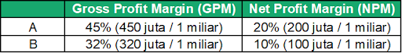

| Perusahaan | Pendapatan | Laba Kotor | Laba Bersih |                    Gross Profit Margin (GPM)                    |                     Net Profit Margin (NPM)                     |
| :--------: | :--------: | :--------: | :---------: | :-------------------------------------------------------------: | :-------------------------------------------------------------: |
|   **A**    | Rp1 Miliar | Rp450 Juta | Rp200 Juta  | **45%** $\left(\dfrac{\text{450 Juta}}{\text{1 Miliar}}\right)$ | **20%** $\left(\dfrac{\text{200 Juta}}{\text{1 Miliar}}\right)$ |
|   **B**    | Rp1 Miliar | Rp320 Juta | Rp100 Juta  | **32%** $\left(\dfrac{\text{320 Juta}}{\text{1 Miliar}}\right)$ | **10%** $\left(\dfrac{\text{100 Juta}}{\text{1 Miliar}}\right)$ |

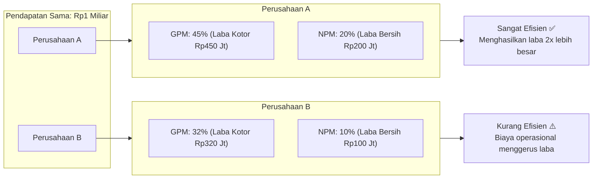

> [!TIP]
> **Kesimpulan Analisis Margin:**  
> Dari perbandingan di atas, terlihat jelas bahwa **Perusahaan A lebih efisien** karena walaupun memiliki omzet pendapatan yang sama persis dengan Perusahaan B (Rp1 Miliar), Perusahaan A mampu menghasilkan laba kotor maupun laba bersih yang jauh lebih besar.

---

### 2. Imbal Hasil Modal: Return on Asset (ROA) & Return on Equity (ROE)

Rasio ini mengukur seberapa handal manajemen perusahaan dalam mengolah modal kekayaan yang dipercayakan kepadanya untuk mencetak laba bersih.

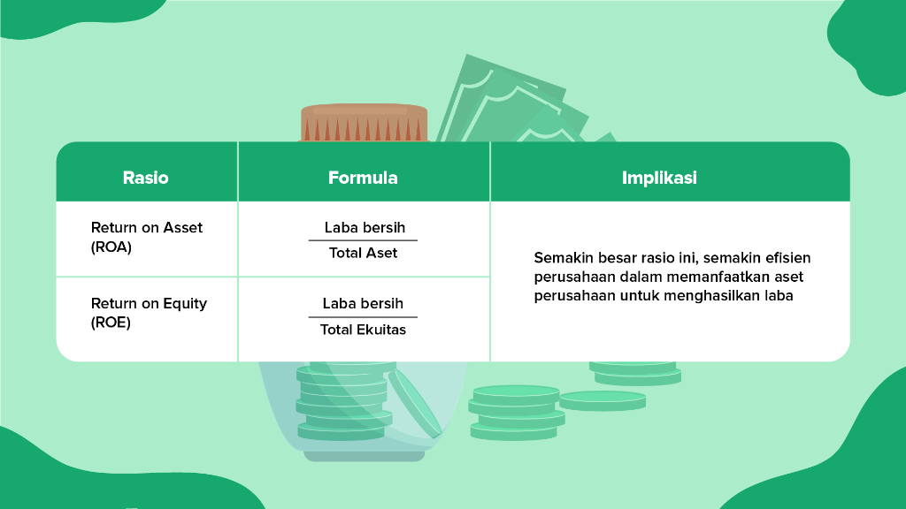

#### Definisi & Formula:

1. **Return on Asset (ROA):**
   Rasio yang mengukur kemampuan seluruh aset yang dimiliki perusahaan dalam menghasilkan laba bersih. Semakin besar ROA, semakin efisien penggunaan aset-aset tersebut.

   $$
   \text{Return on Asset (ROA)} = \frac{\text{Laba Bersih}}{\text{Total Aset}}
   $$

2. **Return on Equity (ROE):**
   Rasio yang mengukur kemampuan ekuitas yang dimiliki pemegang saham (_shareholders’ equity_) dalam menghasilkan laba bersih. Semakin besar ROE, semakin efisien penggunaan ekuitas modal tersebut.
   $$
   \text{Return on Equity (ROE)} = \frac{\text{Laba Bersih}}{\text{Total Ekuitas}}
   $$

| Metrik                     | Formula                                            | Implikasi                                                                                                                |
| :------------------------- | :------------------------------------------------- | :----------------------------------------------------------------------------------------------------------------------- |
| **Return on Asset (ROA)**  | $\dfrac{\text{Laba Bersih}}{\text{Total Aset}}$    | Semakin besar rasio ini, semakin efisien perusahaan dalam memanfaatkan aset perusahaan untuk menghasilkan laba.          |
| **Return on Equity (ROE)** | $\dfrac{\text{Laba Bersih}}{\text{Total Ekuitas}}$ | Semakin besar rasio ini, semakin efisien perusahaan dalam mendayagunakan ekuitas pemegang saham untuk menghasilkan laba. |

#### Contoh Studi Kasus Imbal Hasil (Perusahaan A vs Perusahaan B):

Sebagai contoh, **Perusahaan A** dan **Perusahaan B** masing-masing memiliki:

- Total Aset: **Rp1 Miliar**
- Total Ekuitas: **Rp500 Juta**

Pada tahun yang sama:

- **Perusahaan A:** Mencatatkan laba bersih sebesar **Rp100 Juta**.
- **Perusahaan B:** Mencatatkan laba bersih sebesar **Rp40 Juta**.

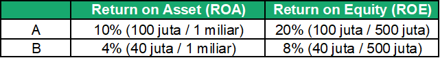

| Perusahaan | Total Aset | Total Ekuitas | Laba Bersih |                      Return on Asset (ROA)                      |                     Return on Equity (ROE)                      |
| :--------: | :--------: | :-----------: | :---------: | :-------------------------------------------------------------: | :-------------------------------------------------------------: |
|   **A**    | Rp1 Miliar |  Rp500 Juta   | Rp100 Juta  | **10%** $\left(\dfrac{\text{100 Juta}}{\text{1 Miliar}}\right)$ | **20%** $\left(\dfrac{\text{100 Juta}}{\text{500 Juta}}\right)$ |
|   **B**    | Rp1 Miliar |  Rp500 Juta   |  Rp40 Juta  |  **4%** $\left(\dfrac{\text{40 Juta}}{\text{1 Miliar}}\right)$  |  **8%** $\left(\dfrac{\text{40 Juta}}{\text{500 Juta}}\right)$  |

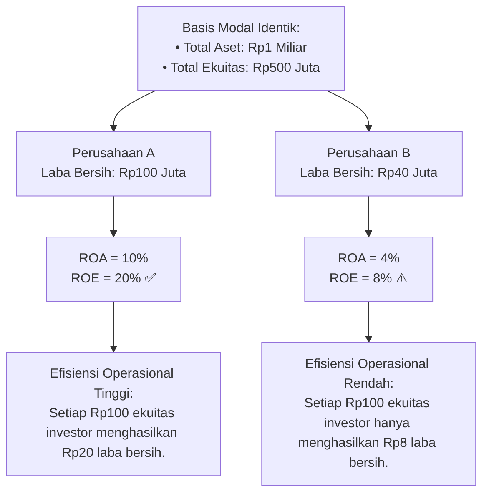

> [!NOTE]
> **Kesimpulan Analisis ROA & ROE:**  
> Dengan besaran basis aset dan ekuitas yang sama, **Perusahaan A bisa menghasilkan laba bersih yang jauh lebih besar dibanding Perusahaan B (Rp100 Juta vs Rp40 Juta)**.  
> Dengan kata lain, **Perusahaan A terbukti jauh lebih efisien secara operasional** dalam mengelola aset dan modal ekuitasnya untuk memaksimalkan keuntungan bagi pemegang saham.

---

### 3. Rangkuman Rasio Profitabilitas

|  No   | Rasio                         | Formula                                                     |     Target Evaluasi     | Esensi Fundamental bagi Investor                                                                    |
| :---: | :---------------------------- | :---------------------------------------------------------- | :---------------------: | :-------------------------------------------------------------------------------------------------- |
| **1** | **Gross Profit Margin (GPM)** | $\dfrac{\text{Pendapatan} - \text{HPP}}{\text{Pendapatan}}$ | Lebih tinggi lebih baik | Mengukur daya tawar penetapan harga produk (_pricing power_) dan efisiensi biaya pabrik/produksi.   |
| **2** | **Net Profit Margin (NPM)**   | $\dfrac{\text{Laba Bersih}}{\text{Pendapatan}}$             | Lebih tinggi lebih baik | Mengukur laba bersih final setelah memotong seluruh OPEX, bunga utang, dan beban pajak penghasilan. |
| **3** | **Return on Asset (ROA)**     | $\dfrac{\text{Laba Bersih}}{\text{Total Aset}}$             | Lebih tinggi lebih baik | Mengukur seberapa cerdas manajemen memanfaatkan seluruh aset perusahaan untuk menghasilkan profit.  |
| **4** | **Return on Equity (ROE)**    | $\dfrac{\text{Laba Bersih}}{\text{Total Ekuitas}}$          | Lebih tinggi lebih baik | Tolok ukur utama bagi investor saham untuk melihat tingkat imbal hasil atas modal modal sendiri.    |

---

## 7. Mengenal Solvency Ratio (Rasio Solvabilitas)

### Apa Itu Solvency Ratio?

> [!NOTE]
> **Definisi:**  
> **Solvency Ratio** (Rasio Solvabilitas) adalah kelompok rasio keuangan yang menunjukkan kemampuan perusahaan dalam memenuhi dan melunasi seluruh **kewajiban jangka panjangnya**.

Rasio ini sangat krusial untuk mengevaluasi struktur permodalan perusahaan (_capital structure_), tingkat risiko kebangkrutan, serta ketergantungan bisnis terhadap dana pinjaman berbunga.

Dua rasio utama dalam Solvency Ratio yang saling melengkapi adalah:

1. **Debt-to-Equity Ratio (DER):** Mengukur porsi besaran utang terhadap modal sendiri.
2. **Interest Coverage Ratio (ICR):** Mengukur daya tahan laba operasional dalam melunasi beban bunga utang tersebut.

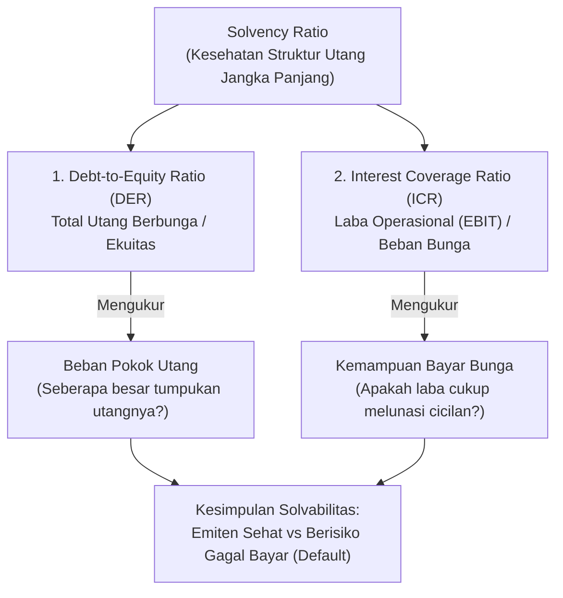

---

## 8. Pembahasan Lengkap Rasio Solvabilitas

### 1. Debt-to-Equity Ratio (DER)

Rasio yang berfungsi untuk menunjukkan proporsi utang terhadap ekuitas yang digunakan dalam membiayai aset dan kegiatan operasional perusahaan.

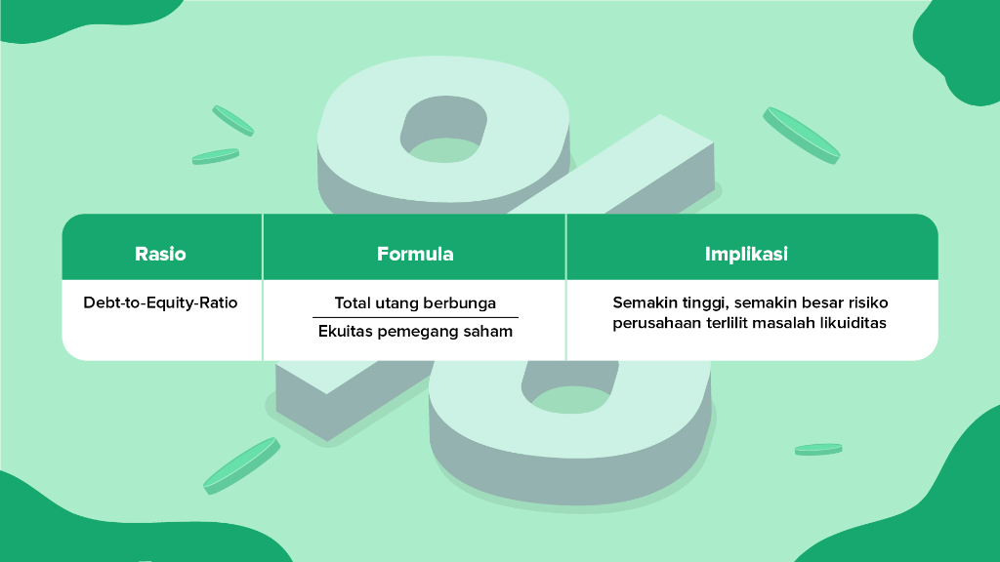

#### Formula Perhitungan:

$$
\text{Debt-to-Equity Ratio (DER)} = \frac{\text{Total Utang Berbunga}}{\text{Ekuitas Pemegang Saham}}
$$

> [!IMPORTANT]
> **Fokus pada Utang Berbunga (_Interest-Bearing Debt_):**  
> Dalam analisis fundamental saham profesional, pos utang yang diperhitungkan pada pembilang diutamakan berupa **utang berbunga** (seperti pinjaman bank jangka pendek/panjang dan obligasi), bukan sekadar seluruh liabilitas (seperti utang dagang non-bunga atau utang pajak).

#### Interpretasi:

- **DER Rendah:** Perusahaan mengandalkan modal sendiri (ekuitas). Struktur keuangan konservatif dan risiko finansial rendah.
- **DER Tinggi:** Mengindikasikan tingginya proporsi utang berbunga dibandingkan nilai ekuitas pemegang saham. Semakin tinggi rasionya, semakin besar risiko perusahaan terlilit masalah likuiditas apabila kondisi ekonomi memburuk.

| Metrik                         | Formula                                                              | Implikasi                                                                                    |
| :----------------------------- | :------------------------------------------------------------------- | :------------------------------------------------------------------------------------------- |
| **Debt-to-Equity Ratio (DER)** | $\dfrac{\text{Total Utang Berbunga}}{\text{Ekuitas Pemegang Saham}}$ | Semakin tinggi, semakin besar risiko perusahaan terlilit masalah likuiditas dan beban bunga. |

#### Contoh Studi Kasus DER (Perusahaan A vs Perusahaan B):

Misalkan **Perusahaan A** dan **Perusahaan B** sama-sama memiliki ekuitas sebesar **Rp1 Miliar**:

- **Perusahaan A:** Memiliki utang berbunga sebesar **Rp2 Miliar**.
  $$
  \text{DER}_A = \frac{\text{Rp2.000.000.000}}{\text{Rp1.000.000.000}} = \mathbf{2{,}0\times}
  $$
- **Perusahaan B:** Memiliki utang berbunga sebesar **Rp500 Juta**.
  $$
  \text{DER}_B = \frac{\text{Rp500.000.000}}{\text{Rp1.000.000.000}} = \mathbf{0{,}5\times}
  $$

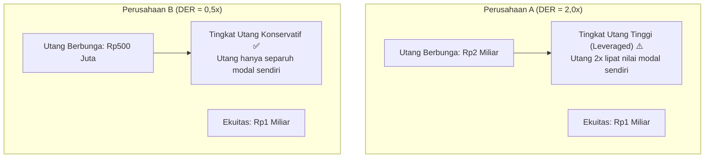

> [!NOTE]
> **Pentingnya Analisis Lanjutan:**  
> Dari ilustrasi di atas, jelas Perusahaan A memiliki tingkat utang yang lebih tinggi dibanding Perusahaan B.  
> Namun, **tidak menutup kemungkinan jika perusahaan dengan tingkat utang berbunga lebih tinggi bisa tetap membayar utang yang dimilikinya secara aman**, asalkan bisnisnya mampu mencetak laba operasional yang melimpah.  
> Oleh karena itu, analisis DER **wajib dikombinasikan dengan Interest Coverage Ratio**.

---

### 2. Interest Coverage Ratio (ICR / Rasio Cakupan Bunga)

Rasio yang mengukur kemampuan dan keamanan perusahaan dalam membayar beban bunga pinjamannya menggunakan pendapatan/laba operasional yang dihasilkan.

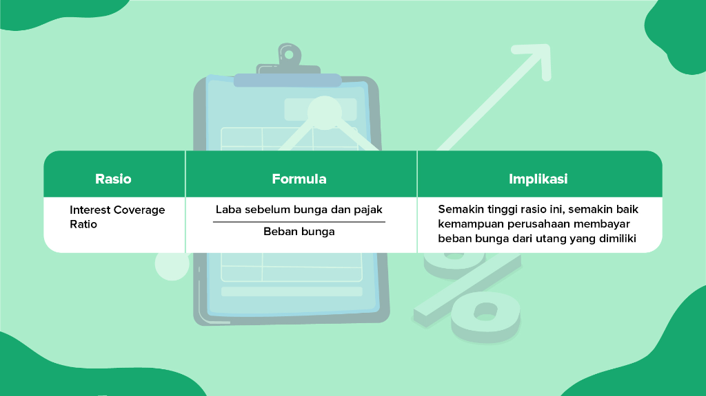

#### Formula Perhitungan:

$$
\text{Interest Coverage Ratio (ICR)} = \frac{\text{Laba Sebelum Bunga dan Pajak (EBIT)}}{\text{Beban Bunga}}
$$

#### Interpretasi & Tolok Ukur:

- **ICR $> 1$:** Perusahaan mampu menutupi seluruh beban bunga tahun berjalan menggunakan pendapatan operasionalnya.
- **Semakin Besar Rasionya:** Semakin tebal bantalan keamanan (_margin of safety_) perusahaan dalam melunasi bunga, serta semakin tinggi kapasitas perusahaan untuk menambah pinjaman baru jika diperlukan untuk ekspansi bisnis.
- **Semakin Tinggi Rasionya $\rightarrow$ Risiko Pailit Semakin Kecil:** Menunjukkan risiko kebangkrutan akibat gagal bayar (_default_) sangat rendah.
- **ICR $< 1$:** Menandakan sinyal bahaya serius (_distress_), di mana laba operasional tidak mampu menutup kewajiban bunga utang.

| Metrik                      | Formula                                                           | Implikasi                                                                                                  |
| :-------------------------- | :---------------------------------------------------------------- | :--------------------------------------------------------------------------------------------------------- |
| **Interest Coverage Ratio** | $\dfrac{\text{Laba Sebelum Bunga dan Pajak}}{\text{Beban Bunga}}$ | Semakin tinggi rasio ini, semakin baik kemampuan perusahaan membayar beban bunga dari utang yang dimiliki. |

#### Contoh Studi Kasus ICR (Perusahaan A vs Perusahaan B):

Misalkan **Perusahaan A** dan **Perusahaan B** sama-sama memiliki beban bunga tahunan sebesar **Rp200 Juta**:

- **Perusahaan A:** Mencatatkan laba operasional (sebelum bunga dan pajak / EBIT) sebesar **Rp5 Miliar**.
  $$
  \text{Interest Coverage Ratio}_A = \frac{\text{Rp5.000.000.000}}{\text{Rp200.000.000}} = \mathbf{25\times}
  $$
- **Perusahaan B:** Mencatatkan laba operasional (sebelum bunga dan pajak / EBIT) sebesar **Rp100 Juta**.
  $$
  \text{Interest Coverage Ratio}_B = \frac{\text{Rp100.000.000}}{\text{Rp200.000.000}} = \mathbf{0{,}5\times}
  $$

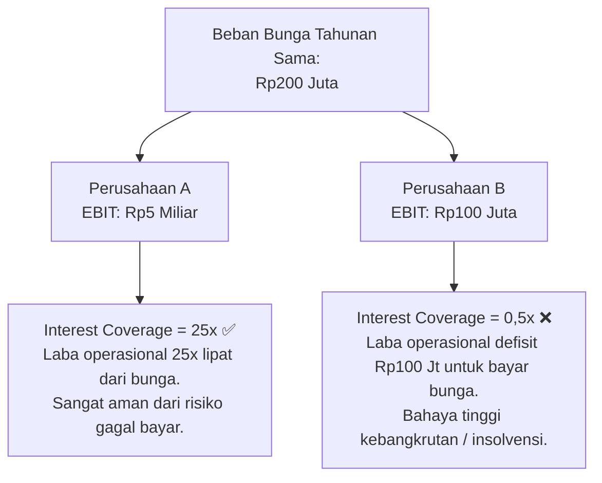

> [!WARNING]
> **Kesimpulan Solvabilitas Kasus:**
>
> - **Perusahaan A** dapat membayar beban bunga dari utang dengan sangat baik karena memiliki rasio 25x (sangat aman).
> - **Perusahaan B** mengalami kesulitan besar membayar beban bunga karena rasionya hanya 0,5x dan laba operasionalnya tidak cukup untuk menutup kewajiban bunga. Perusahaan B terpaksa menguras kas cadangan atau menambah utang baru hanya untuk membayar bunga pinjaman lama.

---

## 9. Penerapan Analisis Rasio Secara Efektif

Rasio laporan keuangan tidak dapat berdiri sendiri sebagai angka tunggal. Agar memberikan kesimpulan analisis yang tajam dan akurat, investor perlu menerapkan kerangka kerja analisis berikut:

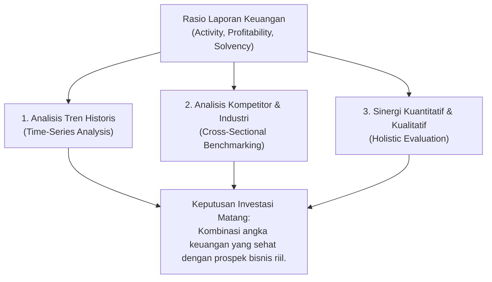

### 1. Analisis Tren Historis (_Time-Series Analysis_)

- Membandingkan rasio keuangan perusahaan dengan kinerjanya pada periode-periode sebelumnya (misal: 3 hingga 5 tahun terakhir).
- **Tujuan:** Mengetahui apakah efisiensi, margin keuntungan, dan pengelolaan utang perusahaan sedang berada dalam tren membaik (_improving_), stagnan, atau justru mengalami deteriorasi (_deteriorating_).

### 2. Analisis Komparasi Industri / Kompetitor (_Cross-Sectional Benchmarking_)

- Membandingkan rasio emiten dengan emiten kompetitor dalam sektor atau sub-sektor industri yang sama.
- **Tujuan:** Menilai apakah perusahaan memiliki keunggulan kompetitif (_competitive edge / moat_), misalnya memiliki margin laba di atas rata-rata industri atau perputaran persediaan yang jauh lebih cepat.

### 3. Sinergi Analisis Kuantitatif dan Kualitatif

- **Analisis Kuantitatif:** Memberikan kepastian angka objektif mengenai likuiditas (Current Ratio), produktivitas (Asset Turnover), profitabilitas (GPM, NPM, ROA, ROE), dan kesehatan utang (DER, ICR).
- **Analisis Kualitatif:** Melengkapi angka rasio dengan mengevaluasi integritas manajemen, inovasi produk, kekuatan merek (_brand power_), prospek industri, serta kepatuhan regulasi.
- **Kesimpulan:** Kombinasi kedua analisis ini memastikan investor memilih perusahaan yang tidak hanya bagus di atas kertas laporan keuangan, tetapi juga memiliki bisnis nyata yang kokoh dan berkelanjutan di masa depan.

---

## 10. Praktik Analisis Rasio Menggunakan Stockbit Pro

Untuk melakukan analisis rasio laporan keuangan dengan lebih cepat, praktis, dan akurat tanpa perlu menghitung seluruh formula secara manual dari awal, investor dapat memanfaatkan fitur **Stockbit Pro**.

Fitur ini menyajikan seluruh ringkasan data finansial historis dan kalkulasi rasio penting emiten secara otomatis dan terstandarisasi.

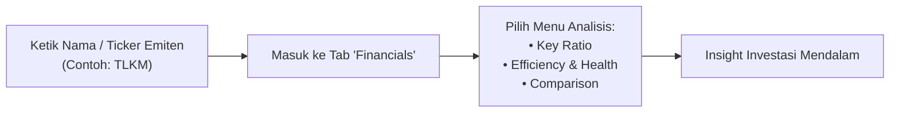

### 1. Membaca Rasio Utama di Tab "Financials" $\rightarrow$ "Key Ratio"

Halaman ini dapat diakses dengan mengetik kode saham pada bilah pencarian, kemudian memilih tab **Financials** $\rightarrow$ **Key Ratio**.

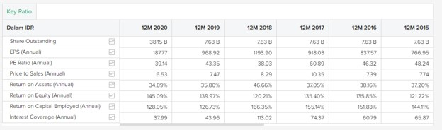

Pada tampilan ini, investor dapat mencermati rekam jejak tren performa tahunan (_annualized_) hingga beberapa tahun ke belakang:

- **Metrik Saham & Valuasi:** _Share Outstanding_, _EPS (Earnings Per Share)_, _PE Ratio_, _Price to Sales_.
- **Profitabilitas & Efisiensi Modal:** _Return on Assets (ROA)_, _Return on Equity (ROE)_, _Return on Capital Employed (ROCE)_.
- **Kesehatan Utang:** _Interest Coverage Ratio_.

---

### 2. Menggali Efisiensi Operasional di Tab "Efficiency"

Investor juga dapat melihat lebih banyak rincian metrik dengan memilih sub-tab atau mengganti jenis laporan yang dilihat. Misalnya, pada sub-tab **Efficiency**, Stockbit Pro secara otomatis menghitung metrik perputaran aktivitas bisnis:

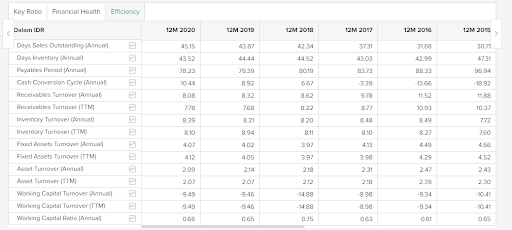

- **Siklus Modal Kerja:**
  - _Days Sales Outstanding (DSO)_ $\rightarrow$ Days in Receivable (DIR)
  - _Days Inventory_ $\rightarrow$ Days in Inventory (DII)
  - _Payables Period_ $\rightarrow$ Days in Payable (DIP)
  - _Cash Conversion Cycle (CCC)_ secara otomatis dikalkulasikan
- **Rasio Perputaran Aset:** _Receivables Turnover_, _Inventory Turnover_, _Fixed Assets Turnover_, _Asset Turnover_, dan _Working Capital Turnover_.

---

### 3. Komparasi Kompetitor Sejenis Melalui Fitur "Comparison"

Salah satu fitur paling powerful di Stockbit Pro adalah **Comparison**, yang memungkinkan investor membandingkan metrik keuangan suatu emiten langsung dengan para pesaingnya (_peer group_) dan rata-rata industri (_Industry & Sector_).

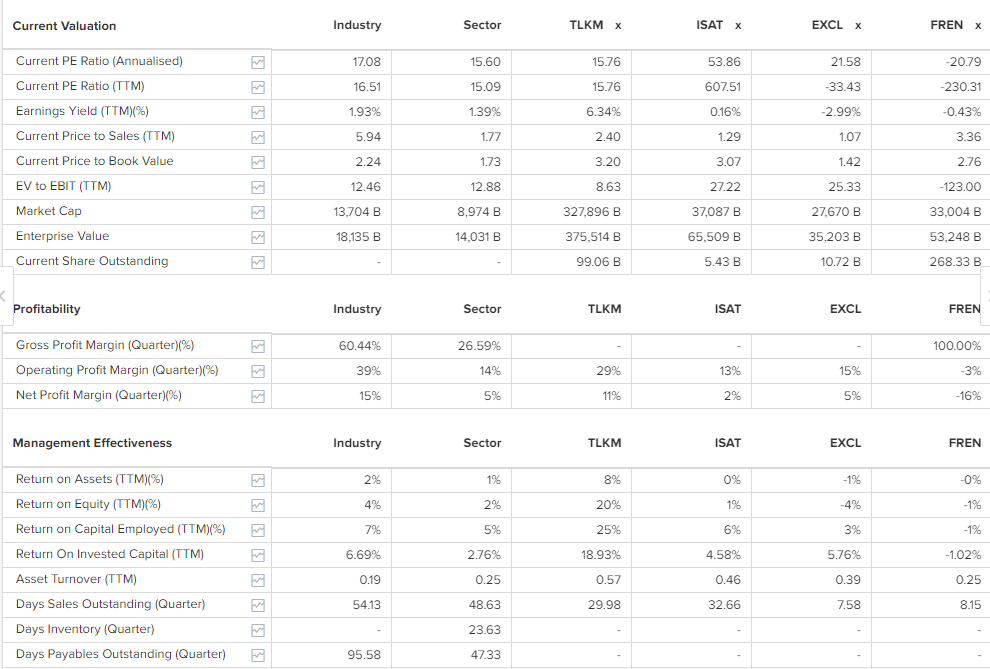

> **Contoh Kasus Sektor Telekomunikasi:**  
> Saat menganalisis **PT Telkom Indonesia Tbk (TLKM)**, investor dapat menyandingkannya dengan operator telekomunikasi lainnya di Bursa Efek Indonesia:
>
> - **ISAT** (Indosat Ooredoo Hutchison)
> - **EXCL** (XL Axiata)
> - **FREN** (Smartfren Telecom)

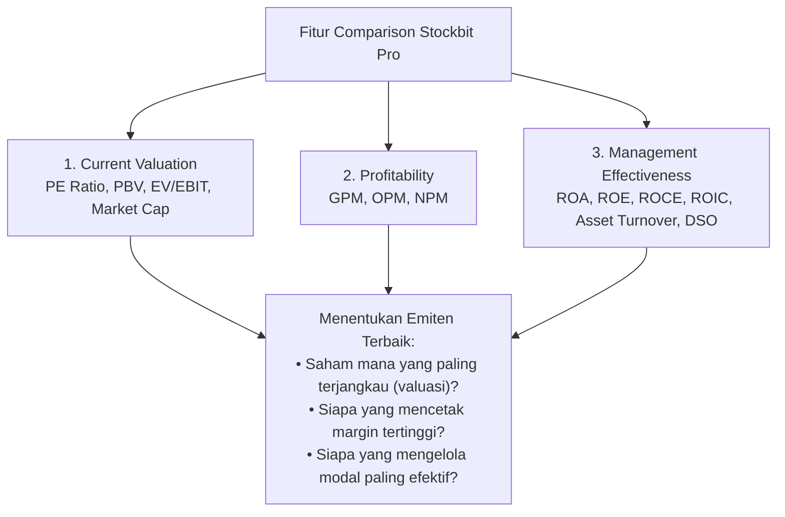

Dari hasil perbandingan tersebut, investor dapat dengan mudah menyimpulkan apakah TLKM memiliki keunggulan kompetitif (_competitive moat_) dibandingkan kompetitornya dalam aspek margin laba (_profitability_) maupun efektivitas manajemen modal (_ROA & ROE_).

---

## 11. Kesimpulan Akhir Modul 2

> [!NOTE]
> **Pencapaian Belajar:**  
> Selamat! Anda telah berhasil menyelesaikan seluruh materi pembelajaran di **Modul 2: Memahami Laporan Keuangan**.

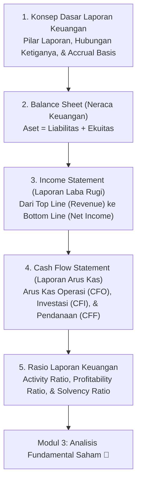

Dengan menguasai cara membaca laporan posisi keuangan, laba rugi, arus kas, hingga kalkulasi rasio keuangan esensial, kini Anda telah memiliki **fondasi fundamental yang kokoh** untuk menyaring saham-saham berkualitas (_quality companies_) dan melangkah ke modul pembelajaran selanjutnya: **Analisis Fundamental Saham**.

---

## 12. Referensi & Bahan Bacaan Lanjutan

Berikut adalah daftar literatur dan referensi yang digunakan oleh tim Stockbit Academy dalam menyusun materi Modul 2 ini:

1. **Buku & Panduan Finansial:**
   - _Financial Intelligence: A Manager’s Guide to Knowing What the Numbers Really Mean_ — Karen Berman, Joe Knight, John Case
   - _The Interpretation of Financial Statements_ — Mary Buffett
   - _Cara Mudah Memahami Laporan Keuangan_ — Joeliardi Sunendar
2. **Artikel & Riset Daring:**
   - _Advanced Financial Statement Analysis_ — Investopedia

### Cheat Sheet Modul 2 (Rangkuman Materi)

Tersedia ringkasan terpadu seluruh materi Modul 2 (_Balance Sheet_, _Income Statement_, _Cash Flow Statement_, dan _Rasio Keuangan_) dalam format PDF:

- 📄 **File Offline (Attachments):** [Cheatsheet-Modul-2.pdf](attachments/Cheatsheet-Modul-2.pdf)
- 🌐 **Tautan Unduh Resmi:** [Stockbit Academy - Cheatsheet Modul 2](https://academy-content.stockbit.com/module-2/Cheatsheet-Modul-2.pdf)

---

> _"Terima kasih atas perhatian dan antusiasme belajarnya, Stockbitor! Sampai jumpa di modul pembelajaran berikutnya: Analisis Fundamental Saham!"_
