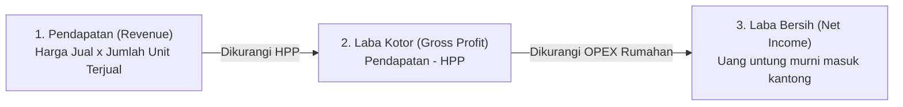
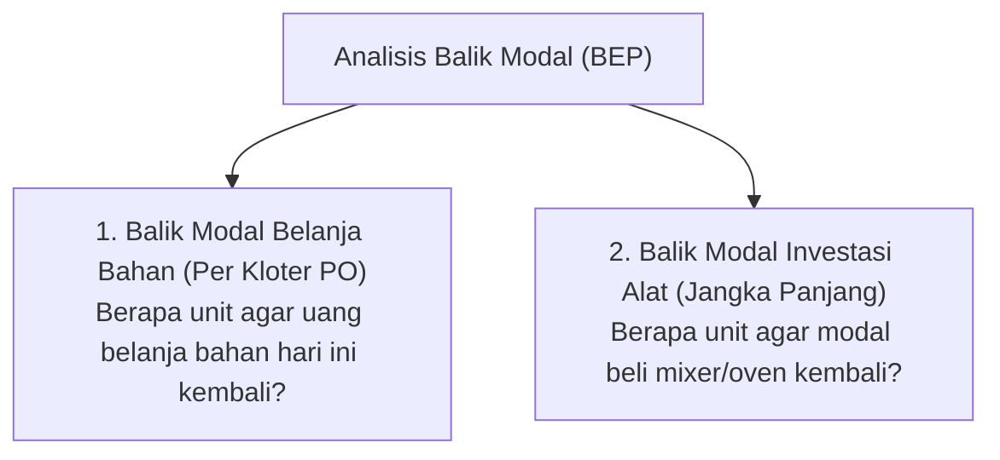

# Template & Catatan Finansial Usaha Pre-Order (PO) Rumahan (Perorangan)

Panduan praktis dan sederhana untuk menghitung modal, beban operasional, margin keuntungan, dan titik balik modal (BEP) usaha berbasis **Pre-Order (PO)** yang dikerjakan sendiri di rumah (perorangan), berdasarkan prinsip dasar laporan laba rugi di [3_income_statement.md](file:///c:/Users/Lyzander%20Andrylie/Documents/5-note/invest/saham/stockbit-academy/2_memahami_laporan_keuangan/3_income_statement.md).

---

## 1. Alur Sederhana Laba Rugi Perorangan

Untuk usaha rumahan sendiri tanpa karyawan dan tanpa iklan berbayar, alur perhitungannya fokus pada 4 pos utama:

1. **Pendapatan (_Revenue_):** Total uang yang diterima dari pembeli ($\text{Harga Jual} \times \text{Jumlah Unit}$).
2. **Harga Pokok Penjualan (_HPP / COGS_):** Total biaya bahan baku langsung + kemasan per unit.
3. **Laba Kotor (_Gross Profit_):** Keuntungan kotor setelah biaya bahan tertutup ($\text{Pendapatan} - \text{HPP}$).
4. **Beban Operasional (_OPEX_):** Biaya utilitas pendukung (listrik, kantong plastik, sabun cuci alat).
5. **Laba Bersih (_Net Income_):** Keuntungan murni yang menjadi penghasilan/uang saku pribadi Anda.

---

## 2. Menghitung HPP (Harga Pokok Penjualan) per Unit

$$
\text{HPP per Unit} = \text{Total Biaya Bahan Baku Terpakai} + \text{Biaya Wadah / Kemasan Langsung}
$$

### Langkah 1: Hitung Harga Satuan Bahan (per Gram, per ml, atau per pcs)

Rumus konversi:

$$
\text{Harga per Satuan} = \frac{\text{Harga Beli Kemasan}}{\text{Ukuran / Berat Bersih Kemasan}}
$$

#### Tabel Contoh Abstrak:

| No  | Komponen                         | Ukuran Kemasan | Satuan | Harga Beli | Harga per Satuan  |
| :-: | :------------------------------- | :------------: | :----: | :--------: | :---------------: |
|  1  | **Bahan Baku A**                 |     1.000      |   g    | Rp100.000  |   **Rp100 / g**   |
|  2  | **Bahan Baku B**                 |      500       |   ml   |  Rp75.000  |  **Rp150 / ml**   |
|  3  | **Bahan Baku C**                 |      250       |   g    |  Rp50.000  |   **Rp200 / g**   |
|  4  | **Bahan Tambahan D**             |      100       |   g    |  Rp20.000  |   **Rp200 / g**   |
|  5  | **Kemasan Langsung (Box/Wadah)** |       10       |  pcs   |  Rp25.000  | **Rp2.500 / pcs** |

---

### Langkah 2: Kalikan Takaran Produk dengan Harga Satuan

Hitung berapa takaran bahan yang terpakai untuk menghasilkan **1 unit produk**:

| Komponen Produk              | Takaran per Unit | Rumus Perhitungan Modal            |  Biaya (Rp)  |
| :--------------------------- | :--------------: | :--------------------------------- | :----------: |
| Bahan Baku A                 |       80 g       | $80\text{ g} \times \text{Rp100}$  |   Rp8.000    |
| Bahan Baku B                 |      40 ml       | $40\text{ ml} \times \text{Rp150}$ |   Rp6.000    |
| Bahan Baku C                 |       20 g       | $20\text{ g} \times \text{Rp200}$  |   Rp4.000    |
| Bahan Tambahan D             |       5 g        | $5\text{ g} \times \text{Rp200}$   |   Rp1.000    |
| **Subtotal Bahan Baku**      |                  |                                    | **Rp19.000** |
| Kemasan Langsung (Box/Wadah) |      1 pcs       | 1 pcs kemasan produk               |   Rp2.500    |
| **TOTAL HPP PER UNIT**       |                  |                                    | **Rp21.500** |

---

## 3. Beban Operasional (OPEX) Sederhana Rumahan

Karena usaha ini dijalankan sendiri tanpa sewa tempat, tanpa karyawan, dan tanpa iklan berbayar, beban operasional cukup dialokasikan secara proporsional untuk utilitas rumah:

| Pos Biaya Operasional Rumahan | Keterangan                                 | Estimasi per Unit  |
| :---------------------------- | :----------------------------------------- | :----------------: |
| **Listrik & Utilitas Alat**   | Pemakaian listrik alat produksi / kulkas   |      Rp1.500       |
| **Kemasan Luar**              | Plastik pembungkus luar / kresek / kantong |      Rp1.000       |
| **Sanitasi & Cuci Alat**      | Air dan sabun pembersih peralatan          |       Rp500        |
| **TOTAL OPEX RUMAHAN**        | **Alokasi biaya per unit**                 | **Rp3.000 / unit** |

---

## 4. Simulasi Laba Bersih 1 Kloter Pre-Order (Contoh: 10 Unit)

Misalkan membuka 1 kloter PO dengan kuota **10 unit** dan menetapkan **Harga Jual Rp40.000 per unit**:

| Pos Keuangan                  | Cara Hitung                        | Per Unit (Rp) | Total 1 Kloter / 10 Unit (Rp) |
| :---------------------------- | :--------------------------------- | :-----------: | :---------------------------: |
| **Pendapatan (Revenue)**      | 10 unit $\times$ Rp40.000          | **Rp40.000**  |         **Rp400.000**         |
| Harga Pokok Penjualan (HPP)   | 10 unit $\times$ Rp21.500          |  (Rp21.500)   |          (Rp215.000)          |
| **LABA KOTOR (GROSS PROFIT)** | $\text{Pendapatan} - \text{HPP}$   | **Rp18.500**  |         **Rp185.000**         |
| Beban Operasional (OPEX)      | 10 unit $\times$ Rp3.000           |   (Rp3.000)   |          (Rp30.000)           |
| **LABA BERSIH (NET INCOME)**  | **Keuntungan murni masuk kantong** | **Rp15.500**  |         **Rp155.000**         |

---

## 5. Menghitung Margin Keuntungan (GPM & NPM)

Margin keuntungan digunakan untuk mengukur seberapa tebal profitabilitas dari harga jual yang Anda tentukan.

### A. Gross Profit Margin (GPM)

Mengukur persentase sisa keuntungan kotor setelah biaya modal bahan baku tertutup:

$$
\text{Gross Profit Margin (GPM)} = \frac{\text{Laba Kotor}}{\text{Pendapatan}} \times 100\% = \frac{\text{Harga Jual} - \text{HPP}}{\text{Harga Jual}} \times 100\%
$$

Menggunakan data simulasi di atas:

$$
\text{GPM} = \frac{\text{Rp18.500}}{\text{Rp40.000}} \times 100\% = \mathbf{46,25\%}
$$

> **Makna GPM:** Dari setiap Rp100 uang yang dibayar pembeli, tersisa **Rp46,25** sebagai laba kotor untuk menutup beban utilitas dan menjadi keuntungan bersih.

---

### B. Net Profit Margin (NPM)

Mengukur persentase keuntungan murni yang benar-benar masuk ke kantong Anda setelah seluruh biaya (bahan + kemasan + operasional) terbayar:

$$
\text{Net Profit Margin (NPM)} = \frac{\text{Laba Bersih}}{\text{Pendapatan}} \times 100\% = \frac{\text{Laba Bersih per Unit}}{\text{Harga Jual per Unit}} \times 100\%
$$

Menggunakan data simulasi di atas:

$$
\text{NPM} = \frac{\text{Rp15.500}}{\text{Rp40.000}} \times 100\% = \mathbf{38,75\%}
$$

> **Makna NPM:** Dari setiap Rp100 harga jual, sebesar **Rp38,75** adalah uang keuntungan bersih pribadi Anda. Untuk usaha makanan rumahan, angka NPM di atas 30% tergolong sangat sehat.

---

## 6. Rumus Balik Modal (Break-Even Point / BEP)

Berapa banyak barang yang harus terjual agar modal kembali 100% (titik impas / tidak rugi)?

Dalam usaha pre-order perorangan, ada 2 jenis balik modal yang paling sering dihitung:

---

### Kasus 1: Balik Modal Belanja Bahan per Kloter PO (Cashflow Safety)

Ketika Anda belanja bahan di awal kloter sebesar total Rp215.000 untuk 10 porsi, berapa porsi yang harus laku agar uang belanja Anda kembali utuh?

$$
\text{BEP Belanja per Kloter (Unit)} = \frac{\text{Total Modal Belanja Bahan yang Dikeluarkan}}{\text{Harga Jual per Unit}}
$$

$$
\text{BEP Belanja per Kloter} = \frac{\text{Rp215.000}}{\text{Rp40.000}} = 5,37 \approx \mathbf{6\text{ unit}}
$$

> [!NOTE]
> **Kesimpulan:** Begitu **6 unit** pertama terjual, uang belanja bahan Anda sudah kembali 100%. Sisa **4 unit** berikutnya adalah porsi keuntungan murni tanpa ada risiko rugi modal lagi.

---

### Kasus 2: Balik Modal Investasi Peralatan (Fixed Cost BEP)

Jika Anda membeli peralatan baru (misalnya membeli mixer atau cetakan khusus seharga **Rp620.000**), berapa total unit yang harus terjual dari seluruh kloter agar modal beli alat tersebut tertutup lunas?

$$
\text{BEP Investasi Alat (Unit)} = \frac{\text{Harga Beli Peralatan}}{\text{Laba Bersih per Unit}}
$$

$$
\text{BEP Investasi Alat} = \frac{\text{Rp620.000}}{\text{Rp15.500}} = \mathbf{40\text{ unit}}
$$

> [!TIP]
> **Kesimpulan:** Setelah Anda berhasil menjual total **40 unit** (misalnya tercapai dalam 4 kali kloter PO @ 10 unit), peralatan tersebut sudah **lunas 100% terbayar dari laba usaha**. Penjualan pada unit ke-41 dan seterusnya murni menjadi keuntungan bebas beban.

---

## 7. Pedoman Praktis Sistem PO Perorangan

1. **Tentukan Minimal Kuota Pemesanan (Slot Batch):**
   - Gunakan angka BEP per kloter (Kasus 1) sebagai batas minimum buka PO. Jika BEP modal belanja adalah 6 unit, pasang target kuota minimal 8–10 unit per kloter agar pasti mengantongi laba bersih.
2. **Pembayaran Lunas / DP di Depan:**
   - Gunakan pembayaran transfer saat pesanan dicatat. Dana dari pembeli langsung dipakai untuk membeli bahan baku, sehingga Anda tidak perlu keluar modal pribadi.
3. **Pelihara Margin yang Sehat:**
   - Usahakan **Gross Profit Margin (GPM) $\ge 40\%$** dan **Net Profit Margin (NPM) $\ge 25\%-30\%$** agar jerih payah memasak sebanding dengan keuntungan yang diperoleh.
