# JSON Web Token (JWT) & The JOSE Architecture

A comprehensive technical guide to **JSON Web Tokens (JWT)**, the **JOSE (Javascript Object Signing and Encryption)** framework, and related specifications including **JWS**, **JWE**, **JWK**, and **JWA**. This document covers token structures, cryptographic mechanisms, communication flows, security pitfalls, and production best practices.

---

## 1. Overview & The JOSE Ecosystem

A **JSON Web Token (JWT)**, defined in [RFC 7519](https://datatracker.ietf.org/doc/html/rfc7519), is a compact, URL-safe means of representing claims to be transferred between two parties. JWTs are widely used for stateless authentication, federated single sign-on (SSO), and decentralized authorization in distributed microservice architectures.

However, a JWT is not a standalone primitive; it is part of a larger cryptographic suite governed by the **JOSE (Javascript Object Signing and Encryption)** family of standards:

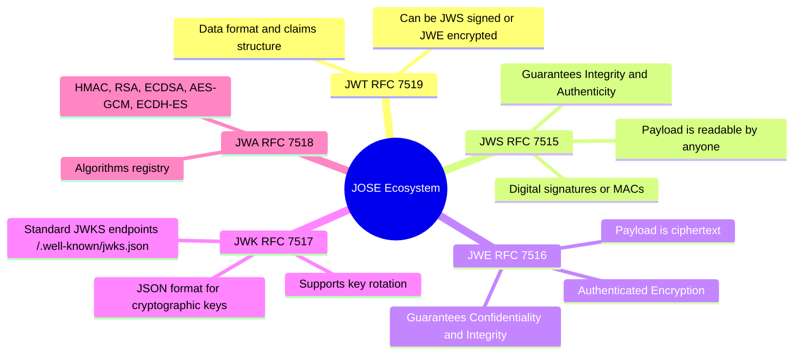

### 1.1 The Family Tree of JOSE Specifications

| Specification                 | RFC                                                       | Primary Responsibility                                           | Data Visibility                                            |
| :---------------------------- | :-------------------------------------------------------- | :--------------------------------------------------------------- | :--------------------------------------------------------- |
| **JWT** (JSON Web Token)      | [RFC 7519](https://datatracker.ietf.org/doc/html/rfc7519) | Defines JSON claims and semantics (`sub`, `iss`, `exp`)          | Depends on underlying container (JWS vs JWE)               |
| **JWS** (JSON Web Signature)  | [RFC 7515](https://datatracker.ietf.org/doc/html/rfc7515) | Signs arbitrary payloads using HMAC, RSA, ECDSA, or EdDSA        | **Publicly readable** (Base64URL encoded, not encrypted)   |
| **JWE** (JSON Web Encryption) | [RFC 7516](https://datatracker.ietf.org/doc/html/rfc7516) | Encrypts arbitrary content using authenticated encryption (AEAD) | **Confidential** (Payload is completely opaque ciphertext) |
| **JWK** (JSON Web Key)        | [RFC 7517](https://datatracker.ietf.org/doc/html/rfc7517) | Standardized JSON representation of asymmetric/symmetric keys    | Keys/Certificates metadata (e.g. JWKS)                     |
| **JWA** (JSON Web Algorithms) | [RFC 7518](https://datatracker.ietf.org/doc/html/rfc7518) | Algorithmic catalogs and crypto parameters used across JOSE      | Cryptographic definitions                                  |

> [!IMPORTANT]
>
> In everyday engineering conversations, when developers say "JWT", they almost always refer to a **JWS Compact Serialization** (the familiar three-part string). A JWT can be either a **signed JWS** or an **encrypted JWE**.

---

## 2. Standard Signed JWT (JWS - RFC 7515 & RFC 7519)

A signed JWT uses **JWS Compact Serialization**, where the token is represented as three distinct URL-safe Base64URL-encoded parts separated by periods (`.`):

```text
<Header>.<Payload>.<Signature>
```

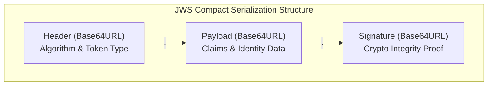

### 2.1 Base64URL Encoding vs. Standard Base64

JWT components are encoded using **Base64URL** (RFC 4648 §5) rather than standard Base64:

- Standard Base64 uses `+`, `/`, and `=` (padding), which conflict with URI query parameters and HTTP header delimiters.
- Base64URL substitutes `+` with `-` (minus) and `/` with `_` (underscore), and omits trailing `=` padding characters.

| Standard Base64 Character | Conflicts With                        | Reason for Conflict                                                                                                                                                                 | Base64URL Replacement                           |
| ------------------------- | ------------------------------------- | ----------------------------------------------------------------------------------------------------------------------------------------------------------------------------------- | ----------------------------------------------- |
| **`+`**                   | **URI Query Strings / Form encoding** | In URL query strings (`?token=...`), `+` is reserved and decoded by servers as an encoded space (` `), corrupting the token unless escaped as `%2B`.                                | Replaced with **`-`** (minus/hyphen)            |
| **`/`**                   | **URI Paths**                         | In URL paths (e.g., `/verify/<token>`), `/` is the path segment delimiter, splitting the token across route segments.                                                               | Replaced with **`_`** (underscore)              |
| **`=`** (Padding)         | **Query Strings & HTTP Delimiters**   | In query strings (`?k=v`) and HTTP headers (e.g., `Cookie: token=...;`), `=` is the key-value assignment delimiter. Trailing `=` can break naive parsers or require `%3D` encoding. | **Omitted completely** (length can be inferred) |

> [!WARNING]
>
> Base64URL is **encoding, not encryption**. Anyone who intercepts a standard JWS can decode the header and payload immediately without needing the secret or private key.

### 2.2 Header

The header contains cryptographic metadata specifying how the token was produced:

```json
{
  "alg": "RS256",
  "typ": "JWT",
  "kid": "auth-key-2026-q1"
}
```

- **`alg`**: The cryptographic algorithm used to secure the JWS (e.g., `HS256`, `RS256`, `ES256`, `EdDSA`).
- **`typ`**: Type of token, conventionally `"JWT"`.
- **`kid`** _(Key ID)_: An identifier matching a specific key in a JSON Web Key Set (JWKS), enabling seamless key rotation.
- **`cty`** _(Content Type)_: Used when nesting tokens (e.g. `cty: "JWT"` inside a JWE).

### 2.3 Payload & Claims

The payload contains the **claims**—statements about an entity (typically the user or client) and additional metadata:

```json
{
  "iss": "https://auth.example.com",
  "sub": "usr_9941a82f",
  "aud": "https://api.example.com",
  "exp": 1790289600,
  "nbf": 1790286000,
  "iat": 1790286000,
  "jti": "b47c0c16-d3c5-4cb2-83b5-318e470875e1",
  "role": "editor",
  "org_id": "org_5512"
}
```

Claims are divided into three categories:

#### 1. Registered Claims (Predefined by RFC 7519)

- **`iss`** (_Issuer_): Identity of the identity provider issuing the token.
- **`sub`** (_Subject_): Unique identifier of the principal (e.g., user ID, service account, or device).
- **`aud`** (_Audience_): Intended recipient(s) of the token (e.g., target API URI). The resource server must reject tokens where it is not listed in `aud`.
- **`exp`** (_Expiration Time_): Unix timestamp after which the token must be rejected.
- **`nbf`** (_Not Before_): Unix timestamp before which the token must not be accepted.
- **`iat`** (_Issued At_): Unix timestamp indicating when the token was created.
- **`jti`** (_JWT ID_): Unique nonce identifier for the token, used for one-time tokens or replay attack detection.

> [!NOTE]
>
> **Understanding `jti` (JWT ID): Nonces, Replay Protection, and Revocation**
> Per RFC 7519 §4.1.7, the `jti` claim provides a globally unique identifier for a token (typically a cryptographically secure UUID v4 or high-entropy nonce). While pure stateless JWTs do not require server-side state, `jti` serves as the critical bridge when state-assisted security guarantees are needed:
>
> 1. **Replay Attack Mitigation (Single-Use Actions)**:
>
> - If an attacker intercepts a valid, signed JWT (e.g., authorizing a high-value bank transaction, email verification, or password reset link), they could attempt to submit it multiple times before `exp` elapses.
> - **Mitigation Pattern**: When the server processes a request, it performs an atomic check-and-set in a fast in-memory store (e.g., Redis):
>
>   ```text
>   SET jti:<token_jti> 1 EX <ttl_remaining> NX
>   ```
>
>   If the key already exists (`NX` fails), the token is rejected as a duplicate/replay. Once the token expires naturally, Redis evicts the key automatically.
>
> 2. **Efficient Revocation Denylist (Blocklist)**:
>
> - Pure stateless JWTs cannot be revoked on-demand (e.g., upon user logout or security breach) without state. Storing entire 500+ byte JWTs in a revocation cache is wasteful; storing only the compact 36-byte `jti` string with a TTL equal to the token's remaining lifetime provides instant revocation with minimal memory overhead.
>
> 3. **Refresh Token Rotation (RTR) & Theft Detection**:
>
> - In OAuth 2.0 flows, each issued refresh token contains a unique `jti`. When exchanged, the old `jti` is marked consumed. If a previously consumed `jti` is submitted again, the authorization server detects token theft (someone else is attempting to reuse an old refresh token) and immediately revokes all active tokens for that user session.
>   - _Why revoke all tokens in the session?_ When an already-consumed token is resubmitted, a replay collision has occurred. The authorization server cannot know whether the attacker or the legitimate user made the earlier exchange. Revoking the entire token family/session evicts the attacker if they exchanged first, while forcing the legitimate user to re-authenticate (RFC 6819 §5.2.2.3).

> [!NOTE]
>
> **Understanding the "Principal" in `sub`**
> In security and IAM (Identity and Access Management), a **principal** is any authenticated entity granted permission to act within a system. JWT uses the term "principal" rather than "user" because tokens are frequently issued to automated systems or devices (such as microservices, background jobs, or IoT gateways) where no human user is present.
>
> | Principal Type         | Example Identifier (`sub`)         | Typical Scenario                            |
> | :--------------------- | :--------------------------------- | :------------------------------------------ |
> | **Human User**         | `usr_98a72f` or `user@example.com` | End-user web/mobile app authentication      |
> | **Service Account**    | `client_svc_payment_processor`     | Machine-to-machine (M2M) microservice calls |
> | **Federated Identity** | `auth0\                            | 64f12ab...` or Google Sub                   |
> | **Device / IoT**       | `device_sensor_temp_04`            | IoT telemetry & hardware gateway auth       |
>
> **Deep Dive: Federated Identity in `sub`**
>
> - **What is Federated Identity?**: Instead of maintaining local user credentials (passwords), an application delegates authentication to an external Identity Provider (IdP) such as Google, GitHub, Microsoft Entra ID, Okta, or Auth0 via OpenID Connect (OIDC) or SAML 2.0. The identity is "federated" across trust boundaries.
> - **Why `sub` looks like `auth0|64f12ab...` or Google Sub**:
> - **Namespaced Identifiers (Multi-IdP Brokers)**: Brokers like Auth0 or Okta aggregate multiple authentication strategies (e.g., Google OAuth, GitHub, Enterprise SAML). They prefix the `sub` with the connection strategy (`<strategy>|<provider-user-id>`, e.g., `google-oauth2|10928374...`, `github|5839210`, `auth0|64f12ab...`) to guarantee uniqueness across different upstream identity providers.
> - **Immutable Numeric Subjects (e.g., Google Sub)**: Google's OpenID Connect `sub` is an immutable 21-digit number (`10928374619...`). Even if a user updates their primary email address or profile name, this subject identifier remains invariant.
> - **Pairwise Pseudonymous Identifiers (e.g., Apple Sign-In)**: To preserve user privacy across different developers, Apple generates a unique pseudonymous `sub` per developer team account (`sub` differs across applications for the same user).
> - **Architectural Best Practice: The Compound Key `(iss, sub)`**:
> - A `sub` value is only guaranteed to be unique within its specific issuer (`iss`).
> - Never use mutable attributes (like `email`) as the database primary key. Instead, map external accounts using the compound key tuple:
>
> $$\text{Unique Identity} = (\mathbf{iss}, \mathbf{sub})$$
>
> - Applications link external federated identities to internal accounts via a mapping table:
>
> ```text
> User Record = Lookup(iss: "https://accounts.google.com", sub: "109283746192837465920")
> ```

#### 2. Public Claims

Claims registered in the [IANA JSON Web Token Claims Registry](https://www.iana.org/assignments/jwt/jwt.xhtml) or defined with collision-resistant namespaces (e.g., URIs) to prevent naming collisions across systems.

#### 3. Private Claims

Per [RFC 7519 §4.3](https://datatracker.ietf.org/doc/html/rfc7519#section-4.3), private claims are custom, application-specific claims agreed upon privately between the token producer (identity provider) and consumers (downstream APIs/resource servers).

> [!WARNING]
>
> **"Private" Does NOT Mean Confidential or Secret**
> In standard signed JWTs (JWS), the payload is only **Base64URL-encoded**, not encrypted. Anyone holding or inspecting the token can decode and view private claim values.
>
> - **Never store sensitive credentials** (e.g., plain passwords, unhashed secrets, PII, credit card numbers, or social security numbers) in private claims.
> - If confidential claim data must be transferred, encrypt the payload using **JWE (JSON Web Encryption, RFC 7516)**.

##### Common Use Cases

Private claims make JWTs **self-contained**, allowing resource servers and API gateways to make authorization decisions statelessly without repetitive database lookups:

- **Role-Based Access Control (RBAC)**:

  ```json
  {
    "role": "editor",
    "permissions": ["posts:create", "posts:update", "media:upload"]
  }
  ```

- **Multi-Tenancy & Data Isolation**:

  ```json
  {
    "tenant_id": "tenant_enterprise_01",
    "org_id": "org_5512"
  }
  ```

  _(Downstream services automatically scope database queries, e.g., `WHERE org_id = claims.org_id`)_.

- **Entitlements & Feature Tiers**:

  ```json
  {
    "plan": "enterprise",
    "features": ["audit_logs", "sso_enforced"]
  }
  ```

##### Architectural Considerations & Pitfalls

1. **Token Bloat & HTTP Header Limits**:

   - Because access tokens are sent with every HTTP request in the `Authorization: Bearer <token>` header, stuffing large arrays of permissions or deep nested objects inflates network overhead and risks hitting server/reverse proxy header limits (e.g., 8KB–16KB in Nginx, Apache, or AWS ALB).
   - _Mitigation_: Store only coarse roles or tenant IDs in the token, or use compact bitmasks / short scope identifiers.

1. **Stale Authorization State**:

   - Claims are an immutable snapshot captured at token issuance. If an administrator revokes a user's role or permissions in the database, the private claims in the existing access token remain active until the token reaches its `exp`.
   - _Mitigations_:
     - **Short TTL + Refresh Rotation**: Enforce short access token lifetimes (e.g., 5–15 minutes) to bound the staleness window.
     - **Immediate Revocation via Denylist + Refresh Handshake**: Blacklist the token's `jti` in Redis when scopes change. When the client receives `401 Unauthorized`, it invokes its refresh token to fetch an updated access token immediately.
     - **Phantom Token Pattern**: Use opaque reference tokens at the public edge and translate them into ultra-short-lived internal JWTs (30–60s) at the API Gateway (see [§6.4 The Token Revocation Problem](#64-the-token-revocation-problem)).

1. **Collision Avoidance**:

   - Private claim names must not shadow or redefine standardized registered claims (`sub`, `iss`, `aud`, `exp`, `nbf`, `iat`, `jti`) or public claims.

### 2.4 Signature Generation & Verification

The signature is created by concatenating the Base64URL-encoded header and payload with a period, hashing that string, and signing or computing a **Message Authentication Code (MAC)** with a secret or private key:

$$
\text{Signing Input} = \text{base64Url}(\text{Header}) \mathbin{\Vert} \text{"."} \mathbin{\Vert} \text{base64Url}(\text{Payload})
$$

$$
\text{Signature} = \text{Sign}_{\text{Key}}(\text{Hash}(\text{Signing Input}))
$$

For symmetric HMAC-SHA256:

```text
HMACSHA256(
  base64UrlEncode(header) + "." + base64UrlEncode(payload),
  secretKey
)
```

```mermaid
flowchart TD
    subgraph SignPhase ["Token Creation (Issuer)"]
        H1["Header JSON"] --> B_H["base64Url(Header)"]
        P1["Payload JSON"] --> B_P["base64Url(Payload)"]
        B_H --> Input["Signing Input: H + '.' + P"]
        B_P --> Input
        Input --> CryptoSign["Crypto Sign / MAC<br/>(Private Key or Shared Secret)"]
        CryptoSign --> Sig["base64Url(Signature)"]
        Input --> FinalToken["JWT: base64Url(H).base64Url(P).base64Url(S)"]
        Sig --> FinalToken
    end

    subgraph VerifyPhase ["Token Verification (Consumer)"]
        RcvToken["Received Token"] --> Split["Split by '.'"]
        Split --> V_H["base64Url(Header)"]
        Split --> V_P["base64Url(Payload)"]
        Split --> V_S["base64Url(Signature)"]
        V_H --> V_Input["Verify Input: V_H + '.' + V_P"]
        V_P --> V_Input
        V_Input --> VerifyAlg["Cryptographic Verify<br/>(Public Key or Shared Secret)"]
        V_S --> VerifyAlg
        VerifyAlg --> Valid{"Signature Matches?"}
        Valid -- Yes --> CheckClaims{"Validate Claims<br/>exp, nbf, iss, aud"}
        Valid -- No --> Reject["REJECT: Invalid Signature"]
        CheckClaims -- Pass --> Accept["ACCEPT: Valid Token"]
        CheckClaims -- Fail --> RejectClaim["REJECT: Claim Violation"]
    end
```

> [!NOTE]
>
> **Deep Dive: What is a Message Authentication Code (MAC)?**
> A **Message Authentication Code (MAC)** is a cryptographic tag generated by combining an arbitrary-length message with a **symmetric shared secret key**. It simultaneously provides two essential security guarantees:
>
> 1. **Data Integrity**: Ensures the token's header and payload were not altered or corrupted in transit.
> 2. **Authenticity**: Proves the token was generated by a party possessing the shared secret key.
>
> **Why Not Just Use a Standard Hash (e.g., SHA-256 alone)?**
> A common question in cryptography is why a secret key is required if a hash function already verifies data integrity:
>
> - If an issuer sends a message $M$ alongside a plain hash $\text{SHA-256}(M)$, an attacker (man-in-the-middle) can intercept $M$, alter it to $M'$, recompute $\text{SHA-256}(M')$, and forward both to the consumer. The consumer checks the hash and falsely believes the message is authentic.
> - **A hash proves data was not accidentally corrupted, but provides zero authenticity.** Because an attacker does not possess the secret key $K$, they cannot compute a valid $\text{MAC}(K, M')$.
>
> **MAC vs. Digital Signature**:
>
> | Property             | MAC (e.g., `HS256` in JWT)                                               | Digital Signature (e.g., `RS256`, `ES256`, `EdDSA`)                                                        |
> | :------------------- | :----------------------------------------------------------------------- | :--------------------------------------------------------------------------------------------------------- |
> | **Key Architecture** | **Symmetric** (Single shared secret key)                                 | **Asymmetric** (Private key to sign, public key to verify)                                                 |
> | **Trust Boundary**   | All verifiers must hold the secret key; any verifier could forge tokens. | Only the Auth Server holds the private key; verifiers only need the public key and can never forge tokens. |
> | **Non-Repudiation**  | ❌ No (either party holding the secret could have generated it).         | ✅ Yes (mathematical proof that only the private key holder generated it).                                 |
> | **Computation**      | Blisteringly fast (simple hashing operations, $O(1)$ symmetric compute). | Slower (asymmetric modular exponentiation or elliptic curve math).                                         |
>
> ---
>
> **Deep Dive: Authenticity vs. Non-Repudiation (Are They Combined?)**
>
> A frequent source of confusion is whether **authenticity** and **non-repudiation** mean the same thing:
>
> - **Authenticity** (_"I know it came from you"_): Proves that a message or token was generated by a party possessing the legitimate key. In symmetric MAC (`HS256`), Alice and Bob share secret $K$. When Bob receives a valid token, Bob knows Alice wrote it (because Bob knows he didn't). Authenticity between Alice and Bob is achieved.
> - **Non-Repudiation** (_"I can prove to a 3rd party that you wrote it, and you cannot deny it"_): Derived from _"to repudiate"_ (to deny or disown). It is the property where the author has no plausible deniability before an independent third party, auditor, or court.
>
> **The Relationship: A One-Way Hierarchy**
>
> - $\text{Non-Repudiation} \implies \text{Authenticity}$ (Non-repudiation strictly includes authenticity).
> - $\text{Authenticity} \not\implies \text{Non-Repudiation}$ (Authenticity alone does **not** provide non-repudiation).
>
> **Why Symmetric MAC (`HS256`) Fails Non-Repudiation**:
> If Bob presents an `HS256` token to an auditor or judge to prove Alice issued it, Alice can plausibly claim: _"Bob holds secret $K$ too. Bob fabricated that token himself!"_ Because both parties possess the secret key, Bob cannot cryptographically prove Alice was the true author.
>
> **When Are They Combined?**
> They are combined in **Asymmetric Digital Signatures (`RS256`, `ES256`, `EdDSA`)**:
>
> $$\text{Authenticity} + \text{Third-Party Verifiability} = \mathbf{Non\text{-}Repudiation}$$
>
> Because **only the Auth Server holds the private key** while verifiers and auditors only hold the public key, verifiers cannot forge tokens. Thus, the author cannot deny authoring the token to anyone.

---

## 3. Encrypted Tokens (JWE - RFC 7516)

While a standard JWS guarantees **authenticity** and **integrity**, it provides **zero confidentiality**. Any proxy, browser extension, or man-in-the-middle observing the HTTP header can read the entire payload.

When sensitive information (PII, session secrets, private identity claims) must reside inside the token, **JSON Web Encryption (JWE)** is used.

### 3.1 Anatomy of a JWE Compact Token

A compact serialized JWE consists of **five Base64URL-encoded parts** separated by periods (`.`):

```text
<Protected Header>.<Encrypted Key>.<Initialization Vector>.<Ciphertext>.<Authentication Tag>
```

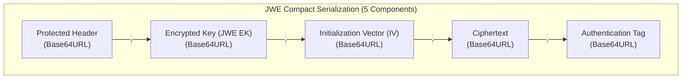

| Part  | Component                      | Purpose                                                                                                                                                   |
| :---- | :----------------------------- | :-------------------------------------------------------------------------------------------------------------------------------------------------------- |
| **1** | **Protected Header**           | Specifies both key management algorithm (`alg`) and content encryption algorithm (`enc`).                                                                 |
| **2** | **Encrypted Key (JWE EK)**     | The random symmetric Content Encryption Key (CEK), encrypted with the recipient's public key or pre-shared key. Empty if using direct encryption (`dir`). |
| **3** | **Initialization Vector (IV)** | Cryptographic nonce providing uniqueness for the symmetric cipher, preventing identical plaintexts from yielding identical ciphertexts.                   |
| **4** | **Ciphertext**                 | The actual encrypted payload data.                                                                                                                        |
| **5** | **Authentication Tag**         | Generated by the AEAD cipher (e.g. AES-GCM) to guarantee integrity and authenticity of both ciphertext and protected header.                              |

### 3.2 The Two-Tier Encryption Process

JWE avoids the high computational cost of encrypting large payloads with asymmetric cryptography by using a **hybrid two-tier envelope pattern**:

1. **Step 1 (Generate CEK)**: A high-entropy symmetric **Content Encryption Key (CEK)** is generated randomly for each individual token.
2. **Step 2 (Key Wrap / Encrypt CEK)**: The CEK is encrypted using the recipient's public key (e.g. `RSA-OAEP-256` or `ECDH-ES+A256KW`).
3. **Step 3 (Payload Encryption)**: The payload is encrypted with the CEK using an AEAD cipher (e.g., `A256GCM`), producing the **Ciphertext** and **Authentication Tag**.

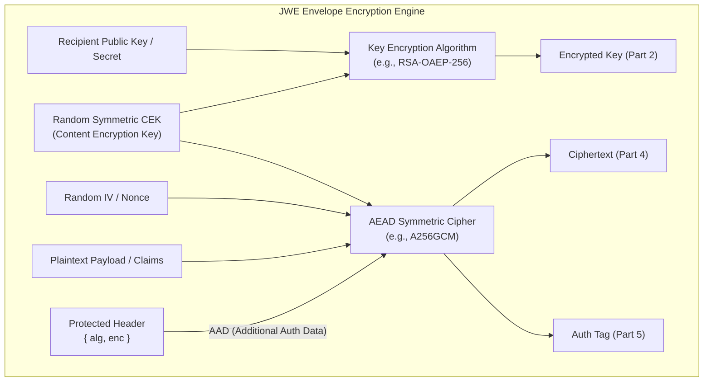

### 3.3 Nested JWT: Combining JWS and JWE

When a token requires **both** non-repudiation (proof of who created it) and confidentiality (only the recipient can read it), the specifications recommend a **Nested JWT**:

> [!TIP]
>
> **Best Practice**: **Sign-then-Encrypt** (JWS nested inside JWE).
>
> 1. Sign the inner claims using the issuer's private key to form a standard JWS.
> 2. Encrypt the entire JWS string as the payload of an outer JWE using the recipient's public key.
> 3. Set the JWE header `cty: "JWT"` to inform the recipient to parse the decrypted payload as a nested token.

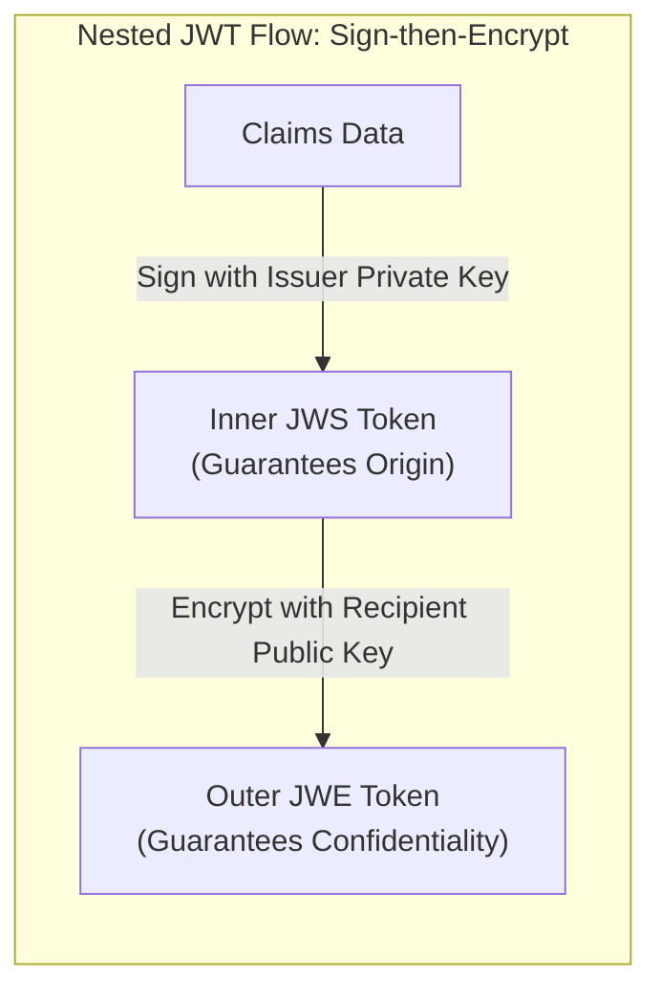

#### Why Not JWE Alone? (The "AEAD Illusion")

A common question is why JWE alone is insufficient if it already uses **AEAD** (Authenticated Encryption with Associated Data, e.g., `A256GCM`) which produces an "Authentication Tag".

The critical distinction is:

> **AEAD authenticates _tamper-resistance against the key holder_, NOT _sender identity or origin_.**

1. **The Asymmetric Public-Key Vulnerability**:
   - In asymmetric JWE (e.g., `RSA-OAEP-256`, `ECDH-ES`), the token is encrypted with the **Recipient's Public Key**.
   - Because the recipient's public key is **public**, _anyone_ (including attackers, malicious proxies, or rogue clients) can encrypt arbitrary claims (e.g., `{"role": "admin"}`) with that public key.
   - When the recipient decrypts the token with its private key, the AEAD tag verification succeeds because the ciphertext was not modified after encryption. However, the recipient has **zero proof** of who actually created the token.
2. **Why Symmetric JWE Alone Is Still Insufficient**:
   - If using a pre-shared symmetric key (`dir` or `A256KW`), both the issuer and recipient hold the same secret.
   - **No Non-Repudiation**: The recipient could have fabricated the token itself; it cannot be proven to third parties or auditors.
   - **Shared-Secret Blast Radius**: In a multi-service or microservice mesh, any service holding the decryption key could forge tokens pretending to be the Identity Provider.

#### Cryptographic Guarantees Comparison

| Token Architecture            | Confidentiality<br/>_(Hidden Payload)_ | Integrity<br/>_(Tamper-Proof)_ | Sender Authenticity<br/>_(Verified Origin)_ | Non-Repudiation<br/>_(Cryptographic Proof)_ | Common Use Case                                                                          |
| :---------------------------- | :------------------------------------: | :----------------------------: | :-----------------------------------------: | :-----------------------------------------: | :--------------------------------------------------------------------------------------- |
| **JWS Alone**                 |           ❌ (Public claims)           |               ✅               |             ✅ (Issuer signed)              |                     ✅                      | Standard OAuth 2.0 / OIDC ID tokens                                                      |
| **JWE Alone** _(Asymmetric)_  |       ✅ (Only recipient reads)        |         ✅ (AEAD tag)          |      ❌ (Anyone with pubkey can craft)      |                     ❌                      | Point-to-point payload encryption where sender is already authenticated (e.g., via mTLS) |
| **Nested JWT** _(JWS in JWE)_ |                   ✅                   |               ✅               |                     ✅                      |                     ✅                      | High-security identity delegation, financial APIs (FAPI), health records                 |

#### Verification Lifecycle of a Nested JWT

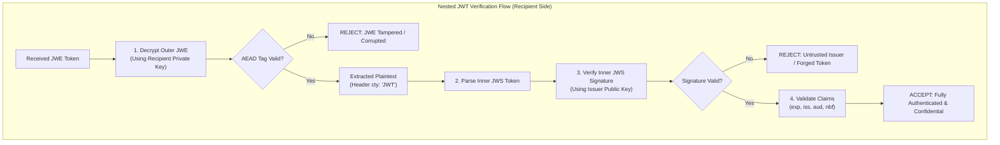

> [!IMPORTANT]
>
> **Why Sign-then-Encrypt instead of Encrypt-then-Sign?**
>
> 1. **Prevents Forwarding Attacks**: If you encrypt first and sign the outside (Encrypt-then-Sign), an eavesdropper can strip your signature and re-sign the ciphertext with their own key without modifying or decrypting it. The recipient would mistakenly credit the eavesdropper as the author.
> 2. **Spec Compliance**: RFC 7519 §1.1 explicitly specifies that when nested signing and encryption are performed, the JWT claims MUST be signed first (producing a JWS) and then encrypted (producing a JWE) with `cty: "JWT"` in the outer JWE header.

---

## 4. Key Management & Cryptography: JWK & JWA

### 4.1 JSON Web Key (JWK - RFC 7517)

A **JWK** is a JSON object representing a cryptographic key. It replaces cumbersome PEM and X.509 formats with standard JSON.

#### Example RSA Public Key (`JWK`):

```json
{
  "kty": "RSA",
  "use": "sig",
  "alg": "RS256",
  "kid": "k-2026-auth-01",
  "n": "u1W1gh...[Base64URL Modulus]...",
  "e": "AQAB"
}
```

#### Example Elliptic Curve Public Key (`JWK`):

```json
{
  "kty": "EC",
  "crv": "P-256",
  "use": "sig",
  "kid": "k-2026-ec-01",
  "x": "f83OJ3D2xFmT4v74...",
  "y": "x_daQJJea3DBBQni..."
}
```

#### Key Set (`JWKS`) & Discovery Endpoint

Systems host their public verification keys at a standardized public endpoint, typically:
`https://auth.example.com/.well-known/jwks.json`

```json
{
  "keys": [
    {
      "kty": "RSA",
      "kid": "key-2025-legacy",
      "use": "sig",
      "n": "...",
      "e": "AQAB"
    },
    {
      "kty": "RSA",
      "kid": "key-2026-current",
      "use": "sig",
      "n": "...",
      "e": "AQAB"
    }
  ]
}
```

This allows resource servers to fetch and cache public keys dynamically and match incoming tokens via the header `kid` without redeploying code during key rotations.

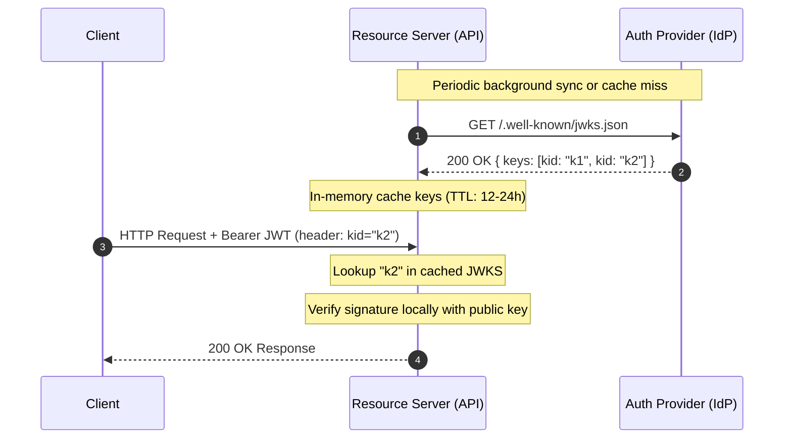

### 4.2 JSON Web Algorithms (JWA - RFC 7518)

| Category                     | Algorithm                 | Description & Security Posture                                                                                                                                                    |
| :--------------------------- | :------------------------ | :-------------------------------------------------------------------------------------------------------------------------------------------------------------------------------- |
| **Symmetric Signing**        | `HS256`, `HS384`, `HS512` | HMAC with SHA-2. Fast, but requires sharing the secret between issuer and all verifiers.                                                                                          |
| **Asymmetric Signing (RSA)** | `RS256`, `RS384`, `RS512` | RSASSA-PKCS1-v1_5. Legacy standard; widely supported.                                                                                                                             |
| **Asymmetric Signing (PSS)** | `PS256`, `PS384`, `PS512` | RSASSA-PSS with MGF1. **Recommended over RS256** due to a tighter security reduction (random oracle model) and resilience against padding-related attacks (e.g., Bleichenbacher). |
| **Elliptic Curve Signing**   | `ES256`, `ES384`, `ES512` | ECDSA using NIST curves (P-256, P-384, P-521). Small keys, short signatures, fast computation.                                                                                    |
| **Edwards Curve Signing**    | `EdDSA` (Ed25519)         | [RFC 8037]. Immune to side-channel timing attacks, fast, minimal signature size. State-of-the-art choice.                                                                         |
| **JWE Key Encryption**       | `RSA-OAEP-256`, `ECDH-ES` | Used in Part 2 of JWE to encrypt the Content Encryption Key.                                                                                                                      |
| **JWE AEAD Cipher**          | `A128GCM`, `A256GCM`      | Authenticated Encryption with Associated Data for encrypting the payload.                                                                                                         |

---

## 5. Architectural Authentication Flows

In modern distributed systems, JWTs are commonly employed as **Access Tokens** paired with **Refresh Tokens**.

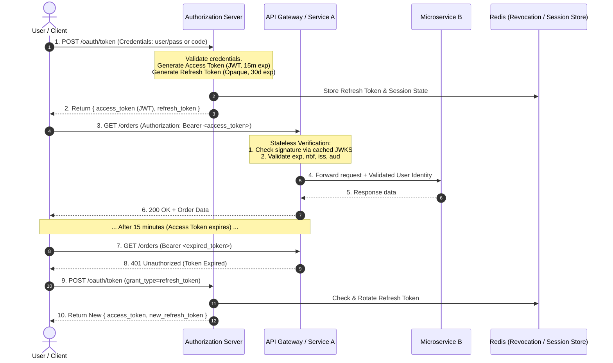

---

## 6. Security Pitfalls & Attack Vectors

JWTs are susceptible to subtle configuration errors and cryptographic vulnerabilities. Below are the most critical vulnerabilities and their mitigations (per [RFC 8725: JWT Best Current Practices](https://datatracker.ietf.org/doc/html/rfc8725)).

### 6.1 The `alg: "none"` Exploit

- **Vulnerability**: RFC 7515 permitted an algorithm value of `"none"` for unsigned tokens. Vulnerable libraries allowed attackers to modify the payload (e.g. elevating `"role": "admin"`), alter the header to `{"alg": "none"}`, strip the signature, and submit the token. If the parser did not explicitly enforce a cryptographic algorithm, it accepted the forged token as valid.
- **Mitigation**: Strictly whitelist expected algorithms in the verification configuration. Completely reject `"none"` in production.

```go
// Safe verification: Explicitly restrict allowed algorithms
parsedToken, err := jwt.Parse(tokenStr, keyFunc, jwt.WithValidMethods([]string{"RS256", "PS256"}))
```

### 6.2 The Algorithm Confusion Attack (HMAC vs. RSA)

- **Vulnerability**: An attacker takes an asymmetric token (using `RS256`). They obtain the server's public key (which is publicly accessible via JWKS), tamper with the payload, and change the header `alg` to `HS256` (symmetric HMAC). When the server verifies the token with its RSA public key using a generic verification function, the library treats the public key string as the HMAC shared secret. Because the attacker signed the token using that exact same public key, the signature matches!
- **Mitigation**: Never allow the incoming token's header to determine whether a symmetric or asymmetric validation key is passed to the verifier. Enforce key type checks against the header `alg`.

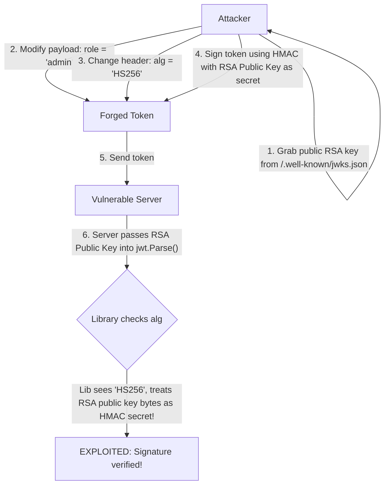

### 6.3 Sensitive Data Leakage in JWS

- **Vulnerability**: Developers frequently store passwords, hashes, personal identifiable information (PII), or database connection details inside standard JWT payloads, assuming that because it looks like a hash, it is secret.
- **Mitigation**: Never store credentials or sensitive data in a JWS. Use JWE if confidential data must be included, or keep data server-side and store only an opaque reference ID in the token.

### 6.4 The Token Revocation Problem

Because JWT verification is designed to be stateless ($O(1)$ cryptographic signature check with zero database I/O), a valid token cannot be invalidated before its `exp` expires without introducing state. This creates the **Stale Scope / Revocation Dilemma**: if an administrator revokes a user's privileges or an account is compromised, the access token continues to grant access until it expires.

To resolve this, modern architectures deploy one of four core strategies:

#### Strategy A: Short Lifetimes (Passive Acceptance)

- **Mechanism**: Issue access tokens with 5–15 minute lifetimes and use refresh token rotation for stateful session persistence.
- **Trade-off**: High performance (100% stateless, zero network lookups), but accepts a 5–15 minute vulnerability window where stale claims/scopes remain active.

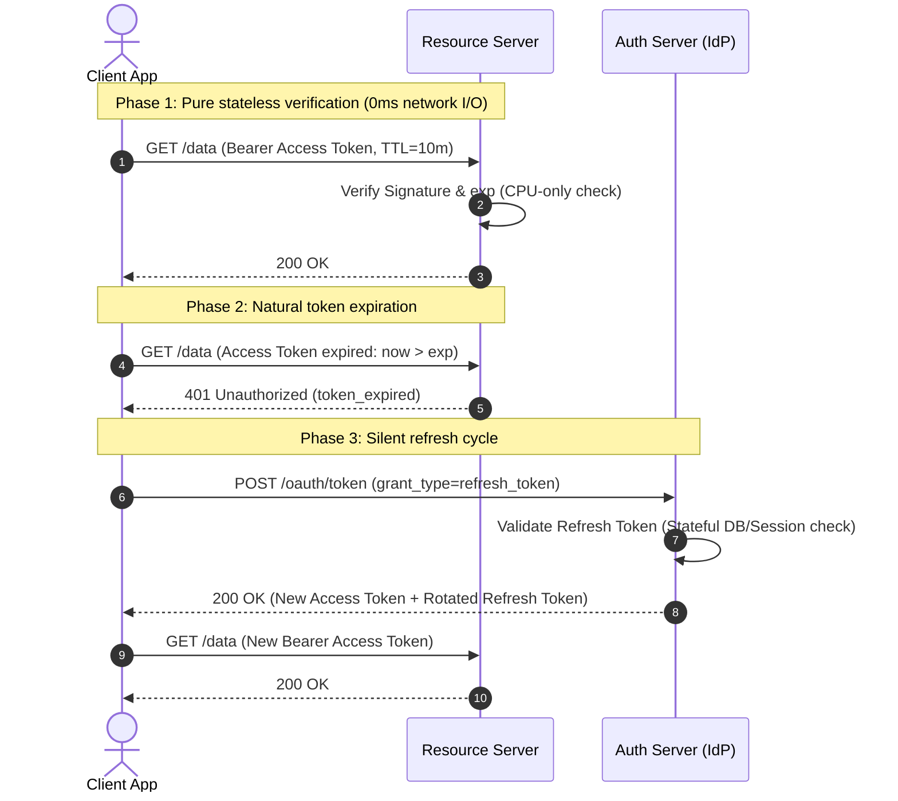

#### Strategy B: Immediate Revocation via Denylist + Refresh Handshake

- **Mechanism**: When privileges change or a token is revoked:

  1. The authorization server writes the token's unique identifier (`jti`) into a fast in-memory store (e.g., Redis) with a TTL equal to the token's remaining lifetime:

     ```text
     SET blacklist:jti:<token_jti> 1 EX <ttl_remaining>
     ```

  1. When the client submits the revoked token, the API gateway/server detects the entry in Redis and responds with `401 Unauthorized` (`error: "token_revoked"`).
  1. The client application (via HTTP interceptors) catches the `401`, transparently invokes the `/oauth/token?grant_type=refresh_token` endpoint, receives a new access token containing fresh scopes from the database, and retries the original request without user interruption.

- **Trade-off**: Instant revocation, but requires an external cache lookup per request.

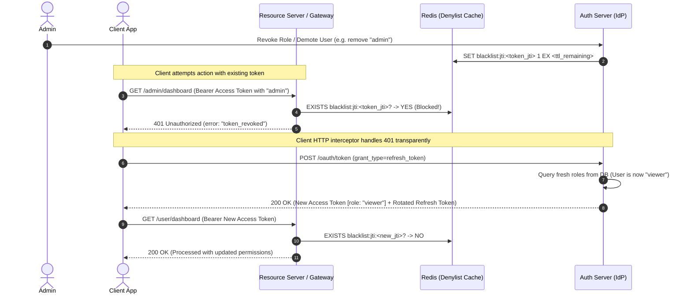

#### Strategy C: User Security Stamp / Epoch Versioning

- **Mechanism**: Instead of storing millions of individual `jti` strings in Redis, maintain a `token_version` integer (or `min_iat` timestamp cutoff) per user record:
  - Embed `"ver": 3` or `"iat"` in the JWT payload.
  - When permissions change or global logout is triggered, increment `token_version` in the database / Redis (`user:<id>:min_iat = now()`).
  - The verifier rejects tokens where `claims.ver < user.current_ver` or `claims.iat < min_iat`.
- **Trade-off**: Extremely memory-efficient (only stores state for users whose permissions actively changed), but requires verifying the version against state.

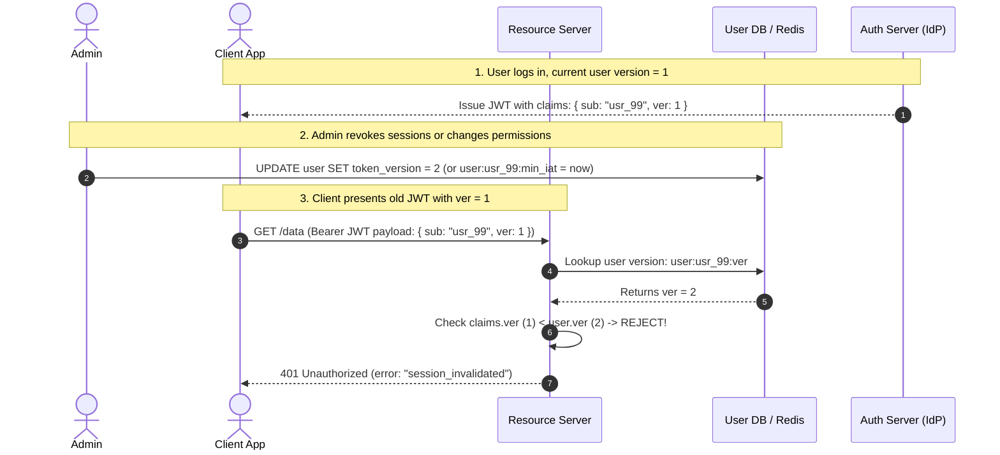

#### Strategy D: The Phantom Token Pattern (Perimeter Translation)

An enterprise OAuth 2.0 pattern (standardized by API gateways like Kong, Envoy, and Apigee) that bridges public clients and private microservices:

- **Outside the Perimeter (Public Internet $\leftrightarrow$ API Gateway)**:
  - The client only receives a lightweight **opaque reference token** (a random UUID, e.g., `ref_7f9b8c2d-e5a1-4321-9988`).
  - **Zero Data Leakage**: No internal user IDs, tenant scopes, roles, or microservice topologies are exposed in browser DevTools or mobile apps.
  - **Instant Revocation**: If the user logs out or permissions change, deleting the opaque token from the session store immediately blocks the client at the gateway on the next request.
- **Inside the Perimeter (API Gateway $\leftrightarrow$ Microservices)**:
  - The API Gateway validates the opaque token at the edge, swaps it for an **internal, short-lived signed JWT** (e.g., 30–60 second TTL) populated with full user claims, and forwards it downstream.
  - Microservices verify the internal JWT statelessly via CPU math ($0$ network hops to Redis/DB), keeping internal latency minimal while completely eliminating stale scope risks.

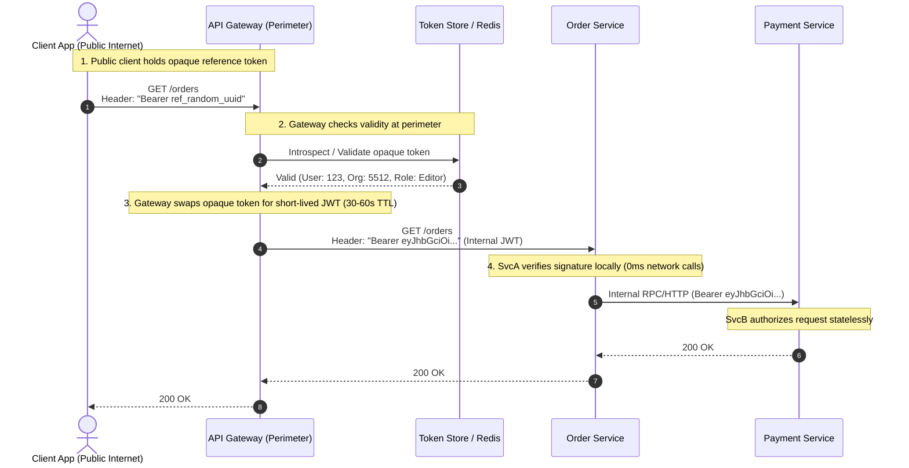

##### Revocation Architectures Compared

| Architecture                          | Propagation Delay  | Network I/O per Request | Data Leakage to Client        | Best Suited For                                     |
| :------------------------------------ | :----------------- | :---------------------- | :---------------------------- | :-------------------------------------------------- |
| **Short TTL Only (5–15 min)**         | 5–15 minutes       | **Zero** (Pure CPU)     | Moderate (Payload visible)    | Standard B2B / B2C web applications                 |
| **`jti` / Version Denylist in Redis** | **Instant (0 ms)** | 1 cache lookup (~0.5ms) | Moderate (Payload visible)    | Financial, healthcare, high-security APIs           |
| **Phantom Token Pattern**             | **Instant (0 ms)** | 1 edge lookup only      | **Zero** (Opaque string only) | Enterprise microservices, public mobile/SPA clients |

### 6.5 Storage Dilemma: `localStorage` vs. `HttpOnly` Cookies

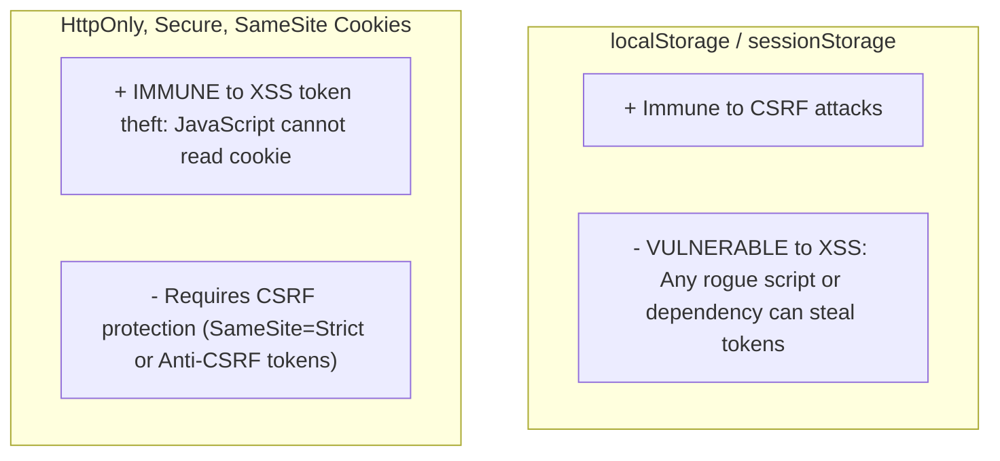

> [!CAUTION]
>
> For browser clients, storing sensitive access tokens in `localStorage` exposes them to complete compromise via **Cross-Site Scripting (XSS)**. Use **`HttpOnly; Secure; SameSite=Lax/Strict`** cookies or the **Backend-For-Frontend (BFF)** proxy pattern.

---

## 7. Comparative Analysis: JWT vs Alternative Token Formats

| Feature / Metric             | JWT (JWS)                   | JWE                         | Opaque Session Tokens             | PASETO (Platform-Agnostic SEcurity TOkens)   |
| :--------------------------- | :-------------------------- | :-------------------------- | :-------------------------------- | :------------------------------------------- |
| **Format**                   | 3 Base64URL parts           | 5 Base64URL parts           | Random string (e.g. UUID)         | Versioned prefix (`v4.public.`, `v4.local.`) |
| **Stateless Verification**   | Yes (Public Key / Secret)   | Yes (Private Key / Secret)  | **No** (Database lookup required) | Yes                                          |
| **Payload Privacy**          | Visible                     | Fully Encrypted             | Server-side only                  | Either Public or Encrypted                   |
| **Revocation Ease**          | Hard (Requires cache/epoch) | Hard (Requires cache/epoch) | **Instant** (Delete row/key)      | Hard                                         |
| **Cipher Negotiation**       | In header (`alg` agility)   | In header (`alg` + `enc`)   | N/A                               | **None** (Hardcoded modern crypto suites)    |
| **Algorithm Confusion Risk** | Possible if misconfigured   | Lower                       | None                              | **Impossible by design**                     |
| **Payload Size**             | Moderate (~300–800 bytes)   | Large (~1–2 KB)             | Minimal (~32–64 bytes)            | Moderate                                     |

### Decision Guide: Choosing the Right Token Architecture

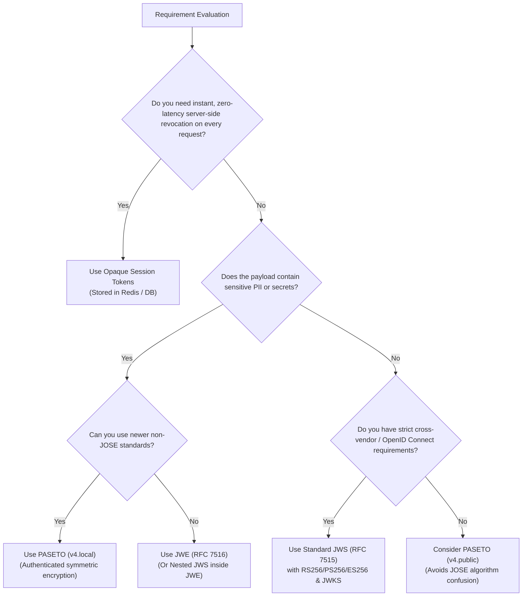

---

## 8. Implementation Code Examples

### 8.1 Go: Generating & Verifying a Signed JWT with Asymmetric Key Pair

Using the standard `golang-jwt/jwt/v5` package:

```go
package main

import (
	"crypto/rsa"
	"fmt"
	"time"

	"github.com/golang-jwt/jwt/v5"
)

type CustomClaims struct {
	UserID string `json:"user_id"`
	Role   string `json:"role"`
	jwt.RegisteredClaims
}

// GenerateToken creates an RS256-signed JWT
func GenerateToken(privateKey *rsa.PrivateKey, keyID string, userID string, role string) (string, error) {
	now := time.Now()
	claims := CustomClaims{
		UserID: userID,
		Role:   role,
		RegisteredClaims: jwt.RegisteredClaims{
			Issuer:    "https://auth.example.com",
			Subject:   userID,
			Audience:  jwt.ClaimStrings{"https://api.example.com"},
			ExpiresAt: jwt.NewNumericDate(now.Add(15 * time.Minute)),
			NotBefore: jwt.NewNumericDate(now),
			IssuedAt:  jwt.NewNumericDate(now),
			ID:        "unique-nonce-uuid",
		},
	}

	token := jwt.NewWithClaims(jwt.SigningMethodRS256, claims)
	token.Header["kid"] = keyID // Key ID for JWKS matching

	return token.SignedString(privateKey)
}

// VerifyToken verifies signature, algorithm, and registered claims
func VerifyToken(tokenString string, publicKey *rsa.PublicKey) (*CustomClaims, error) {
	token, err := jwt.ParseWithClaims(
		tokenString,
		&CustomClaims{},
		func(t *jwt.Token) (interface{}, error) {
			// Enforce specific algorithm to prevent algorithm confusion attacks
			if _, ok := t.Method.(*jwt.SigningMethodRSA); !ok {
				return nil, fmt.Errorf("unexpected signing method: %v", t.Header["alg"])
			}
			return publicKey, nil
		},
		jwt.WithIssuer("https://auth.example.com"),
		jwt.WithAudience("https://api.example.com"),
		jwt.WithValidMethods([]string{"RS256", "PS256"}),
	)

	if err != nil {
		return nil, fmt.Errorf("token validation failed: %w", err)
	}

	if claims, ok := token.Claims.(*CustomClaims); ok && token.Valid {
		return claims, nil
	}

	return nil, fmt.Errorf("invalid token claims")
}
```

### 8.2 TypeScript / Node.js: Generating a JWE (Encrypted Token)

Using the standard `jose` npm library:

```typescript
import { CompactEncrypt, compactDecrypt, generateSecret } from "jose";

async function runJWEDemo() {
  // 1. Generate or load a 256-bit symmetric key for A256GCM
  const secretKey = await generateSecret("A256GCM");

  const payload = JSON.stringify({
    sub: "user_12345",
    ssn: "000-12-3456", // Sensitive data protected by encryption
    scope: "admin:billing",
  });

  // 2. Encrypt into 5-part JWE compact string
  const jwe = await new CompactEncrypt(new TextEncoder().encode(payload))
    .setProtectedHeader({ alg: "dir", enc: "A256GCM" }) // 'dir' = direct encryption with shared key
    .encrypt(secretKey);

  console.log("JWE String (5 parts separated by dots):");
  console.log(jwe);

  // 3. Decrypt on recipient side
  const { plaintext, protectedHeader } = await compactDecrypt(jwe, secretKey, {
    contentEncryptionAlgorithms: ["A256GCM"],
    keyManagementAlgorithms: ["dir"],
  });

  const decryptedClaims = JSON.parse(new TextDecoder().decode(plaintext));
  console.log("Decrypted Claims:", decryptedClaims);
  console.log("Protected Header:", protectedHeader);
}
```

---

## 9. Summary & Quick Reference

| Concept        | Structure                                   | Key RFC       | Primary Use Case                                       |
| :------------- | :------------------------------------------ | :------------ | :----------------------------------------------------- |
| **JWS**        | `Header.Payload.Signature` (3 parts)        | RFC 7515      | Stateless API authentication, OpenID Connect ID Tokens |
| **JWE**        | `Header.EncKey.IV.Ciphertext.Tag` (5 parts) | RFC 7516      | Transferring confidential data over untrusted channels |
| **JWK / JWKS** | JSON key representations and set lists      | RFC 7517      | Public key sharing, automated key rotation             |
| **JWA**        | Cryptographic identifier catalog            | RFC 7518      | Algorithm negotiation specifications                   |
| **Nested JWT** | JWS signed inside JWE encrypted wrapper     | RFC 7519 §7.1 | Authenticated origin + strict confidentiality          |

---

## References & Further Reading

- [RFC 7519: JSON Web Token (JWT)](https://datatracker.ietf.org/doc/html/rfc7519)
- [RFC 7515: JSON Web Signature (JWS)](https://datatracker.ietf.org/doc/html/rfc7515)
- [RFC 7516: JSON Web Encryption (JWE)](https://datatracker.ietf.org/doc/html/rfc7516)
- [RFC 7517: JSON Web Key (JWK)](https://datatracker.ietf.org/doc/html/rfc7517)
- [RFC 7518: JSON Web Algorithms (JWA)](https://datatracker.ietf.org/doc/html/rfc7518)
- [RFC 8725: JSON Web Token Best Current Practices](https://datatracker.ietf.org/doc/html/rfc8725)
- [RFC 8037: CFRG Elliptic Curve Diffie-Hellman (ECDH) and Signatures in JOSE](https://datatracker.ietf.org/doc/html/rfc8037)
- [OpenID Connect Core 1.0 Specification](https://openid.net/specs/openid-connect-core-1_0.html)
