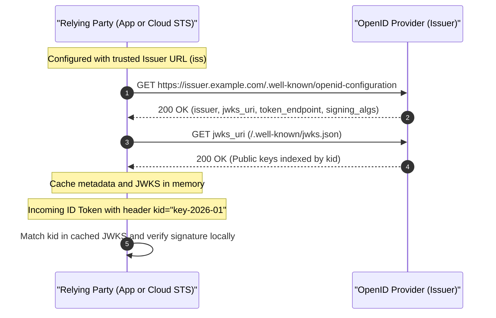
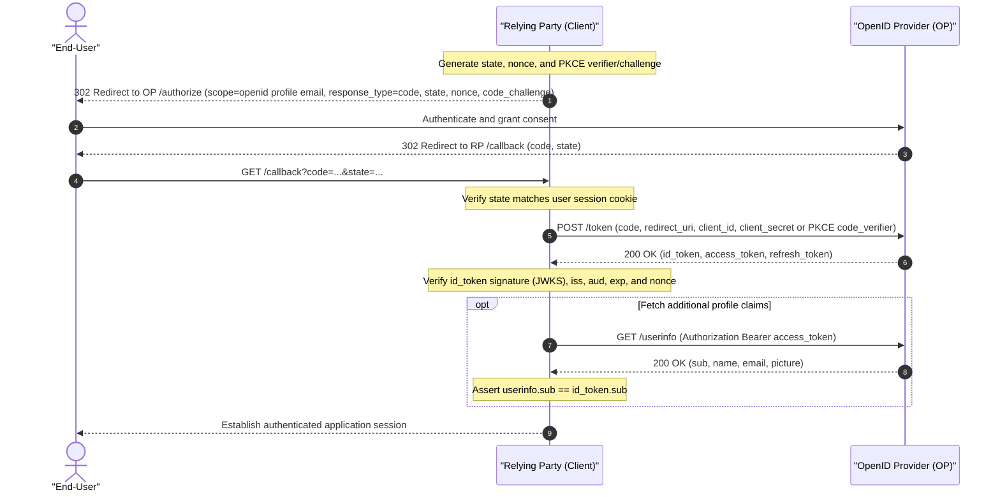
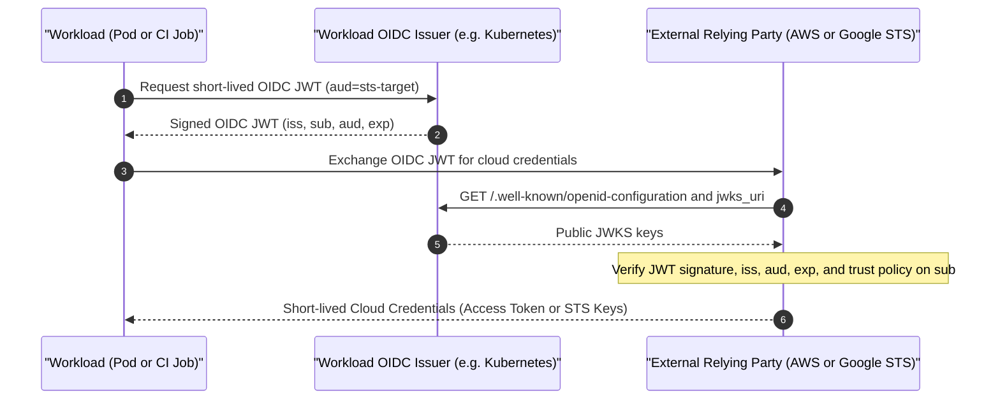

# OpenID Connect (OIDC): Identity Layer, Discovery & Workload Federation

| Metadata      | Value                      |
| ------------- | -------------------------- |
| Author        | Lyzander Marciano Andrylie |
| Creation Date | Nov 20, 2026               |
| Last Updated  | Nov 20, 2026               |

## References

- [OpenID Connect Core 1.0 Specification](https://openid.net/specs/openid-connect-core-1_0.html): Identity layer on top of OAuth 2.0, ID Token claims, authentication flows, and verification rules
- [OpenID Connect Discovery 1.0 Specification](https://openid.net/specs/openid-connect-discovery-1_0.html): Provider metadata discovery via `/.well-known/openid-configuration` and `jwks_uri`
- [RFC 6749: The OAuth 2.0 Authorization Framework](https://datatracker.ietf.org/doc/html/rfc6749): Underlying delegated authorization protocol extended by OIDC
- [RFC 7519: JSON Web Token (JWT)](https://datatracker.ietf.org/doc/html/rfc7519): Compact signed/encrypted token format used by OIDC ID Tokens
- [RFC 7517: JSON Web Key (JWK)](https://datatracker.ietf.org/doc/html/rfc7517): JSON representation of public signing keys served by JWKS endpoints
- [oauth.md](./oauth.md): OAuth 2.0 / OAuth 2.1 grant flows, PKCE, refresh token rotation, and OAuth vs OIDC comparison
- [jwt.md](./jwt.md): JWS/JWE structures, registered claims (`iss`, `sub`, `aud`, `exp`), JWKS key rotation, and JWT attack vectors
- [tls.md](./tls.md): HTTPS transport security required for OIDC discovery, token endpoints, and JWKS distribution
- [workload_identity.md](../kubernetes/workload_identity.md): Non-human OIDC federation connecting Kubernetes ServiceAccount tokens to AWS STS and Google STS

## Description

**OpenID Connect (OIDC)** is an interoperable authentication layer built directly on top of **OAuth 2.0** that enables clients to verify the identity of a user or workload and obtain standardized profile claims. It solves OAuth 2.0's lack of a standard authentication mechanism by introducing a cryptographically signed **ID Token (JWT)**, a standardized `/userinfo` endpoint, and automatic cryptographic trust discovery via `/.well-known/openid-configuration`.

## Concepts

### 1. Authentication Layer Over OAuth 2.0 & Protocol Roles

OAuth 2.0 solves **authorization** ("what can this app access?"), whereas OIDC adds **authentication** ("who is the principal?") without inventing a separate transport protocol.

- **Triggered by the `openid` Scope**: An OIDC request is an OAuth 2.0 authorization request that includes `openid` in the `scope` parameter; omitting `openid` turns the exchange into plain OAuth 2.0 with no ID Token.
- **Standard OIDC Scopes**:
  - `openid`: Mandatory; instructs the provider to issue an **ID Token**.
  - `profile`: Requests default profile claims (`name`, `family_name`, `given_name`, `picture`, `updated_at`).
  - `email`: Requests `email` and `email_verified`.
  - `address` / `phone`: Requests physical address and phone claims.
  - `offline_access`: Requests a Refresh Token for background access when the user is offline.
- **ID Token vs Access Token Boundary**:
  - The **ID Token** is intended for the **Relying Party (Client)** to establish a local session or verify principal identity.
  - The **Access Token** is intended for the **Resource Server (API)** (including `/userinfo`) to authorize API calls.

| OIDC Role                | OAuth 2.0 Equivalent | Responsibility                                                                   |
| :----------------------- | :------------------- | :------------------------------------------------------------------------------- |
| **End-User**             | Resource Owner       | Human user (or workload principal in federated M2M flows) being authenticated    |
| **Relying Party (RP)**   | Client               | Application or cloud STS relying on the provider's cryptographic identity proof  |
| **OpenID Provider (OP)** | Authorization Server | Identity provider that authenticates the principal, signs ID Tokens, serves JWKS |

> [!WARNING]
> Never send an **ID Token** as a `Bearer` credential to downstream resource APIs, and never parse an OAuth **Access Token** in a client app to infer user login state. Access Tokens are opaque to clients and targeted at resource servers (`aud = api`), while ID Tokens are targeted at the client (`aud = client_id`).

---

### 2. OIDC Discovery & JWKS Dynamic Trust Establishment

OIDC removes static key distribution by publishing provider metadata and public signing keys at deterministic HTTPS URLs derived from the **Issuer Identifier (`iss`)**.

- **Discovery Document**: Relying Parties append `/.well-known/openid-configuration` to the exact `iss` URL (removing any trailing slash) and fetch a JSON document describing all supported endpoints, algorithms, and the `jwks_uri`.
- **JWKS (`jwks_uri`)**: Serves the provider's active and recently rotated public keys as a JSON Web Key Set (`keys: [...]`), each tagged with a unique `kid` (Key ID).
- **Zero-Downtime Key Rotation**:
  1. OP publishes the new public key (`kid: "k2"`) alongside the existing key (`kid: "k1"`) in JWKS.
  2. After RP caches pick up `k2`, OP switches signing to `k2`.
  3. Once all tokens signed with `k1` have expired, OP removes `k1` from JWKS.
- **Workload Federation Subset**: Machine identity issuers such as Kubernetes (`kube-apiserver`) and GitHub Actions only need to expose `/.well-known/openid-configuration`, `jwks_uri`, and signed OIDC JWTs—no interactive `/authorize` or `/userinfo` endpoints are required for cloud STS federation.

#### Interaction



```json
{
  "issuer": "https://auth.example.com",
  "authorization_endpoint": "https://auth.example.com/authorize",
  "token_endpoint": "https://auth.example.com/oauth/token",
  "userinfo_endpoint": "https://auth.example.com/userinfo",
  "jwks_uri": "https://auth.example.com/.well-known/jwks.json",
  "response_types_supported": ["code"],
  "subject_types_supported": ["public"],
  "id_token_signing_alg_values_supported": ["RS256", "ES256"],
  "scopes_supported": ["openid", "profile", "email"]
}
```

```shell
# Inspect a live OIDC discovery document and its JWKS keys
ISSUER="https://accounts.google.com"
JWKS_URI=$(curl -fsSL "${ISSUER}/.well-known/openid-configuration" | jq -r '.jwks_uri')
curl -fsSL "$JWKS_URI" | jq '.keys[] | {kid, kty, alg, use}'
```

---

### 3. ID Token Anatomy & Claims Semantics

An **ID Token** is a security token formatted as a signed **JWT (JWS)**—or nested JWS inside JWE when confidentiality is required—containing claims about the authentication event.

- **Compound Identity Key `(iss, sub)`**: `sub` is only guaranteed to be unique within a single `iss`. Always store `(iss, sub)` as the immutable external identity key; never key accounts by `email` (emails can be recycled or changed).
- **Subject Types**:
  - `public`: Same `sub` returned to all Relying Parties for a given user.
  - `pairwise`: Distinct pseudonymous `sub` generated per RP sector identifier (e.g., Apple Sign-In) to prevent cross-site user tracking.
- **Multi-Audience Rule (`aud` & `azp`)**: If `aud` is an array containing multiple audiences, the token **must** include `azp` (Authorized Party), and the RP must verify `azp` matches its own `client_id`.
- **Cryptographic Binding Claims (`nonce`, `at_hash`, `c_hash`)**:
  - `nonce`: Client-generated random value sent on `/authorize` and echoed verbatim in the ID Token to prevent token replay attacks.
  - `at_hash` / `c_hash`: Base64URL encoding of the left-most half of the hash (using the hash from `alg`, e.g., SHA-256 for `RS256`) of the `access_token` or authorization `code`, preventing token substitution in front-channel flows.

| Claim       | Requirement | Type              | Semantics                                                            |
| :---------- | :---------- | :---------------- | :------------------------------------------------------------------- |
| `iss`       | Required    | String (URI)      | Exact Issuer Identifier URL (HTTPS, no query or fragment)            |
| `sub`       | Required    | String            | Locally unique, never-reassigned principal ID (max 255 ASCII chars)  |
| `aud`       | Required    | String or Array   | Intended recipient(s); must include the RP's `client_id` or STS URI  |
| `exp`       | Required    | Number (Unix sec) | Expiration timestamp after which the token must be rejected          |
| `iat`       | Required    | Number (Unix sec) | Timestamp when the ID Token was issued                               |
| `auth_time` | Conditional | Number (Unix sec) | When user authentication occurred (required if `max_age` requested)  |
| `nonce`     | Conditional | String            | Echoed anti-replay value binding the ID Token to the client session  |
| `azp`       | Conditional | String            | `client_id` to which the token was issued (required if multi-`aud`)  |
| `acr`/`amr` | Optional    | String / Array    | Assurance level (e.g., `urn:mace:incommon:iap:silver`) & MFA methods |

```json
{
  "iss": "https://auth.example.com",
  "sub": "usr_01J9K7M2P4Q8R5T6",
  "aud": "web-client-prod",
  "exp": 1795174800,
  "iat": 1795171200,
  "auth_time": 1795171195,
  "nonce": "n-0S6_WzA2Mj",
  "amr": ["pwd", "webauthn"],
  "email": "alice@example.com",
  "email_verified": true
}
```

---

### 4. OIDC Authentication Flows

OIDC defines three interactive browser flows based on OAuth 2.0 (`response_type`) plus a non-interactive **workload federation** pattern used by Kubernetes and CI/CD systems.

| Flow                            | `response_type`                  | Token Delivery Channel         | Recommended Use                                                         |
| :------------------------------ | :------------------------------- | :----------------------------- | :---------------------------------------------------------------------- |
| **Authorization Code (+ PKCE)** | `code`                           | Back-channel (`/token`)        | All modern web apps, SPAs (with BFF or PKCE), native mobile, CLI        |
| **Hybrid Flow**                 | `code id_token` (or `+ token`)   | Front-channel + Back-channel   | Legacy high-assurance specs (FAPI 1.0) needing early ID check; rare now |
| **Implicit Flow (Legacy)**      | `id_token` or `id_token token`   | Front-channel (`#` fragment)   | Deprecated in OAuth 2.1; leaks tokens in browser history/redirects      |
| **Workload OIDC Federation**    | None (direct platform issuance)  | Local projection / runtime API | Kubernetes Pods, GitHub Actions, GitLab CI authenticating to Cloud STS  |

#### a. Authorization Code Flow with PKCE (Interactive Login)

The standard flow for human authentication: the browser only handles a single-use authorization `code`, while tokens are exchanged over a direct back-channel HTTPS call.

- **Security Properties**: Combines `state` (CSRF protection), PKCE `code_challenge`/`code_verifier` (code interception protection), and `nonce` (ID Token replay protection).
- **Minimal Exposure**: ID Tokens, Access Tokens, and Refresh Tokens never appear in browser URLs or redirect logs.

##### Interaction



#### b. Non-Interactive Workload OIDC Federation (Machine-to-Machine)

Cloud-native workloads have no browser or human user; instead, the workload orchestrator acts as an OpenID Provider that mints short-lived, audience-scoped OIDC JWTs directly to each workload.

- **No Shared Secrets**: Replaces static API keys and OAuth `client_secret` values with asymmetric public-key cryptography (`RS256` / `ES256`).
- **Two-Step Exchange**: The workload presents its signed OIDC JWT to an external Relying Party (such as AWS STS or Google STS), which validates the JWT against the platform's public discovery/JWKS endpoint and returns short-lived cloud credentials.
- See [workload_identity.md](../kubernetes/workload_identity.md) for the full Kubernetes + AWS STS + Google STS implementation.

##### Interaction



---

### 5. ID Token Verification Checklist & `/userinfo`

Accepting an ID Token without enforcing every validation step in OpenID Connect Core §3.1.3.7 breaks authentication guarantees.

1. **Validate `iss` Against a Static Allowlist First**: Confirm the decoded `iss` matches the exact configured OpenID Provider URL **before** fetching any metadata or JWKS.
2. **Restrict Signing Algorithm (`alg`)**: Reject `"none"` and symmetric algorithms (`HS256`) unless explicitly configured with a shared `client_secret`; verify against `id_token_signing_alg_values_supported`.
3. **Verify Signature via Cached JWKS**: Match header `kid` to a public key in the issuer's cached JWKS. On a `kid` miss, rate-limit JWKS refreshes (e.g., at most once per minute) to prevent cache-miss DoS attacks.
4. **Validate `aud` (and `azp`)**: Confirm `aud` contains the exact `client_id` (or expected STS audience); if `aud` has multiple entries, confirm `azp` equals `client_id`.
5. **Validate Time Windows (`exp`, `iat`, `nbf`, `auth_time`)**: Reject expired tokens (`now > exp + skew`, with small skew leeway such as 30–60s). If `max_age` was sent, verify `now - auth_time <= max_age`.
6. **Validate `nonce`**: In interactive flows, confirm `nonce` matches the value stored in the user's pre-login session and invalidate it after single use.
7. **Cross-Check `/userinfo` Subject**: When calling `/userinfo` with the Access Token, verify the returned `sub` equals the ID Token's `sub` to detect token substitution attacks.

```shell
# Decode and inspect an OIDC JWT header and payload locally (does NOT verify signature)
TOKEN="eyJhbGciOiJSUzI1NiIsImtpZCI6ImstMSJ9.eyJpc3MiOiJodHRwczovL2F1dGguZXhhbXBsZS5jb20iLCJzdWIiOiJ1c3JfMTIzIiwiYXVkIjoid2ViLWFwcCIsImV4cCI6MTc5NTE3NDgwMH0.sig"
printf '%s\n' "$TOKEN" | cut -d'.' -f1,2 | tr '.' '\n' | while read -r part; do
  # Pad Base64URL to a multiple of 4 and translate URL-safe chars (- at end so tr treats it literally)
  pad=$(( (4 - ${#part} % 4) % 4 ))
  printf '%s%*s' "$part" "$pad" '' | tr ' _-' '=/+' | base64 -d
  printf '\n'
done | jq .
# Output:
# {
#   "alg": "RS256",
#   "kid": "k-1"
# }
# {
#   "iss": "https://auth.example.com",
#   "sub": "usr_123",
#   "aud": "web-app",
#   "exp": 1795174800
# }
```

---

### 6. Common OIDC Security Pitfalls & Mitigations

Most real-world OIDC vulnerabilities stem from trusting unverified claims, bypassing discovery constraints, or conflating identity with authorization.

| Pitfall / Attack Vector                | Failure Mechanism                                                                       | Mitigation                                                                          |
| :------------------------------------- | :-------------------------------------------------------------------------------------- | :---------------------------------------------------------------------------------- |
| **Dynamic Discovery SSRF (`iss`/`jku`)** | RP fetches `/.well-known/openid-configuration` from attacker-controlled `iss` in token  | Pin trusted `iss` URLs in config; ignore untrusted `jku`/`x5u` headers              |
| **Email-Based Account Takeover**       | App links users by `email` instead of `(iss, sub)`; attacker registers unverified email | Key users strictly by `(iss, sub)`; check `email_verified: true` for display/alerts |
| **Token Confusion (Cross-App Replay)** | RP skips `aud` check; attacker replays an ID Token issued for App A into App B          | Enforce exact `aud` match (and `azp` when multi-audience)                           |
| **ID Token Used as API Bearer Token**  | Resource server accepts ID Token instead of Access Token; lacks scopes & wrong `aud`    | Require Access Tokens at Resource Servers; keep ID Tokens inside the RP             |
| **Unbounded JWKS Refresh on `kid` Miss** | Attacker floods requests with random `kid` values, triggering outbound JWKS storms      | Cache JWKS with TTL + cooldown/single-flight lock on refresh                        |
| **Missing `nonce` / `state` Check**    | Attacker injects their own login callback (Login CSRF) or replays a captured ID Token   | Bind cryptographic `state` and `nonce` to `HttpOnly; SameSite=Lax` session cookies  |

> [!IMPORTANT]
> In multi-tenant OIDC setups (such as federated Kubernetes clusters or SaaS SSO), always validate **both** `iss` and `sub` together and apply explicit claim scoping (e.g., exact namespace and service account match) to prevent confused-deputy privilege escalation across tenants.
