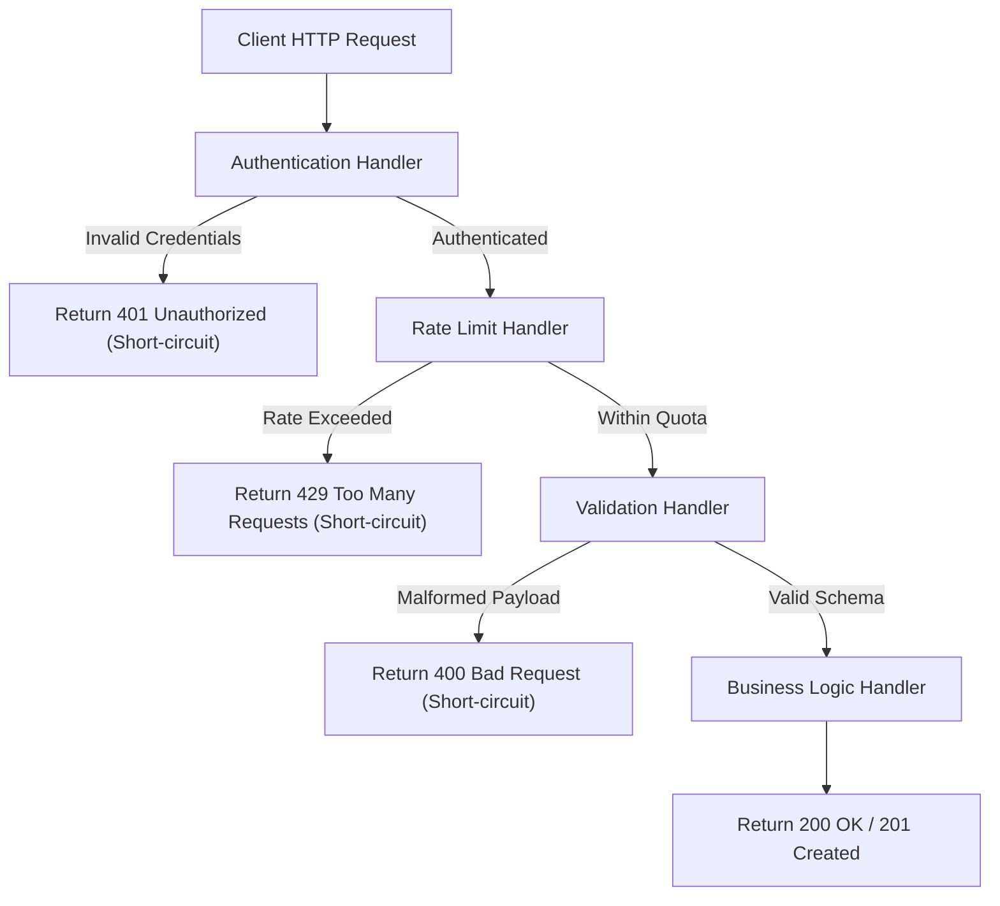
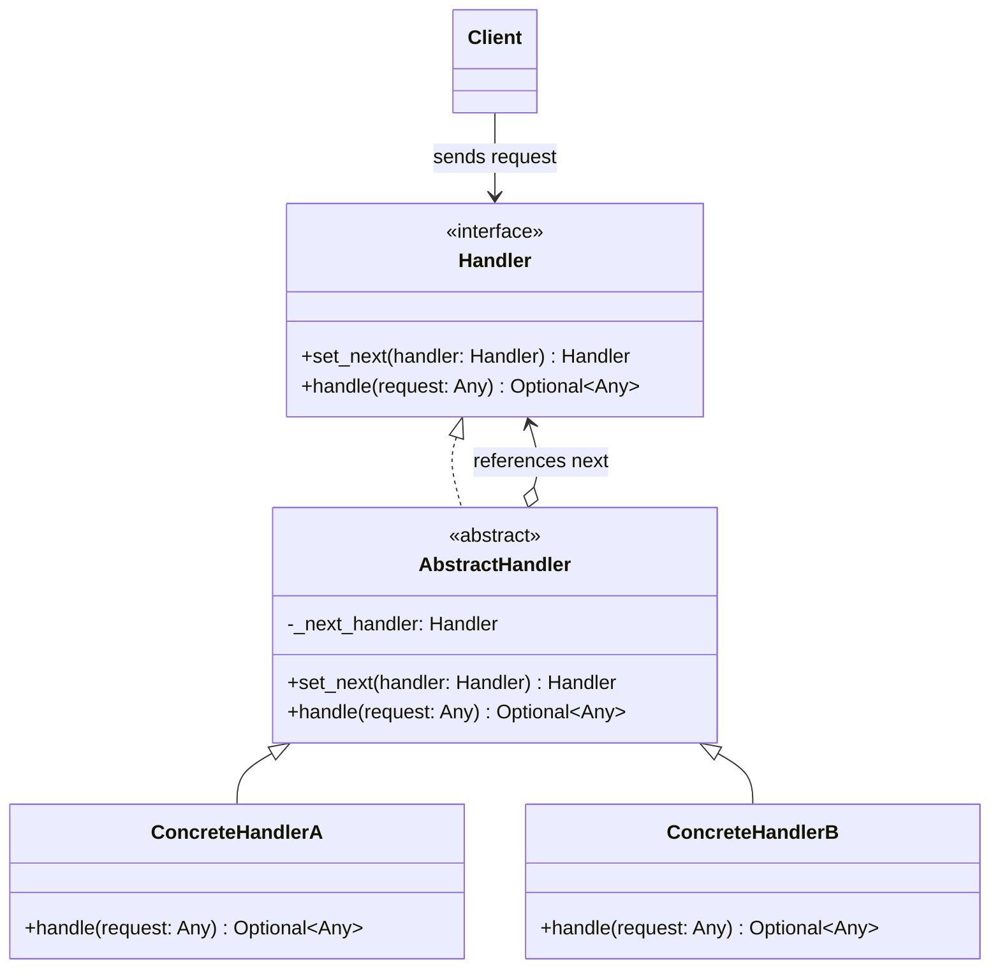

# Chain of Responsibility Design Pattern

| Metadata      | Value                      |
| ------------- | -------------------------- |
| Author        | Lyzander Marciano Andrylie |
| Creation Date | Nov 12, 2026               |
| Last Updated  | Nov 12, 2026               |

## References

- [Refactoring.Guru - Chain of Responsibility](https://refactoring.guru/design-patterns/chain-of-responsibility): Comprehensive explanation of the Chain of Responsibility pattern, intent, structure, and trade-offs
- [Refactoring.Guru - Chain of Responsibility in Python](https://refactoring.guru/design-patterns/chain-of-responsibility/python/example): Python conceptual code implementation and structure
- [design-pattern.md](../design-pattern.md): Overview of software design patterns and catalog categories
- [command.md](./command.md): Requests in a chain can be represented as Command objects
- [composite.md](../structural/composite.md): Component trees can use Chain of Responsibility to bubble events up through parent nodes
- [decorator.md](../structural/decorator.md): Similar linked structure, but Handlers in a chain can break execution at any point

## Description

The Chain of Responsibility is a behavioral design pattern that allows passing requests along a sequential chain of potential handlers. Upon receiving a request, each handler decides either to process it or pass it to the next handler in the chain, thereby decoupling sender and receiver.

## Concepts

### 1. Intent, Problem, and Solution

#### Intent

Avoid coupling the sender of a request to its receiver by giving more than one object a chance to handle the request. Sequential handlers are chained together, allowing the request to travel along the chain until an object handles it or the chain reaches its end.

#### Problem

In web services, order processing systems, and GUI frameworks, incoming requests frequently require a succession of checks or transformations before core business operations execute:

1. **Authentication**: Verify identity and session tokens.
2. **Rate Limiting**: Defend against denial-of-service abuse and brute-force traffic.
3. **Authorization**: Verify role-based access permissions.
4. **Validation & Sanitization**: Reject malformed payloads or malicious injections.
5. **Caching**: Return precomputed responses directly when available.

Implementing these checks inside a single monolithic controller leads to tightly coupled, deeply nested conditional statements (`if...else` ladders). Adding, modifying, or reordering checks requires modifying central classes, directly violating the Single Responsibility Principle and the Open/Closed Principle.

#### Solution

The Chain of Responsibility pattern decomposes each processing check into an independent object called a **Handler**:

- Each handler implements a common interface containing a processing method (e.g., `handle(request)`) and a mechanism to store a reference to the next handler.
- When a request enters the pipeline, the active handler evaluates whether it can or should process it.
- A handler can:
  - **Short-circuit**: Completely fulfill or reject the request (e.g., returning an HTTP 401 or 429 response) and stop further chain progression.
  - **Pass through**: Perform non-terminal operations (e.g., logging, validation) and forward the request to the next handler in line.

#### Applicability

- When a system must process multiple types of requests in diverse ways, but the exact request varieties and sequence cannot be determined statically.
- When an operation must execute several handlers in a precise sequence with short-circuit capability.
- When the set of handlers and their execution order should be configured or modified dynamically at runtime.

#### Trade-offs and Comparisons

| Benefit (Pros)                                                                                                                                  | Trade-off (Cons)                                                                                                                                       |
| :---------------------------------------------------------------------------------------------------------------------------------------------- | :----------------------------------------------------------------------------------------------------------------------------------------------------- |
| **Controlled Execution Order**: Handlers can be rearranged, appended, or removed at runtime without altering client logic.                      | **Unprocessed Requests**: Requests may traverse the entire chain without being handled if no handler claims responsibility and no fallback is defined. |
| **Single Responsibility Principle (SRP)**: Each handler focuses solely on a single task (e.g., authentication, rate-limiting, or validation).   | **Debugging Complexity**: Tracing request progression through deep chains can complicate runtime debugging and stack trace analysis.                   |
| **Open/Closed Principle (OCP)**: New handlers can be introduced into the pipeline without modifying existing handler or client implementations. | **Latency Overhead**: Extremely deep chains can add cumulative call-stack overhead and memory overhead.                                                |

#### Interaction



---

### 2. Structure and Components

The pattern separates request handling into standard components that form a linked pipeline.

| Component                             | Type           | Responsibility                                                                                                                         |
| :------------------------------------ | :------------- | :------------------------------------------------------------------------------------------------------------------------------------- |
| **`Handler`**                         | Interface      | Declares the common interface for configuring the chain (`set_next`) and executing requests (`handle`).                                |
| **`BaseHandler` / `AbstractHandler`** | Abstract Class | Implements default chaining logic, stores the `_next_handler` reference, and forwards unhandled requests down the chain.               |
| **`ConcreteHandler`**                 | Concrete Class | Implements specific request-handling logic. Determines whether to process the request, stop execution, or forward to the next handler. |
| **`Client`**                          | Caller         | Composes chains dynamically (e.g., `h1.set_next(h2).set_next(h3)`) and submits requests to the head of the chain.                      |

- **`Handler` (Interface)**: Defines the common contract for all concrete handlers. Typically includes `set_next(handler)` to establish links and `handle(request)` to process or pass requests.
- **`BaseHandler` / `AbstractHandler` (Optional Base)**: Centralizes boilerplate code. It maintains a private `_next_handler` attribute and provides a default `handle(request)` implementation that forwards requests to `_next_handler` when not handled locally. Returning `handler` from `set_next()` enables fluent builder-style chaining.
- **`ConcreteHandlers`**: Subclasses containing the business rules. Each concrete handler inspects the incoming request; if it can satisfy the request, it handles it, or alternatively decorates the request and invokes `super().handle(request)`.
- **`Client`**: Assembles the pipeline by linking handlers in the desired sequence. The client code interacts solely with the `Handler` interface, remaining agnostic to the concrete classes in the chain.

#### Interaction



---

### 3. Python Implementation

#### a. Conceptual Structure Example

The conceptual example implements a chain of animal handlers (`MonkeyHandler`, `SquirrelHandler`, `DogHandler`), each configured to consume a specific food item:

- **`Handler`**: Defines abstract methods `set_next` and `handle`.
- **`AbstractHandler`**: Holds `_next_handler` and defaults to forwarding requests to the next link.
- **`MonkeyHandler`**: Handles `"Banana"`; passes everything else to the next handler.
- **`SquirrelHandler`**: Handles `"Nut"`; passes everything else to the next handler.
- **`DogHandler`**: Handles `"Meatball"`; passes everything else to the next handler.
- **`client_code`**: Iterates through test requests against any handler or subchain.

```python
from __future__ import annotations
from abc import ABC, abstractmethod
from typing import Any, Optional


class Handler(ABC):
    """
    The Handler interface declares a method for building the chain of handlers.
    It also declares a method for executing a request.
    """

    @abstractmethod
    def set_next(self, handler: Handler) -> Handler:
        pass

    @abstractmethod
    def handle(self, request: Any) -> Optional[str]:
        pass


class AbstractHandler(Handler):
    """
    The default chaining behavior can be implemented inside a base handler class.
    """

    _next_handler: Optional[Handler] = None

    def set_next(self, handler: Handler) -> Handler:
        self._next_handler = handler
        # Returning a handler from here enables fluent chaining:
        # monkey.set_next(squirrel).set_next(dog)
        return handler

    @abstractmethod
    def handle(self, request: Any) -> Optional[str]:
        if self._next_handler:
            return self._next_handler.handle(request)
        return None


class MonkeyHandler(AbstractHandler):
    def handle(self, request: Any) -> Optional[str]:
        if request == "Banana":
            return f"Monkey: I will eat the {request}"
        return super().handle(request)


class SquirrelHandler(AbstractHandler):
    def handle(self, request: Any) -> Optional[str]:
        if request == "Nut":
            return f"Squirrel: I will eat the {request}"
        return super().handle(request)


class DogHandler(AbstractHandler):
    def handle(self, request: Any) -> Optional[str]:
        if request == "Meatball":
            return f"Dog: I will eat the {request}"
        return super().handle(request)


def client_code(handler: Handler) -> None:
    """
    The client code sends requests to a handler. In most cases, it is unaware
    that the handler is part of a larger chain.
    """
    for food in ["Nut", "Banana", "Cup of coffee"]:
        print(f"\nClient: Who wants a {food}?")
        result = handler.handle(food)
        if result:
            print(f"  {result}")
        else:
            print(f"  {food} was left untouched.")


if __name__ == "__main__":
    monkey = MonkeyHandler()
    squirrel = SquirrelHandler()
    dog = DogHandler()

    # Assemble the full chain: Monkey -> Squirrel -> Dog
    monkey.set_next(squirrel).set_next(dog)

    print("--- Chain: Monkey > Squirrel > Dog ---")
    client_code(monkey)
    # Output:
    # --- Chain: Monkey > Squirrel > Dog ---
    #
    # Client: Who wants a Nut?
    #   Squirrel: I will eat the Nut
    #
    # Client: Who wants a Banana?
    #   Monkey: I will eat the Banana
    #
    # Client: Who wants a Cup of coffee?
    #   Cup of coffee was left untouched.

    print("\n--- Subchain: Squirrel > Dog ---")
    client_code(squirrel)
    # Output:
    # --- Subchain: Squirrel > Dog ---
    #
    # Client: Who wants a Nut?
    #   Squirrel: I will eat the Nut
    #
    # Client: Who wants a Banana?
    #   Banana was left untouched.
    #
    # Client: Who wants a Cup of coffee?
    #   Cup of coffee was left untouched.
```

#### b. Practical Real-World Example

This practical example models an HTTP request processing pipeline using Chain of Responsibility middleware:

- **`HttpRequest` and `HttpResponse`**: Strongly-typed data structures for network request attributes and response payloads.
- **`MiddlewareHandler`**: Abstract base handler providing the chaining mechanism (`set_next`) and chain delegation.
- **`AuthHandler`**: Inspects the `Authorization` header. Rejects unauthenticated requests with `401 Unauthorized` or forwards valid tokens.
- **`RateLimitHandler`**: Tracks per-IP request frequency. Rejects excess requests with `429 Too Many Requests` when limits are exceeded.
- **`ValidationHandler`**: Validates request body schema. Rejects invalid or missing fields with `400 Bad Request`.
- **`OrderProcessingHandler`**: Terminal business logic handler that commits the order and returns `201 Created`.

```python
from __future__ import annotations
from abc import ABC, abstractmethod
from dataclasses import dataclass, field
from typing import Any, Dict, Optional


@dataclass
class HttpRequest:
    path: str
    method: str
    headers: Dict[str, str] = field(default_factory=dict)
    body: Dict[str, Any] = field(default_factory=dict)


@dataclass
class HttpResponse:
    status_code: int
    message: str
    data: Optional[Dict[str, Any]] = None


class MiddlewareHandler(ABC):
    """
    Abstract Base Handler for the HTTP middleware pipeline.
    """

    def __init__(self) -> None:
        self._next_handler: Optional[MiddlewareHandler] = None

    def set_next(self, handler: MiddlewareHandler) -> MiddlewareHandler:
        self._next_handler = handler
        return handler

    @abstractmethod
    def handle(self, request: HttpRequest) -> HttpResponse:
        if self._next_handler:
            return self._next_handler.handle(request)
        return HttpResponse(status_code=200, message="OK", data=request.body)


class AuthHandler(MiddlewareHandler):
    """
    Verifies that the request contains a valid bearer token.
    """

    def handle(self, request: HttpRequest) -> HttpResponse:
        token = request.headers.get("Authorization")
        if not token or token != "Bearer secret-token":
            print("[AuthHandler] Failed: Missing or invalid Authorization token.")
            return HttpResponse(status_code=401, message="Unauthorized")

        print("[AuthHandler] Passed: Authentication successful.")
        return super().handle(request)


class RateLimitHandler(MiddlewareHandler):
    """
    Enforces per-client IP rate limits to protect backend resources.
    """

    def __init__(self, max_requests: int = 5) -> None:
        super().__init__()
        self._max_requests = max_requests
        self._request_counts: Dict[str, int] = {}

    def handle(self, request: HttpRequest) -> HttpResponse:
        client_ip = request.headers.get("X-Forwarded-For", "127.0.0.1")
        current_count = self._request_counts.get(client_ip, 0)

        if current_count >= self._max_requests:
            print(f"[RateLimitHandler] Failed: Rate limit exceeded for IP {client_ip}.")
            return HttpResponse(status_code=429, message="Too Many Requests")

        self._request_counts[client_ip] = current_count + 1
        print(
            f"[RateLimitHandler] Passed: Request count {self._request_counts[client_ip]}/{self._max_requests} for IP {client_ip}."
        )
        return super().handle(request)


class ValidationHandler(MiddlewareHandler):
    """
    Validates required payload fields for state-modifying HTTP methods.
    """

    def handle(self, request: HttpRequest) -> HttpResponse:
        if request.method in ("POST", "PUT"):
            if not request.body or "email" not in request.body:
                print("[ValidationHandler] Failed: Missing required payload field: email.")
                return HttpResponse(status_code=400, message="Bad Request: Missing email field")

        print("[ValidationHandler] Passed: Payload schema is valid.")
        return super().handle(request)


class OrderProcessingHandler(MiddlewareHandler):
    """
    Terminal Handler: Executes core business logic once all middleware passes.
    """

    def handle(self, request: HttpRequest) -> HttpResponse:
        email = request.body.get("email")
        print(f"[OrderProcessingHandler] Success: Processing order for {email}.")
        return HttpResponse(
            status_code=201,
            message="Order Created Successfully",
            data={"order_id": 1001, "email": email},
        )


if __name__ == "__main__":
    # Assemble the middleware pipeline:
    # AuthHandler -> RateLimitHandler -> ValidationHandler -> OrderProcessingHandler
    auth = AuthHandler()
    rate_limiter = RateLimitHandler(max_requests=2)
    validator = ValidationHandler()
    order_processor = OrderProcessingHandler()

    auth.set_next(rate_limiter).set_next(validator).set_next(order_processor)

    # Test 1: Missing authentication token (short-circuits at AuthHandler)
    print("--- Test 1: Missing Token ---")
    req1 = HttpRequest(
        path="/orders",
        method="POST",
        headers={},
        body={"email": "alice@example.com"},
    )
    res1 = auth.handle(req1)
    print(f"Result: {res1.status_code} - {res1.message}\n")
    # Output:
    # --- Test 1: Missing Token ---
    # [AuthHandler] Failed: Missing or invalid Authorization token.
    # Result: 401 - Unauthorized

    # Test 2: Valid authenticated request (passes through entire pipeline)
    print("--- Test 2: Valid Request ---")
    req2 = HttpRequest(
        path="/orders",
        method="POST",
        headers={"Authorization": "Bearer secret-token", "X-Forwarded-For": "192.168.1.10"},
        body={"email": "alice@example.com"},
    )
    res2 = auth.handle(req2)
    print(f"Result: {res2.status_code} - {res2.message} (Data: {res2.data})\n")
    # Output:
    # --- Test 2: Valid Request ---
    # [AuthHandler] Passed: Authentication successful.
    # [RateLimitHandler] Passed: Request count 1/2 for IP 192.168.1.10.
    # [ValidationHandler] Passed: Payload schema is valid.
    # [OrderProcessingHandler] Success: Processing order for alice@example.com.
    # Result: 201 - Order Created Successfully (Data: {'order_id': 1001, 'email': 'alice@example.com'})

    # Test 3: Invalid payload schema (short-circuits at ValidationHandler)
    print("--- Test 3: Invalid Payload ---")
    req3 = HttpRequest(
        path="/orders",
        method="POST",
        headers={"Authorization": "Bearer secret-token", "X-Forwarded-For": "192.168.1.10"},
        body={"username": "bob"},
    )
    res3 = auth.handle(req3)
    print(f"Result: {res3.status_code} - {res3.message}\n")
    # Output:
    # --- Test 3: Invalid Payload ---
    # [AuthHandler] Passed: Authentication successful.
    # [RateLimitHandler] Passed: Request count 2/2 for IP 192.168.1.10.
    # [ValidationHandler] Failed: Missing required payload field: email.
    # Result: 400 - Bad Request: Missing email field

    # Test 4: Rate limit exceeded (short-circuits at RateLimitHandler)
    print("--- Test 4: Rate Limit Exceeded ---")
    req4 = HttpRequest(
        path="/orders",
        method="POST",
        headers={"Authorization": "Bearer secret-token", "X-Forwarded-For": "192.168.1.10"},
        body={"email": "charlie@example.com"},
    )
    res4 = auth.handle(req4)
    print(f"Result: {res4.status_code} - {res4.message}\n")
    # Output:
    # --- Test 4: Rate Limit Exceeded ---
    # [AuthHandler] Passed: Authentication successful.
    # [RateLimitHandler] Failed: Rate limit exceeded for IP 192.168.1.10.
    # Result: 429 - Too Many Requests
```
