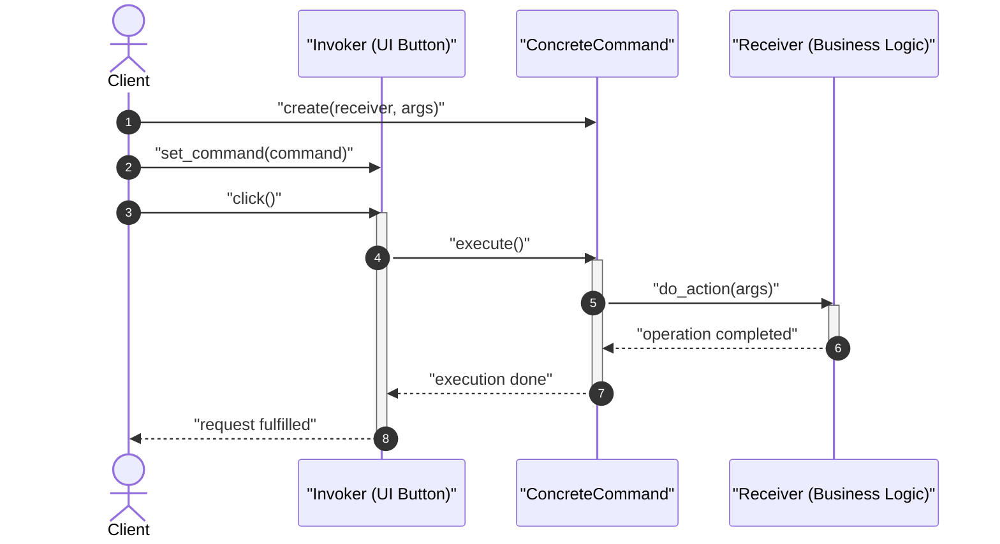
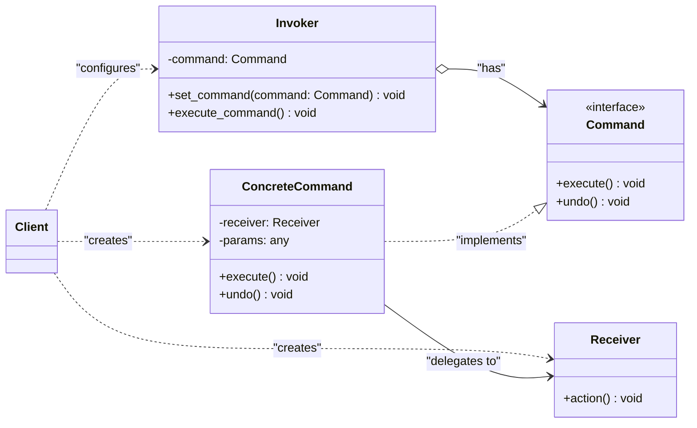

# Command Design Pattern

| Metadata      | Value                      |
| ------------- | -------------------------- |
| Author        | Lyzander Marciano Andrylie |
| Creation Date | Nov 12, 2026               |
| Last Updated  | Nov 12, 2026               |

## References

- [Refactoring Guru: Command Pattern](https://refactoring.guru/design-patterns/command): Architectural overview, motivation, and structural design of the Command pattern
- [Refactoring Guru: Command in Python](https://refactoring.guru/design-patterns/command/python/example): Canonical Python code examples and implementation details
- [design-pattern.md](../design-pattern.md): Overview of software design patterns and catalog categories
- [chain_of_responsibility.md](./chain_of_responsibility.md): Handlers can process incoming requests packaged as Command objects
- [memento.md](./memento.md): Often paired with Command to implement reversible undo/redo history
- [strategy.md](./strategy.md): Parameterizes an object with an algorithm rather than encapsulating an operation invocation

## Description

**Command** is a behavioral design pattern that turns a request into a stand-alone object containing all information about the request. By encapsulating an action as an object, it decouples the sender (invoker) triggering an operation from the receiver performing the actual work, enabling parameterization, delayed execution, queuing, and reversible undo/redo operations.

## Concepts

### 1. Intent, Problem, and Solution

- **Intent**: Encapsulate a request as an object, thereby letting you parameterize clients with different requests, queue or log requests, and support undoable operations.
- **Problem**:
  - In user interface frameworks and distributed request dispatchers, invokers such as UI buttons, menu items, toolbar icons, and keyboard shortcuts need to trigger business logic.
  - Tightly coupling every button or menu item directly to backend business logic classes produces rigid code and prevents reuse.
  - Subclassing base button components for every action (e.g., `SaveButton`, `PrintButton`, `CopyButton`) results in severe class explosion and duplicated logic when multiple UI controls invoke the same action (such as pressing `Ctrl+S` or clicking "Save").
  - Furthermore, tracking command histories, queuing background tasks, and implementing reversible undo/redo workflows becomes unmaintainable without an isolated abstraction for each operation.
- **Solution**:
  - Extract all request details—the receiver object, method name, and arguments—into a separate command class implementing a uniform interface (typically `execute()` and optionally `undo()`).
  - The invoker (e.g., a button or scheduler) keeps a reference to the `Command` interface rather than a concrete business service. When an event fires, the invoker simply triggers `command.execute()`.
  - The receiver remains decoupled from the caller, while client code can dynamically reconfigure, queue, log, or swap commands at runtime.
- **Applicability**:
  - **Undo / Redo Functionality**: Commands store previous state or reversible actions, allowing an execution history stack to roll back operations sequentially.
  - **Task Queuing & Deferred Execution**: Encapsulated command objects can be serialized, scheduled, and transferred across network boundaries or thread pools.
  - **Macro Recording & Scripting**: Multiple commands can be collected into composite commands to record and replay sequences of actions.
  - **Decoupled User Interfaces**: GUI components trigger operations without depending on specific domain models or services.
- **Trade-offs**:

| Advantages (Pros)                                                                                             | Disadvantages (Cons)                                                                                 |
| :------------------------------------------------------------------------------------------------------------ | :--------------------------------------------------------------------------------------------------- |
| **Single Responsibility Principle**: Decouples classes that invoke operations from classes that execute them. | **Class Proliferation**: Introduces multiple additional command classes, increasing codebase volume. |
| **Open/Closed Principle**: New commands can be added without altering existing client or invoker code.        | **Architectural Overhead**: Can add unnecessary abstraction layers for simple direct invocations.    |
| **Undo / Redo Support**: Storing executed commands enables structured state reversal and history replay.      |                                                                                                      |
| **Queuing & Scheduling**: Commands can be easily prioritized, deferred, logged, or executed asynchronously.   |                                                                                                      |
| **Composite Macros**: Simple commands can be assembled into complex composite operations.                     |                                                                                                      |

#### Interaction



### 2. Structure and Components

The Command pattern organizes responsibilities across five distinct participants:

| Component                | Role                  | Description                                                                                             |
| :----------------------- | :-------------------- | :------------------------------------------------------------------------------------------------------ |
| **`Client`**             | Setup & Configuration | Instantiates receivers and concrete commands, linking each command to its receiver and invoker.         |
| **`Invoker` / `Sender`** | Execution Trigger     | Stores a reference to a `Command` object and calls its `execute()` method when an event occurs.         |
| **`Command`**            | Abstraction Interface | Defines the uniform interface for executing operations (typically `execute()` and `undo()`).            |
| **`ConcreteCommand`**    | Request Binding       | Implements `Command`, storing arguments and receiver references, delegating the action to the receiver. |
| **`Receiver`**           | Business Logic        | Performs the actual domain logic required to fulfill the request.                                       |

- **`Client`**: Configures the dependency graph by creating the target `Receiver`, constructing the `ConcreteCommand` with parameters, and assigning it to the `Invoker`.
- **`Invoker` (or `Sender`)**: Does not know what the command does or which receiver will handle it; it only invokes `execute()` when triggered by user input, timers, or events.
- **`Command`**: An abstract interface that decouples the invoker from the execution logic, ensuring all commands are interchangeable.
- **`ConcreteCommand`**: Acts as a bridge. When `execute()` is called, it translates the call into one or more method invocations on its encapsulated receiver.
- **`Receiver`**: Contains the actual business logic (e.g., database writes, file manipulations, audio rendering). Any class can serve as a receiver.

#### Interaction



### 3. Python Implementation

#### a. Conceptual Structure Example

The following example illustrates the base mechanics of the Command pattern:

- **`Command`**: Abstract base class declaring the standard `execute()` interface.
- **`SimpleCommand`**: Standalone command that performs a self-contained action without requiring a separate receiver.
- **`Receiver`**: Service class containing specialized business logic.
- **`ComplexCommand`**: Command that accepts a `Receiver` and payload parameters, delegating multi-step execution to the receiver.
- **`Invoker`**: Coordinates pre-execution and post-execution hooks via commands without coupling to concrete implementations.

```python
from __future__ import annotations
from abc import ABC, abstractmethod


class Command(ABC):
    """Abstract Command interface declaring execute method."""

    @abstractmethod
    def execute(self) -> None:
        pass


class SimpleCommand(Command):
    """Executes a simple operation directly without delegating to a receiver."""

    def __init__(self, payload: str) -> None:
        self._payload = payload

    def execute(self) -> None:
        print(f"SimpleCommand: Handling self-contained task ({self._payload})")


class Receiver:
    """Contains domain-specific business logic."""

    def do_action(self, task: str) -> None:
        print(f"Receiver: Executing task '{task}'")

    def do_another_action(self, detail: str) -> None:
        print(f"Receiver: Executing secondary task '{detail}'")


class ComplexCommand(Command):
    """Delegates complex operations to one or more receiver objects."""

    def __init__(self, receiver: Receiver, task: str, detail: str) -> None:
        self._receiver = receiver
        self._task = task
        self._detail = detail

    def execute(self) -> None:
        print("ComplexCommand: Delegating work to Receiver...")
        self._receiver.do_action(self._task)
        self._receiver.do_another_action(self._detail)


class Invoker:
    """Triggers commands without knowing concrete command or receiver details."""

    def __init__(self) -> None:
        self._on_start: Command | None = None
        self._on_finish: Command | None = None

    def set_on_start(self, command: Command) -> None:
        self._on_start = command

    def set_on_finish(self, command: Command) -> None:
        self._on_finish = command

    def execute_operation(self) -> None:
        print("Invoker: Initializing operation sequence...")
        if self._on_start:
            self._on_start.execute()

        print("Invoker: Performing core internal workload...")

        if self._on_finish:
            self._on_finish.execute()
        print("Invoker: Operation sequence complete.")


if __name__ == "__main__":
    invoker = Invoker()
    invoker.set_on_start(SimpleCommand("System Check"))

    receiver = Receiver()
    invoker.set_on_finish(ComplexCommand(receiver, "Generate Report", "Save to S3"))

    invoker.execute_operation()

# Output:
# Invoker: Initializing operation sequence...
# SimpleCommand: Handling self-contained task (System Check)
# Invoker: Performing core internal workload...
# ComplexCommand: Delegating work to Receiver...
# Receiver: Executing task 'Generate Report'
# Receiver: Executing secondary task 'Save to S3'
# Invoker: Operation sequence complete.
```

#### b. Practical Real-World Example

In real-world applications such as text editors, graphic design software, and IDEs, commands encapsulate reversible actions to provide multi-level undo and redo:

- **`Document` (`Receiver`)**: Maintains the document text buffer and handles insertion and deletion.
- **`Command` (`Interface`)**: Declares `execute()` and `undo()` signatures.
- **`InsertTextCommand` (`ConcreteCommand`)**: Inserts characters at a target position and removes them upon undo.
- **`DeleteTextCommand` (`ConcreteCommand`)**: Removes characters while caching deleted content to restore it on undo.
- **`CommandHistory`**: Manages undo and redo stacks.
- **`TextEditor` (`Invoker` / `Client`)**: Exposes user-facing actions, creating commands and passing them to the history manager.

```python
from __future__ import annotations
from abc import ABC, abstractmethod


class Document:
    """Receiver: Manages the document buffer and content modifications."""

    def __init__(self) -> None:
        self._text: str = ""

    def insert(self, position: int, text: str) -> None:
        self._text = self._text[:position] + text + self._text[position:]

    def delete(self, position: int, length: int) -> str:
        deleted = self._text[position:position + length]
        self._text = self._text[:position] + self._text[position + length:]
        return deleted

    def get_content(self) -> str:
        return self._text


class Command(ABC):
    """Command Interface declaring execute and undo methods."""

    @abstractmethod
    def execute(self) -> None:
        pass

    @abstractmethod
    def undo(self) -> None:
        pass


class InsertTextCommand(Command):
    """ConcreteCommand: Inserts text and tracks state for reversal."""

    def __init__(self, doc: Document, position: int, text: str) -> None:
        self._doc = doc
        self._position = position
        self._text = text

    def execute(self) -> None:
        self._doc.insert(self._position, self._text)

    def undo(self) -> None:
        self._doc.delete(self._position, len(self._text))


class DeleteTextCommand(Command):
    """ConcreteCommand: Deletes text and caches removed characters for restoration."""

    def __init__(self, doc: Document, position: int, length: int) -> None:
        self._doc = doc
        self._position = position
        self._length = length
        self._deleted_text: str = ""

    def execute(self) -> None:
        self._deleted_text = self._doc.delete(self._position, self._length)

    def undo(self) -> None:
        self._doc.insert(self._position, self._deleted_text)


class CommandHistory:
    """Manages undo and redo history stacks."""

    def __init__(self) -> None:
        self._undo_stack: list[Command] = []
        self._redo_stack: list[Command] = []

    def execute(self, command: Command) -> None:
        command.execute()
        self._undo_stack.append(command)
        self._redo_stack.clear()

    def undo(self) -> bool:
        if not self._undo_stack:
            return False
        cmd = self._undo_stack.pop()
        cmd.undo()
        self._redo_stack.append(cmd)
        return True

    def redo(self) -> bool:
        if not self._redo_stack:
            return False
        cmd = self._redo_stack.pop()
        cmd.execute()
        self._undo_stack.append(cmd)
        return True


class TextEditor:
    """Invoker / Client: Dispatches editing operations through commands."""

    def __init__(self) -> None:
        self._doc = Document()
        self._history = CommandHistory()

    def type_text(self, text: str) -> None:
        position = len(self._doc.get_content())
        cmd = InsertTextCommand(self._doc, position, text)
        self._history.execute(cmd)

    def delete_chars(self, length: int) -> None:
        position = max(0, len(self._doc.get_content()) - length)
        cmd = DeleteTextCommand(self._doc, position, length)
        self._history.execute(cmd)

    def undo(self) -> None:
        self._history.undo()

    def redo(self) -> None:
        self._history.redo()

    def display(self) -> None:
        print(f'Document Content: "{self._doc.get_content()}"')


if __name__ == "__main__":
    editor = TextEditor()

    editor.type_text("Hello")
    editor.type_text(", World!")
    editor.display()

    editor.delete_chars(8)
    editor.display()

    print("Action: Undo deletion")
    editor.undo()
    editor.display()

    print("Action: Undo typing")
    editor.undo()
    editor.display()

    print("Action: Redo typing")
    editor.redo()
    editor.display()

# Output:
# Document Content: "Hello, World!"
# Document Content: "Hello"
# Action: Undo deletion
# Document Content: "Hello, World!"
# Action: Undo typing
# Document Content: "Hello"
# Action: Redo typing
# Document Content: "Hello, World!"
```
