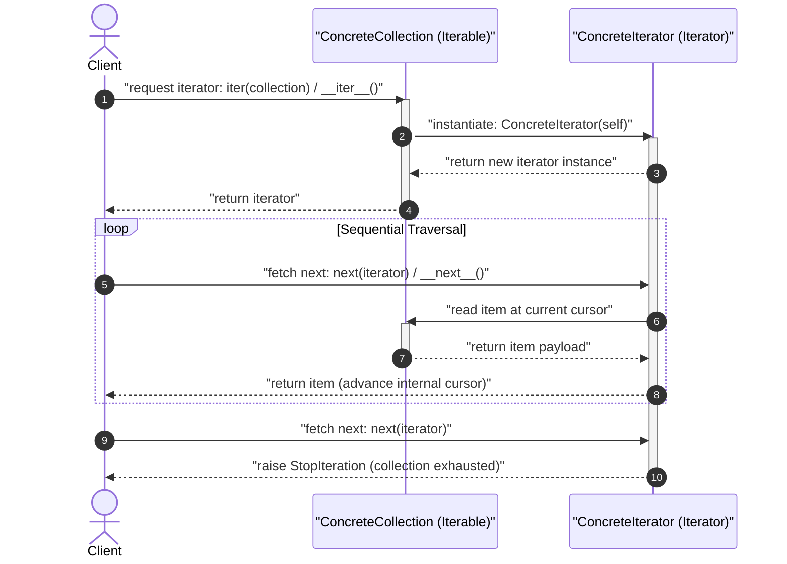
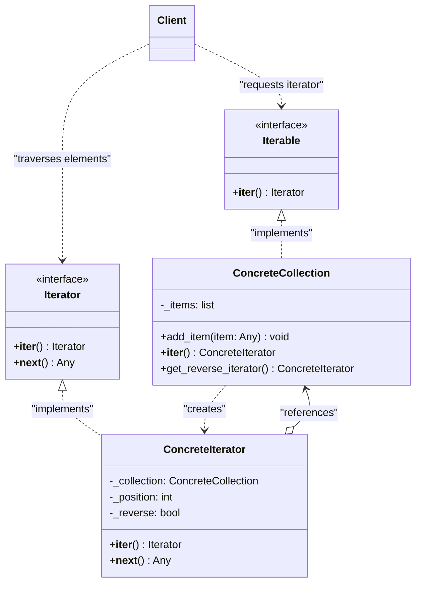

# Iterator Design Pattern

| Metadata      | Value                      |
| ------------- | -------------------------- |
| Author        | Lyzander Marciano Andrylie |
| Creation Date | Nov 12, 2026               |
| Last Updated  | Nov 12, 2026               |

## References

- [Refactoring Guru: Iterator Pattern](https://refactoring.guru/design-patterns/iterator): Architectural overview, motivation, and structural design of the Iterator pattern
- [Refactoring Guru: Iterator in Python](https://refactoring.guru/design-patterns/iterator/python/example): Canonical Python code examples and implementation details using `collections.abc`
- [design-pattern.md](../design-pattern.md): Overview of software design patterns and catalog categories
- [composite.md](../structural/composite.md): Iterators are frequently used to traverse recursive Composite trees
- [factory_method.md](../creational/factory_method.md): Collections use factory methods (`__iter__`) to return compatible Iterator instances
- [visitor.md](./visitor.md): Can work alongside Iterator to execute operations on elements of heterogeneous collections

## Description

The **Iterator** is a behavioral design pattern that lets you traverse elements of a collection without exposing its underlying internal representation (such as lists, stacks, trees, or graphs). By extracting traversal mechanics and cursor state into dedicated iterator objects, it decouples algorithms from data structures and enables multiple independent traversals simultaneously.

## Concepts

### 1. Intent, Problem, and Solution

- **Intent**: Provide a way to access the elements of an aggregate object sequentially without exposing its underlying representation.
- **Problem**:
  - Collections in software applications store items in many diverse structures: contiguous arrays, linked lists, hash tables, trees, or cyclic graphs.
  - Exposing the internal structure forces client code to couple tightly with specific storage layouts (e.g., using integer indexing `collection[i]` vs. pointer traversal `node.next` vs. recursive tree traversal `node.left` / `node.right`).
  - If the collection changes its internal data structure (such as migrating from an array to a balanced binary search tree), every client traversal loop breaks.
  - Adding traversal algorithms (such as breadth-first search, depth-first search, forward, or reverse traversal) directly into the collection class clutters its primary responsibility (data storage and mutation), violating the **Single Responsibility Principle (SRP)**.
  - Storing traversal state (such as cursor offset or pointer) inside the collection class prevents multiple clients or threads from iterating over the same collection concurrently, as they would overwrite each other's cursor positions.
- **Solution**:
  - Extract the traversal behavior and cursor state into a separate object called an **Iterator**.
  - In Python, this is standardized through abstract base classes in the `collections.abc` module:
    - **`Iterable`**: Any collection class implementing `__iter__()` that acts as a factory returning a new `Iterator` instance.
    - **`Iterator`**: Any iterator class implementing `__next__()` to fetch elements sequentially and raising `StopIteration` upon exhaustion (and returning `self` for `__iter__()`).
  - By isolating traversal state in the iterator, the collection class remains clean and focused solely on storage, while multiple iterators can traverse the same collection independently, simultaneously, and in different directions.
- **Applicability**:
  - **Complex Data Structures**: When a collection has a complex internal structure (trees, graphs, nested tables) and you want to hide the structural complexity from clients.
  - **Multiple Traversal Algorithms**: When the same underlying collection needs multiple navigation strategies (e.g., in-order, pre-order, reverse, or priority-filtered).
  - **Uniform Traversal Interface**: When client code needs to iterate over different, unknown data structures polymorphically through a standardized protocol (`for item in collection`).
  - **Memory Efficiency / Lazy Loading**: When collections represent unbounded streams, large paginated database queries, or remote API endpoints where items must be fetched lazily on demand.
- **Trade-offs**:

| Advantages (Pros)                                                                                                           | Disadvantages (Cons)                                                                                                       |
| :-------------------------------------------------------------------------------------------------------------------------- | :------------------------------------------------------------------------------------------------------------------------- |
| **Single Responsibility Principle**: Moves bulky traversal algorithms and cursor state into iterator classes.               | **Overkill for Simple Collections**: Unnecessary abstraction layer if only using standard arrays or lists.                 |
| **Open/Closed Principle**: New collections and traversal algorithms can be added without modifying existing code.           | **Minor Performance Overhead**: Calling `__next__()` indirection can add slight overhead over raw indexing in tight loops. |
| **Parallel Iteration**: Multiple iterators can navigate the same collection concurrently without state conflicts.           |                                                                                                                            |
| **Clean Polymorphic Interface**: Clients interact exclusively through standard iterator protocols (`__iter__`, `__next__`). |                                                                                                                            |
| **Lazy Evaluation**: Can consume infinite sequences or paginated remote data streams on demand without high memory usage.   |                                                                                                                            |

#### Interaction



### 2. Structure and Components

The Iterator pattern organizes responsibilities across five distinct participants:

| Component                             | Role                     | Description                                                                                                                              |
| :------------------------------------ | :----------------------- | :--------------------------------------------------------------------------------------------------------------------------------------- |
| **`Iterator`**                        | Abstraction Interface    | Declares the operations required for traversing a collection (in Python, `__next__()` and `__iter__()`).                                 |
| **`ConcreteIterator`**                | Traversal Implementation | Implements the traversal algorithm, maintains cursor state, checks boundaries, and retrieves data from the collection.                   |
| **`IterableCollection` (`Iterable`)** | Aggregate Interface      | Declares the factory method (in Python, `__iter__()`) to produce an iterator compatible with the collection.                             |
| **`ConcreteCollection`**              | Aggregate Implementation | Stores the actual data elements and implements `__iter__()` to return fresh instances of `ConcreteIterator`.                             |
| **`Client`**                          | Consumer                 | Consumes collections and iterators exclusively through standard interfaces, remaining completely decoupled from data storage structures. |

- **`Iterator`**: Defines the iteration contract. In Python, this is formalized by `collections.abc.Iterator`, which requires `__next__()` to return the next element or raise `StopIteration`, and `__iter__()` to return `self`.
- **`ConcreteIterator`**: Encapsulates the traversal algorithm (e.g., forward, reverse, tree DFS/BFS) and stores runtime cursor state (e.g., current index, current tree node pointer, or pagination token). It accesses items from the collection without mutating the collection.
- **`IterableCollection` (`Iterable`)**: Defines the aggregation contract. In Python, this is formalized by `collections.abc.Iterable`, requiring `__iter__()` to instantiate and return an iterator.
- **`ConcreteCollection`**: Manages the underlying data structure (such as an internal list, hash map, or binary tree). It implements `__iter__()` and may provide additional factory methods (e.g., `get_reverse_iterator()`) for specialized traversals.
- **`Client`**: Interacts with collections and iterators using idiomatic constructs (such as Python's `for` loops, comprehensions, or `next()`). The client has no awareness of whether the collection is backed by an in-memory array, a linked list, or a remote paginated API.

#### Interaction



### 3. Python Implementation

#### a. Conceptual Structure Example

The following example illustrates the base mechanics of the Iterator pattern using Python's `collections.abc.Iterator` and `collections.abc.Iterable`:

- **`collections.abc.Iterator` & `collections.abc.Iterable`**: Abstract base classes from Python's standard library that define the formal iteration protocol.
- **`AlphabeticalOrderIterator` (`ConcreteIterator`)**: Inherits from `collections.abc.Iterator`. Accepts a reference to the collection's items and a `reverse` boolean flag. Tracks traversal progression via an internal `_position` index. In `__next__()`, accesses the current item, advances/decrements `_position`, and catches `IndexError` to raise `StopIteration`.
- **`WordsCollection` (`ConcreteCollection`)**: Inherits from `collections.abc.Iterable`. Encapsulates internal list storage `_collection`. Implements `__iter__()` to return a default forward iterator and `get_reverse_iterator()` to return a reverse iterator.
- **Client code**: Demonstrates both straight and reverse iteration using native `for ... in` syntax.

```python
from __future__ import annotations
from collections.abc import Iterable, Iterator
from typing import Any, List


class AlphabeticalOrderIterator(Iterator):
    """
    Concrete Iterator that traverses a WordsCollection in straight or reverse order.
    Maintains current cursor position and traversal direction.
    """

    def __init__(self, collection: List[str], reverse: bool = False) -> None:
        self._collection = collection
        self._reverse = reverse
        # When traversing backwards, start at -1 (last element in Python indexing);
        # otherwise, start at 0 (first element).
        self._position: int = -1 if reverse else 0

    def __next__(self) -> str:
        """
        Return the next item in sequence.
        Raises StopIteration when boundary is reached.
        """
        try:
            value = self._collection[self._position]
            self._position += -1 if self._reverse else 1
            return value
        except IndexError:
            raise StopIteration


class WordsCollection(Iterable):
    """
    Concrete Collection that maintains an internal list and produces iterators.
    """

    def __init__(self, collection: List[str] | None = None) -> None:
        self._collection: List[str] = collection or []

    def add_item(self, item: str) -> None:
        self._collection.append(item)

    def __iter__(self) -> AlphabeticalOrderIterator:
        """Return the default forward iterator."""
        return AlphabeticalOrderIterator(self._collection)

    def get_reverse_iterator(self) -> AlphabeticalOrderIterator:
        """Return a reverse iterator."""
        return AlphabeticalOrderIterator(self._collection, reverse=True)


if __name__ == "__main__":
    # Client initializes and populates the collection
    collection = WordsCollection()
    collection.add_item("First")
    collection.add_item("Second")
    collection.add_item("Third")

    print("Straight traversal:")
    for item in collection:
        print(item)

    print("\nReverse traversal:")
    for item in collection.get_reverse_iterator():
        print(item)

# Output:
# Straight traversal:
# First
# Second
# Third
#
# Reverse traversal:
# Third
# Second
# First
```

#### b. Practical Real-World Example

In real-world distributed architectures, database engines and REST/GraphQL APIs paginate large query results across multiple network round-trips. Rather than loading thousands of records into memory at once or forcing client code to manually handle pagination tokens and page offsets, the Iterator pattern encapsulates network retrieval and cursor state inside an iterator:

- **`MockApiClient`**: Simulates a remote HTTP service with database records served in paginated chunks via cursor tokens.
- **`PaginatedApiIterator` (`ConcreteIterator`)**: Implements `collections.abc.Iterator`. Manages the network client, endpoint URL, batch size, current in-memory page buffer (`_buffer`), cursor index (`_buffer_index`), and `_next_page_token`. When the buffer is consumed, it transparently fetches the next page from the network. When no pages remain, it raises `StopIteration`.
- **`PaginatedApiCollection` (`ConcreteCollection`)**: Implements `collections.abc.Iterable`. Represents an abstract, iterable stream of remote resources. Client code simply loops over `PaginatedApiCollection` using standard Python syntax without coupling to pagination mechanics.

```python
from __future__ import annotations
from collections.abc import Iterable, Iterator
from typing import Any, Dict, List, Optional


class MockApiClient:
    """
    Simulates a remote HTTP API client returning paginated JSON responses.
    """

    def __init__(self) -> None:
        self._database = [
            {"id": 101, "name": "Alice", "role": "Admin"},
            {"id": 102, "name": "Bob", "role": "Engineer"},
            {"id": 103, "name": "Charlie", "role": "Designer"},
            {"id": 104, "name": "Diana", "role": "Product Manager"},
            {"id": 105, "name": "Evan", "role": "QA Analyst"},
        ]

    def fetch_page(
        self, endpoint: str, page_token: Optional[int] = None, page_size: int = 2
    ) -> Dict[str, Any]:
        """Fetch a page of records starting from page_token offset."""
        start = page_token or 0
        end = start + page_size
        items = self._database[start:end]
        next_token = end if end < len(self._database) else None
        print(f"[API] GET {endpoint} (token={start}, size={page_size}) -> returned {len(items)} items")
        return {"items": items, "next_page_token": next_token}


class PaginatedApiIterator(Iterator):
    """
    Concrete Iterator that manages pagination state and lazily fetches records.
    """

    def __init__(self, client: MockApiClient, endpoint: str, page_size: int = 2) -> None:
        self._client = client
        self._endpoint = endpoint
        self._page_size = page_size
        self._next_page_token: Optional[int] = 0
        self._buffer: List[Dict[str, Any]] = []
        self._buffer_index: int = 0
        self._exhausted: bool = False

    def __next__(self) -> Dict[str, Any]:
        """
        Return the next item. If the current buffer is exhausted,
        fetch the next page from the API until all records are consumed.
        """
        # If current buffer is consumed, fetch the next page from the API
        if self._buffer_index >= len(self._buffer):
            if self._exhausted or self._next_page_token is None:
                raise StopIteration

            response = self._client.fetch_page(
                endpoint=self._endpoint,
                page_token=self._next_page_token,
                page_size=self._page_size,
            )
            self._buffer = response.get("items", [])
            self._next_page_token = response.get("next_page_token")
            self._buffer_index = 0

            # If the response returned no items, stop immediately
            if not self._buffer:
                self._exhausted = True
                raise StopIteration

        item = self._buffer[self._buffer_index]
        self._buffer_index += 1
        return item


class PaginatedApiCollection(Iterable):
    """
    Concrete Collection representing an abstract stream of remote paginated data.
    """

    def __init__(self, client: MockApiClient, endpoint: str, page_size: int = 2) -> None:
        self._client = client
        self._endpoint = endpoint
        self._page_size = page_size

    def __iter__(self) -> PaginatedApiIterator:
        """Return a fresh iterator instance."""
        return PaginatedApiIterator(
            client=self._client,
            endpoint=self._endpoint,
            page_size=self._page_size,
        )


if __name__ == "__main__":
    # Initialize API client and paginated collection
    api = MockApiClient()
    users = PaginatedApiCollection(client=api, endpoint="/v1/users", page_size=2)

    print("Starting client iteration:")
    for user in users:
        user_id = user["id"]
        user_name = user["name"]
        user_role = user["role"]
        print(f"  Consumed: User {user_id} - {user_name} ({user_role})")

# Output:
# Starting client iteration:
# [API] GET /v1/users (token=0, size=2) -> returned 2 items
#   Consumed: User 101 - Alice (Admin)
#   Consumed: User 102 - Bob (Engineer)
# [API] GET /v1/users (token=2, size=2) -> returned 2 items
#   Consumed: User 103 - Charlie (Designer)
#   Consumed: User 104 - Diana (Product Manager)
# [API] GET /v1/users (token=4, size=2) -> returned 1 items
#   Consumed: User 105 - Evan (QA Analyst)
```
