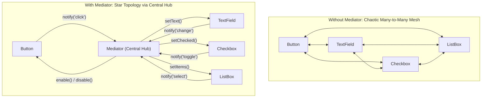
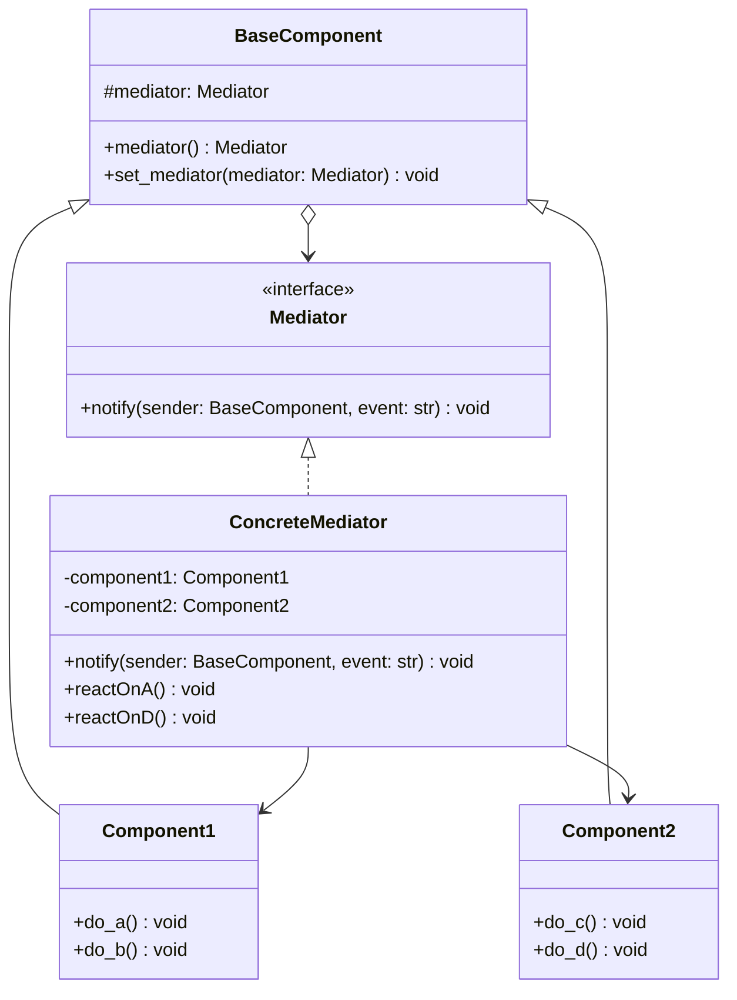

# Mediator Design Pattern

| Metadata      | Value                      |
| ------------- | -------------------------- |
| Author        | Lyzander Marciano Andrylie |
| Creation Date | Nov 12, 2026               |
| Last Updated  | Nov 12, 2026               |

## References

- [Refactoring Guru - Mediator Pattern](https://refactoring.guru/design-patterns/mediator): Overview of the Mediator pattern, its problem space, solution, applicability, and structure
- [Refactoring Guru - Mediator in Python](https://refactoring.guru/design-patterns/mediator/python/example): Implementation example and structure of the Mediator pattern in Python
- [design-pattern.md](../design-pattern.md): Overview of software design patterns and catalog categories
- [facade.md](../structural/facade.md): Simplifies a subsystem interface without adding bidirectional peer coordination
- [observer.md](./observer.md): Mediator can be implemented using Observer subscriptions between components and the mediator

## Description

The **Mediator** design pattern is a behavioral pattern that restricts direct communication between objects, forcing them to collaborate exclusively through a central mediator object. By decoupling sender and receiver components into a star topology, it eliminates chaotic many-to-many dependencies and makes individual components reusable and independent.

## Concepts

### 1. Intent, Problem, and Solution

The primary **intent** of the Mediator pattern is to encapsulate how a set of objects interact, promoting loose coupling by keeping objects from referring to each other explicitly and letting you vary their interaction independently.

- **The Problem**:
  - In complex systems (such as graphical user interfaces with many interactive widgets or air traffic management systems), individual components must coordinate their states and actions.
  - When components communicate directly, every component holds references to multiple peer components, creating an intricate, tightly coupled many-to-many mesh network ($O(N^2)$ direct connections).
  - Any change to one component requires modifying or testing several other interconnected components.
  - Components become impossible to reuse in other dialogs, windows, or workflows because they are inextricably tied to their peers.
  - Subclassing individual widgets just to customize cross-component behavior leads to subclass explosion and unmaintainable code.

- **The Solution**:
  - Extract all communication and orchestration logic into a centralized hub class known as the **Mediator**.
  - Components (often called **Colleagues**) no longer talk to each other directly. Instead, when an event occurs, a component merely notifies its mediator.
  - The mediator intercepts the notification, evaluates the required business rules, and calls methods on the relevant target components.
  - **Real-World Analogy**: An **Air Traffic Control (ATC) Tower**. Aircraft in an airport's airspace do not broadcast directly to every other aircraft to negotiate runway landings or takeoffs. Instead, every pilot communicates solely with the ATC tower, and air traffic controllers coordinate landing queues, runway clearances, and holding patterns.

- **Applicability**:
  - Use Mediator when you want to reduce tightly coupled dependencies among a set of collaborating classes.
  - Use Mediator when you cannot reuse a component in another context because it depends directly on too many other classes.
  - Use Mediator when you find yourself creating numerous subclasses across multiple classes just to reuse basic behavior in slightly different interaction scenarios.

- **Trade-offs (Pros and Cons)**:

| Advantage (Pros)                                                                                                                         | Disadvantage (Cons)                                                                                                                            |
| :--------------------------------------------------------------------------------------------------------------------------------------- | :--------------------------------------------------------------------------------------------------------------------------------------------- |
| **Single Responsibility Principle (SRP)**: Centralizes cross-component coordination logic into a single dedicated coordinator.           | **Risk of God Object**: Over time, a concrete mediator can accumulate excessive business logic and become an unmanageable monolithic class.    |
| **Open/Closed Principle (OCP)**: Introduces new mediators or coordination behaviors without modifying existing component classes.        | **Indirection Overhead**: All messages flow through an intermediary, introducing a slight dispatch overhead compared to direct invocations.    |
| **Eliminates Mesh Coupling**: Replaces $O(N^2)$ inter-object connections with an $O(N)$ star topology centered on the mediator.          | **Complex Debugging**: Tracking control flow can become less obvious because event triggering and execution are decoupled across the mediator. |
| **High Component Reusability**: Individual colleagues remain unaware of peers and can be plugged into different dialogues or subsystems. |                                                                                                                                                |

#### Interaction



### 2. Structure and Components

The Mediator pattern organizes participants into a star topology where components hold a reference only to their abstract mediator interface, and the concrete mediator holds references to all collaborating components.

| Participant              | Role & Responsibility                                                                                                                            |
| :----------------------- | :----------------------------------------------------------------------------------------------------------------------------------------------- |
| **`Mediator`**           | Declares the interface for communicating with components, typically exposing a notification method like `notify(sender, event)`.                 |
| **`ConcreteMediator`**   | Implements the mediator interface, maintains references to managed components, and encapsulates the coordination logic between them.             |
| **`BaseComponent`**      | Provides base storage for a `Mediator` reference so concrete components can report events without knowing the concrete mediator class.           |
| **`ConcreteComponents`** | Colleague classes containing specific domain or UI logic. They execute their own tasks and notify their mediator when significant events happen. |

- **Key Structural Traits**:
  - **Unidirectional Notification, Bidirectional Dispatch**: Components notify the mediator unidirectionally without expecting an immediate return value. The mediator then coordinates by invoking specific methods on appropriate recipient components.
  - **Component Decoupling**: Components only depend on the abstract `Mediator` interface, ensuring that changes to other components or mediation rules never alter component source code.
  - **Mediator Coupling**: The `ConcreteMediator` does know about the concrete component interfaces it coordinates, trading distributed coupling for centralized orchestration.

#### Interaction



### 3. Python Implementation

#### a. Conceptual Structure Example

The conceptual example illustrates how `Component1` and `Component2` delegate their mutual coordination to `ConcreteMediator` via an abstract `Mediator` interface.

- **`Mediator`**: Abstract base class declaring the `notify(sender, event)` contract.
- **`ConcreteMediator`**: Stores references to `Component1` and `Component2`, binding itself as their mediator. Upon receiving event `"A"`, it triggers `Component2.do_c()`. Upon event `"D"`, it coordinates both `Component1.do_b()` and `Component2.do_c()`.
- **`BaseComponent`**: Holds a property reference to `Mediator`, enabling dynamic assignment.
- **`Component1` & `Component2`**: Specialized colleague classes that execute primary operations and notify their assigned mediator without referencing peer components.

```python
from __future__ import annotations
from abc import ABC, abstractmethod


class Mediator(ABC):
    """
    The Mediator interface declares a method used by components to notify the
    mediator about various events. The Mediator can react to these events and
    pass the execution to other components.
    """

    @abstractmethod
    def notify(self, sender: BaseComponent, event: str) -> None:
        pass


class ConcreteMediator(Mediator):
    def __init__(self, component1: Component1, component2: Component2) -> None:
        self._component1 = component1
        self._component1.mediator = self
        self._component2 = component2
        self._component2.mediator = self

    def notify(self, sender: BaseComponent, event: str) -> None:
        if event == "A":
            print("Mediator reacts on A and triggers following operations:")
            self._component2.do_c()
        elif event == "D":
            print("Mediator reacts on D and triggers following operations:")
            self._component1.do_b()
            self._component2.do_c()


class BaseComponent:
    """
    The Base Component provides the basic functionality of storing a
    mediator's instance inside component objects.
    """

    def __init__(self, mediator: Mediator | None = None) -> None:
        self._mediator = mediator

    @property
    def mediator(self) -> Mediator | None:
        return self._mediator

    @mediator.setter
    def mediator(self, mediator: Mediator) -> None:
        self._mediator = mediator


class Component1(BaseComponent):
    def do_a(self) -> None:
        print("Component 1 does A.")
        if self.mediator:
            self.mediator.notify(self, "A")

    def do_b(self) -> None:
        print("Component 1 does B.")
        if self.mediator:
            self.mediator.notify(self, "B")


class Component2(BaseComponent):
    def do_c(self) -> None:
        print("Component 2 does C.")
        if self.mediator:
            self.mediator.notify(self, "C")

    def do_d(self) -> None:
        print("Component 2 does D.")
        if self.mediator:
            self.mediator.notify(self, "D")


if __name__ == "__main__":
    c1 = Component1()
    c2 = Component2()
    mediator = ConcreteMediator(c1, c2)

    print("Client triggers operation A.")
    c1.do_a()

    print("\nClient triggers operation D.")
    c2.do_d()

# Output:
# Client triggers operation A.
# Component 1 does A.
# Mediator reacts on A and triggers following operations:
# Component 2 does C.
#
# Client triggers operation D.
# Component 2 does D.
# Mediator reacts on D and triggers following operations:
# Component 1 does B.
# Component 2 does C.
```

#### b. Practical Real-World Example

This real-world example models an **Air Traffic Control (ATC) System** where multiple flights request runway clearance for landing. The control tower acts as the concrete mediator managing runway access and sequencing holding patterns, ensuring flights never negotiate clearance directly with each other.

- **`AirTrafficControl`**: Abstract mediator defining registration, landing requests, and runway vacation notifications.
- **`AirportControlTower`**: Concrete mediator managing runway status (`runway_occupied`), registered flights, and a FIFO holding queue (`deque`). If the runway is occupied, the tower places requesting flights in a holding pattern. When a landed flight vacates the runway, the tower automatically clears the next holding flight.
- **`Aircraft`**: Abstract colleague base class holding a `callsign` and an `AirTrafficControl` mediator reference.
- **`CommercialAirliner` & `CargoTransport`**: Concrete aircraft implementations that request landings, vacate runways, and receive ATC radio transmissions.

```python
from __future__ import annotations
from abc import ABC, abstractmethod
from collections import deque


class AirTrafficControl(ABC):
    """
    Mediator interface declaring coordination operations for aircraft.
    """

    @abstractmethod
    def register_aircraft(self, aircraft: Aircraft) -> None:
        pass

    @abstractmethod
    def request_landing(self, aircraft: Aircraft) -> bool:
        pass

    @abstractmethod
    def notify_runway_cleared(self, aircraft: Aircraft) -> None:
        pass


class Aircraft(ABC):
    """
    Base colleague class storing a reference to the ATC mediator.
    """

    def __init__(self, callsign: str, atc: AirTrafficControl | None = None) -> None:
        self.callsign = callsign
        self._atc = atc

    @property
    def atc(self) -> AirTrafficControl | None:
        return self._atc

    @atc.setter
    def atc(self, atc: AirTrafficControl) -> None:
        self._atc = atc

    def request_landing(self) -> None:
        if not self._atc:
            print(f"[{self.callsign}] Cannot request landing: No ATC assigned.")
            return
        print(f"[{self.callsign}] Requesting permission to land.")
        self._atc.request_landing(self)

    def land_and_vacate(self) -> None:
        print(f"[{self.callsign}] Landed safely. Vacating runway.")
        if self._atc:
            self._atc.notify_runway_cleared(self)

    def receive_transmission(self, message: str) -> None:
        print(f"[{self.callsign}] Radio received: \"{message}\"")


class CommercialAirliner(Aircraft):
    pass


class CargoTransport(Aircraft):
    pass


class AirportControlTower(AirTrafficControl):
    """
    Concrete mediator coordinating landing clearances and holding patterns.
    """

    def __init__(self, airport_code: str) -> None:
        self.airport_code = airport_code
        self._registered_aircraft: list[Aircraft] = []
        self._runway_occupied: bool = False
        self._holding_queue: deque[Aircraft] = deque()

    def register_aircraft(self, aircraft: Aircraft) -> None:
        aircraft.atc = self
        self._registered_aircraft.append(aircraft)
        print(f"[{self.airport_code} Tower] Radar contact established with {aircraft.callsign}.")

    def request_landing(self, aircraft: Aircraft) -> bool:
        if not self._runway_occupied:
            self._runway_occupied = True
            aircraft.receive_transmission(
                f"Runway 09L is clear. Cleared to land, {aircraft.callsign}."
            )
            return True
        else:
            self._holding_queue.append(aircraft)
            aircraft.receive_transmission(
                f"Runway occupied. Enter holding pattern at 5,000 ft, {aircraft.callsign}."
            )
            return False

    def notify_runway_cleared(self, aircraft: Aircraft) -> None:
        print(f"[{self.airport_code} Tower] Runway 09L confirmed clear by {aircraft.callsign}.")
        self._runway_occupied = False

        if self._holding_queue:
            next_flight = self._holding_queue.popleft()
            self._runway_occupied = True
            print(f"[{self.airport_code} Tower] Sequencing next flight from holding pattern.")
            next_flight.receive_transmission(
                f"Runway 09L clear. Cleared to land, {next_flight.callsign}."
            )


if __name__ == "__main__":
    tower = AirportControlTower(airport_code="JFK")

    flight1 = CommercialAirliner(callsign="Delta 101")
    flight2 = CommercialAirliner(callsign="United 452")
    cargo1 = CargoTransport(callsign="FedEx 88")

    tower.register_aircraft(flight1)
    tower.register_aircraft(flight2)
    tower.register_aircraft(cargo1)

    print("\n--- Landing Requests ---")
    flight1.request_landing()
    flight2.request_landing()
    cargo1.request_landing()

    print("\n--- Flight 1 Vacates Runway ---")
    flight1.land_and_vacate()

    print("\n--- Flight 2 Vacates Runway ---")
    flight2.land_and_vacate()

# Output:
# [JFK Tower] Radar contact established with Delta 101.
# [JFK Tower] Radar contact established with United 452.
# [JFK Tower] Radar contact established with FedEx 88.
#
# --- Landing Requests ---
# [Delta 101] Requesting permission to land.
# [Delta 101] Radio received: "Runway 09L is clear. Cleared to land, Delta 101."
# [United 452] Requesting permission to land.
# [United 452] Radio received: "Runway occupied. Enter holding pattern at 5,000 ft, United 452."
# [FedEx 88] Requesting permission to land.
# [FedEx 88] Radio received: "Runway occupied. Enter holding pattern at 5,000 ft, FedEx 88."
#
# --- Flight 1 Vacates Runway ---
# [Delta 101] Landed safely. Vacating runway.
# [JFK Tower] Runway 09L confirmed clear by Delta 101.
# [JFK Tower] Sequencing next flight from holding pattern.
# [United 452] Radio received: "Runway 09L clear. Cleared to land, United 452."
#
# --- Flight 2 Vacates Runway ---
# [United 452] Landed safely. Vacating runway.
# [JFK Tower] Runway 09L confirmed clear by United 452.
# [JFK Tower] Sequencing next flight from holding pattern.
# [FedEx 88] Radio received: "Runway 09L clear. Cleared to land, FedEx 88."
```
