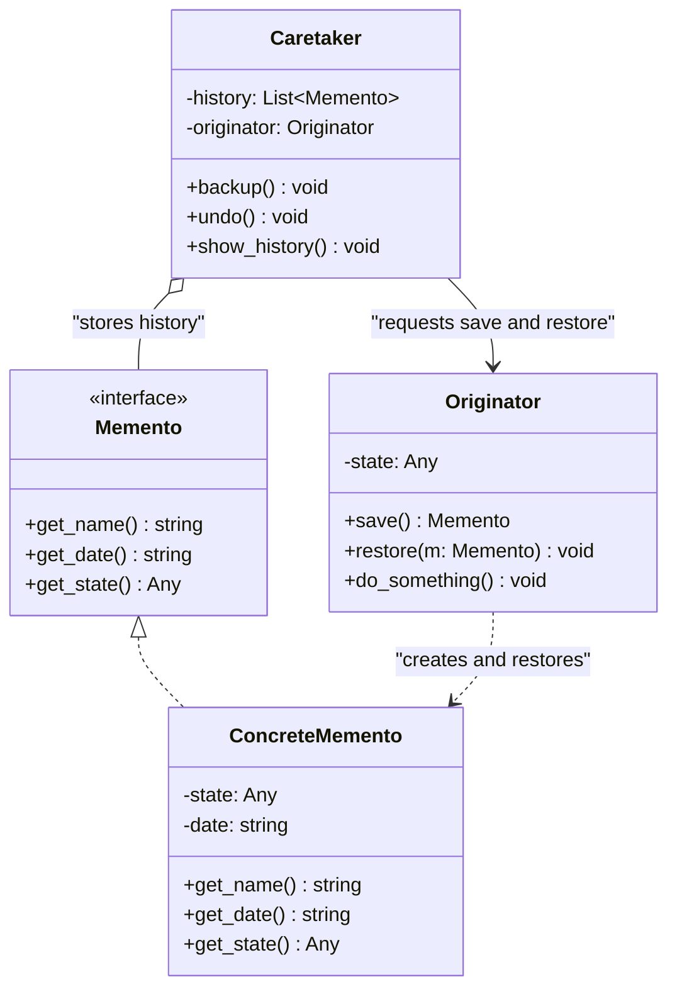

# Memento Design Pattern

| Metadata      | Value                      |
| ------------- | -------------------------- |
| Author        | Lyzander Marciano Andrylie |
| Creation Date | Nov 12, 2026               |
| Last Updated  | Nov 12, 2026               |

## References

- [Refactoring Guru - Memento Design Pattern](https://refactoring.guru/design-patterns/memento): Overview of the Memento pattern, intent, structure, and applicability
- [Refactoring Guru - Memento in Python](https://refactoring.guru/design-patterns/memento/python/example): Conceptual implementation of Memento in Python
- [design-pattern.md](../design-pattern.md): Overview of software design patterns and catalog categories
- [command.md](./command.md): Commands use Mementos to capture state snapshots before executing reversible operations
- [iterator.md](./iterator.md): Can use Memento to capture and restore iteration state
- [prototype.md](../creational/prototype.md): Simple alternative when the object holds only public or straightforward references

## Description

Memento is a behavioral design pattern that allows capturing and externalizing an object's internal state without exposing its private implementation details. This pattern enables saving checkpoints and restoring prior states (such as undo, redo, and transactional rollbacks) while strictly preserving object encapsulation.

## Concepts

### 1. Intent, Problem, and Solution

#### Intent

The intent of the Memento pattern is to capture an object's internal state without violating encapsulation, allowing the state to be stored externally and later restored when needed.

#### Problem

Applications frequently require undo/redo capabilities, rollback checkpoints, or history tracking (e.g., text editors, games, database transactions, form wizards). To save and restore an object's state from the outside:

- An external history manager would need direct access to the object's internal fields, including private variables, flags, and helper data structures.
- Exposing internal fields via public getters and setters breaks encapsulation, exposing implementation details to outside callers.
- Any future refactoring of the object's internal structure would break external consumers that depend on those private fields.

#### Solution

The Memento pattern delegates state snapshot creation to the state owner itself—the **Originator**:

- The **Originator** creates a snapshot of its own internal state and wraps it inside an opaque, immutable object called a **Memento**.
- The **Memento** restricts outside access to the saved state. It exposes only limited metadata (such as timestamps, state descriptions, or IDs) to external objects.
- The **Caretaker** (such as a command manager or history stack) stores and tracks Mementos across time. The Caretaker knows _when_ and _why_ to trigger snapshots or rollbacks, but it never modifies or inspects the private state stored inside.
- When an undo or rollback occurs, the Caretaker hands the Memento back to the Originator, and the Originator extracts the state to restore itself.

#### Applicability

- **Undo and Redo Mechanisms**: When implementing undo/redo stacks, reversible user commands, or history trackers.
- **Direct Access Violates Encapsulation**: When an object's fields, transient buffers, or internal states must not be exposed to other objects.
- **Transactional Rollbacks**: When an operation consists of multiple steps that must revert cleanly if a step fails or is aborted.

#### Pros and Cons

| Pros                                                                           | Cons                                                                                                                                  |
| :----------------------------------------------------------------------------- | :------------------------------------------------------------------------------------------------------------------------------------ |
| Preserves encapsulation by avoiding public exposure of private state.          | Can consume substantial memory (RAM) if Originators change state frequently or store large data payloads.                             |
| Simplifies Originator code by delegating state history tracking to Caretakers. | Caretakers must manage the lifecycle and garbage collection of obsolete mementos.                                                     |
| Provides clean undo/redo checkpoints and transactional rollback support.       | Some programming languages lack fine-grained access modifiers (like friend classes or nested classes) to fully restrict state access. |

#### Interaction

```mermaid
sequenceDiagram
    autonumber
    actor Client
    participant Caretaker
    participant Originator
    participant Memento

    Note over Originator: Originator state is "State A"
    Client ->> Caretaker: "backup()"
    Caretaker ->> Originator: "save()"
    create participant Memento
    Originator ->> Memento: "ConcreteMemento(state)"
    Originator -->> Caretaker: return memento
    Note over Caretaker: Store memento in history stack

    Client ->> Originator: "do_something()"
    Note over Originator: Originator state changes to "State B"

    Client ->> Caretaker: "undo()"
    Note over Caretaker: Pop memento from history stack
    Caretaker ->> Originator: "restore(memento)"
    Originator ->> Memento: "get_state()"
    Memento -->> Originator: return saved state
    Note over Originator: Originator state restored to "State A"
```

---

### 2. Structure and Components

The Memento pattern separates state management responsibilities across three core roles:

| Component           | Responsibility                                                                                            | Access Privileges                                                             |
| :------------------ | :-------------------------------------------------------------------------------------------------------- | :---------------------------------------------------------------------------- |
| **Originator**      | Holds business state; creates snapshots via `save()`; restores internal state via `restore(memento)`.     | Full read/write access to internal state and Memento state.                   |
| **Memento**         | Immutable value object storing the state snapshot; exposes metadata methods (`get_name()`, `get_date()`). | Narrow interface exposed to Caretakers; wide interface exposed to Originator. |
| **ConcreteMemento** | Concrete implementation storing the state payload and metadata attributes.                                | Holds private state fields safe from external mutation.                       |
| **Caretaker**       | Tracks Memento history (e.g., stacks, queues, or maps); decides when to save and restore.                 | Limited read-only access to Memento metadata; never alters snapshot state.    |

- **Originator**: The business object that owns mutable state. When requested, it serializes or packs its private fields into a new Memento instance. It also accepts a Memento to overwrite its current state.
- **Memento**: An abstract interface representing state snapshots. It hides the Originator's state representation from external components.
- **ConcreteMemento**: Stores the actual state snapshot alongside descriptive metadata (creation timestamp, transaction ID, label). In strict implementations, its state getter is accessible only to the Originator.
- **Caretaker**: Manages the collection of Memento instances without modifying them. It invokes `originator.save()` before state changes and `originator.restore(memento)` during rollback operations.

#### Interaction



---

### 3. Python Implementation

#### a. Conceptual Structure Example

The conceptual example demonstrates the division of responsibilities:

- **`Memento`**: An abstract base class providing access to metadata while defining the interface for state extraction.
- **`ConcreteMemento`**: Implements the snapshot container storing state and timestamp metadata.
- **`Originator`**: Holds the mutable state string, producing a `ConcreteMemento` on `save()` and consuming it on `restore()`.
- **`Caretaker`**: Manages a stack of `Memento` instances, orchestrating `backup()` and `undo()` workflows without inspecting state contents.

```python
from abc import ABC, abstractmethod


class Memento(ABC):
    """The Memento interface provides metadata methods without exposing raw state."""

    @abstractmethod
    def get_name(self) -> str:
        """Returns metadata description for history listing."""
        pass

    @abstractmethod
    def get_date(self) -> str:
        """Returns snapshot creation date/time."""
        pass

    @abstractmethod
    def get_state(self) -> str:
        """Returns internal state (intended for Originator use)."""
        pass


class ConcreteMemento(Memento):
    """Concrete container storing the Originator's state snapshot and metadata."""

    def __init__(self, state: str, date: str) -> None:
        self._state = state
        self._date = date

    def get_state(self) -> str:
        """Provides state back to the Originator during restore."""
        return self._state

    def get_name(self) -> str:
        """Provides metadata used by the Caretaker to inspect history."""
        return f"{self._date} / ({self._state[:15]}...)"

    def get_date(self) -> str:
        return self._date


class Originator:
    """The Originator holds state and creates/restores Memento snapshots."""

    def __init__(self, state: str) -> None:
        self._state = state
        print(f"Originator: Initialized state to \"{self._state}\"")

    def do_business_logic(self, new_state: str) -> None:
        """Modifies internal state as part of business logic."""
        print(f"Originator: Changing state from \"{self._state}\" to \"{new_state}\"")
        self._state = new_state

    def save(self, timestamp: str) -> Memento:
        """Creates a snapshot of the current state wrapped in a Memento."""
        print(f"Originator: Saving state \"{self._state}\" into Memento")
        return ConcreteMemento(self._state, timestamp)

    def restore(self, memento: Memento) -> None:
        """Restores internal state from a given Memento."""
        self._state = memento.get_state()
        print(f"Originator: Restored state to \"{self._state}\"")


class Caretaker:
    """The Caretaker tracks Mementos without inspecting internal state."""

    def __init__(self, originator: Originator) -> None:
        self._mementos: list[Memento] = []
        self._originator = originator

    def backup(self, timestamp: str) -> None:
        """Captures a snapshot before operations."""
        print("\nCaretaker: Saving snapshot...")
        self._mementos.append(self._originator.save(timestamp))

    def undo(self) -> None:
        """Reverts the Originator to the most recent checkpoint."""
        if not self._mementos:
            print("Caretaker: No mementos left to undo.")
            return

        memento = self._mementos.pop()
        print(f"Caretaker: Rolling back state using [{memento.get_name()}]")
        self._originator.restore(memento)

    def show_history(self) -> None:
        """Displays saved checkpoints using public metadata."""
        print("Caretaker: Snapshot history list:")
        for idx, m in enumerate(self._mementos, start=1):
            print(f"  {idx}. {m.get_name()}")


if __name__ == "__main__":
    originator = Originator("State-Alpha")
    caretaker = Caretaker(originator)

    caretaker.backup("2026-11-12 10:00:00")
    originator.do_business_logic("State-Beta")

    caretaker.backup("2026-11-12 10:05:00")
    originator.do_business_logic("State-Gamma")

    caretaker.backup("2026-11-12 10:10:00")
    originator.do_business_logic("State-Delta")

    print()
    caretaker.show_history()

    print("\n--- Undoing Last Changes ---")
    caretaker.undo()

    print("\n--- Undoing Previous Change ---")
    caretaker.undo()

# Output:
# Originator: Initialized state to "State-Alpha"
#
# Caretaker: Saving snapshot...
# Originator: Saving state "State-Alpha" into Memento
# Originator: Changing state from "State-Alpha" to "State-Beta"
#
# Caretaker: Saving snapshot...
# Originator: Saving state "State-Beta" into Memento
# Originator: Changing state from "State-Beta" to "State-Gamma"
#
# Caretaker: Saving snapshot...
# Originator: Saving state "State-Gamma" into Memento
# Originator: Changing state from "State-Gamma" to "State-Delta"
#
# Caretaker: Snapshot history list:
#   1. 2026-11-12 10:00:00 / (State-Alpha...)
#   2. 2026-11-12 10:05:00 / (State-Beta...)
#   3. 2026-11-12 10:10:00 / (State-Gamma...)
#
# --- Undoing Last Changes ---
# Caretaker: Rolling back state using [2026-11-12 10:10:00 / (State-Gamma...)]
# Originator: Restored state to "State-Gamma"
#
# --- Undoing Previous Change ---
# Caretaker: Rolling back state using [2026-11-12 10:05:00 / (State-Beta...)]
# Originator: Restored state to "State-Beta"
```

---

#### b. Practical Real-World Example

A practical application of Memento is a **Document Editor** with multi-level undo and redo:

- **`DocumentSnapshot` (Memento)**: A frozen, immutable dataclass containing text content, cursor position, and style formatting.
- **`TextDocument` (Originator)**: Holds the working document state, edits content, modifies styles, and produces/restores snapshots.
- **`HistoryManager` (Caretaker)**: Manages undo and redo stacks with bounded history capacity to avoid unbounded memory consumption.

```python
from dataclasses import dataclass
from typing import List


@dataclass(frozen=True)
class DocumentSnapshot:
    """Immutable Memento storing private snapshot state of a document."""

    text: str
    cursor_position: int
    formatting: str


class TextDocument:
    """The Originator whose internal state requires checkpointing and restoration."""

    def __init__(self, filename: str) -> None:
        self.filename = filename
        self._text: str = ""
        self._cursor_position: int = 0
        self._formatting: str = "plain"

    def write(self, content: str) -> None:
        """Inserts text at current cursor position and advances the cursor."""
        self._text = (
            self._text[: self._cursor_position]
            + content
            + self._text[self._cursor_position :]
        )
        self._cursor_position += len(content)

    def set_formatting(self, style: str) -> None:
        """Updates text style format."""
        self._formatting = style

    def set_cursor(self, position: int) -> None:
        """Repositions the cursor within valid string bounds."""
        self._cursor_position = max(0, min(position, len(self._text)))

    def save(self) -> DocumentSnapshot:
        """Creates an immutable Memento snapshot of internal state."""
        return DocumentSnapshot(
            text=self._text,
            cursor_position=self._cursor_position,
            formatting=self._formatting,
        )

    def restore(self, snapshot: DocumentSnapshot) -> None:
        """Restores internal state directly from a Memento snapshot."""
        self._text = snapshot.text
        self._cursor_position = snapshot.cursor_position
        self._formatting = snapshot.formatting

    def display(self) -> None:
        """Prints current document contents and internal parameters."""
        print(
            f"[{self.filename}] Text: \"{self._text}\" | "
            f"Cursor: {self._cursor_position} | Style: {self._formatting}"
        )


class HistoryManager:
    """The Caretaker maintaining bounded undo and redo snapshot stacks."""

    def __init__(self, document: TextDocument, max_history: int = 5) -> None:
        self._document = document
        self._max_history = max_history
        self._undo_stack: List[DocumentSnapshot] = []
        self._redo_stack: List[DocumentSnapshot] = []

    def checkpoint(self) -> None:
        """Captures current document state before applying new edits."""
        snapshot = self._document.save()
        if len(self._undo_stack) >= self._max_history:
            self._undo_stack.pop(0)  # Evict oldest snapshot when limit reached
        self._undo_stack.append(snapshot)
        self._redo_stack.clear()

    def undo(self) -> bool:
        """Rolls back document state to the latest checkpoint."""
        if not self._undo_stack:
            print("History: Nothing to undo.")
            return False

        # Save current state onto redo stack before restoring
        self._redo_stack.append(self._document.save())
        previous_snapshot = self._undo_stack.pop()
        self._document.restore(previous_snapshot)
        print("History: Undo executed.")
        return True

    def redo(self) -> bool:
        """Reapplies an undone state."""
        if not self._redo_stack:
            print("History: Nothing to redo.")
            return False

        self._undo_stack.append(self._document.save())
        next_snapshot = self._redo_stack.pop()
        self._document.restore(next_snapshot)
        print("History: Redo executed.")
        return True


if __name__ == "__main__":
    doc = TextDocument("rfc_draft.txt")
    history = HistoryManager(doc)

    print("--- Initial Document ---")
    doc.display()

    print("\n--- Typing First Sentence ---")
    history.checkpoint()
    doc.write("Design patterns are reusable solutions.")
    doc.display()

    print("\n--- Applying Formatting ---")
    history.checkpoint()
    doc.set_formatting("markdown-bold")
    doc.write(" They accelerate software design.")
    doc.display()

    print("\n--- Accidental Erroneous Edit ---")
    history.checkpoint()
    doc.set_cursor(0)
    doc.write("[CORRUPTED HEADER] ")
    doc.display()

    print("\n--- Performing Undo 1 (Rollback Corrupted Edit) ---")
    history.undo()
    doc.display()

    print("\n--- Performing Undo 2 (Rollback Bold Append) ---")
    history.undo()
    doc.display()

    print("\n--- Performing Redo (Restore Bold Append) ---")
    history.redo()
    doc.display()

# Output:
# --- Initial Document ---
# [rfc_draft.txt] Text: "" | Cursor: 0 | Style: plain
#
# --- Typing First Sentence ---
# [rfc_draft.txt] Text: "Design patterns are reusable solutions." | Cursor: 39 | Style: plain
#
# --- Applying Formatting ---
# [rfc_draft.txt] Text: "Design patterns are reusable solutions. They accelerate software design." | Cursor: 72 | Style: markdown-bold
#
# --- Accidental Erroneous Edit ---
# [rfc_draft.txt] Text: "[CORRUPTED HEADER] Design patterns are reusable solutions. They accelerate software design." | Cursor: 19 | Style: markdown-bold
#
# --- Performing Undo 1 (Rollback Corrupted Edit) ---
# History: Undo executed.
# [rfc_draft.txt] Text: "Design patterns are reusable solutions. They accelerate software design." | Cursor: 72 | Style: markdown-bold
#
# --- Performing Undo 2 (Rollback Bold Append) ---
# History: Undo executed.
# [rfc_draft.txt] Text: "Design patterns are reusable solutions." | Cursor: 39 | Style: plain
#
# --- Performing Redo (Restore Bold Append) ---
# History: Redo executed.
# [rfc_draft.txt] Text: "Design patterns are reusable solutions. They accelerate software design." | Cursor: 72 | Style: markdown-bold
```
