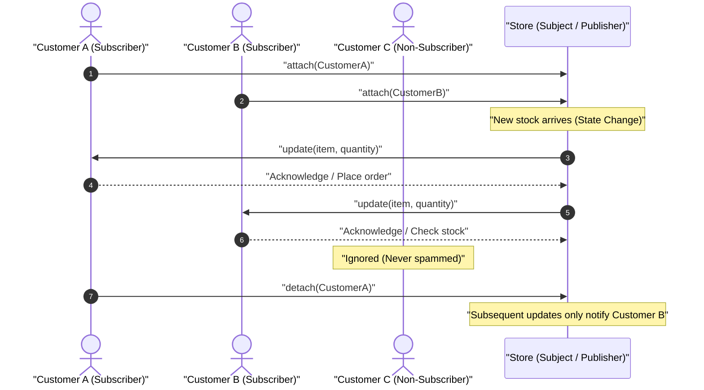
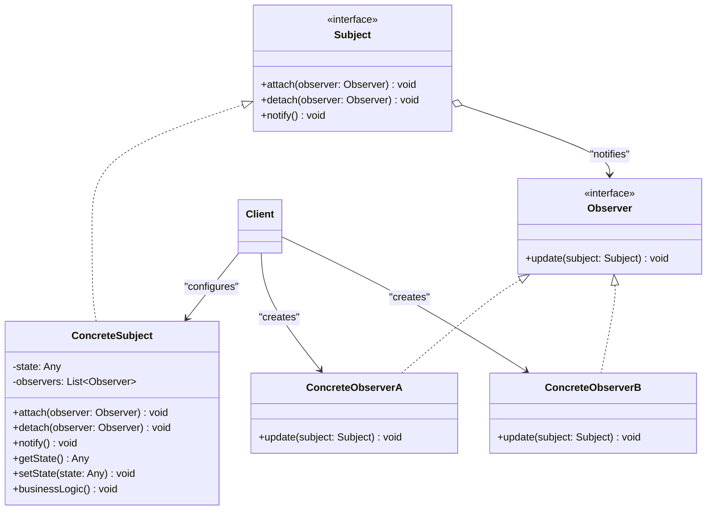

# Observer Design Pattern

| Metadata      | Value                      |
| ------------- | -------------------------- |
| Author        | Lyzander Marciano Andrylie |
| Creation Date | Nov 12, 2026               |
| Last Updated  | Nov 12, 2026               |

## References

- [Observer Pattern - Refactoring.Guru](https://refactoring.guru/design-patterns/observer): Comprehensive overview of the Observer design pattern, intent, problem, solution, structure, and applicability
- [Observer in Python - Refactoring.Guru](https://refactoring.guru/design-patterns/observer/python/example): Conceptual structure and idiomatic Python implementation examples
- [design-pattern.md](../design-pattern.md): Overview of software design patterns and catalog categories
- [mediator.md](./mediator.md): Centralizes communication via a hub, whereas Observer distributes events dynamically to subscribers

## Description

The **Observer** is a behavioral design pattern that lets you define a subscription mechanism to notify multiple objects automatically about any events or state changes happening to the object they are observing. It solves tight coupling between event producers and consumers by enabling objects to dynamically subscribe to or unsubscribe from subject notifications at runtime.

## Concepts

### 1. Intent, Problem, and Solution

#### Intent

Define a one-to-many dependency between objects so that when one object (the subject or publisher) changes state, all its dependents (the observers or subscribers) are notified and updated automatically.

#### The Problem: Polling Waste vs. Broadcast Spam

Consider an e-commerce store with customers waiting for a high-demand item (such as a restocked graphics card or gaming console):

- **Wasted Polling Loops (Pull Anti-Pattern)**: Customers repeatedly visit or send queries to the store to check if the product has arrived. In most attempts, stock has not changed, wasting computing power, network bandwidth, and time on repeated empty checks.
- **Indiscriminate Broadcast (Spam Anti-Pattern)**: The store broadcasts a catalog newsletter to every customer in its database whenever any product arrives. Customers who have no interest in that specific item are overwhelmed with irrelevant notifications, degrading user experience.

#### The Solution: Subscription Publisher-Subscriber Mechanism

The Observer pattern resolves this dilemma by introducing a **subscription mechanism**:

1. The **Subject** (Publisher) maintains a private registry of subscribers interested in its events.
2. The Subject exposes public methods (`attach` and `detach`) that allow any subscriber to subscribe or unsubscribe dynamically at runtime.
3. Whenever an internal state transition occurs (e.g., an item is restocked or sold), the Subject iterates through its subscription list and invokes a uniform `update` method on each registered **Observer**.
4. Subscribers that have registered receive instant alerts; unrelated objects remain unaffected and receive zero unwanted notifications.

#### Applicability

- **Dynamic One-to-Many Dependencies**: When a mutation in one object requires updating other objects, and the exact quantity or identity of those dependent objects is not known beforehand or changes at runtime.
- **Temporary Event Subscriptions**: When an object must listen to events only for a limited timeframe, during specific runtime operations, or within a specific UI view lifecycle.
- **Decoupled Architecture**: When publishers need to emit notifications without knowing concrete subscriber classes, supporting loose coupling across architectural layers.

#### Trade-offs & Limitations

| Dimension                  | Advantages (Pros)                                                                                                                       | Trade-offs & Limitations (Cons)                                                                                                                                 |
| :------------------------- | :-------------------------------------------------------------------------------------------------------------------------------------- | :-------------------------------------------------------------------------------------------------------------------------------------------------------------- |
| **Extensibility**          | **Open/Closed Principle**: Introduce new observer implementations without altering publisher code, and vice versa.                      | **Unordered Notification**: Observers are notified in an unspecified or random order; application logic cannot rely on execution sequence.                      |
| **Coupling**               | **Loose Runtime Binding**: Establish, alter, or terminate communication channels between objects dynamically at runtime.                | **Lapsed Listener Problem**: Forgetting to detach unused observers prevents garbage collection, potentially leaking memory.                                     |
| **Separation of Concerns** | **Decoupled Responsibilities**: Publishers focus purely on state management; observers isolate side effects (e.g., emails, audit logs). | **Cascading Updates**: Complex chains of observers triggering secondary updates across multiple subjects can cause unintended cascades or performance overhead. |

#### Interaction



---

### 2. Structure and Components

The Observer pattern organizes collaboration between publishers and subscribers through dedicated abstractions:

| Component                     | Role                     | Description                                                                                                                |
| :---------------------------- | :----------------------- | :------------------------------------------------------------------------------------------------------------------------- |
| **`Subject` / `Publisher`**   | Interface / Base Class   | Declares the subscription interface (`attach`, `detach`, and `notify`) for managing subscribers.                           |
| **`ConcreteSubject`**         | Core Event Producer      | Stores the state of interest, executes core business logic, and notifies registered observers when its state changes.      |
| **`Observer` / `Subscriber`** | Notification Interface   | Declares the common update contract (`update`) called by subjects to dispatch event notifications.                         |
| **`ConcreteObserver`**        | Event Consumer           | Implements the `update` method to perform domain-specific reactions (e.g., sending emails, logging audits, refreshing UI). |
| **`Client`**                  | Assembler / Orchestrator | Instantiates subject and observer objects, and attaches or detaches observers to subjects at runtime.                      |

- **`Subject` (Publisher)**: Declares the subscription management methods. It maintains a collection of references to objects implementing the `Observer` interface without coupling itself to concrete observer classes.
- **`ConcreteSubject`**: Tracks internal state and triggers `notify()` when mutations occur. Depending on the design, it can push specific event data directly into `update(event_data)` or pass a reference to itself `update(self)` so observers pull whatever state they require.
- **`Observer` (Subscriber)**: An abstract interface standardizing how notifications are received. In most cases, it declares a single `update` method.
- **`ConcreteObserver`**: Implements specialized response behaviors. Each observer maintains independence from other observers and responds exclusively to the updates it receives.
- **`Client`**: Configures the relationship between subjects and observers. The client creates subject instances, creates observer instances, and registers them via `attach()`.

#### Interaction



---

### 3. Python Implementation

#### a. Conceptual Structure Example

The conceptual example demonstrates the classic pull-model Observer pattern:

- **`Subject` (ABC)**: Defines the abstract contract for `attach`, `detach`, and `notify`.
- **`ConcreteSubject`**: Holds an integer state `_state` and a list of observers `_observers`. When `some_business_logic()` modifies the state, it triggers `notify()`.
- **`Observer` (ABC)**: Declares `update(subject: Subject)` so observers receive the subject instance and inspect its state.
- **`ConcreteObserverA`**: Reacts only when the subject's state is strictly less than 3 (`subject.state < 3`).
- **`ConcreteObserverB`**: Reacts when the subject's state is 0 or greater than or equal to 2 (`subject.state == 0 or subject.state >= 2`).

```python
from abc import ABC, abstractmethod
from typing import List


class Observer(ABC):
    """
    The Observer interface declares the update method, used by subjects.
    """

    @abstractmethod
    def update(self, subject: "Subject") -> None:
        """Receive update from subject."""
        pass


class Subject(ABC):
    """
    The Subject interface declares a set of methods for managing subscribers.
    """

    @abstractmethod
    def attach(self, observer: Observer) -> None:
        """Attach an observer to the subject."""
        pass

    @abstractmethod
    def detach(self, observer: Observer) -> None:
        """Detach an observer from the subject."""
        pass

    @abstractmethod
    def notify(self) -> None:
        """Notify all observers about an event."""
        pass


class ConcreteSubject(Subject):
    """
    The ConcreteSubject owns important state and notifies observers when the state changes.
    """

    def __init__(self) -> None:
        self._state: int = 0
        self._observers: List[Observer] = []

    @property
    def state(self) -> int:
        return self._state

    def attach(self, observer: Observer) -> None:
        if observer not in self._observers:
            self._observers.append(observer)
            print(f"Subject: Attached observer {observer.__class__.__name__}.")

    def detach(self, observer: Observer) -> None:
        if observer in self._observers:
            self._observers.remove(observer)
            print(f"Subject: Detached observer {observer.__class__.__name__}.")

    def notify(self) -> None:
        """Trigger an update in each subscriber."""
        print("Subject: Notifying observers...")
        for observer in self._observers:
            observer.update(self)

    def some_business_logic(self, new_state: int) -> None:
        """
        Executes core logic and triggers a notification whenever state changes.
        """
        print(f"\nSubject: Changing internal state to {new_state}.")
        self._state = new_state
        print(f"Subject: My state has just changed to: {self._state}")
        self.notify()


class ConcreteObserverA(Observer):
    def update(self, subject: Subject) -> None:
        if isinstance(subject, ConcreteSubject) and subject.state < 3:
            print("ConcreteObserverA: Reacted to low state (< 3).")


class ConcreteObserverB(Observer):
    def update(self, subject: Subject) -> None:
        if isinstance(subject, ConcreteSubject) and (subject.state == 0 or subject.state >= 2):
            print("ConcreteObserverB: Reacted to state (0 or >= 2).")


if __name__ == "__main__":
    # Client setup
    subject = ConcreteSubject()

    observer_a = ConcreteObserverA()
    subject.attach(observer_a)

    observer_b = ConcreteObserverB()
    subject.attach(observer_b)

    # State changes trigger observers conditionally
    subject.some_business_logic(1)
    subject.some_business_logic(8)

    # Detaching an observer prevents further notifications
    subject.detach(observer_a)

    subject.some_business_logic(5)
```

##### Output

```text
Subject: Attached observer ConcreteObserverA.
Subject: Attached observer ConcreteObserverB.

Subject: Changing internal state to 1.
Subject: My state has just changed to: 1
Subject: Notifying observers...
ConcreteObserverA: Reacted to low state (< 3).

Subject: Changing internal state to 8.
Subject: My state has just changed to: 8
Subject: Notifying observers...
ConcreteObserverB: Reacted to state (0 or >= 2).
Subject: Detached observer ConcreteObserverA.

Subject: Changing internal state to 5.
Subject: My state has just changed to: 5
Subject: Notifying observers...
ConcreteObserverB: Reacted to state (0 or >= 2).
```

---

#### b. Practical Real-World Example

This real-world example models a **Store Inventory Alert System**:

- **`InventoryObserver` (ABC)**: Base subscriber interface defining `update(product_name: str, quantity: int)`.
- **`StoreInventory` (Subject)**: Maintains stock levels for products. Methods `restock()` and `purchase()` modify stock counts and broadcast updates via `notify()`.
- **`EmailAlertListener` (Concrete Observer)**: Monitors a specific target product (e.g., `"GPU RTX 5090"`) and threshold. Dispatches stock arrival emails, low-stock warnings, and out-of-stock alerts.
- **`LoggingListener` (Concrete Observer)**: An audit logger that records every stock movement across all products to an audit channel.

```python
from abc import ABC, abstractmethod
from typing import Dict, List


class InventoryObserver(ABC):
    """
    Observer interface declaring the notification handler for inventory events.
    """

    @abstractmethod
    def update(self, product_name: str, quantity: int) -> None:
        """Receive updated inventory status for a product."""
        pass


class StoreInventory:
    """
    Subject / Publisher that maintains warehouse inventory and dispatches events.
    """

    def __init__(self) -> None:
        self._observers: List[InventoryObserver] = []
        self._stock: Dict[str, int] = {}

    def attach(self, observer: InventoryObserver) -> None:
        """Subscribe a listener to inventory events."""
        if observer not in self._observers:
            self._observers.append(observer)
            print(f"[Inventory] Subscribed: {observer.__class__.__name__}")

    def detach(self, observer: InventoryObserver) -> None:
        """Unsubscribe a listener from inventory events."""
        if observer in self._observers:
            self._observers.remove(observer)
            print(f"[Inventory] Unsubscribed: {observer.__class__.__name__}")

    def notify(self, product_name: str, quantity: int) -> None:
        """Broadcast stock changes to all active listeners."""
        print(f"[Inventory] Broadcasting update for {product_name} ({quantity} units)...")
        for observer in self._observers:
            observer.update(product_name, quantity)

    def restock(self, product_name: str, quantity: int) -> None:
        """Add stock for a product and notify observers."""
        current_quantity = self._stock.get(product_name, 0)
        new_quantity = current_quantity + quantity
        self._stock[product_name] = new_quantity
        print(f"\n[Store Action] Restocked {product_name} (+{quantity} units -> Total: {new_quantity})")
        self.notify(product_name, new_quantity)

    def purchase(self, product_name: str, quantity: int) -> None:
        """Deduct stock when items are purchased and notify observers."""
        current_quantity = self._stock.get(product_name, 0)
        if current_quantity < quantity:
            print(f"\n[Store Action] Insufficient inventory for {product_name}!")
            return

        new_quantity = current_quantity - quantity
        self._stock[product_name] = new_quantity
        print(f"\n[Store Action] Purchased {quantity} units of {product_name} (Remaining: {new_quantity})")
        self.notify(product_name, new_quantity)


class EmailAlertListener(InventoryObserver):
    """
    Concrete Observer sending email notifications based on stock thresholds.
    """

    def __init__(self, target_product: str, threshold: int, recipient_email: str) -> None:
        self.target_product = target_product
        self.threshold = threshold
        self.recipient_email = recipient_email

    def update(self, product_name: str, quantity: int) -> None:
        if product_name != self.target_product:
            return

        if quantity == 0:
            print(f"  [EmailAlertListener] ALERT to {self.recipient_email}: {product_name} is OUT OF STOCK!")
        elif quantity <= self.threshold:
            print(f"  [EmailAlertListener] WARNING to {self.recipient_email}: {product_name} stock is low ({quantity} remaining).")
        else:
            print(f"  [EmailAlertListener] NOTIFICATION to {self.recipient_email}: {product_name} is in stock ({quantity} available).")


class LoggingListener(InventoryObserver):
    """
    Concrete Observer recording an audit trail of all inventory events.
    """

    def __init__(self, log_channel: str) -> None:
        self.log_channel = log_channel

    def update(self, product_name: str, quantity: int) -> None:
        print(f"  [LoggingListener][{self.log_channel}] AUDIT: product={product_name}, stock={quantity}")


if __name__ == "__main__":
    # Initialize store inventory subject
    store = StoreInventory()

    # Create concrete observers
    email_alert = EmailAlertListener(
        target_product="GPU RTX 5090",
        threshold=2,
        recipient_email="buyer@example.com",
    )
    audit_log = LoggingListener(log_channel="AUDIT-BUS")

    # Subscribe listeners
    store.attach(email_alert)
    store.attach(audit_log)

    # 1. Restock item -> Both listeners receive notification
    store.restock("GPU RTX 5090", 5)

    # 2. Purchase item -> Reaches low-stock threshold (2 remaining)
    store.purchase("GPU RTX 5090", 3)

    # 3. Purchase remaining -> Reaches 0 stock (out-of-stock alert)
    store.purchase("GPU RTX 5090", 2)

    # 4. Detach email alert listener -> Subsequent restock only logs audit
    store.detach(email_alert)
    store.restock("GPU RTX 5090", 10)
```

##### Output

```text
[Inventory] Subscribed: EmailAlertListener
[Inventory] Subscribed: LoggingListener

[Store Action] Restocked GPU RTX 5090 (+5 units -> Total: 5)
[Inventory] Broadcasting update for GPU RTX 5090 (5 units)...
  [EmailAlertListener] NOTIFICATION to buyer@example.com: GPU RTX 5090 is in stock (5 available).
  [LoggingListener][AUDIT-BUS] AUDIT: product=GPU RTX 5090, stock=5

[Store Action] Purchased 3 units of GPU RTX 5090 (Remaining: 2)
[Inventory] Broadcasting update for GPU RTX 5090 (2 units)...
  [EmailAlertListener] WARNING to buyer@example.com: GPU RTX 5090 stock is low (2 remaining).
  [LoggingListener][AUDIT-BUS] AUDIT: product=GPU RTX 5090, stock=2

[Store Action] Purchased 2 units of GPU RTX 5090 (Remaining: 0)
[Inventory] Broadcasting update for GPU RTX 5090 (0 units)...
  [EmailAlertListener] ALERT to buyer@example.com: GPU RTX 5090 is OUT OF STOCK!
  [LoggingListener][AUDIT-BUS] AUDIT: product=GPU RTX 5090, stock=0
[Inventory] Unsubscribed: EmailAlertListener

[Store Action] Restocked GPU RTX 5090 (+10 units -> Total: 10)
[Inventory] Broadcasting update for GPU RTX 5090 (10 units)...
  [LoggingListener][AUDIT-BUS] AUDIT: product=GPU RTX 5090, stock=10
```
