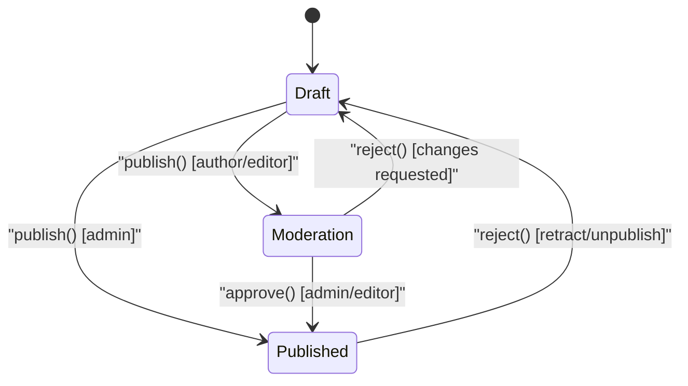
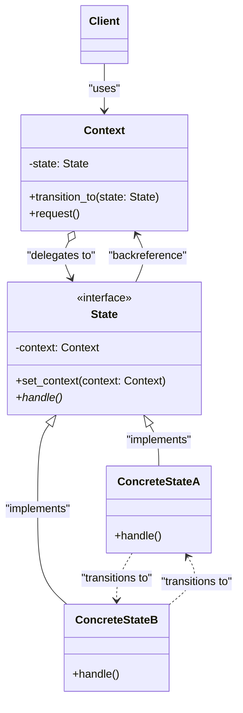

# State Design Pattern

| Metadata      | Value                      |
| ------------- | -------------------------- |
| Author        | Lyzander Marciano Andrylie |
| Creation Date | Nov 12, 2026               |
| Last Updated  | Nov 12, 2026               |

## References

- [State Pattern - Refactoring Guru](https://refactoring.guru/design-patterns/state): Overview of the State design pattern, problem, solution, applicability, and structure
- [State in Python - Refactoring Guru](https://refactoring.guru/design-patterns/state/python/example): Conceptual code implementation of the State pattern in Python
- [design-pattern.md](../design-pattern.md): Overview of software design patterns and catalog categories
- [strategy.md](./strategy.md): Shares an identical composition structure, but States are aware of each other and trigger transitions
- [bridge.md](../structural/bridge.md): Uses composition to separate abstraction and implementation hierarchies

## Description

The State design pattern is a behavioral pattern that allows an object to alter its behavior when its internal state changes, appearing to an outside observer as if the object changed its class. It replaces fragile, branching conditional logic by encapsulating state-specific behavior into dedicated state classes that transition dynamically at runtime.

## Concepts

### 1. Intent, Problem, and Solution

The core intent of the State pattern is to model an object whose behavior fundamentally changes based on its internal state, without burdening the object with cumbersome conditional branches.

- **Intent**:
  - Encapsulate state-specific logic into individual, interchangeable state objects.
  - Delegate state-dependent behavior from the context object to its current state representation.
  - Enable state transitions to happen smoothly at runtime by replacing the active state object reference.

- **Problem**:
  - Complex domain entities (such as a publishing `Document` with `Draft`, `Moderation`, and `Published` states, or an `AudioPlayer` with `Playing`, `Paused`, and `Locked` states) operate as finite state machines.
  - Without a dedicated pattern, every single method (`publish()`, `approve()`, `reject()`, `render()`) requires sprawling `if/elif/else` or `match/case` blocks checking the current state string or enum flag:
    ```python
    def publish(self):
        if self.state == "draft":
            self.state = "moderation"
        elif self.state == "moderation":
            if self.user_role == "admin":
                self.state = "published"
        elif self.state == "published":
            print("Already published.")
    ```
  - When new states or transitions are introduced, developers must locate and modify every method across the entire class, creating massive merge conflicts, risking regressions, and violating the Single Responsibility Principle (SRP) and Open/Closed Principle (OCP).

- **Solution**:
  - Extract each state's distinct behavior into a concrete class implementing a shared `State` interface.
  - Maintain a reference to the active state inside the `Context` class.
  - Instead of performing conditionals, the `Context` delegates method calls directly to the current state object (`self._state.publish()`).
  - To transition between states, the context's internal state reference is updated with a new concrete state instance (`self.transition_to(ModerationState())`). This transition can be initiated either by the `Context` or by the concrete state objects themselves.

- **Applicability**:
  - Use when an object behaves differently depending on its current state, the number of states is high, and state-specific logic changes frequently.
  - Use when class methods are cluttered with massive conditional statements that inspect internal field values before deciding how to proceed.
  - Use when you have significant duplicate code across similar states and want to isolate transitions cleanly into reusable components.

| Aspect              | Advantages                                                                                          | Disadvantages                                                                               |
| ------------------- | --------------------------------------------------------------------------------------------------- | ------------------------------------------------------------------------------------------- |
| **Maintainability** | Organizes state-specific code into independent classes adhering to Single Responsibility Principle. | Can introduce class explosion if an entity has few states or simple transitions.            |
| **Extensibility**   | Introduces new states without modifying existing states or context (Open/Closed Principle).         | May be overkill for simple flags or binary state logic (e.g., boolean `is_active`).         |
| **Code Clarity**    | Eliminates bulky, deeply nested conditionals and simplifies the context class.                      | Requires all concrete states to share a common interface, which may declare unused methods. |

#### Interaction



### 2. Structure and Components

The State pattern coordinates responsibilities between a client, a context object that maintains the current state, and polymorphic state classes that encapsulate behavior.

| Component        | Responsibility                                                                                                                           | Relationship                                                      |
| ---------------- | ---------------------------------------------------------------------------------------------------------------------------------------- | ----------------------------------------------------------------- |
| `Context`        | Holds a private reference to the current `State` object and delegates state-specific requests to it. Exposes a `transition_to()` method. | Aggregates `State` and exposes operations to `Client`.            |
| `State`          | Declares the common interface for all concrete states, specifying methods that correspond to state-dependent operations.                 | Extended by `ConcreteStates`, holds a backreference to `Context`. |
| `ConcreteStates` | Implements state-specific handling for context requests. Can trigger transitions to other states via `self.context.transition_to()`.     | Implements `State`, manipulates `Context`.                        |
| `Client`         | Creates and configures the `Context` with an initial state and invokes high-level operations.                                            | Interacts only with `Context`.                                    |

- **Key Collaboration Mechanics**:
  - **Context Delegation**: The context never executes state-dependent logic directly. When a client calls `context.request()`, the context forwards it to `state.handle()`.
  - **Backreference**: Concrete states often need to trigger state transitions on the context. The state holds a backreference (`context`) so it can invoke `context.transition_to(NewState())`.
  - **State Transition Responsibility**: Transitions can be managed either by the `Context` (when state transitions are fixed and sequential) or by the `ConcreteStates` themselves (when transitions depend dynamically on runtime conditions and previous state outcomes).

#### Interaction



### 3. Python Implementation

The following examples demonstrate the State pattern using modern Python typing and abstract base classes (`abc.ABC`).

#### a. Conceptual Structure Example

This example demonstrates the base mechanics of the State pattern:

- `Context`: Stores the active state and exposes `transition_to()` to swap state instances.
- `State`: Abstract base class providing a `context` property backreference and abstract request handlers.
- `ConcreteStateA` and `ConcreteStateB`: Handle requests and trigger state transitions using `self.context.transition_to(...)`.

```python
from __future__ import annotations
from abc import ABC, abstractmethod


class Context:
    """The Context defines the interface of interest to clients and maintains

    a reference to an instance of a State subclass representing the current state.
    """

    _state: State | None = None

    def __init__(self, state: State) -> None:
        self.transition_to(state)

    def transition_to(self, state: State) -> None:
        """Allows changing the State object dynamically at runtime."""
        print(f"Context: Transition to {type(state).__name__}")
        self._state = state
        self._state.context = self

    def request_a(self) -> None:
        """The Context delegates state-specific requests to the current State."""
        self._state.handle_a()

    def request_b(self) -> None:
        self._state.handle_b()


class State(ABC):
    """The base State declares methods that all Concrete States must implement

    and maintains a backreference to the Context object.
    """

    _context: Context | None = None

    @property
    def context(self) -> Context:
        if self._context is None:
            raise RuntimeError("Context is not attached to this state.")
        return self._context

    @context.setter
    def context(self, context: Context) -> None:
        self._context = context

    @abstractmethod
    def handle_a(self) -> None:
        pass

    @abstractmethod
    def handle_b(self) -> None:
        pass


class ConcreteStateA(State):
    def handle_a(self) -> None:
        print("ConcreteStateA handles request_a and transitions to ConcreteStateB.")
        self.context.transition_to(ConcreteStateB())

    def handle_b(self) -> None:
        print("ConcreteStateA handles request_b.")


class ConcreteStateB(State):
    def handle_a(self) -> None:
        print("ConcreteStateB handles request_a.")

    def handle_b(self) -> None:
        print("ConcreteStateB handles request_b and transitions to ConcreteStateA.")
        self.context.transition_to(ConcreteStateA())


if __name__ == "__main__":
    context = Context(ConcreteStateA())
    # Output: Context: Transition to ConcreteStateA

    context.request_a()
    # Output: ConcreteStateA handles request_a and transitions to ConcreteStateB.
    # Output: Context: Transition to ConcreteStateB

    context.request_b()
    # Output: ConcreteStateB handles request_b and transitions to ConcreteStateA.
    # Output: Context: Transition to ConcreteStateA
```

#### b. Practical Real-World Example

This real-world example models a **Document Publishing Workflow**:

- `Document` (`Context`): Encapsulates title, author, user role, and delegates actions (`publish()`, `approve()`, `reject()`, `render()`) to the current state.
- `DocumentState` (`State`): Base class declaring operations and holding a backreference to the `Document`.
- `DraftState`: Allows authors to edit or submit for review (transitions to `ModerationState`). Admins can publish directly to `PublishedState`.
- `ModerationState`: Locks edits while awaiting approval. Only admins/editors can approve (transitions to `PublishedState`), while rejection sends it back to `DraftState`.
- `PublishedState`: Document is live to the public. If rejected or retracted, it moves back to `DraftState` for revision.

```python
from __future__ import annotations
from abc import ABC, abstractmethod


class Document:
    """Context representing a document with evolving lifecycle states."""

    def __init__(self, title: str, author: str, user_role: str = "author") -> None:
        self.title = title
        self.author = author
        self.user_role = user_role
        self._state: DocumentState | None = None
        self.transition_to(DraftState())

    def transition_to(self, state: DocumentState) -> None:
        print(f"Document: Switching state to {state.__class__.__name__}")
        self._state = state
        self._state.document = self

    def publish(self) -> None:
        self._state.publish()

    def approve(self) -> None:
        self._state.approve()

    def reject(self, reason: str) -> None:
        self._state.reject(reason)

    def render(self) -> None:
        self._state.render()


class DocumentState(ABC):
    """Base State interface defining operations available across document states."""

    _document: Document | None = None

    @property
    def document(self) -> Document:
        if self._document is None:
            raise RuntimeError("Document reference is not set.")
        return self._document

    @document.setter
    def document(self, doc: Document) -> None:
        self._document = doc

    @abstractmethod
    def publish(self) -> None:
        pass

    @abstractmethod
    def approve(self) -> None:
        pass

    @abstractmethod
    def reject(self, reason: str) -> None:
        pass

    @abstractmethod
    def render(self) -> None:
        pass


class DraftState(DocumentState):
    """In Draft state, documents can be edited, previewed, or submitted for review."""

    def publish(self) -> None:
        if self.document.user_role == "admin":
            print("DraftState: Admin publishing directly to Published state.")
            self.document.transition_to(PublishedState())
        else:
            print("DraftState: Author submitted document for review. Moving to Moderation.")
            self.document.transition_to(ModerationState())

    def approve(self) -> None:
        print("DraftState: Cannot approve a draft. Submit it for review first.")

    def reject(self, reason: str) -> None:
        print("DraftState: Cannot reject a draft that has not been submitted.")

    def render(self) -> None:
        print(f'[Draft Preview] "{self.document.title}" by {self.document.author} (Editable)')


class ModerationState(DocumentState):
    """In Moderation state, documents are locked and await approval or rejection."""

    def publish(self) -> None:
        print("ModerationState: Document is already in review awaiting approval.")

    def approve(self) -> None:
        if self.document.user_role in ("admin", "editor"):
            print(f"ModerationState: Approved by {self.document.user_role}. Publishing document.")
            self.document.transition_to(PublishedState())
        else:
            print(f'ModerationState: User role "{self.document.user_role}" cannot approve documents.')

    def reject(self, reason: str) -> None:
        print(f'ModerationState: Document rejected: "{reason}". Returning to Draft.')
        self.document.transition_to(DraftState())

    def render(self) -> None:
        print(f'[Under Moderation] "{self.document.title}" - Locked for review')


class PublishedState(DocumentState):
    """In Published state, documents are publicly viewable and cannot be re-published."""

    def publish(self) -> None:
        print("PublishedState: Document is already published and live.")

    def approve(self) -> None:
        print("PublishedState: Document is already approved and active.")

    def reject(self, reason: str) -> None:
        print(f'PublishedState: Document unpublished due to: "{reason}". Returning to Draft.')
        self.document.transition_to(DraftState())

    def render(self) -> None:
        print(f'[Public View] "{self.document.title}" by {self.document.author} - Live to public')


if __name__ == "__main__":
    doc = Document(title="Design Patterns in Python", author="Alice", user_role="author")
    # Output: Document: Switching state to DraftState

    doc.render()
    # Output: [Draft Preview] "Design Patterns in Python" by Alice (Editable)

    doc.approve()
    # Output: DraftState: Cannot approve a draft. Submit it for review first.

    print("--- Author Submits Document ---")
    # Output: --- Author Submits Document ---
    doc.publish()
    # Output: DraftState: Author submitted document for review. Moving to Moderation.
    # Output: Document: Switching state to ModerationState

    doc.render()
    # Output: [Under Moderation] "Design Patterns in Python" - Locked for review

    print("--- Admin Reviews and Approves ---")
    # Output: --- Admin Reviews and Approves ---
    doc.user_role = "admin"
    doc.approve()
    # Output: ModerationState: Approved by admin. Publishing document.
    # Output: Document: Switching state to PublishedState

    doc.render()
    # Output: [Public View] "Design Patterns in Python" by Alice - Live to public

    print("--- Document Retracted for Edits ---")
    # Output: --- Document Retracted for Edits ---
    doc.reject("Typo discovered in section 2")
    # Output: PublishedState: Document unpublished due to: "Typo discovered in section 2". Returning to Draft.
    # Output: Document: Switching state to DraftState

    doc.render()
    # Output: [Draft Preview] "Design Patterns in Python" by Alice (Editable)
```
