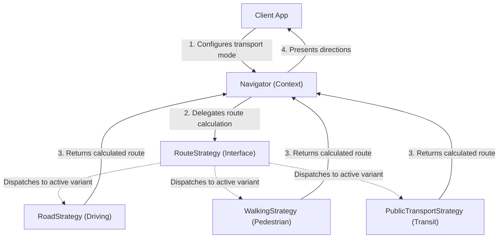
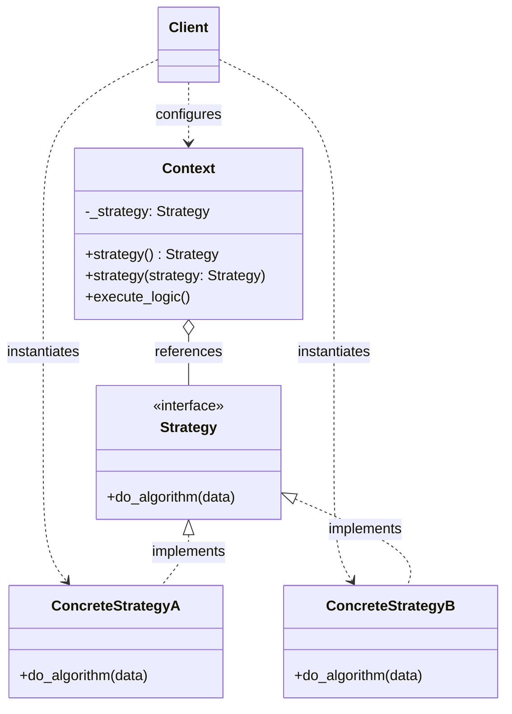

# Strategy Design Pattern

| Metadata      | Value                      |
| ------------- | -------------------------- |
| Author        | Lyzander Marciano Andrylie |
| Creation Date | Nov 12, 2026               |
| Last Updated  | Nov 12, 2026               |

## References

- [Strategy Design Pattern - Refactoring.Guru](https://refactoring.guru/design-patterns/strategy): Comprehensive architectural breakdown of Strategy, including problem statement, solution, applicability, and structure
- [Strategy in Python - Refactoring.Guru](https://refactoring.guru/design-patterns/strategy/python/example): Conceptual structure and idiomatic Python implementation examples
- [design-pattern.md](../design-pattern.md): Overview of software design patterns and catalog categories
- [state.md](./state.md): Similar structure, but State encapsulates state transitions while Strategy encapsulates independent algorithms
- [template_method.md](./template_method.md): Alters parts of an algorithm via inheritance at the class level rather than composition at runtime
- [command.md](./command.md): Converts an action into an object rather than swapping implementations of the same algorithm

## Description

The Strategy design pattern is a behavioral pattern that defines a family of interchangeable algorithms, encapsulates each algorithm inside an independent class, and delegates execution to them at runtime. It solves the problem of rigid, bloated classes bogged down by massive conditional branching by substituting static inheritance with runtime object composition.

## Concepts

### 1. Intent, Problem, and Solution

The core purpose of the Strategy pattern is to decouple algorithmic logic from the contexts and clients that execute it.

- **Intent**: Define a family of related algorithms, encapsulate each one inside a separate class, and make their instances interchangeable so that algorithms vary independently from clients using them.
- **Problem**: In a mapping and navigation application, the primary `Navigator` class initially calculates routes for vehicles. As requirements evolve, new routing options such as walking trails, cycling paths, and public transit connections are added directly to `Navigator`. Over time:
  - The `Navigator` class expands into a bloated monolith full of convoluted `if-elif-else` or `match` blocks.
  - Updating or optimizing one routing algorithm creates high risks of introducing regressions into other transport modes.
  - Merge conflicts proliferate across engineering teams modifying the same centralized file for different transport features.
  - Adding a new algorithm requires editing existing, tested code in `Navigator`, violating the Open/Closed Principle.
- **Solution**: Extract each route calculation algorithm into its own dedicated class called a **Concrete Strategy** conforming to a common `RouteStrategy` interface. The `Navigator` class (the **Context**) retains a reference to a strategy instance and delegates routing computations to it. Switching transport modes simply replaces the active strategy instance at runtime using object composition.
- **Applicability**:
  - When an application requires multiple variations of an algorithm (such as different compression codecs, payment gateways, or sorting routines).
  - When you want to eliminate massive conditional branching statements (`if/elif` or `switch`) that select between algorithm variants.
  - When an algorithm uses proprietary data structures, helper utilities, or dependencies that client code should not know about.
  - When behaviors must be swapped dynamically at runtime based on user preferences or environmental conditions.

#### Trade-offs and Comparison

| Aspect                      | Advantages (Pros)                                                                                                                      | Trade-offs (Cons)                                                                                                                             |
| :-------------------------- | :------------------------------------------------------------------------------------------------------------------------------------- | :-------------------------------------------------------------------------------------------------------------------------------------------- |
| **Extensibility**           | Conforms to the Open/Closed Principle: new concrete strategies can be introduced without modifying the Context or existing strategies. | Increases overall class count and architectural layers, which can be unnecessary overhead when only one or two static algorithms exist.       |
| **Coupling & Architecture** | Replaces rigid inheritance hierarchies with flexible object composition, allowing dynamic runtime algorithm switching.                 | Clients must understand the operational differences between strategies to select the appropriate concrete implementation.                     |
| **Maintainability**         | Isolates algorithm implementation details and algorithmic helper data from caller business logic.                                      | In modern languages like Python, passing simple functions or callables directly is often more idiomatic than building full class hierarchies. |

#### Interaction



### 2. Structure and Components

The Strategy pattern separates the entity requesting algorithmic computation from the entities executing it through four core components:

| Component                | Responsibility                                                                                                                               | Relationship                                                         |
| :----------------------- | :------------------------------------------------------------------------------------------------------------------------------------------- | :------------------------------------------------------------------- |
| **Context**              | Maintains a reference to a `Strategy` object and delegates algorithm execution to it; provides methods to set or swap strategies at runtime. | Holds a reference to `Strategy` via composition (`has-a`).           |
| **Strategy (Interface)** | Declares the common interface or abstract base class implemented by all algorithm variations.                                                | Abstract contract implemented by concrete strategies.                |
| **Concrete Strategies**  | Implement specific algorithm variations conforming to the `Strategy` interface contract.                                                     | Implements or inherits from `Strategy` (`is-a`).                     |
| **Client**               | Instantiates a concrete strategy object and passes it to the `Context`; may replace strategies on the context dynamically.                   | Interacts directly with `Context` and creates `Concrete Strategies`. |

- **Context Delegation**: The context does not perform the algorithm calculation directly. Instead, it calls the strategy's interface method (e.g., `execute()` or `do_algorithm()`), passing any required contextual data as parameters.
- **Client Awareness**: The client determines which strategy best fits the current context and injects it into the context. After configuration, the client interacts purely with the context.
- **Encapsulation**: Strategies remain interchangeable because they share the identical method signature and return type enforced by the base interface.

#### Interaction



### 3. Python Implementation

Python provides built-in support for abstract base classes via the `abc` module to formalize strategy interfaces, while property setters enable dynamic strategy swapping at runtime.

#### a. Conceptual Structure Example

The conceptual example demonstrates the structural relationship between the `Context`, the abstract `Strategy` interface, and two interchangeable `ConcreteStrategy` implementations performing standard and reverse sorting:

- **`Strategy`**: Abstract Base Class (`ABC`) declaring `do_algorithm()`.
- **`ConcreteStrategyA` & `ConcreteStrategyB`**: Concrete classes implementing standard sorting (`sorted()`) and reversed sorting (`reversed(sorted())`).
- **`Context`**: Encapsulates `_strategy` with getter and setter properties, delegating sorting execution to the active strategy.
- **`Client`**: Instantiates the context with `ConcreteStrategyA`, executes the logic, and switches to `ConcreteStrategyB` at runtime.

```python
from __future__ import annotations
from abc import ABC, abstractmethod
from typing import List


class Strategy(ABC):
    """
    The Strategy interface declares operations common to all supported versions
    of some algorithm.
    """

    @abstractmethod
    def do_algorithm(self, data: List[str]) -> List[str]:
        """Execute algorithmic transformation on input data."""
        pass


class ConcreteStrategyA(Strategy):
    """
    Concrete Strategy A: Sorts data in ascending alphabetical order.
    """

    def do_algorithm(self, data: List[str]) -> List[str]:
        return sorted(data)


class ConcreteStrategyB(Strategy):
    """
    Concrete Strategy B: Sorts data in descending alphabetical order.
    """

    def do_algorithm(self, data: List[str]) -> List[str]:
        return list(reversed(sorted(data)))


class Context:
    """
    The Context maintains a reference to a Strategy object and delegates work
    to it instead of implementing multiple algorithm versions internally.
    """

    def __init__(self, strategy: Strategy) -> None:
        self._strategy = strategy

    @property
    def strategy(self) -> Strategy:
        """Get the currently configured strategy."""
        return self._strategy

    @strategy.setter
    def strategy(self, strategy: Strategy) -> None:
        """Replace the active strategy at runtime."""
        self._strategy = strategy

    def execute_logic(self) -> None:
        """Delegate algorithm execution to the active strategy."""
        print("Context: Delegating data processing to current strategy...")
        sample_data = ["e", "b", "a", "d", "c"]
        result = self._strategy.do_algorithm(sample_data)
        formatted_result = ", ".join(result)
        print(f"Result: {formatted_result}")


if __name__ == "__main__":
    # Client configures context with ascending sort strategy
    context = Context(ConcreteStrategyA())
    print("Client: Configured with ConcreteStrategyA (Ascending Sort).")
    context.execute_logic()
    # Output:
    # Client: Configured with ConcreteStrategyA (Ascending Sort).
    # Context: Delegating data processing to current strategy...
    # Result: a, b, c, d, e

    # Client swaps strategy dynamically at runtime
    print("\nClient: Swapping to ConcreteStrategyB (Descending Sort) at runtime.")
    context.strategy = ConcreteStrategyB()
    context.execute_logic()
    # Output:
    # Client: Swapping to ConcreteStrategyB (Descending Sort) at runtime.
    # Context: Delegating data processing to current strategy...
    # Result: e, d, c, b, a
```

#### b. Practical Real-World Example

In a navigation application, a `Navigator` context calculates routes between an origin and destination. Rather than embedding road, walking, and transit routing logic inside `Navigator` with conditional flags, each routing modality is encapsulated inside a distinct `RouteStrategy`:

- **`RouteStrategy`**: Abstract interface defining `build_route(origin, destination) -> List[str]`.
- **`RoadStrategy`**: Implements vehicular route calculation prioritizing expressways.
- **`WalkingStrategy`**: Implements pedestrian routing navigating sidewalks and park pathways.
- **`PublicTransportStrategy`**: Implements transit routing coordinating subway trains and bus transfers.
- **`Navigator`**: Acts as the context, maintaining the selected `RouteStrategy` and computing turn-by-turn routes on demand.

```python
from __future__ import annotations
from abc import ABC, abstractmethod
from typing import List


class RouteStrategy(ABC):
    """
    Common Strategy interface declaring route calculation operations.
    """

    @abstractmethod
    def build_route(self, origin: str, destination: str) -> List[str]:
        """Calculate and return waypoint directions between two locations."""
        pass


class RoadStrategy(RouteStrategy):
    """
    Concrete Strategy: High-speed driving route utilizing expressways.
    """

    def build_route(self, origin: str, destination: str) -> List[str]:
        return [
            f"Depart from {origin}",
            "Merge onto Highway I-95 North (express toll lanes)",
            "Take Exit 42 toward Downtown",
            f"Arrive at {destination} (Est. time: 25 mins by car)",
        ]


class WalkingStrategy(RouteStrategy):
    """
    Concrete Strategy: Pedestrian walking route utilizing sidewalks and footpaths.
    """

    def build_route(self, origin: str, destination: str) -> List[str]:
        return [
            f"Depart from {origin}",
            "Walk east along Maple Street sidewalk",
            "Cut through Central Park pedestrian footpath",
            "Cross 5th Avenue pedestrian crosswalk",
            f"Arrive at {destination} (Est. time: 65 mins on foot)",
        ]


class PublicTransportStrategy(RouteStrategy):
    """
    Concrete Strategy: Mass transit route utilizing subways and commuter buses.
    """

    def build_route(self, origin: str, destination: str) -> List[str]:
        return [
            f"Depart from {origin}",
            "Walk 200m to Metro Line 1 Station",
            "Board Northbound Train #4 to Central Station",
            "Transfer to Bus Line 12 for 3 stops",
            f"Arrive at {destination} (Est. time: 35 mins via transit)",
        ]


class Navigator:
    """
    Context class maintaining a reference to a RouteStrategy.
    """

    def __init__(self, route_strategy: RouteStrategy) -> None:
        self._route_strategy = route_strategy

    @property
    def route_strategy(self) -> RouteStrategy:
        """Access the current route strategy."""
        return self._route_strategy

    @route_strategy.setter
    def route_strategy(self, route_strategy: RouteStrategy) -> None:
        """Switch the routing strategy at runtime."""
        self._route_strategy = route_strategy

    def navigate(self, origin: str, destination: str) -> None:
        """Delegate route calculation to the active strategy and display directions."""
        print(f"Computing route from '{origin}' to '{destination}'...")
        directions = self._route_strategy.build_route(origin, destination)
        for step_idx, step_desc in enumerate(directions, start=1):
            print(f"  {step_idx}. {step_desc}")


if __name__ == "__main__":
    start_point = "Penn Station"
    end_point = "Metropolitan Museum of Art"

    # 1. Default navigation: Driving mode
    navigator = Navigator(RoadStrategy())
    print("Mode: Driving")
    navigator.navigate(start_point, end_point)
    # Output:
    # Mode: Driving
    # Computing route from 'Penn Station' to 'Metropolitan Museum of Art'...
    #   1. Depart from Penn Station
    #   2. Merge onto Highway I-95 North (express toll lanes)
    #   3. Take Exit 42 toward Downtown
    #   4. Arrive at Metropolitan Museum of Art (Est. time: 25 mins by car)

    # 2. User switches to walking mode at runtime
    print("\nMode: Walking")
    navigator.route_strategy = WalkingStrategy()
    navigator.navigate(start_point, end_point)
    # Output:
    # Mode: Walking
    # Computing route from 'Penn Station' to 'Metropolitan Museum of Art'...
    #   1. Depart from Penn Station
    #   2. Walk east along Maple Street sidewalk
    #   3. Cut through Central Park pedestrian footpath
    #   4. Cross 5th Avenue pedestrian crosswalk
    #   5. Arrive at Metropolitan Museum of Art (Est. time: 65 mins on foot)

    # 3. User switches to public transit mode at runtime
    print("\nMode: Public Transit")
    navigator.route_strategy = PublicTransportStrategy()
    navigator.navigate(start_point, end_point)
    # Output:
    # Mode: Public Transit
    # Computing route from 'Penn Station' to 'Metropolitan Museum of Art'...
    #   1. Depart from Penn Station
    #   2. Walk 200m to Metro Line 1 Station
    #   3. Board Northbound Train #4 to Central Station
    #   4. Transfer to Bus Line 12 for 3 stops
    #   5. Arrive at Metropolitan Museum of Art (Est. time: 35 mins via transit)
```
