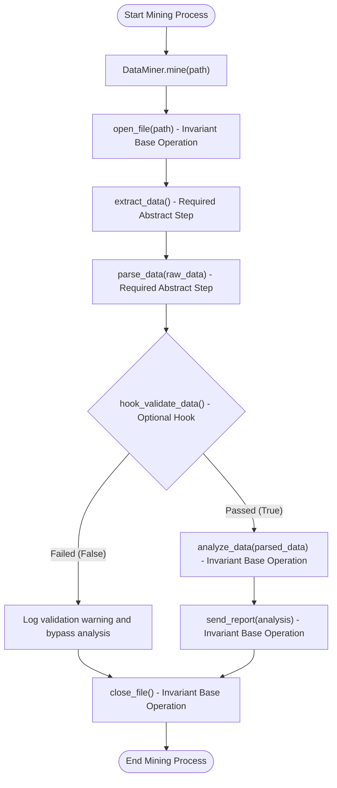
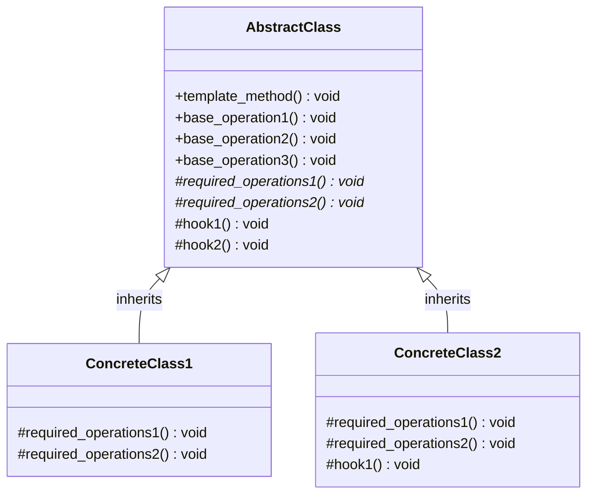

# Template Method Design Pattern

| Metadata      | Value                      |
| ------------- | -------------------------- |
| Author        | Lyzander Marciano Andrylie |
| Creation Date | Nov 12, 2026               |
| Last Updated  | Nov 12, 2026               |

## References

- [Template Method Pattern - Refactoring.Guru](https://refactoring.guru/design-patterns/template-method): Architectural overview of Template Method intent, problem, solution, applicability, and structure
- [Template Method in Python - Refactoring.Guru](https://refactoring.guru/design-patterns/template-method/python/example): Python conceptual code implementation and structure examples
- [design-pattern.md](../design-pattern.md): Overview of software design patterns and catalog categories
- [factory_method.md](../creational/factory_method.md): Specialization of Template Method dedicated to object creation
- [strategy.md](./strategy.md): Uses composition to swap entire algorithms at runtime rather than inheritance to override steps

## Description

Template Method is a behavioral design pattern that defines the skeleton of an algorithm in an abstract base class while allowing subclasses to override specific steps without modifying the overall execution structure. It eliminates code duplication across classes that share an identical workflow but require custom implementations for individual stages.

## Concepts

### 1. Intent, Problem, and Solution

The Template Method pattern establishes a structured framework for algorithm execution by enforcing an invariant sequence of operations while delegating variant steps to subclasses.

- **Intent**:
  - Define the master skeleton of an algorithm inside a single base-class method (`template_method`).
  - Let subclasses redefine specific algorithm steps without altering the high-level workflow sequence or invariant rules.
  - Apply the **Hollywood Principle** (_"Don't call us, we'll call you"_): the parent class controls execution and invokes subclass methods, preventing child classes from dictating overall control flow.
- **Problem**:
  - Suppose an organization builds an automated data-mining application to ingest and extract insights from corporate documents across multiple formats: `DocDataMiner`, `CSVDataMiner`, and `PDFDataMiner`.
  - Each class executes the exact same sequential lifecycle:
    1. Open the file from a given path.
    2. Extract raw data from the file stream.
    3. Parse extracted content into structured records.
    4. Analyze the structured data.
    5. Send an aggregated analysis report.
    6. Close the file resource.
  - While opening files and parsing content differ across formats (e.g., CSV splits text by commas, while PDF reads binary streams and fonts), data analysis and report dispatching are identical across all document types.
  - Without a template method, each miner class duplicates the overarching sequence and shared logic. Adding a new step (e.g., data caching or compliance auditing) requires modifying every single miner class, creating a maintenance bottleneck and introducing risks of divergence.
- **Solution**:
  - Break the algorithm down into distinct functional steps represented as separate methods.
  - Define a master `template_method()` in an `AbstractClass` that calls these steps in strict sequence.
  - Split operations into three distinct categories:
    - **Base Operations (Invariant)**: Standard methods implemented directly in `AbstractClass` that provide shared logic (e.g., opening files, analyzing data, dispatching reports, closing resources).
    - **Required Operations (Variant)**: Abstract methods decorated with `@abstractmethod` that every subclass must implement (e.g., extracting data, parsing format-specific records).
    - **Hooks (Optional)**: Extension points implemented with empty or default behavior in `AbstractClass` that subclasses can selectively override (e.g., optional schema validation or pre/post-processing filters).
  - Concrete subclasses inherit from `AbstractClass` and implement only the required abstract methods or hooks, leaving the algorithm skeleton untouched.
- **Applicability**:
  - When clients should be permitted to extend only specific steps of a larger algorithm, but not the overall structure or sequence.
  - When multiple classes contain nearly identical algorithms with minor variations, allowing you to pull duplicate boilerplate into a common superclass.
  - When you want to impose rigid lifecycle stages across a family of subclasses while preserving safe extension points.

#### Trade-offs and Comparison

| Aspect                     | Advantage / Limitation              | Impact                                                                                                          |
| :------------------------- | :---------------------------------- | :-------------------------------------------------------------------------------------------------------------- |
| **Code Reuse**             | Eliminates code duplication         | Invariant algorithm steps reside exclusively in the base class, adhering to the DRY principle.                  |
| **Controlled Extension**   | Protects algorithm integrity        | Subclasses can only customize predefined steps, preventing inadvertent disruption of the core workflow.         |
| **Inversion of Control**   | Centralized coordination            | The superclass drives the algorithm flow rather than client code or subclasses directly.                        |
| **Rigid Structure**        | Subclasses cannot reorder steps     | Subclasses are constrained to the predefined execution pipeline defined by the template method.                 |
| **LSP Violation Risk**     | Risk of improper subclass overrides | Subclasses that suppress default behavior with no-ops may violate the Liskov Substitution Principle.            |
| **Maintenance Complexity** | Step explosion over time            | Algorithms with many fine-grained steps become challenging to maintain and document in large class hierarchies. |

#### Interaction

The following flowchart illustrates how the template method orchestrates invariant base operations, required subclass steps, and optional hooks:



---

### 2. Structure and Components

The Template Method pattern separates algorithm coordination from individual step implementation using inheritance.

| Component               | Role                      | Description                                                                                                                    |
| :---------------------- | :------------------------ | :----------------------------------------------------------------------------------------------------------------------------- |
| `AbstractClass`         | Algorithm Coordinator     | Declares the `template_method()` and provides default implementations for invariant base operations and hooks.                 |
| `template_method()`     | Invariant Skeleton        | Public method that calls primitive operations, base operations, and hooks in a fixed order. Subclasses should not override it. |
| `base_operations()`     | Invariant Steps           | Concrete methods in `AbstractClass` that execute standard, shared logic across all subclasses.                                 |
| `required_operations()` | Mandatory Steps           | Abstract methods (`@abstractmethod`) without implementation that subclasses must define.                                       |
| `hooks()`               | Optional Extension Points | Methods in `AbstractClass` with empty or default logic that subclasses may optionally override to inject custom behavior.      |
| `ConcreteClass`         | Step Specializer          | Inherits from `AbstractClass` and implements all required operations and any desired hooks.                                    |

- **`AbstractClass`**: Serves as the base coordinator. It encapsulates the invariant business rules and sequences all operational steps.
- **`template_method()`**: The core entry point. In Python, this method coordinates calls to self-referential helper methods (`self.base_operation()`, `self.required_operation()`, `self.hook()`). It should remain stable across all child implementations.
- **`base_operations()`**: Provide common functionality (e.g., standard file handles, logging, or notifications) that child classes inherit directly without needing modification.
- **`required_operations()`**: Force concrete classes to provide domain-specific implementations. If a subclass fails to implement any required operation, Python prevents instantiation at runtime by raising `TypeError`.
- **`hooks()`**: Placed before or after crucial operations. A hook might return a boolean that acts as a conditional guard (e.g., `if self.hook(): ...`) or execute an empty placeholder action that subclasses can populate.
- **`ConcreteClass`**: Subclasses `AbstractClass` to provide format-specific or domain-specific mechanics. Multiple concrete classes can be passed interchangeably to client code through polymorphism.

#### Interaction

The class diagram below depicts the relationship between the abstract coordinator and its concrete subclasses:



---

### 3. Python Implementation

Python implements the Template Method pattern using the built-in `abc` (Abstract Base Classes) module, where `@abstractmethod` enforces the implementation of required steps in concrete subclasses.

#### a. Conceptual Structure Example

The conceptual structure demonstrates the orchestration of base operations, required abstract operations, and optional hooks across two concrete implementations.

- **`AbstractClass`**: Inherits from `abc.ABC` and defines `template_method()`. It executes `base_operation1()`, `required_operations1()`, `base_operation2()`, `hook1()`, `required_operations2()`, `base_operation3()`, and `hook2()`.
- **`base_operation1..3`**: Fully implemented methods in `AbstractClass` that provide default shared behavior.
- **`required_operations1..2`**: Abstract methods decorated with `@abstractmethod` that child classes must define.
- **`hook1..2`**: Optional extension hooks with empty default bodies (`pass`).
- **`ConcreteClass1`**: Implements the mandatory required operations while leaving hooks untouched.
- **`ConcreteClass2`**: Implements the mandatory required operations and overrides `hook1()` to inject custom logic into the template execution.
- **`client_code()`**: Accepts any instance of `AbstractClass` and triggers `template_method()`.

```python
from abc import ABC, abstractmethod


class AbstractClass(ABC):
    """
    AbstractClass defines the template method containing the skeleton of an
    algorithm, composed of calls to invariant base operations, required
    primitive operations, and optional hooks.
    """

    def template_method(self) -> None:
        """The template method defines the invariant execution skeleton."""
        self.base_operation1()
        self.required_operations1()
        self.base_operation2()
        self.hook1()
        self.required_operations2()
        self.base_operation3()
        self.hook2()

    # Invariant base operations (already implemented)
    def base_operation1(self) -> None:
        print("AbstractClass: Performing invariant setup (base_operation1)")

    def base_operation2(self) -> None:
        print("AbstractClass: Coordinating intermediate step (base_operation2)")

    def base_operation3(self) -> None:
        print("AbstractClass: Finalizing standard cleanup (base_operation3)")

    # Required operations (must be implemented by subclasses)
    @abstractmethod
    def required_operations1(self) -> None:
        pass

    @abstractmethod
    def required_operations2(self) -> None:
        pass

    # Optional hooks (subclasses may override, but default implementation is empty)
    def hook1(self) -> None:
        pass

    def hook2(self) -> None:
        pass


class ConcreteClass1(AbstractClass):
    """
    ConcreteClass1 implements all required operations and relies on the default
    empty implementations of hooks.
    """

    def required_operations1(self) -> None:
        print("ConcreteClass1: Implemented required operation 1")

    def required_operations2(self) -> None:
        print("ConcreteClass1: Implemented required operation 2")


class ConcreteClass2(AbstractClass):
    """
    ConcreteClass2 implements all required operations and overrides hook1
    to inject custom behavior into the algorithm skeleton.
    """

    def required_operations1(self) -> None:
        print("ConcreteClass2: Implemented required operation 1")

    def required_operations2(self) -> None:
        print("ConcreteClass2: Implemented required operation 2")

    def hook1(self) -> None:
        print("ConcreteClass2: Custom extension executed via hook1")


def client_code(abstract_class: AbstractClass) -> None:
    """
    The client code calls the template method to execute the algorithm without
    needing to know the concrete class type.
    """
    abstract_class.template_method()


if __name__ == "__main__":
    print("--- Executing with ConcreteClass1 ---")
    client_code(ConcreteClass1())
    # Output:
    # --- Executing with ConcreteClass1 ---
    # AbstractClass: Performing invariant setup (base_operation1)
    # ConcreteClass1: Implemented required operation 1
    # AbstractClass: Coordinating intermediate step (base_operation2)
    # ConcreteClass1: Implemented required operation 2
    # AbstractClass: Finalizing standard cleanup (base_operation3)

    print("\n--- Executing with ConcreteClass2 ---")
    client_code(ConcreteClass2())
    # Output:
    # --- Executing with ConcreteClass2 ---
    # AbstractClass: Performing invariant setup (base_operation1)
    # ConcreteClass2: Implemented required operation 1
    # AbstractClass: Coordinating intermediate step (base_operation2)
    # ConcreteClass2: Custom extension executed via hook1
    # ConcreteClass2: Implemented required operation 2
    # AbstractClass: Finalizing standard cleanup (base_operation3)
```

#### b. Practical Real-World Example

This practical example models a document data-mining pipeline where different document formats (`CSVDataMiner` and `PDFDataMiner`) share an invariant lifecycle while specializing file extraction, data parsing, and optional document validation.

- **`DataMiner` (`AbstractClass`)**: Defines `mine(path: str)` as the template method.
  - Invariant steps: `open_file(path)`, `analyze_data(parsed_data)`, `send_report(analysis)`, and `close_file()`.
  - Required abstract steps: `extract_data()` and `parse_data(raw_data)`.
  - Optional hook: `hook_validate_data(parsed_data)`, which defaults to returning `True`.
- **`CSVDataMiner` (`ConcreteClass`)**: Implements raw text extraction and parses comma-separated rows into structured dictionaries. It uses the default validation hook.
- **`PDFDataMiner` (`ConcreteClass`)**: Implements binary stream parsing for PDF documents and overrides `hook_validate_data()` to ensure mandatory schema keys exist before analysis proceeds.
- **`run_mining_pipeline()`**: Demonstrates client invocation of polymorphic miners through the uniform `mine()` interface.

```python
from abc import ABC, abstractmethod
from typing import Any, Dict, List


class DataMiner(ABC):
    """
    Abstract base class defining the invariant template method for mining
    structured data from various document formats.
    """

    def mine(self, path: str) -> None:
        """
        The template method defining the invariant data-mining algorithm skeleton.
        """
        self.open_file(path)
        raw_data = self.extract_data()
        parsed_data = self.parse_data(raw_data)

        # Optional hook evaluation controls execution flow
        if self.hook_validate_data(parsed_data):
            analysis = self.analyze_data(parsed_data)
            self.send_report(analysis)
        else:
            print(f"Validation failed for {path}; skipping analysis.")

        self.close_file()

    # Invariant base operations shared across all miners
    def open_file(self, path: str) -> None:
        print(f"Opening file: {path}")

    def close_file(self) -> None:
        print("Closing file connection.\n")

    def analyze_data(self, data: List[Dict[str, Any]]) -> Dict[str, Any]:
        print(f"Analyzing {len(data)} parsed records...")
        return {"record_count": len(data), "status": "PROCESSED"}

    def send_report(self, analysis: Dict[str, Any]) -> None:
        print(f"Dispatching report: {analysis}")

    # Required operations that subclasses must implement
    @abstractmethod
    def extract_data(self) -> str:
        """Extract raw content from the file source."""
        pass

    @abstractmethod
    def parse_data(self, raw_data: str) -> List[Dict[str, Any]]:
        """Parse raw content into structured record dictionaries."""
        pass

    # Optional hook providing an extension point for document validation
    def hook_validate_data(self, data: List[Dict[str, Any]]) -> bool:
        """Defaults to True; subclasses can override to enforce schema validation."""
        return True


class CSVDataMiner(DataMiner):
    """Concrete miner specialized for Comma-Separated Values (CSV) files."""

    def extract_data(self) -> str:
        print("CSVDataMiner: Extracting raw CSV text lines...")
        return "id,name,value\n1,Alpha,100\n2,Beta,250"

    def parse_data(self, raw_data: str) -> List[Dict[str, Any]]:
        print("CSVDataMiner: Parsing comma-separated rows into records...")
        lines = raw_data.strip().split("\n")
        headers = lines[0].split(",")
        records = []
        for line in lines[1:]:
            values = line.split(",")
            records.append(dict(zip(headers, values)))
        return records


class PDFDataMiner(DataMiner):
    """Concrete miner specialized for Portable Document Format (PDF) files."""

    def extract_data(self) -> str:
        print("PDFDataMiner: Extracting binary text streams from PDF pages...")
        return "ID:101;Name:Gamma;Value:500\nID:102;Name:Delta;Value:750"

    def parse_data(self, raw_data: str) -> List[Dict[str, Any]]:
        print("PDFDataMiner: Parsing delimited text tokens into structured records...")
        records = []
        for line in raw_data.strip().split("\n"):
            entry = {}
            for item in line.split(";"):
                k, v = item.split(":")
                entry[k.lower()] = v
            records.append(entry)
        return records

    def hook_validate_data(self, data: List[Dict[str, Any]]) -> bool:
        print("PDFDataMiner (Hook): Validating document integrity and field presence...")
        is_valid = all("id" in item and "value" in item for item in data)
        print(f"PDFDataMiner (Hook): Integrity check passed = {is_valid}")
        return is_valid


def run_mining_pipeline(miner: DataMiner, file_path: str) -> None:
    """Client function operating against the abstract DataMiner interface."""
    miner.mine(file_path)


if __name__ == "__main__":
    print("=== Processing CSV Document ===")
    csv_miner = CSVDataMiner()
    run_mining_pipeline(csv_miner, "finance_q3.csv")
    # Output:
    # === Processing CSV Document ===
    # Opening file: finance_q3.csv
    # CSVDataMiner: Extracting raw CSV text lines...
    # CSVDataMiner: Parsing comma-separated rows into records...
    # Analyzing 2 parsed records...
    # Dispatching report: {'record_count': 2, 'status': 'PROCESSED'}
    # Closing file connection.

    print("=== Processing PDF Document ===")
    pdf_miner = PDFDataMiner()
    run_mining_pipeline(pdf_miner, "annual_audit.pdf")
    # Output:
    # === Processing PDF Document ===
    # Opening file: annual_audit.pdf
    # PDFDataMiner: Extracting binary text streams from PDF pages...
    # PDFDataMiner: Parsing delimited text tokens into structured records...
    # PDFDataMiner (Hook): Validating document integrity and field presence...
    # PDFDataMiner (Hook): Integrity check passed = True
    # Analyzing 2 parsed records...
    # Dispatching report: {'record_count': 2, 'status': 'PROCESSED'}
    # Closing file connection.
```
