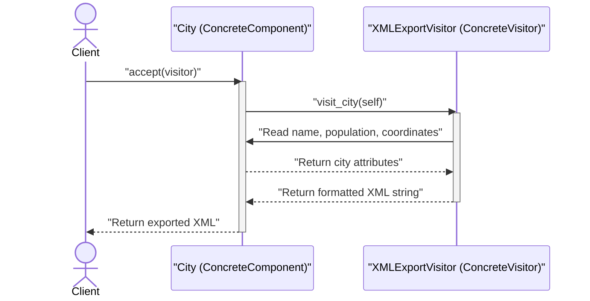
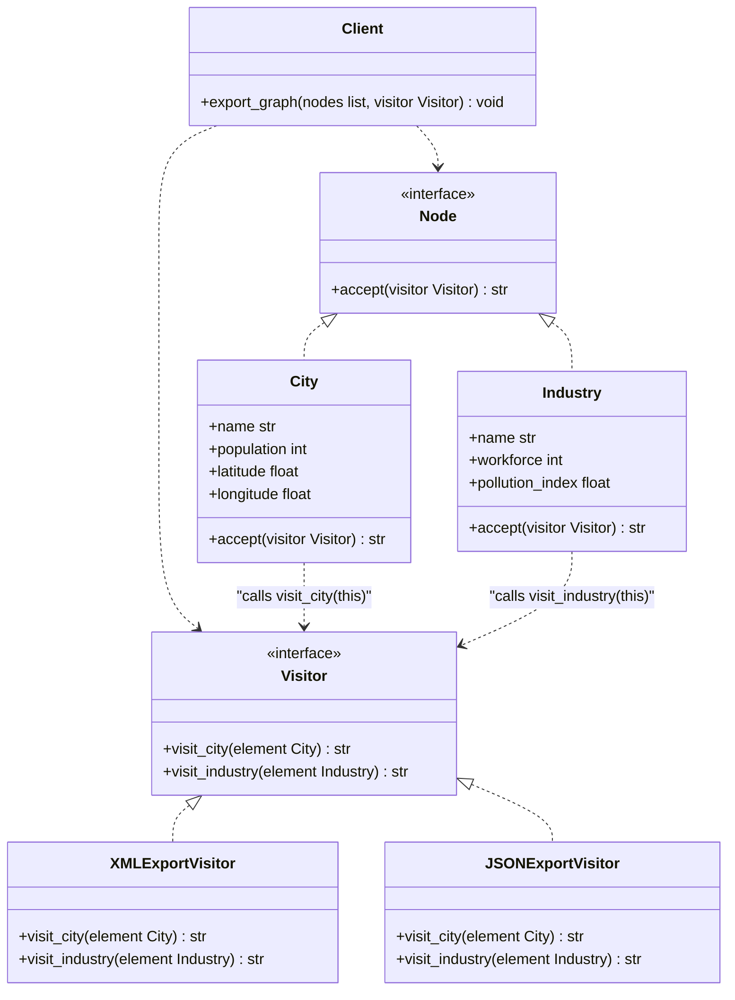

# Visitor Design Pattern

| Metadata      | Value                      |
| ------------- | -------------------------- |
| Author        | Lyzander Marciano Andrylie |
| Creation Date | Nov 12, 2026               |
| Last Updated  | Nov 12, 2026               |

## References

- [Refactoring.Guru - Visitor](https://refactoring.guru/design-patterns/visitor): Core pattern intent, problem description, structure, and trade-offs
- [Refactoring.Guru - Visitor in Python](https://refactoring.guru/design-patterns/visitor/python/example): Python conceptual and real-world implementation examples
- [design-pattern.md](../design-pattern.md): Overview of software design patterns and catalog categories
- [composite.md](../structural/composite.md): Visitor is commonly used to execute operations across an entire Composite tree
- [iterator.md](./iterator.md): Can traverse a complex data structure while Visitor performs operations on each element

## Description

The **Visitor** is a behavioral design pattern that allows you to separate algorithms and operational behaviors from the objects on which they operate. It solves the problem of adding new behaviors or operations to an existing class hierarchy without modifying, polluting, or breaking existing domain classes.

## Concepts

### 1. Intent, Problem, and Solution

The Visitor pattern addresses the architectural tension between stable data structures and evolving operations by leveraging **Double Dispatch**.

- **Intent**: Separate algorithms from the object structures on which they operate, enabling you to define new operations without altering the classes of the elements being operated upon.
- **Problem**:
  - Suppose you have a geographic mapping and navigation application with a stable graph of domain node classes: `City`, `Industry`, and `SightSeeing`.
  - You are tasked with adding export functionality across the graph (such as exporting nodes to XML, JSON, or CSV formats) or generating specialized analytical reports.
  - Adding serialization or reporting methods (e.g., `export_xml()`, `export_json()`) directly to each domain class violates the **Single Responsibility Principle (SRP)** by mingling core domain logic with auxiliary export logic.
  - Adding a new export format in the future forces modifications across all node classes, violating the **Open/Closed Principle (OCP)** and risking regressions in stable domain entities.
- **Solution**:
  - Place the new behavior into a separate `Visitor` class hierarchy rather than embedding it inside domain classes.
  - Define a visitor interface with distinct visiting methods for each concrete element type (e.g., `visit_city(City)`, `visit_industry(Industry)`, `visit_sight_seeing(SightSeeing)`).
  - Add a lightweight `accept(visitor)` method to each domain element class.
  - Inside `accept(visitor)`, the element dispatches execution back to the visitor by invoking the corresponding type-specific method (e.g., `visitor.visit_city(self)`), passing itself as the argument.
  - This technique—known as **Double Dispatch**—delegates the choice of executing method to both the runtime type of the visitor and the runtime type of the element.
- **Applicability**:
  - Use Visitor when you need to execute an operation across all elements of a complex object graph or tree structure (e.g., an abstract syntax tree or Composite hierarchy).
  - Use Visitor when you need to clean up domain entity classes by moving secondary, auxiliary, or formatting operations (exporting, printing, auditing, type-checking) into external classes.
  - Use Visitor when the object class hierarchy is stable and changes infrequently, but you frequently introduce new operations or algorithms that operate on these objects.

| Trade-off Dimension     | Advantage (Pros)                                                                                              | Disadvantage (Cons)                                                                                       |
| ----------------------- | ------------------------------------------------------------------------------------------------------------- | --------------------------------------------------------------------------------------------------------- |
| **Extensibility (OCP)** | Open/Closed Principle: Add new operations over various classes without altering those classes.                | Introducing a new concrete element class forces updates to every existing visitor interface and subclass. |
| **Modularity (SRP)**    | Single Responsibility Principle: Groups related behaviors and algorithms across diverse nodes into one class. | Violates encapsulation if visitors require access to private or internal attributes of visited elements.  |
| **State Accumulation**  | Visitors can maintain and accumulate state as they traverse through complex object collections.               | Increases architectural complexity and indirection compared to standard method calls.                     |

#### Interaction



### 2. Structure and Components

The Visitor pattern decouples operations from domain objects by establishing two collaborating hierarchies: **Elements** (`Component`) and **Visitors**.

| Component           | Role                     | Responsibility                                                                                                                     |
| ------------------- | ------------------------ | ---------------------------------------------------------------------------------------------------------------------------------- |
| `Visitor`           | Abstract Interface       | Declares visit operations for each concrete element type in the object structure (e.g., `visit_city`, `visit_industry`).           |
| `ConcreteVisitor`   | Concrete Algorithm Class | Implements distinct versions of the operation tailored for each concrete element class (e.g., `XMLExportVisitor`).                 |
| `Component`         | Abstract Interface       | Declares the `accept(visitor)` entry point that accepts a visitor instance.                                                        |
| `ConcreteComponent` | Concrete Domain Node     | Implements `accept(visitor)` to invoke the matching visit method on the visitor, passing `self` (`visitor.visit_<element>(self)`). |
| `Client`            | Workflow Coordinator     | Traverses a collection or composite structure of components, passing a visitor instance to each component's `accept()` method.     |

- **Double Dispatch Mechanism**: In single dispatch languages (such as Python, Java, and C++), virtual method resolution depends solely on the runtime type of the receiver object. The pattern overcomes this by issuing two calls: first, `element.accept(visitor)` resolves based on the element type; second, `visitor.visit_<element>(self)` resolves based on the visitor type.
- **Separation of Concerns**: Data structures store application state, while visitors encapsulate algorithms that process that state.
- **Synergy with Composite & Iterator**: Visitors are frequently combined with [composite.md](../structural/composite.md) trees and [iterator.md](./iterator.md) instances to traverse hierarchical graph structures and execute polymorphic actions across varied node types.

#### Interaction



### 3. Python Implementation

The following examples demonstrate how to implement the Visitor pattern in Python using the `abc` standard library module and type annotations.

#### a. Conceptual Structure Example

The conceptual example illustrates the fundamental components and double dispatch flow:

- `Component`: Abstract interface declaring the `accept(visitor: Visitor) -> None` method.
- `ConcreteComponentA`: Concrete element class implementing `accept()` to call `visitor.visit_concrete_component_a(self)` and exposing `exclusive_method_of_concrete_component_a()`.
- `ConcreteComponentB`: Concrete element class implementing `accept()` to call `visitor.visit_concrete_component_b(self)` and exposing `special_method_of_concrete_component_b()`.
- `Visitor`: Abstract visitor interface declaring visit methods for all concrete components: `visit_concrete_component_a()` and `visit_concrete_component_b()`.
- `ConcreteVisitor1`: Concrete visitor executing algorithm variant 1 across both component types.
- `ConcreteVisitor2`: Concrete visitor executing algorithm variant 2 across both component types.
- `client_code`: Client function that iterates through a list of `Component` objects, passing a visitor instance to each without binding to concrete element classes.

```python
from __future__ import annotations
from abc import ABC, abstractmethod
from typing import List


# 1. Component Interface
class Component(ABC):
    """
    The Component interface declares an `accept` method that should take the
    base visitor interface as an argument.
    """

    @abstractmethod
    def accept(self, visitor: Visitor) -> None:
        pass


# 2. Concrete Components
class ConcreteComponentA(Component):
    """
    Each Concrete Component must implement the `accept` method in such a way
    that it calls the visitor's method corresponding to the component's class.
    """

    def accept(self, visitor: Visitor) -> None:
        # Note that we are calling `visit_concrete_component_a`, which matches
        # the current class name. This allows the visitor to know the type.
        visitor.visit_concrete_component_a(self)

    def exclusive_method_of_concrete_component_a(self) -> str:
        """
        Concrete Components may have unique methods that don't exist in their
        base class or interface.
        """
        return "A"


class ConcreteComponentB(Component):
    """
    Same here: ConcreteComponentB calls `visit_concrete_component_b`.
    """

    def accept(self, visitor: Visitor) -> None:
        visitor.visit_concrete_component_b(self)

    def special_method_of_concrete_component_b(self) -> str:
        return "B"


# 3. Visitor Interface
class Visitor(ABC):
    """
    The Visitor Interface declares a set of visiting methods that correspond to
    component classes. The signature of a visiting method allows the visitor to
    identify the exact class of the component that it's dealing with.
    """

    @abstractmethod
    def visit_concrete_component_a(self, element: ConcreteComponentA) -> None:
        pass

    @abstractmethod
    def visit_concrete_component_b(self, element: ConcreteComponentB) -> None:
        pass


# 4. Concrete Visitors
class ConcreteVisitor1(Visitor):
    """
    Concrete Visitors implement several versions of the same algorithm, which
    can work with all concrete component classes.
    """

    def visit_concrete_component_a(self, element: ConcreteComponentA) -> None:
        print(f"{element.exclusive_method_of_concrete_component_a()} + ConcreteVisitor1")

    def visit_concrete_component_b(self, element: ConcreteComponentB) -> None:
        print(f"{element.special_method_of_concrete_component_b()} + ConcreteVisitor1")


class ConcreteVisitor2(Visitor):
    """
    Another Concrete Visitor implementing a distinct algorithm variant.
    """

    def visit_concrete_component_a(self, element: ConcreteComponentA) -> None:
        print(f"{element.exclusive_method_of_concrete_component_a()} + ConcreteVisitor2")

    def visit_concrete_component_b(self, element: ConcreteComponentB) -> None:
        print(f"{element.special_method_of_concrete_component_b()} + ConcreteVisitor2")


# 5. Client Code
def client_code(components: List[Component], visitor: Visitor) -> None:
    """
    The client code can run visitor operations over any set of elements
    without figuring out their concrete classes. The `accept` operation
    directs a call to the appropriate operation in the visitor object.
    """
    for component in components:
        component.accept(visitor)


if __name__ == "__main__":
    components = [ConcreteComponentA(), ConcreteComponentB()]

    print("The client code works with all visitors via the base Visitor interface:")
    visitor1 = ConcreteVisitor1()
    client_code(components, visitor1)
    # Output:
    # The client code works with all visitors via the base Visitor interface:
    # A + ConcreteVisitor1
    # B + ConcreteVisitor1

    print()

    print("It allows the same client code to work with different types of visitors:")
    visitor2 = ConcreteVisitor2()
    client_code(components, visitor2)
    # Output:
    # It allows the same client code to work with different types of visitors:
    # A + ConcreteVisitor2
    # B + ConcreteVisitor2
```

#### b. Practical Real-World Example

A practical geographic information system (GIS) where map graph nodes representing cities and industrial complexes are exported into XML and JSON representations without altering core domain entities:

- `Node`: Abstract base component representing any geographic entity on the map, declaring `accept(visitor: Visitor) -> str`.
- `City`: Concrete node storing geospatial and population data for an urban area (`name`, `population`, `latitude`, `longitude`).
- `Industry`: Concrete node storing industrial information (`name`, `workforce`, `pollution_index`).
- `Visitor`: Abstract visitor interface declaring type-specific export signatures: `visit_city(city: City) -> str` and `visit_industry(industry: Industry) -> str`.
- `XMLExportVisitor`: Concrete visitor serializing node attributes into structured XML tags.
- `JSONExportVisitor`: Concrete visitor serializing node attributes into JSON string format.
- `export_graph`: Client function iterating across graph nodes and applying the selected export visitor polymorphically.

```python
from __future__ import annotations
from abc import ABC, abstractmethod
from typing import List


# 1. Component (Element) Interface
class Node(ABC):
    """
    The Node interface declares the `accept` method for geographic entities.
    """

    @abstractmethod
    def accept(self, visitor: Visitor) -> str:
        """
        Accepts a visitor and delegates execution via double dispatch.
        """
        pass


# 2. Concrete Components
class City(Node):
    """
    Concrete Component: Represents an urban city center in the geographic graph.
    """

    def __init__(
        self, name: str, population: int, latitude: float, longitude: float
    ) -> None:
        self.name = name
        self.population = population
        self.latitude = latitude
        self.longitude = longitude

    def accept(self, visitor: Visitor) -> str:
        """
        Double dispatch: routes execution to the visitor's visit_city method.
        """
        return visitor.visit_city(self)


class Industry(Node):
    """
    Concrete Component: Represents an industrial manufacturing or processing hub.
    """

    def __init__(self, name: str, workforce: int, pollution_index: float) -> None:
        self.name = name
        self.workforce = workforce
        self.pollution_index = pollution_index

    def accept(self, visitor: Visitor) -> str:
        """
        Double dispatch: routes execution to the visitor's visit_industry method.
        """
        return visitor.visit_industry(self)


# 3. Visitor Interface
class Visitor(ABC):
    """
    The Visitor interface declares export operations for each concrete node type.
    """

    @abstractmethod
    def visit_city(self, city: City) -> str:
        pass

    @abstractmethod
    def visit_industry(self, industry: Industry) -> str:
        pass


# 4. Concrete Visitors
class XMLExportVisitor(Visitor):
    """
    Concrete Visitor: Serializes geographic graph nodes into formatted XML tags.
    """

    def visit_city(self, city: City) -> str:
        return (
            f'  <city name="{city.name}">\n'
            f'    <population>{city.population}</population>\n'
            f'    <coordinates lat="{city.latitude}" lon="{city.longitude}"/>\n'
            f'  </city>'
        )

    def visit_industry(self, industry: Industry) -> str:
        return (
            f'  <industry name="{industry.name}">\n'
            f'    <workforce>{industry.workforce}</workforce>\n'
            f'    <pollution_index>{industry.pollution_index}</pollution_index>\n'
            f'  </industry>'
        )


class JSONExportVisitor(Visitor):
    """
    Concrete Visitor: Serializes geographic graph nodes into JSON format.
    """

    def visit_city(self, city: City) -> str:
        return (
            f'  {{"type": "city", "name": "{city.name}", '
            f'"population": {city.population}, '
            f'"coordinates": [{city.latitude}, {city.longitude}]}}'
        )

    def visit_industry(self, industry: Industry) -> str:
        return (
            f'  {{"type": "industry", "name": "{industry.name}", '
            f'"workforce": {industry.workforce}, '
            f'"pollution_index": {industry.pollution_index}}}'
        )


# 5. Client Code
def export_graph(nodes: List[Node], visitor: Visitor) -> None:
    """
    Client function operating across a collection of nodes polymorphically,
    delegating export logic entirely to the visitor object.
    """
    print(f"Exporting using {type(visitor).__name__}:")
    for node in nodes:
        print(node.accept(visitor))


if __name__ == "__main__":
    graph: List[Node] = [
        City(name="Tokyo", population=13960000, latitude=35.6762, longitude=139.6503),
        Industry(name="Keihin Complex", workforce=45000, pollution_index=4.2),
        City(name="Osaka", population=2690000, latitude=34.6937, longitude=135.5023),
    ]

    xml_visitor = XMLExportVisitor()
    export_graph(graph, xml_visitor)
    # Output:
    # Exporting using XMLExportVisitor:
    #   <city name="Tokyo">
    #     <population>13960000</population>
    #     <coordinates lat="35.6762" lon="139.6503"/>
    #   </city>
    #   <industry name="Keihin Complex">
    #     <workforce>45000</workforce>
    #     <pollution_index>4.2</pollution_index>
    #   </industry>
    #   <city name="Osaka">
    #     <population>2690000</population>
    #     <coordinates lat="34.6937" lon="135.5023"/>
    #   </city>

    print()

    json_visitor = JSONExportVisitor()
    export_graph(graph, json_visitor)
    # Output:
    # Exporting using JSONExportVisitor:
    #   {"type": "city", "name": "Tokyo", "population": 13960000, "coordinates": [35.6762, 139.6503]}
    #   {"type": "industry", "name": "Keihin Complex", "workforce": 45000, "pollution_index": 4.2}
    #   {"type": "city", "name": "Osaka", "population": 2690000, "coordinates": [34.6937, 135.5023]}
```
