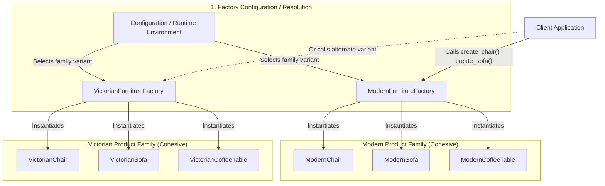
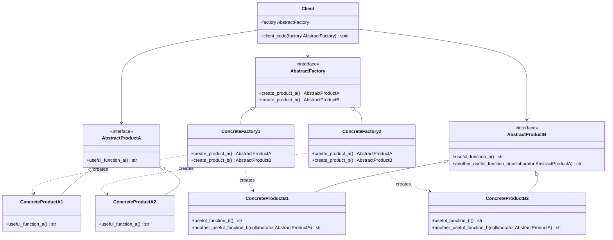

# Abstract Factory Design Pattern

| Metadata      | Value                      |
| ------------- | -------------------------- |
| Author        | Lyzander Marciano Andrylie |
| Creation Date | Nov 12, 2026               |
| Last Updated  | Nov 12, 2026               |

## References

- [Abstract Factory - Refactoring.Guru](https://refactoring.guru/design-patterns/abstract-factory): Overview of the Abstract Factory design pattern, intent, problem, solution, applicability, and structure
- [Abstract Factory in Python - Refactoring.Guru](https://refactoring.guru/design-patterns/abstract-factory/python/example): Python conceptual and practical implementations of the Abstract Factory pattern
- [design-pattern.md](../design-pattern.md): Overview of software design patterns and catalog categories
- [factory_method.md](./factory_method.md): Foundation pattern often used to implement abstract factory methods
- [builder.md](./builder.md): Focuses on constructing complex objects step by step rather than product families
- [prototype.md](./prototype.md): Can be used to implement concrete factories via object cloning
- [facade.md](../structural/facade.md): Can be paired with Abstract Factory to hide subsystem creation

## Description

The **Abstract Factory** is a creational design pattern that provides an interface for creating families of related or dependent objects without specifying their concrete classes. It solves the problem of instantiating cohesive product sets across multiple variants while ensuring that client code remains decoupled from concrete implementation details.

## Concepts

### 1. Intent, Problem, and Solution

The Abstract Factory pattern centralizes the creation of matching product suites, guaranteeing that products from different variants are never mixed inadvertently.

- **Intent**: Provide an abstract creation interface for a family of related products so client code deals only with interfaces rather than concrete class constructors.
- **Problem**: Consider an application such as a furniture shop simulator or a cross-platform user interface toolkit.
  - You have a family of distinct products: `Chair` + `Sofa` + `CoffeeTable`.
  - These products exist across multiple stylistic variants: `Modern`, `Victorian`, and `ArtDeco`.
  - Creating individual furniture objects with direct constructor calls (e.g., `new ModernChair()`, `new VictorianSofa()`) leads to two critical flaws:
    1. **Style Mismatch**: Nothing prevents accidental pairing of a `VictorianSofa` with a `ModernChair`, resulting in inconsistent product suites.
    2. **Tight Coupling**: Adding new product styles or altering existing constructors forces pervasive modifications across all client code.
- **Solution**:
  1. Define explicit abstract interfaces for each product in the family (`Chair`, `Sofa`, `CoffeeTable`).
  2. Implement concrete product classes adhering to these interfaces for each style variant (`ModernChair`, `VictorianChair`, etc.).
  3. Declare an `AbstractFactory` interface with creation methods for every product in the family (`create_chair()`, `create_sofa()`, `create_coffee_table()`).
  4. Create a concrete factory class for each variant (`ModernFurnitureFactory`, `VictorianFurnitureFactory`). Each factory instantiates only products belonging to its respective variant family.
  5. The client code receives an abstract factory instance via dependency injection or configuration and invokes creation methods against the abstract interface.
- **Applicability**:
  - Use when code must operate across multiple families of related products without depending on the concrete classes of those products.
  - Use when a system needs to be configured with one of several product families at runtime or initialization (e.g., operating system themes, localized database connectors).
  - Use when enforcing consistent collaboration between products is mandatory.

#### Trade-offs and Comparisons

| Dimension                       | Abstract Factory                                                  | Direct Instantiation                                  |
| :------------------------------ | :---------------------------------------------------------------- | :---------------------------------------------------- |
| **Product Compatibility**       | Guaranteed by dedicated variant factories                         | Error-prone; non-matching products can be mixed       |
| **Coupling**                    | Loosely coupled to abstract interfaces                            | Tightly coupled to concrete classes                   |
| **Adding New Product Families** | Easy (Open/Closed Principle): add a new concrete factory          | Requires editing all client instantiation sites       |
| **Adding New Product Types**    | Difficult: requires updating `AbstractFactory` and all subclasses | Ad-hoc updates without interface constraints          |
| **Code Complexity**             | Higher initial overhead (many interfaces and classes)             | Low initial overhead, high long-term maintenance cost |

#### Pros and Cons

- **Pros**:
  - **Compatibility**: Assures products generated by a factory belong to the same variant family.
  - **Loose Coupling**: Decouples client code from concrete product implementations.
  - **Single Responsibility Principle**: Isolates product creation code into dedicated factory classes.
  - **Open/Closed Principle**: Introduces new product variants without breaking existing client code.
- **Cons**:
  - **Architectural Overhead**: Requires introducing numerous interfaces and supporting classes.
  - **Rigid Product Families**: Extending the abstract factory to support a brand new product type (e.g., adding `create_desk()`) necessitates modifying the abstract factory interface and every concrete factory implementation.

#### Interaction

The following flowchart illustrates how client configuration selects a specific factory variant, ensuring that all instantiated products strictly belong to the matching product family:



---

### 2. Structure and Components

The Abstract Factory architecture separates the definition of abstract product families from their variant-specific implementations.

| Component                                     | Role                   | Description                                                                                    |
| :-------------------------------------------- | :--------------------- | :--------------------------------------------------------------------------------------------- |
| **`AbstractProductA` / `AbstractProductB`**   | Interface / ABC        | Declares contracts and operations for distinct product types within the family.                |
| **`ConcreteProductA1` / `ConcreteProductA2`** | Product Implementation | Concrete implementations of `AbstractProductA` tailored for Variant 1 and Variant 2.           |
| **`ConcreteProductB1` / `ConcreteProductB2`** | Product Implementation | Concrete implementations of `AbstractProductB` tailored for Variant 1 and Variant 2.           |
| **`AbstractFactory`**                         | Factory Interface      | Declares creation signatures for each distinct abstract product in the family.                 |
| **`ConcreteFactory1` / `ConcreteFactory2`**   | Factory Implementation | Implements creation methods to produce products belonging to a single specific variant family. |
| **`Client`**                                  | Consumer               | Interacts exclusively with interfaces declared by `AbstractFactory` and abstract products.     |

- **Component Relationships**:
  - `ConcreteFactory1` produces only `ConcreteProductA1` and `ConcreteProductB1`.
  - `ConcreteFactory2` produces only `ConcreteProductA2` and `ConcreteProductB2`.
  - `ConcreteProductB1` can collaborate with `AbstractProductA`, but expects an instance of `ConcreteProductA1` when executing variant-specific operations.
  - The client is initialized with a concrete factory reference typed to `AbstractFactory`.

#### Interaction

The class diagram below displays the relationships between abstract interfaces, concrete factories, product variants, and the client:



---

### 3. Python Implementation

The following examples demonstrate the Abstract Factory pattern in Python, utilizing standard library `abc.ABC` and `@abstractmethod` decorators to define interfaces and type hints.

#### a. Conceptual Structure Example

The conceptual example shows standard interface declarations, variant-specific implementations, cross-product collaboration, and client invocation without concrete class dependencies:

- **`AbstractProductA` & `AbstractProductB`**: Define product contracts. `AbstractProductB` includes a collaboration method accepting an `AbstractProductA` instance.
- **`ConcreteProductA1` / `B1` & `ConcreteProductA2` / `B2`**: Concrete product variants implementing specific behaviors.
- **`AbstractFactory`**: Defines `create_product_a()` and `create_product_b()`.
- **`ConcreteFactory1` & `ConcreteFactory2`**: Construct and return variant-compatible product pairs.
- **`client_code()`**: Operates solely on the `AbstractFactory` interface.

```python
from __future__ import annotations
from abc import ABC, abstractmethod


class AbstractProductA(ABC):
    """Abstract interface for Product A."""

    @abstractmethod
    def useful_function_a(self) -> str:
        """Produce a functional output for Product A."""
        pass


class AbstractProductB(ABC):
    """Abstract interface for Product B."""

    @abstractmethod
    def useful_function_b(self) -> str:
        """Produce a functional output for Product B."""
        pass

    @abstractmethod
    def another_useful_function_b(self, collaborator: AbstractProductA) -> str:
        """Collaborate with an instance of Product A."""
        pass


class ConcreteProductA1(AbstractProductA):
    """Concrete Product A for Variant 1."""

    def useful_function_a(self) -> str:
        return "The result of the product A1."


class ConcreteProductB1(AbstractProductB):
    """Concrete Product B for Variant 1."""

    def useful_function_b(self) -> str:
        return "The result of the product B1."

    def another_useful_function_b(self, collaborator: AbstractProductA) -> str:
        result = collaborator.useful_function_a()
        return f"The result of the B1 collaborating with the ({result})"


class ConcreteProductA2(AbstractProductA):
    """Concrete Product A for Variant 2."""

    def useful_function_a(self) -> str:
        return "The result of the product A2."


class ConcreteProductB2(AbstractProductB):
    """Concrete Product B for Variant 2."""

    def useful_function_b(self) -> str:
        return "The result of the product B2."

    def another_useful_function_b(self, collaborator: AbstractProductA) -> str:
        result = collaborator.useful_function_a()
        return f"The result of the B2 collaborating with the ({result})"


class AbstractFactory(ABC):
    """Abstract Factory declaring creation methods for all abstract products."""

    @abstractmethod
    def create_product_a(self) -> AbstractProductA:
        """Create an instance of AbstractProductA."""
        pass

    @abstractmethod
    def create_product_b(self) -> AbstractProductB:
        """Create an instance of AbstractProductB."""
        pass


class ConcreteFactory1(AbstractFactory):
    """Concrete Factory producing Variant 1 products."""

    def create_product_a(self) -> AbstractProductA:
        return ConcreteProductA1()

    def create_product_b(self) -> AbstractProductB:
        return ConcreteProductB1()


class ConcreteFactory2(AbstractFactory):
    """Concrete Factory producing Variant 2 products."""

    def create_product_a(self) -> AbstractProductA:
        return ConcreteProductA2()

    def create_product_b(self) -> AbstractProductB:
        return ConcreteProductB2()


def client_code(factory: AbstractFactory) -> None:
    """Client function operating exclusively through abstract interfaces."""
    product_a = factory.create_product_a()
    product_b = factory.create_product_b()

    print(product_b.useful_function_b())
    print(product_b.another_useful_function_b(product_a))


if __name__ == "__main__":
    print("Client: Testing client code with the first factory type:")
    client_code(ConcreteFactory1())
    # Output:
    # Client: Testing client code with the first factory type:
    # The result of the product B1.
    # The result of the B1 collaborating with the (The result of the product A1.)

    print()

    print("Client: Testing the same client code with the second factory type:")
    client_code(ConcreteFactory2())
    # Output:
    # Client: Testing the same client code with the second factory type:
    # The result of the product B2.
    # The result of the B2 collaborating with the (The result of the product A2.)
```

#### b. Practical Real-World Example

This practical example models a **Cross-Platform GUI Toolkit** where an application dynamically renders UI elements (`Button` and `Checkbox`) matching the native appearance and behavior of either **Windows** or **macOS**:

- **`Button` & `Checkbox`**: Abstract product interfaces defining rendering and interaction contracts.
- **`WinButton` & `WinCheckbox`**: Windows-themed widgets rendering Win32-style controls.
- **`MacButton` & `MacCheckbox`**: macOS-themed widgets rendering Aqua-style controls.
- **`GUIFactory`**: Abstract factory interface specifying `create_button()` and `create_checkbox()`.
- **`WinFactory` & `MacFactory`**: Concrete factory implementations returning OS-specific component families.
- **`Application`**: Client class that builds and renders user interfaces without hardcoding platform-specific types.

```python
from __future__ import annotations
from abc import ABC, abstractmethod


class Button(ABC):
    """Abstract Product: Button interface."""

    @abstractmethod
    def render(self) -> str:
        """Render button visual representation."""
        pass

    @abstractmethod
    def on_click(self) -> str:
        """Handle button click event."""
        pass


class Checkbox(ABC):
    """Abstract Product: Checkbox interface."""

    @abstractmethod
    def render(self) -> str:
        """Render checkbox visual representation."""
        pass

    @abstractmethod
    def toggle(self) -> str:
        """Toggle checkbox selection state."""
        pass

    @abstractmethod
    def link_with_button(self, button: Button) -> str:
        """Couple checkbox action with an associated button."""
        pass


class WinButton(Button):
    """Concrete Product: Windows-styled Button."""

    def render(self) -> str:
        return "Rendering Windows Button [OK]"

    def on_click(self) -> str:
        return "Windows Button clicked: Dispatched Win32 WM_COMMAND event."


class WinCheckbox(Checkbox):
    """Concrete Product: Windows-styled Checkbox."""

    def render(self) -> str:
        return "Rendering Windows Checkbox [X]"

    def toggle(self) -> str:
        return "Windows Checkbox: Checked state set to True."

    def link_with_button(self, button: Button) -> str:
        return f"Windows Checkbox linked to control: ({button.render()})"


class MacButton(Button):
    """Concrete Product: macOS-styled Button."""

    def render(self) -> str:
        return "Rendering macOS Button (Aqua Rounded)"

    def on_click(self) -> str:
        return "macOS Button clicked: Dispatched Cocoa NSButton action."


class MacCheckbox(Checkbox):
    """Concrete Product: macOS-styled Checkbox."""

    def render(self) -> str:
        return "Rendering macOS Checkbox (Checkmark)"

    def toggle(self) -> str:
        return "macOS Checkbox: State toggled via NSButtonTypeSwitch."

    def link_with_button(self, button: Button) -> str:
        return f"macOS Checkbox linked to control: ({button.render()})"


class GUIFactory(ABC):
    """Abstract Factory interface for UI widget families."""

    @abstractmethod
    def create_button(self) -> Button:
        """Create a platform-compatible Button."""
        pass

    @abstractmethod
    def create_checkbox(self) -> Checkbox:
        """Create a platform-compatible Checkbox."""
        pass


class WinFactory(GUIFactory):
    """Concrete Factory producing Windows UI components."""

    def create_button(self) -> Button:
        return WinButton()

    def create_checkbox(self) -> Checkbox:
        return WinCheckbox()


class MacFactory(GUIFactory):
    """Concrete Factory producing macOS UI components."""

    def create_button(self) -> Button:
        return MacButton()

    def create_checkbox(self) -> Checkbox:
        return MacCheckbox()


class Application:
    """Client class orchestrating UI rendering via GUIFactory."""

    def __init__(self, factory: GUIFactory) -> None:
        self.button: Button = factory.create_button()
        self.checkbox: Checkbox = factory.create_checkbox()

    def render_ui(self) -> None:
        """Render widget family and demonstrate inter-component communication."""
        print(self.button.render())
        print(self.checkbox.render())
        print(self.checkbox.link_with_button(self.button))
        print(self.button.on_click())


if __name__ == "__main__":
    print("Configuring Application with Windows Factory:")
    app_win = Application(WinFactory())
    app_win.render_ui()
    # Output:
    # Configuring Application with Windows Factory:
    # Rendering Windows Button [OK]
    # Rendering Windows Checkbox [X]
    # Windows Checkbox linked to control: (Rendering Windows Button [OK])
    # Windows Button clicked: Dispatched Win32 WM_COMMAND event.

    print()

    print("Configuring Application with Mac Factory:")
    app_mac = Application(MacFactory())
    app_mac.render_ui()
    # Output:
    # Configuring Application with Mac Factory:
    # Rendering macOS Button (Aqua Rounded)
    # Rendering macOS Checkbox (Checkmark)
    # macOS Checkbox linked to control: (Rendering macOS Button (Aqua Rounded))
    # macOS Button clicked: Dispatched Cocoa NSButton action.
```
