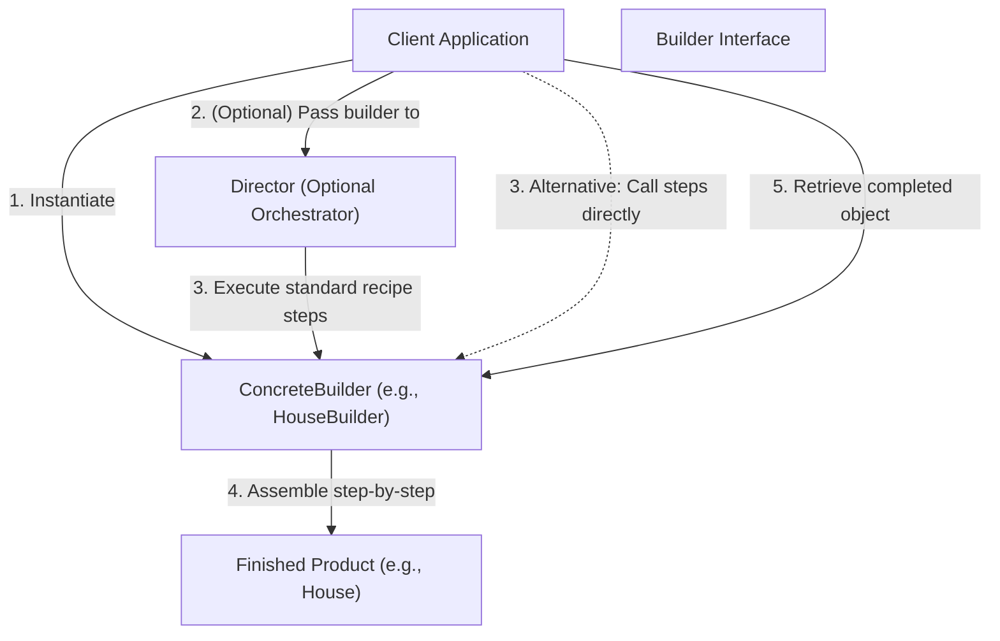
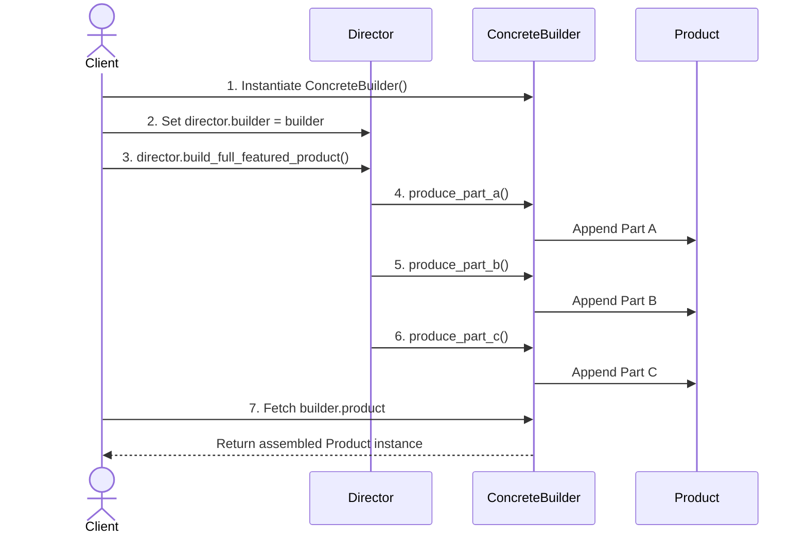

# Builder Design Pattern

| Metadata      | Value                      |
| ------------- | -------------------------- |
| Author        | Lyzander Marciano Andrylie |
| Creation Date | Nov 12, 2026               |
| Last Updated  | Nov 12, 2026               |

## References

- [Refactoring Guru - Builder Pattern](https://refactoring.guru/design-patterns/builder): Detailed explanation of the Builder design pattern, problem contexts, and design trade-offs
- [Refactoring Guru - Builder in Python](https://refactoring.guru/design-patterns/builder/python/example): Python conceptual code implementation and structure guidelines
- [design-pattern.md](../design-pattern.md): Overview of software design patterns and catalog categories
- [abstract_factory.md](./abstract_factory.md): Returns product families immediately rather than constructing step by step
- [composite.md](../structural/composite.md): Complex composite trees are frequently constructed using a Builder

## Description

The **Builder** is a creational design pattern that separates the construction of a complex object from its representation, allowing the same construction process to produce different types and representations step by step. It resolves the issues of telescoping constructors and subclass explosion by encapsulating individual assembly steps within dedicated builder objects.

## Concepts

### 1. Intent, Problem, and Solution

- **Intent**: Extract complex object assembly out of target classes into separate builder objects, enabling step-by-step creation of diverse representations using a consistent configuration interface.
- **Problem (Telescoping Constructor & Subclass Explosion)**:
  - Complex domain objects often require multiple attributes, subsystems, and optional components.
  - _Subclass Explosion_: For example, building a `House` entity with optional features like a garage, swimming pool, garden, heating, and security systems quickly leads to a combinatorial nightmare of subclasses (`HouseWithGarage`, `HouseWithGarageAndPool`, etc.).
  - _Telescoping Constructors_: Attempting to handle variations using overloaded constructors or constructors with dozens of parameters results in telescoping constructors (`House(windows, doors, rooms, has_garage, has_pool, has_garden, ...)`). Most invocation calls pass multiple unused `None` or default parameters, making client code brittle, unreadable, and error-prone.
- **Solution (Step-by-Step Builders & Directors)**:
  - Decompose product creation into discrete, isolated steps (`build_walls()`, `build_doors()`, `build_garage()`, `build_pool()`).
  - The client executes only the building steps required for its target configuration.
  - Different concrete builders can implement the same steps differently to produce distinct representations (e.g., `StoneHouseBuilder` vs. `WoodHouseBuilder`, or `CarBuilder` vs. `CarManualBuilder`).
  - An optional orchestrator class called the **Director** can encapsulate standard construction recipes (e.g., `construct_minimal_house()`, `construct_luxury_villa()`), preventing construction logic from scattering across client code.
- **Applicability**:
  - Eliminating telescoping constructors containing extensive optional arguments.
  - Producing different representations of a product using the same multi-step construction process.
  - Constructing complex object hierarchies, such as recursive [composite.md](../structural/composite.md) trees.

| Advantage (Pro)                                                                                    | Disadvantage (Con)                                                                                     |
| :------------------------------------------------------------------------------------------------- | :----------------------------------------------------------------------------------------------------- |
| Constructs objects incrementally, defers steps, or executes steps recursively                      | Increases overall code complexity by introducing new interfaces and builder classes                    |
| Reuses the same construction pipeline across diverse product representations                       | Tightens client coupling to the builder interface methods                                              |
| Adheres to the Single Responsibility Principle (SRP) by isolating construction from business logic | Requires creating a new concrete builder class for every fundamentally different construction strategy |

#### Interaction



### 2. Structure and Components

| Component         | Role                      | Description                                                                                                   |
| :---------------- | :------------------------ | :------------------------------------------------------------------------------------------------------------ |
| `Builder`         | Interface / Abstract Base | Declares product construction step methods shared across all concrete builders                                |
| `ConcreteBuilder` | Implementation            | Implements construction steps, maintains the internal product state, and delivers the result                  |
| `Product`         | Complex Entity            | The target object being constructed; products from different builders do not need to share a common interface |
| `Director`        | Orchestrator (Optional)   | Defines the order in which construction steps are invoked for routine configurations                          |
| `Client`          | Consumer                  | Configures the builder, optionally delegates execution to a director, and fetches the finished product        |

- **`Builder`**: Declares abstract methods representing individual assembly stages (e.g., `produce_part_a()`, `produce_part_b()`).
- **`ConcreteBuilder`**: Implements the step methods to assemble parts. It holds a product instance internally and exposes a retrieval method (such as `get_product()` or property `product`) that often resets the builder to prepare for subsequent assemblies.
- **`Product`**: The complex object resulting from construction. Unlike factories where products share a common interface, products created by different builders may have completely different interfaces and internal structures (e.g., an actual vehicle object versus a printed instruction manual).
- **`Director`**: Accepts a builder instance and calls building methods in specific sequences. This hides common construction sequences from client code and promotes configuration reuse.
- **`Client`**: Pairs a concrete builder with a director (or interacts directly with the builder's step methods) to generate the target product.

#### Interaction



### 3. Python Implementation

#### a. Conceptual Structure Example

The conceptual implementation demonstrates the classic Builder architecture:

- `Builder`: Abstract base class specifying the construction step contract and the product retrieval property.
- `ConcreteBuilder1`: Implements the step methods, manages an internal `Product1` instance, and resets its internal state upon delivering the finished product.
- `Product1`: The resulting complex object holding an internal list of parts and an inspection helper.
- `Director`: Orchestrates predefined construction workflows (`build_minimal_viable_product()` and `build_full_featured_product()`).
- `Client`: Illustrates construction using the `Director` for standard configurations, as well as direct step invocation on the builder without a director.

```python
from __future__ import annotations
from abc import ABC, abstractmethod
from typing import Any


class Builder(ABC):
    """
    The Builder interface specifies methods for creating the different parts
    of the Product objects.
    """

    @property
    @abstractmethod
    def product(self) -> None:
        pass

    @abstractmethod
    def produce_part_a(self) -> None:
        pass

    @abstractmethod
    def produce_part_b(self) -> None:
        pass

    @abstractmethod
    def produce_part_c(self) -> None:
        pass


class ConcreteBuilder1(Builder):
    """
    Concrete Builders implement the Builder interface and track the product assembly.
    """

    def __init__(self) -> None:
        self.reset()

    def reset(self) -> None:
        self._product = Product1()

    @property
    def product(self) -> Product1:
        product = self._product
        self.reset()
        return product

    def produce_part_a(self) -> None:
        self._product.add("PartA1")

    def produce_part_b(self) -> None:
        self._product.add("PartB1")

    def produce_part_c(self) -> None:
        self._product.add("PartC1")


class Product1:
    """
    The resulting complex product object.
    """

    def __init__(self) -> None:
        self.parts: list[Any] = []

    def add(self, part: Any) -> None:
        self.parts.append(part)

    def list_parts(self) -> None:
        print(f"Product parts: {', '.join(self.parts)}")


class Director:
    """
    The Director defines the sequence of building steps to create reusable configurations.
    """

    def __init__(self) -> None:
        self._builder: Builder | None = None

    @property
    def builder(self) -> Builder | None:
        return self._builder

    @builder.setter
    def builder(self, builder: Builder) -> None:
        self._builder = builder

    def build_minimal_viable_product(self) -> None:
        if self._builder is not None:
            self._builder.produce_part_a()

    def build_full_featured_product(self) -> None:
        if self._builder is not None:
            self._builder.produce_part_a()
            self._builder.produce_part_b()
            self._builder.produce_part_c()


if __name__ == "__main__":
    director = Director()
    builder = ConcreteBuilder1()
    director.builder = builder

    print("Standard basic product:")
    director.build_minimal_viable_product()
    builder.product.list_parts()
    # Output:
    # Standard basic product:
    # Product parts: PartA1

    print("\nStandard full featured product:")
    director.build_full_featured_product()
    builder.product.list_parts()
    # Output:
    # Standard full featured product:
    # Product parts: PartA1, PartB1, PartC1

    print("\nCustom product (without Director):")
    builder.produce_part_a()
    builder.produce_part_c()
    builder.product.list_parts()
    # Output:
    # Custom product (without Director):
    # Product parts: PartA1, PartC1
```

#### b. Practical Real-World Example

A ubiquitous real-world application of the Builder pattern in modern software engineering is constructing complex SQL queries. Instead of brittle string concatenations or a massive constructor accepting dozens of query clauses, a fluent query builder incrementally adds tables, column selections, joins, filter conditions, sort orders, and limits:

- `SqlQuery`: The final product representing an immutable, parameterized SQL statement.
- `QueryBuilder`: Abstract builder interface defining step methods for query assembly, returning `self` to support fluent method chaining.
- `PostgresQueryBuilder`: Concrete builder implementing PostgreSQL dialect conventions (e.g., identifier quotation with double quotes).
- `QueryDirector`: Encapsulates standardized enterprise query recipes (e.g., active user retrieval).
- `Client`: Uses the director for standardized queries and directly invokes chained methods for ad-hoc queries.

```python
from __future__ import annotations
from abc import ABC, abstractmethod


class SqlQuery:
    """
    Product representing an assembled SQL query.
    """

    def __init__(self) -> None:
        self.table: str = ""
        self.columns: list[str] = []
        self.joins: list[str] = []
        self.conditions: list[str] = []
        self.order_by_clauses: list[str] = []
        self.limit_count: int | None = None

    def get_raw_sql(self) -> str:
        cols = ", ".join(self.columns) if self.columns else "*"
        sql_parts = [f"SELECT {cols} FROM {self.table}"]
        if self.joins:
            sql_parts.extend(self.joins)
        if self.conditions:
            sql_parts.append(f"WHERE {' AND '.join(self.conditions)}")
        if self.order_by_clauses:
            sql_parts.append(f"ORDER BY {', '.join(self.order_by_clauses)}")
        if self.limit_count is not None:
            sql_parts.append(f"LIMIT {self.limit_count}")
        return " ".join(sql_parts) + ";"


class QueryBuilder(ABC):
    """
    Abstract Builder declaring query construction steps with fluent method chaining.
    """

    @abstractmethod
    def reset(self) -> None:
        pass

    @abstractmethod
    def from_table(self, table: str) -> QueryBuilder:
        pass

    @abstractmethod
    def select(self, *columns: str) -> QueryBuilder:
        pass

    @abstractmethod
    def where(self, condition: str) -> QueryBuilder:
        pass

    @abstractmethod
    def left_join(self, table: str, condition: str) -> QueryBuilder:
        pass

    @abstractmethod
    def order_by(self, column: str, direction: str = "ASC") -> QueryBuilder:
        pass

    @abstractmethod
    def limit(self, count: int) -> QueryBuilder:
        pass

    @abstractmethod
    def build(self) -> SqlQuery:
        pass


class PostgresQueryBuilder(QueryBuilder):
    """
    Concrete Builder applying PostgreSQL identifier quoting and clause assembly.
    """

    def __init__(self) -> None:
        self.reset()

    def reset(self) -> None:
        self._query = SqlQuery()

    def from_table(self, table: str) -> PostgresQueryBuilder:
        self._query.table = f'"{table}"'
        return self

    def select(self, *columns: str) -> PostgresQueryBuilder:
        self._query.columns.extend([f'"{col}"' for col in columns])
        return self

    def where(self, condition: str) -> PostgresQueryBuilder:
        self._query.conditions.append(condition)
        return self

    def left_join(self, table: str, condition: str) -> PostgresQueryBuilder:
        self._query.joins.append(f'LEFT JOIN "{table}" ON {condition}')
        return self

    def order_by(self, column: str, direction: str = "ASC") -> PostgresQueryBuilder:
        self._query.order_by_clauses.append(f'"{column}" {direction.upper()}')
        return self

    def limit(self, count: int) -> PostgresQueryBuilder:
        self._query.limit_count = count
        return self

    def build(self) -> SqlQuery:
        query = self._query
        self.reset()
        return query


class QueryDirector:
    """
    Optional Director encapsulating common, reusable query patterns.
    """

    def __init__(self, builder: QueryBuilder) -> None:
        self._builder = builder

    def change_builder(self, builder: QueryBuilder) -> None:
        self._builder = builder

    def build_active_users_query(self) -> SqlQuery:
        return (
            self._builder
            .from_table("users")
            .select("id", "username", "email")
            .where("status = 'active'")
            .order_by("created_at", "DESC")
            .limit(10)
            .build()
        )


if __name__ == "__main__":
    builder = PostgresQueryBuilder()
    director = QueryDirector(builder)

    # 1. Using Director for a standardized query configuration
    active_users = director.build_active_users_query()
    print("Director pre-configured query:")
    print(active_users.get_raw_sql())
    # Output:
    # Director pre-configured query:
    # SELECT "id", "username", "email" FROM "users" WHERE status = 'active' ORDER BY "created_at" DESC LIMIT 10;

    # 2. Direct client invocation with customized steps and method chaining
    custom_query = (
        builder
        .from_table("orders")
        .select("id", "total_amount", "created_at")
        .left_join("users", "orders.user_id = users.id")
        .where("orders.total_amount > 100")
        .where("orders.status = 'completed'")
        .order_by("orders.created_at", "DESC")
        .limit(5)
        .build()
    )
    print("\nCustom query (direct builder usage):")
    print(custom_query.get_raw_sql())
    # Output:
    # Custom query (direct builder usage):
    # SELECT "id", "total_amount", "created_at" FROM "orders" LEFT JOIN "users" ON orders.user_id = users.id WHERE orders.total_amount > 100 AND orders.status = 'completed' ORDER BY "orders.created_at" DESC LIMIT 5;
```
