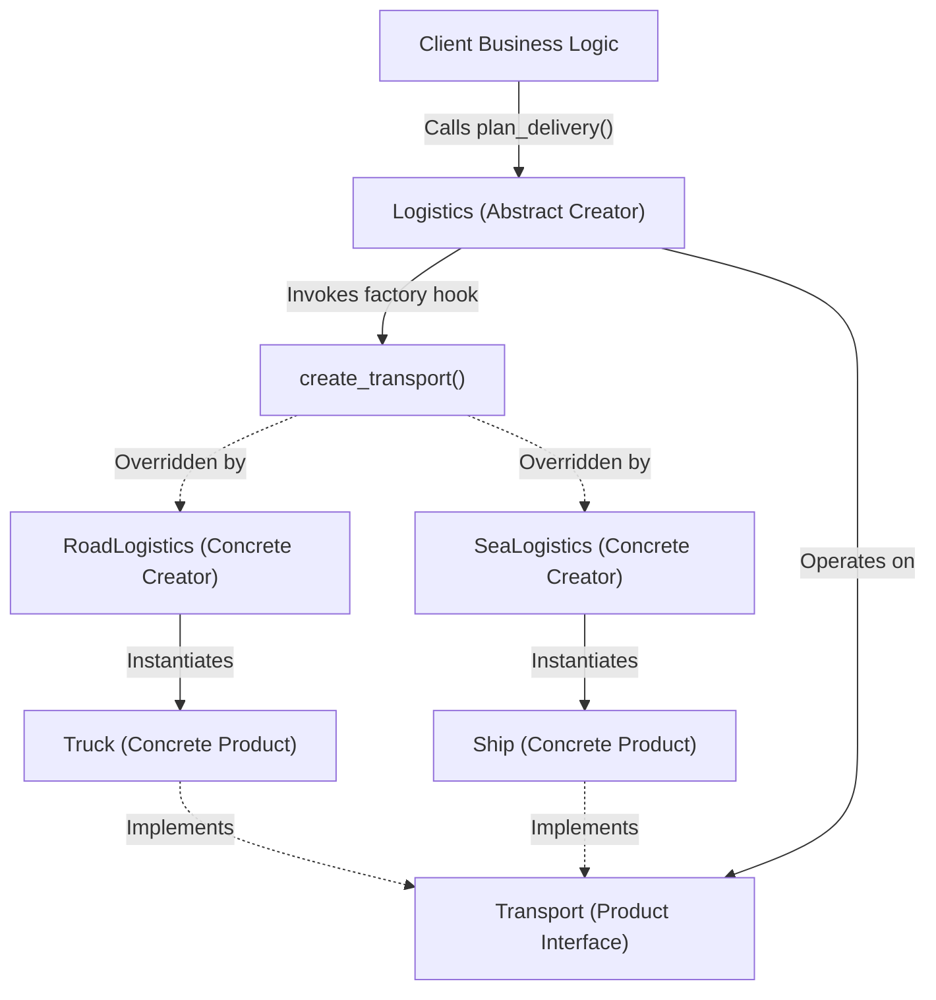
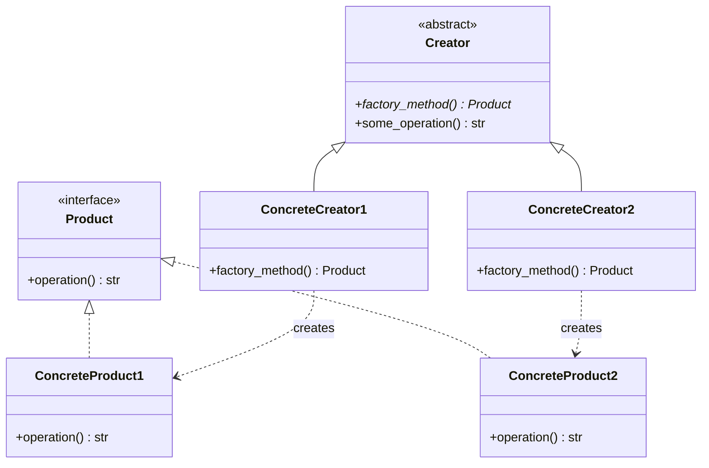
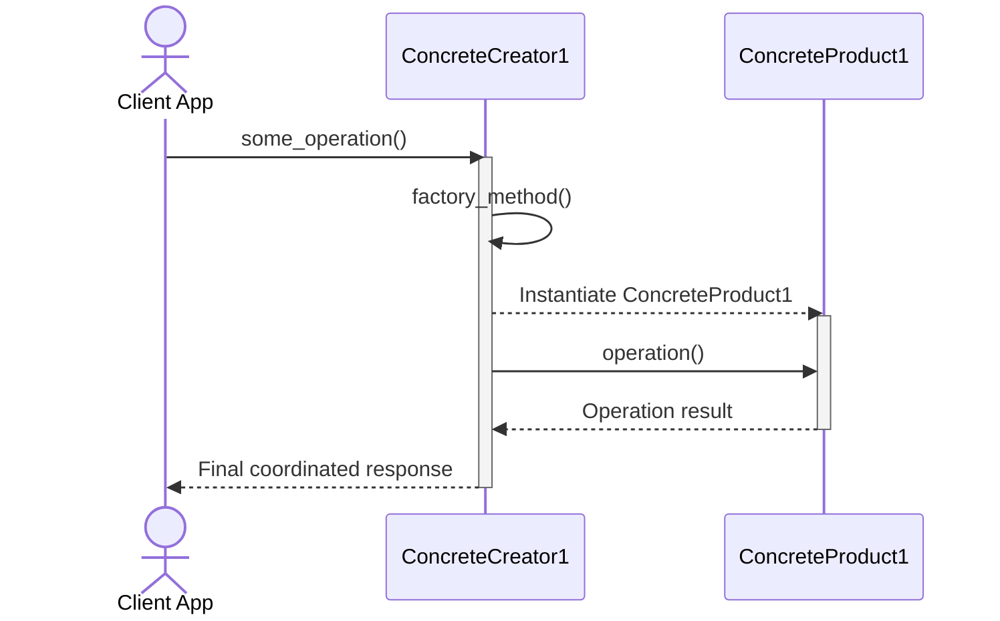

# Factory Method Design Pattern

| Metadata      | Value                      |
| ------------- | -------------------------- |
| Author        | Lyzander Marciano Andrylie |
| Creation Date | Nov 12, 2026               |
| Last Updated  | Nov 12, 2026               |

## References

- [Refactoring.Guru - Factory Method](https://refactoring.guru/design-patterns/factory-method): Core pattern intent, problem description, structure, and trade-offs
- [Refactoring.Guru - Factory Method in Python](https://refactoring.guru/design-patterns/factory-method/python/example): Python conceptual implementation and structure
- [design-pattern.md](../design-pattern.md): Overview of software design patterns and catalog categories
- [abstract_factory.md](./abstract_factory.md): Produces families of related objects using factory methods
- [template_method.md](../behavioural/template_method.md): Behavioral counterpart that delegates algorithm steps to subclasses
- [prototype.md](./prototype.md): Alternative creational pattern based on cloning existing instances

## Description

The **Factory Method** is a creational design pattern that provides an interface for creating objects in a superclass while allowing subclasses to alter the type of objects that will be created. It solves the problem of tight coupling between business logic and concrete classes by delegating object instantiation to specialized subclass methods.

## Concepts

### 1. Intent, Problem, and Solution

The Factory Method pattern resolves rigid instantiation dependencies by replacing direct constructor calls with a polymorphic method.

- **Intent**: Define an interface for creating an object, but let subclasses decide which class to instantiate. Factory Method lets a class defer instantiation to subclasses.
- **Problem**:
  - Suppose a logistics management application initially handles only road transport, where the code directly instantiates `Truck` objects throughout core business routines.
  - When adding maritime transport (`Ship`), the developer must refactor large portions of the codebase, scattering conditional statements (`if-else` or `switch`) and tightly coupling transport logic to concrete classes.
  - Adding future transport types (e.g., `AirCargo`, `Train`) compounds maintenance issues and violates the Open/Closed Principle.
- **Solution**:
  - Replace direct constructor calls (`new Truck()` or `Truck()`) with a call to a dedicated **factory method** (`create_transport()`).
  - Subclasses override the factory method to return concrete product instances (`Truck`, `Ship`).
  - Core business routines interact exclusively with products through a shared abstract interface (`Transport`), decoupling business operations from specific product implementations.
- **Applicability**:
  - Use Factory Method when you do not know beforehand the exact types and dependencies of the objects your code needs to work with.
  - Use Factory Method when designing frameworks or reusable libraries to give consumers an entry point to extend internal components via subclassing.
  - Use Factory Method when managing system resources by caching, pooling, or recycling existing objects instead of creating new instances unconditionally.

| Trade-off Dimension     | Advantage (Pros)                                                                                          | Disadvantage (Cons)                                                                        |
| ----------------------- | --------------------------------------------------------------------------------------------------------- | ------------------------------------------------------------------------------------------ |
| **Coupling**            | Decouples creator business logic from concrete product classes.                                           | Code complexity increases due to requiring a subclass hierarchy for every new product.     |
| **Extensibility (OCP)** | Open/Closed Principle: Introduce new product variants without altering existing client code.              | Simple scenarios without polymorphic variance become unnecessarily over-engineered.        |
| **Maintenance (SRP)**   | Single Responsibility Principle: Centralizes object creation and lifecycle in a single codebase location. | Indirect instantiation can make code navigation slightly harder for unfamiliar developers. |

#### Interaction



### 2. Structure and Components

The Factory Method pattern organizes responsibilities across two parallel hierarchies: **Creators** and **Products**.

| Component         | Role                    | Responsibility                                                                                                                             |
| ----------------- | ----------------------- | ------------------------------------------------------------------------------------------------------------------------------------------ |
| `Product`         | Abstract Interface      | Declares the common interface implemented by all concrete products that the creator can manufacture.                                       |
| `ConcreteProduct` | Concrete Implementation | Implements the `Product` interface, encapsulating variant-specific attributes and behaviors.                                               |
| `Creator`         | Abstract Base Class     | Declares the abstract `factory_method()` (or provides a default implementation) and contains core business workflows relying on `Product`. |
| `ConcreteCreator` | Concrete Subclass       | Overrides `factory_method()` to construct and return a specific `ConcreteProduct` instance matching caller requirements.                   |

- **Parallel Hierarchies**: For every distinct product family line, a corresponding concrete creator subclass handles construction details.
- **Core Business Logic**: Despite its name, the `Creator`'s main role is not merely creating products—it coordinates high-level business rules that operate on the created `Product` abstraction.
- **Subclass Inversion**: Control over which product class is instantiated is inverted from the base class caller to the creator subclass.

#### Interaction





### 3. Python Implementation

The following examples demonstrate how to implement the Factory Method pattern in Python using the `abc` standard library module.

#### a. Conceptual Structure Example

The conceptual example illustrates the fundamental components and control flow of the pattern:

- `Product`: The abstract base class defining `operation() -> str`.
- `ConcreteProduct1` & `ConcreteProduct2`: Concrete implementations providing variant-specific operation results.
- `Creator`: The abstract base class declaring abstract `factory_method()` and executing common business logic in `some_operation()`.
- `ConcreteCreator1` & `ConcreteCreator2`: Concrete subclasses overriding `factory_method()` to return their respective products.
- `client_code`: Client function that accepts any creator conforming to the `Creator` interface without binding to concrete types.

```python
from abc import ABC, abstractmethod


# 1. Product Interface
class Product(ABC):
    """
    The Product interface declares operations that all concrete products
    must implement.
    """

    @abstractmethod
    def operation(self) -> str:
        pass


# 2. Concrete Products
class ConcreteProduct1(Product):
    def operation(self) -> str:
        return "{Result of ConcreteProduct1}"


class ConcreteProduct2(Product):
    def operation(self) -> str:
        return "{Result of ConcreteProduct2}"


# 3. Creator Class
class Creator(ABC):
    """
    The Creator declares the factory method that returns a Product object.
    It also contains core business logic that relies on Product objects.
    """

    @abstractmethod
    def factory_method(self) -> Product:
        """Subclasses must override this factory method."""
        pass

    def some_operation(self) -> str:
        """
        Core business logic that relies on the product produced by the
        factory method.
        """
        # Call the factory method to create a Product object.
        product = self.factory_method()

        # Execute business logic using the product interface.
        return f"Creator: The same creator code has worked with {product.operation()}"


# 4. Concrete Creators
class ConcreteCreator1(Creator):
    """ConcreteCreator1 overrides the factory method to produce ConcreteProduct1."""

    def factory_method(self) -> Product:
        return ConcreteProduct1()


class ConcreteCreator2(Creator):
    """ConcreteCreator2 overrides the factory method to produce ConcreteProduct2."""

    def factory_method(self) -> Product:
        return ConcreteProduct2()


# 5. Client Code
def client_code(creator: Creator) -> None:
    """
    Client code works with any creator instance via its base interface,
    remaining decoupled from concrete creator and product types.
    """
    print(
        f"Client: Unaware of concrete creator class, but execution succeeds.\n"
        f"{creator.some_operation()}"
    )


if __name__ == "__main__":
    print("App: Launched with ConcreteCreator1.")
    client_code(ConcreteCreator1())
    # Output:
    # App: Launched with ConcreteCreator1.
    # Client: Unaware of concrete creator class, but execution succeeds.
    # Creator: The same creator code has worked with {Result of ConcreteProduct1}

    print()

    print("App: Launched with ConcreteCreator2.")
    client_code(ConcreteCreator2())
    # Output:
    # App: Launched with ConcreteCreator2.
    # Client: Unaware of concrete creator class, but execution succeeds.
    # Creator: The same creator code has worked with {Result of ConcreteProduct2}
```

#### b. Practical Real-World Example

A practical logistics management system where goods are transported across different delivery routes (road and sea):

- `Transport`: The abstract product interface defining the `deliver() -> str` operation.
- `Truck`: Concrete product delivering cargo via overland roads in a secure trailer.
- `Ship`: Concrete product delivering cargo across maritime routes in shipping containers.
- `Logistics`: The abstract creator class declaring `create_transport()` and orchestrating order delivery in `plan_delivery()`.
- `RoadLogistics`: Concrete creator configuring road transport operations by instantiating `Truck`.
- `SeaLogistics`: Concrete creator configuring maritime operations by instantiating `Ship`.
- `client_code`: Client application entry point running transport routines independently of underlying vehicle types.

```python
from abc import ABC, abstractmethod


# 1. Product Interface
class Transport(ABC):
    """The Product interface declares operations required for all transport types."""

    @abstractmethod
    def deliver(self) -> str:
        """Execute delivery procedure and return status message."""
        pass


# 2. Concrete Products
class Truck(Transport):
    """Concrete Product: Overland freight truck."""

    def deliver(self) -> str:
        return "Delivered by land in a box (Truck)."


class Ship(Transport):
    """Concrete Product: Sea freight cargo container ship."""

    def deliver(self) -> str:
        return "Delivered by sea in a cargo container (Ship)."


# 3. Creator Class
class Logistics(ABC):
    """
    The Creator class defines business logic for cargo planning and
    declares the factory method for transport instantiation.
    """

    @abstractmethod
    def create_transport(self) -> Transport:
        """Factory method to be implemented by logistics subclasses."""
        pass

    def plan_delivery(self) -> str:
        """
        High-level business workflow. Uses the product returned by
        create_transport() without knowing its concrete class.
        """
        # Call the factory method to obtain a Transport instance.
        transport = self.create_transport()

        # Coordinate delivery operations.
        result = (
            f"Logistics: Initiating delivery plan with {type(transport).__name__}.\n"
            f"Logistics: Transport status -> {transport.deliver()}"
        )
        return result


# 4. Concrete Creators
class RoadLogistics(Logistics):
    """Concrete Creator specialized for road transport distribution."""

    def create_transport(self) -> Transport:
        return Truck()


class SeaLogistics(Logistics):
    """Concrete Creator specialized for sea transport distribution."""

    def create_transport(self) -> Transport:
        return Ship()


# 5. Client Code
def client_code(logistics: Logistics) -> None:
    """
    Client code interacts exclusively with the Logistics base interface,
    enabling seamless addition of new shipping modalities.
    """
    print(f"Client: Delegating transportation execution to {type(logistics).__name__}.")
    print(logistics.plan_delivery())


if __name__ == "__main__":
    print("App: Running distribution via road transport.")
    client_code(RoadLogistics())
    # Output:
    # App: Running distribution via road transport.
    # Client: Delegating transportation execution to RoadLogistics.
    # Logistics: Initiating delivery plan with Truck.
    # Logistics: Transport status -> Delivered by land in a box (Truck).

    print()

    print("App: Running distribution via sea transport.")
    client_code(SeaLogistics())
    # Output:
    # App: Running distribution via sea transport.
    # Client: Delegating transportation execution to SeaLogistics.
    # Logistics: Initiating delivery plan with Ship.
    # Logistics: Transport status -> Delivered by sea in a cargo container (Ship).
```
