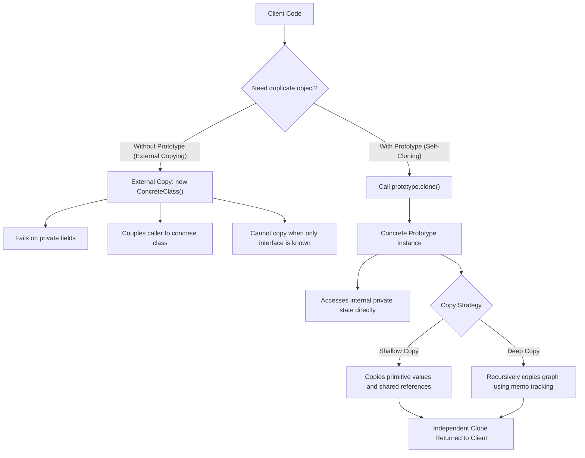
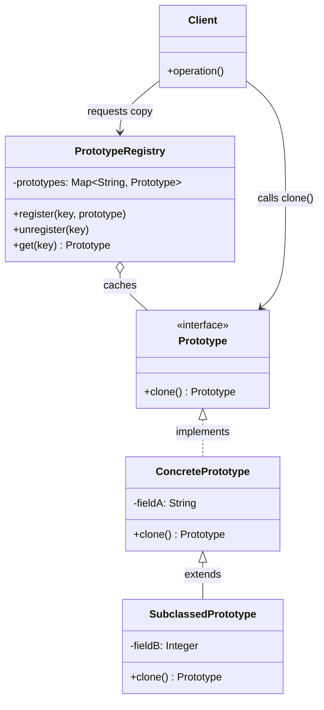

# Prototype Design Pattern

| Metadata      | Value                      |
| ------------- | -------------------------- |
| Author        | Lyzander Marciano Andrylie |
| Creation Date | Nov 12, 2026               |
| Last Updated  | Nov 12, 2026               |

## References

- [Refactoring.Guru - Prototype Design Pattern](https://refactoring.guru/design-patterns/prototype): Core pattern intent, problem description, cloning mechanism, and structure
- [Refactoring.Guru - Prototype in Python](https://refactoring.guru/design-patterns/prototype/python/example): Python conceptual implementation using `__copy__` and `__deepcopy__`
- [design-pattern.md](../design-pattern.md): Overview of software design patterns and catalog categories
- [factory_method.md](./factory_method.md): Inheritance-based alternative to Prototype's cloning approach
- [abstract_factory.md](./abstract_factory.md): Can store a set of prototypes to clone and return product families
- [memento.md](../behavioural/memento.md): Can use Prototype cloning to snapshot simple object state

## Description

The **Prototype** is a creational design pattern that allows copying existing objects without making client code dependent on their concrete classes. It solves the problem of duplicating objects whose internal fields may be private, inaccessible, or tied to complex initialization processes by delegating the cloning responsibility directly to the objects themselves.

## Concepts

### 1. Intent, Problem, and Solution

The Prototype pattern replaces cumbersome external instantiation and field-by-field replication with self-cloning abstractions.

- **Intent**: Specify the kinds of objects to create using a prototypical instance, and create new objects by copying this prototype.
- **Problem**:
  - Direct object duplication from outside an object requires creating a new instance and iteratively copying every field from the original object into the clone.
  - _Private and Encapsulated State_: Many fields are private or hidden within the class implementation, making them inaccessible from outside caller code.
  - _Interface Coupling_: Client code frequently interacts with an abstract interface (such as `Shape` or `Document`) rather than a concrete class (`Circle` or `Spreadsheet`). The client cannot invoke a concrete constructor (`new Circle()`) without tightly coupling its logic to specific implementations.
  - _Expensive Initialization_: Creating fresh objects from scratch often incurs costly file I/O, database lookups, or network handshakes that should not be repeated when an identical or slightly modified instance already exists in memory.
- **Solution**:
  - Delegate the cloning operation directly to the objects being copied.
  - Declare a common cloning interface containing a `clone()` method (or Python's built-in `__copy__` and `__deepcopy__` protocol).
  - Because concrete classes implement this method internally, they have direct access to all private, protected, and parent fields.
  - The client can clone any object polymorphically through the shared interface without knowing its concrete class.
- **Shallow Copy vs. Deep Copy**:
  - _Shallow Copy_: Duplicates the top-level object container, but nested reference fields (such as lists, dictionaries, or child objects) still point to the original memory references. Mutating nested structures in the clone modifies the prototype as well.
  - _Deep Copy_: Recursively duplicates the object along with all child references and data structures, producing a completely isolated clone. Mutating nested attributes in a deep clone does not alter the original object. Circular references must be tracked (via a `memo` dictionary) to prevent infinite recursion loops.
- **Applicability**:
  - Use Prototype when code should not depend on the concrete classes of objects it needs to duplicate.
  - Use Prototype when reducing subclass proliferation where classes differ only in how their instances are initialized or pre-configured.
  - Use Prototype when creating an object is computationally expensive or requires replicating complex runtime states that cannot easily be recreated through constructors.

| Trade-off Dimension    | Advantage (Pros)                                                                                        | Disadvantage (Cons)                                                                          |
| ---------------------- | ------------------------------------------------------------------------------------------------------- | -------------------------------------------------------------------------------------------- |
| **Coupling**           | Clones objects polymorphically without binding client code to concrete classes.                         | Classes with circular references, file streams, or network sockets require complex cloning.  |
| **Performance**        | Avoids repeated expensive database queries, configuration parsing, and constructor routines.            | Maintaining deep copy consistency across large, evolving class graphs requires extra effort. |
| **Design Flexibility** | Provides a dynamic runtime alternative to subclassing for pre-configured object variants.               | Retrofitting cloning into legacy class hierarchies requires modifying existing classes.      |
| **Convenience**        | Prototype registries allow clients to produce pre-configured instances with a single identifier lookup. | Shallow copies can introduce subtle side-effect bugs if mutable nested fields are shared.    |

#### Interaction



### 2. Structure and Components

The Prototype pattern organizes cloning responsibilities across the following components:

| Component             | Role                    | Responsibility                                                                                                                           |
| --------------------- | ----------------------- | ---------------------------------------------------------------------------------------------------------------------------------------- |
| `Prototype`           | Abstract Interface      | Declares the cloning interface (typically a `clone()` method).                                                                           |
| `ConcretePrototype`   | Concrete Implementation | Implements the cloning method, allocating a new object and copying all of its own fields into the new instance.                          |
| `SubclassedPrototype` | Specialized Subclass    | Extends `ConcretePrototype` and overrides `clone()` (often delegating to `super.clone()`) to copy child-specific properties and state.   |
| `PrototypeRegistry`   | Registry / Factory      | Catalogs pre-built, frequently used prototype instances indexed by key or tag, providing quick lookup and cloning access to client code. |
| `Client`              | Consumer                | Creates new objects by invoking the cloning method on a prototype instance or querying the `PrototypeRegistry`.                          |

- **Self-Cloning Delegation**: The client never duplicates object fields from the outside; it simply instructs the object to clone itself.
- **Registry Integration**: When many pre-set configurations are needed, a `PrototypeRegistry` acts as a catalog of factory templates, replacing large conditional factory hierarchies.
- **Subclass Inversion**: Adding a new product configuration does not require writing a new class; developers can configure an existing prototype at runtime and register it.

#### Interaction



### 3. Python Implementation

Python natively supports the Prototype pattern through its standard library `copy` module (`copy.copy` and `copy.deepcopy`). Classes customize this behavior by overriding the special magic methods `__copy__` and `__deepcopy__`.

#### a. Conceptual Structure Example

The conceptual example demonstrates how to implement custom shallow and deep cloning logic while properly handling circular references:

- `SelfReferencingEntity`: An entity that maintains a circular back-reference to its parent container.
- `SomeComponent`: The prototype class holding an integer, a mutable list of nested objects, and a circular reference.
- `__copy__(self)`: Shallow copy hook called by `copy.copy()`. It duplicates immediate attributes and nested reference lists shallowly.
- `__deepcopy__(self, memo)`: Deep copy hook called by `copy.deepcopy()`. The `memo` dictionary prevents infinite recursion by caching references to already duplicated objects.
- Output demonstration with `print()` output comments verifying reference isolation and recursion protection.

```python
import copy
from typing import Any, List


class SelfReferencingEntity:
    """An entity maintaining a circular back-reference to its parent component."""

    def __init__(self) -> None:
        self.parent: Any = None

    def set_parent(self, parent: Any) -> None:
        self.parent = parent


class SomeComponent:
    """
    Python provides its own Prototype interface via `copy.copy` and
    `copy.deepcopy` functions. Classes requiring custom cloning behavior
    override `__copy__` and `__deepcopy__`.
    """

    def __init__(
        self,
        some_int: int,
        some_list_of_objects: List[Any],
        some_circular_ref: SelfReferencingEntity,
    ) -> None:
        self.some_int = some_int
        self.some_list_of_objects = some_list_of_objects
        self.some_circular_ref = some_circular_ref

    def __copy__(self) -> "SomeComponent":
        """
        Create a shallow copy. This method is called whenever someone calls
        `copy.copy` on this object.
        """
        # 1. Create shallow copies of nested objects
        some_list_of_objects = copy.copy(self.some_list_of_objects)
        some_circular_ref = copy.copy(self.some_circular_ref)

        # 2. Instantiate a new object with copied references
        new = self.__class__(
            self.some_int, some_list_of_objects, some_circular_ref
        )
        new.__dict__ = copy.copy(self.__dict__)

        return new

    def __deepcopy__(self, memo: Any = None) -> "SomeComponent":
        """
        Create a deep copy. This method is called whenever someone calls
        `copy.deepcopy` on this object.

        The `memo` dictionary tracks visited objects to avoid infinite recursion
        when circular references are present.
        """
        if memo is None:
            memo = {}

        # 1. Create deep copies of nested objects passing the memo dictionary
        some_list_of_objects = copy.deepcopy(self.some_list_of_objects, memo)
        some_circular_ref = copy.deepcopy(self.some_circular_ref, memo)

        # 2. Instantiate the new object using cloned nested members
        new = self.__class__(
            self.some_int, some_list_of_objects, some_circular_ref
        )
        new.__dict__ = copy.deepcopy(self.__dict__, memo)

        return new


if __name__ == "__main__":
    list_of_objects = [1, {1, 2, 3}, [1, 2, 3]]
    circular_ref = SelfReferencingEntity()

    component = SomeComponent(23, list_of_objects, circular_ref)
    circular_ref.set_parent(component)

    # 1. Test shallow copy behavior
    shallow_copied_component = copy.copy(component)

    shallow_copied_component.some_list_of_objects.append("another object")
    if component.some_list_of_objects[-1] == "another object":
        print(
            "Adding elements to `shallow_copied_component`'s "
            "some_list_of_objects adds it to `component`'s "
            "some_list_of_objects."
        )
    else:
        print(
            "Adding elements to `shallow_copied_component`'s "
            "some_list_of_objects doesn't add it to `component`'s "
            "some_list_of_objects."
        )

    component.some_list_of_objects[1].add(4)
    if 4 in shallow_copied_component.some_list_of_objects[1]:
        print(
            "Changing objects in the `component`'s some_list_of_objects "
            "changes that object in `shallow_copied_component`'s "
            "some_list_of_objects."
        )
    else:
        print(
            "Changing objects in the `component`'s some_list_of_objects "
            "doesn't change that object in `shallow_copied_component`'s "
            "some_list_of_objects."
        )

    # 2. Test deep copy behavior
    deep_copied_component = copy.deepcopy(component)

    deep_copied_component.some_list_of_objects.append("one more object")
    if component.some_list_of_objects[-1] == "one more object":
        print(
            "Adding elements to `deep_copied_component`'s "
            "some_list_of_objects adds it to `component`'s "
            "some_list_of_objects."
        )
    else:
        print(
            "Adding elements to `deep_copied_component`'s "
            "some_list_of_objects doesn't add it to `component`'s "
            "some_list_of_objects."
        )

    component.some_list_of_objects[1].add(10)
    if 10 in deep_copied_component.some_list_of_objects[1]:
        print(
            "Changing objects in the `component`'s some_list_of_objects "
            "changes that object in `deep_copied_component`'s "
            "some_list_of_objects."
        )
    else:
        print(
            "Changing objects in the `component`'s some_list_of_objects "
            "doesn't change that object in `deep_copied_component`'s "
            "some_list_of_objects."
        )

    print(
        f"id(deep_copied_component.some_circular_ref.parent): "
        f"{id(deep_copied_component.some_circular_ref.parent)}"
    )
    print(
        f"id(deep_copied_component.some_circular_ref.parent.some_circular_ref.parent): "
        f"{id(deep_copied_component.some_circular_ref.parent.some_circular_ref.parent)}"
    )
    print(
        "^^ This shows that deepcopied objects contain same reference, they "
        "are not cloned repeatedly."
    )

    # Output:
    # Adding elements to `shallow_copied_component`'s some_list_of_objects adds it to `component`'s some_list_of_objects.
    # Changing objects in the `component`'s some_list_of_objects changes that object in `shallow_copied_component`'s some_list_of_objects.
    # Adding elements to `deep_copied_component`'s some_list_of_objects doesn't add it to `component`'s some_list_of_objects.
    # Changing objects in the `component`'s some_list_of_objects doesn't change that object in `deep_copied_component`'s some_list_of_objects.
    # id(deep_copied_component.some_circular_ref.parent): <memory_address>
    # id(deep_copied_component.some_circular_ref.parent.some_circular_ref.parent): <memory_address>
    # ^^ This shows that deepcopied objects contain same reference, they are not cloned repeatedly.
```

#### b. Practical Real-World Example

In game development, spawning enemies repeatedly from constructors requires heavy configuration and risks sharing mutable abilities or inventory lists. The following example uses a `PrototypeRegistry` to cache pre-configured monster archetypes (`Orc`, `Dragon`) and clone them dynamically:

- `MonsterPrototype`: The abstract base prototype declaring the `clone()` method, stats (`health`, `attack_power`), and a mutable `skills` list.
- `Orc`: Concrete prototype representing a frontline brute with custom `armor`. It overrides `clone()` using `copy.deepcopy` to guarantee that skill list mutations do not leak.
- `Dragon`: Concrete prototype representing an elemental flying boss with an `element` damage type.
- `PrototypeRegistry`: A centralized prototype catalog that registers pre-configured archetype instances and spawns independent clones via string identifiers.
- Client execution showing customized clones created on demand without mutating base prototypes.

```python
from abc import ABC, abstractmethod
import copy
from typing import Dict, List, Optional


class MonsterPrototype(ABC):
    """
    Abstract Prototype interface declaring the clone method and base attributes.
    """

    def __init__(
        self,
        name: str,
        health: int,
        attack_power: int,
        skills: Optional[List[str]] = None,
    ) -> None:
        self.name = name
        self.health = health
        self.attack_power = attack_power
        self.skills = skills if skills is not None else []

    @abstractmethod
    def clone(self) -> "MonsterPrototype":
        """Produce a clone of the current prototype."""
        pass

    def __repr__(self) -> str:
        return (
            f"{self.__class__.__name__}(name=\"{self.name}\", "
            f"hp={self.health}, atk={self.attack_power}, skills={self.skills})"
        )


class Orc(MonsterPrototype):
    """Concrete Prototype representing an Orc warrior with armor."""

    def __init__(
        self,
        name: str = "Orc Grunt",
        health: int = 120,
        attack_power: int = 20,
        skills: Optional[List[str]] = None,
        armor: int = 15,
    ) -> None:
        super().__init__(
            name, health, attack_power, skills if skills is not None else ["Club Smash"]
        )
        self.armor = armor

    def clone(self) -> "Orc":
        # Deep copy ensures mutable fields like skills list are not shared
        return copy.deepcopy(self)


class Dragon(MonsterPrototype):
    """Concrete Prototype representing an elemental Dragon."""

    def __init__(
        self,
        name: str = "Fire Drake",
        health: int = 500,
        attack_power: int = 75,
        skills: Optional[List[str]] = None,
        element: str = "Fire",
    ) -> None:
        super().__init__(
            name,
            health,
            attack_power,
            skills if skills is not None else ["Fire Breath", "Wing Buffet"],
        )
        self.element = element

    def clone(self) -> "Dragon":
        return copy.deepcopy(self)


class PrototypeRegistry:
    """
    Registry that catalogs pre-configured prototype instances for rapid
    on-demand cloning.
    """

    def __init__(self) -> None:
        self._registry: Dict[str, MonsterPrototype] = {}

    def register(self, identifier: str, prototype: MonsterPrototype) -> None:
        """Register a pre-configured prototype instance."""
        self._registry[identifier] = prototype

    def unregister(self, identifier: str) -> None:
        """Remove a prototype from the registry."""
        self._registry.pop(identifier, None)

    def spawn(self, identifier: str) -> MonsterPrototype:
        """Fetch and clone a registered prototype."""
        prototype = self._registry.get(identifier)
        if not prototype:
            raise KeyError(f'Prototype with identifier "{identifier}" not found.')
        return prototype.clone()


if __name__ == "__main__":
    registry = PrototypeRegistry()

    # 1. Register baseline pre-configured prototypes
    base_orc = Orc(
        name="Standard Orc",
        health=100,
        attack_power=15,
        skills=["Club Swing"],
        armor=10,
    )
    boss_dragon = Dragon(
        name="Ancient Dragon",
        health=1000,
        attack_power=85,
        skills=["Inferno", "Tail Swipe"],
        element="Fire",
    )

    registry.register("orc_grunt", base_orc)
    registry.register("dragon_boss", boss_dragon)

    # 2. Spawn clones directly from registry
    orc_a = registry.spawn("orc_grunt")
    orc_b = registry.spawn("orc_grunt")

    # 3. Customize cloned instance without affecting original prototype or other clones
    orc_b.name = "Orc Warlord"
    orc_b.health = 220
    orc_b.skills.append("War Cry")

    print(f"Registry Prototype: {base_orc}")
    print(f"Spawned Orc A:      {orc_a}")
    print(f"Spawned Orc B:      {orc_b}")
    print(f"Independent objects: {orc_a is not orc_b}")
    print(f"Independent skills:  {orc_a.skills is not orc_b.skills}")

    # 4. Spawn and modify boss entity
    dragon_boss = registry.spawn("dragon_boss")
    dragon_boss.name = "Ignis the Immolator"
    dragon_boss.skills.append("Meteor Strike")

    print(f"Original Dragon:    {boss_dragon}")
    print(f"Custom Boss Dragon: {dragon_boss}")

    # Output:
    # Registry Prototype: Orc(name="Standard Orc", hp=100, atk=15, skills=['Club Swing'])
    # Spawned Orc A:      Orc(name="Standard Orc", hp=100, atk=15, skills=['Club Swing'])
    # Spawned Orc B:      Orc(name="Orc Warlord", hp=220, atk=15, skills=['Club Swing', 'War Cry'])
    # Independent objects: True
    # Independent skills:  True
    # Original Dragon:    Dragon(name="Ancient Dragon", hp=1000, atk=85, skills=['Inferno', 'Tail Swipe'])
    # Custom Boss Dragon: Dragon(name="Ignis the Immolator", hp=1000, atk=85, skills=['Inferno', 'Tail Swipe', 'Meteor Strike'])
```
