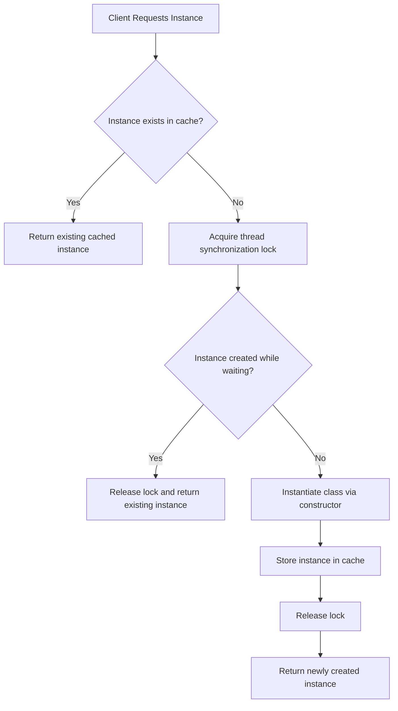
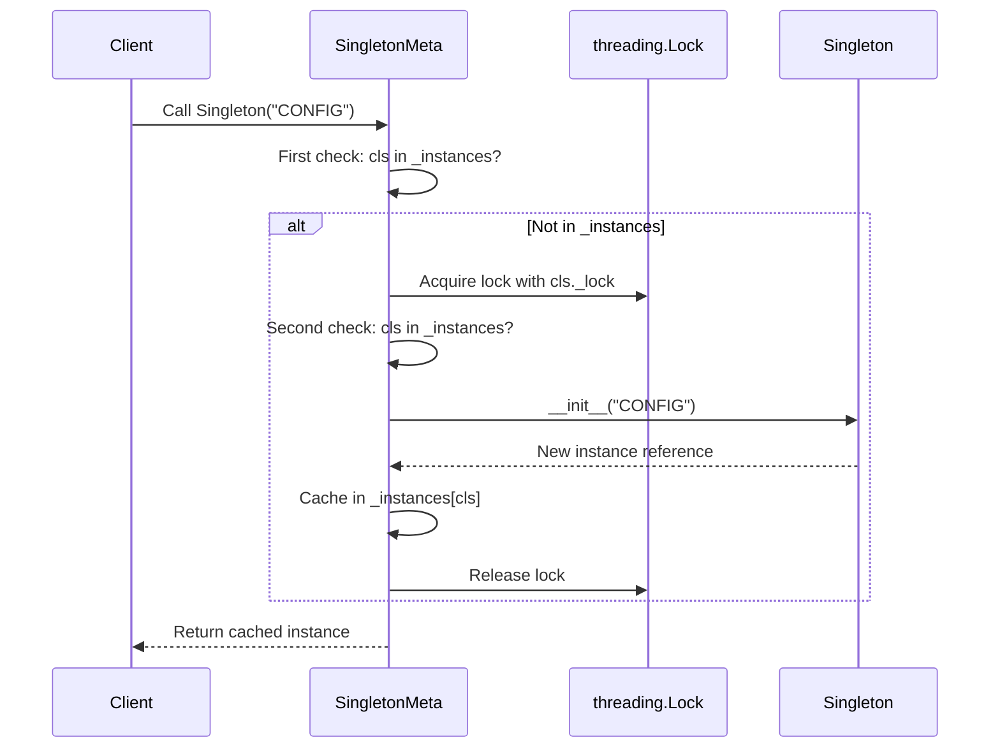

# Singleton Design Pattern

| Metadata      | Value                      |
| ------------- | -------------------------- |
| Author        | Lyzander Marciano Andrylie |
| Creation Date | Nov 12, 2026               |
| Last Updated  | Nov 12, 2026               |

## References

- [Refactoring Guru - Singleton Pattern](https://refactoring.guru/design-patterns/singleton): Comprehensive guide on the Singleton design pattern intent, problem, solution, applicability, and trade-offs
- [Refactoring Guru - Singleton in Python](https://refactoring.guru/design-patterns/singleton/python/example): Metaclass and thread-safe implementation examples for Python
- [design-pattern.md](../design-pattern.md): Overview of software design patterns and catalog categories
- [abstract_factory.md](./abstract_factory.md): Concrete factories are frequently implemented as Singletons
- [facade.md](../structural/facade.md): Facade objects can often be transformed into Singletons
- [flyweight.md](../structural/flyweight.md): Shares immutable state across multiple instances rather than restricting to a single mutable instance

## Description

The Singleton design pattern is a creational pattern that ensures a class has only one instance while providing a global access point to that instance. It solves the dual problems of coordinating access to shared resources (such as database connection pools, file loggers, or configuration settings) and preventing uncontrolled state mutations from multiple object instantiations.

## Concepts

### 1. Intent, Problem, and Solution

The Singleton pattern addresses scenarios where an application requires exactly one instance of a coordinator class to manage access to a shared resource.

- **Intent**: Ensure a class has only one instance, while providing a global access point to this instance throughout the application lifecycle.
- **Problem**: The pattern solves two problems simultaneously, which intentionally violates the Single Responsibility Principle (SRP):
  1. _Ensuring a single instance_: Standard class constructors instantiate a brand-new object on every invocation. When accessing shared hardware, files, or connection pools, creating multiple instances leads to resource exhaustion, inconsistent configuration states, and lock contention.
  2. _Providing a global access point_: Global variables expose state to unintended overwrites from arbitrary code. Singleton encapsulates the instance while providing controlled, centralized access from anywhere in the codebase.
- **Solution**:
  1. Hide or intercept default object construction so external code cannot invoke the constructor directly via standard instantiation.
  2. Maintain an internal cache of the created instance.
  3. Expose a creation hook (such as Python's metaclass `__call__` method or a static factory method like `getInstance()`) that checks the cache: if an instance already exists, return it; otherwise, instantiate the class lazily, store it, and return the new instance.
  4. Guard instantiation with synchronization locks (`threading.Lock`) in concurrent environments to prevent race conditions.
- **Applicability**:
  - Use when a class in your program must have exactly one instance available to all clients (e.g., a centralized database connection pool, a hardware driver interface, or an in-memory cache).
  - Use when you need stricter control over global variables without exposing mutable state to uncontrolled overwriting.
  - Use when lazy initialization is desired to defer heavy initialization costs until the object is actually requested for the first time.

| Trade-off                | Attribute                           | Impact                                                                                 |
| :----------------------- | :---------------------------------- | :------------------------------------------------------------------------------------- |
| **Pros (Advantages)**    | **Guaranteed Single Instance**      | Prevents conflicting states and avoids resource over-allocation.                       |
|                          | **Controlled Global Access Point**  | Provides uniform access across modules without raw global variables.                   |
|                          | **Lazy Initialization**             | Allocates memory and establishes connections only when requested.                      |
| **Cons (Disadvantages)** | **Single Responsibility Violation** | Solves two unrelated concerns: object lifecycle control and business logic.            |
|                          | **Testing & Mocking Difficulties**  | Persistent global state makes unit test isolation and test suite parallelization hard. |
|                          | **Tight Architectural Coupling**    | Callers become coupled to concrete singleton implementations instead of interfaces.    |
|                          | **Concurrency Overhead**            | Requires thread synchronization primitives to prevent multi-threaded race conditions.  |

#### Interaction



### 2. Structure and Components

The Singleton architecture coordinates instantiation through a metaclass or creation manager that inspects an instance registry before dispatching instantiation.

| Component       | Role                      | Description                                                                                                     |
| :-------------- | :------------------------ | :-------------------------------------------------------------------------------------------------------------- |
| `Singleton`     | Concrete Target           | The domain class containing application business logic; configured with `metaclass=SingletonMeta`.              |
| `_instances`    | Instance Registry         | A class-level dictionary (`dict`) storing the mapping between the class type and its instantiated singleton.    |
| `SingletonMeta` | Metaclass Interceptor     | A custom metaclass inheriting from `type` that overrides `__call__` to intercept class instantiation.           |
| `_lock`         | Synchronization Primitive | A `threading.Lock` protecting the critical section during concurrent initialization in multi-threaded programs. |
| `Client`        | Consumer                  | Application code that calls `Singleton()` transparently without managing the underlying caching mechanics.      |

- **`Singleton` Class**: Defines domain methods and properties. It delegates its instantiation lifecycle to its metaclass by specifying `metaclass=SingletonMeta`.
- **`_instances` Cache**: Stores existing class instances indexed by class object (`cls`). If `cls in _instances`, future construction calls return the cached object immediately.
- **`SingletonMeta` Metaclass**: In Python, classes are instances of metaclasses. Overriding `__call__` on the metaclass intercepts standard constructor execution (e.g., `s = Singleton()`), allowing cached instance reuse.
- **`_lock` Synchronization**: Ensures that only one thread enters the instance initialization block when multiple threads attempt concurrent first-time access.
- **`Client`**: Consumes the singleton object identically to a standard class, remaining decoupled from initialization and caching internals.

#### Interaction



### 3. Python Implementation

Python provides multiple mechanisms to implement Singletons (including module imports, decorators, and base classes). Implementing Singleton via a **metaclass** (`type`) is the most idiomatic and transparent approach, as it preserves standard class instantiation syntax (`s = Singleton()`) without modifying the internal structure of the target class.

#### a. Naive Singleton (Metaclass Implementation)

The naive implementation uses a metaclass to intercept object instantiation via `__call__`. It caches the created instance in a dictionary and returns it on subsequent calls.

- **`SingletonMeta(type)`**: Custom metaclass that overrides the default class invocation mechanism.
- **`_instances`**: Class-level dictionary storing references to the singleton instance for each class utilizing `SingletonMeta`.
- **`__call__`**: Intercepts `Singleton(*args, **kwargs)` calls. If `cls` is not already in `_instances`, it invokes `super().__call__(*args, **kwargs)` and caches the result.
- **`Singleton`**: Concrete class declaring `metaclass=SingletonMeta`. Any subsequent calls with different constructor arguments will return the original instance, preserving singleton guarantees.

```python
class SingletonMeta(type):
    """
    A metaclass for creating Singleton classes.
    Overrides __call__ to intercept class instantiation.
    """

    _instances = {}

    def __call__(cls, *args, **kwargs):
        """
        Possible changes to the value of the `__init__` argument do not affect
        the returned instance once cached.
        """
        if cls not in cls._instances:
            instance = super().__call__(*args, **kwargs)
            cls._instances[cls] = instance
        return cls._instances[cls]


class Singleton(metaclass=SingletonMeta):
    def __init__(self, value: str) -> None:
        self.value = value

    def some_business_logic(self) -> str:
        return f"Business logic running on instance with value: '{self.value}'"


if __name__ == "__main__":
    # Client code instantiating two objects
    s1 = Singleton("Initial Configuration")
    s2 = Singleton("New Configuration (Ignored)")

    print(f"s1 id: {id(s1)}")
    print(f"s2 id: {id(s2)}")
    print(f"Both variables hold identical instance: {s1 is s2}")
    print(f"s1 value: {s1.value}")
    print(f"s2 value: {s2.value}")
    print(s1.some_business_logic())

    # Output:
    # Both variables hold identical instance: True
    # s1 value: Initial Configuration
    # s2 value: Initial Configuration
    # Business logic running on instance with value: 'Initial Configuration'
```

#### b. Thread-Safe Singleton with Lock

In multi-threaded applications, the naive singleton exhibits a race condition: if two threads check `cls not in cls._instances` simultaneously before either finishes initialization, two separate instances will be instantiated. To guarantee thread safety, a `threading.Lock` and **double-checked locking** are implemented.

- **`threading.Lock`**: Synchronization primitive that ensures only one thread executes the critical section during initialization.
- **Double-Checked Locking**:
  1. _First check_: Evaluates `if cls not in cls._instances` outside the lock. If the instance is already cached, execution returns immediately without lock acquisition overhead.
  2. _Lock acquisition_: Only executed when the instance has not yet been initialized.
  3. _Second check_: Evaluates `if cls not in cls._instances` inside the synchronized block to protect against threads that waited while another thread completed initialization.
- **Multithreaded `Thread` Execution**: Demonstrates concurrent threads attempting to instantiate the class with different parameters. Both threads receive the identical initial instance.

```python
from threading import Lock, Thread


class SingletonMeta(type):
    """
    Thread-safe implementation of Singleton using double-checked locking.
    """

    _instances = {}
    _lock: Lock = Lock()

    def __call__(cls, *args, **kwargs):
        # First check (without acquiring lock) for optimal performance
        if cls not in cls._instances:
            with cls._lock:
                # Second check (inside lock) to prevent race conditions
                if cls not in cls._instances:
                    instance = super().__call__(*args, **kwargs)
                    cls._instances[cls] = instance
        return cls._instances[cls]


class Singleton(metaclass=SingletonMeta):
    def __init__(self, value: str) -> None:
        self.value = value

    def some_business_logic(self) -> str:
        return f"Business logic running with state: '{self.value}'"


def test_singleton(thread_id: str, value: str) -> None:
    singleton = Singleton(value)
    print(f"[{thread_id}] Received singleton instance with value: '{singleton.value}'")


if __name__ == "__main__":
    print("Starting concurrent thread execution:")

    thread1 = Thread(target=test_singleton, args=("Thread-1", "DATABASE_CONFIG_PRIMARY"))
    thread2 = Thread(target=test_singleton, args=("Thread-2", "DATABASE_CONFIG_SECONDARY"))

    thread1.start()
    thread2.start()

    thread1.join()
    thread2.join()

    # Output:
    # Starting concurrent thread execution:
    # [Thread-1] Received singleton instance with value: 'DATABASE_CONFIG_PRIMARY'
    # [Thread-2] Received singleton instance with value: 'DATABASE_CONFIG_PRIMARY'
```
