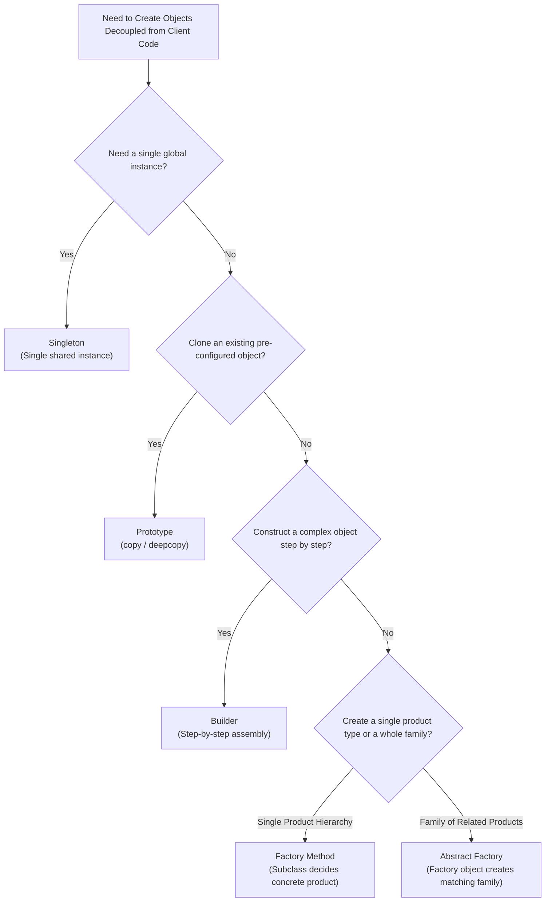
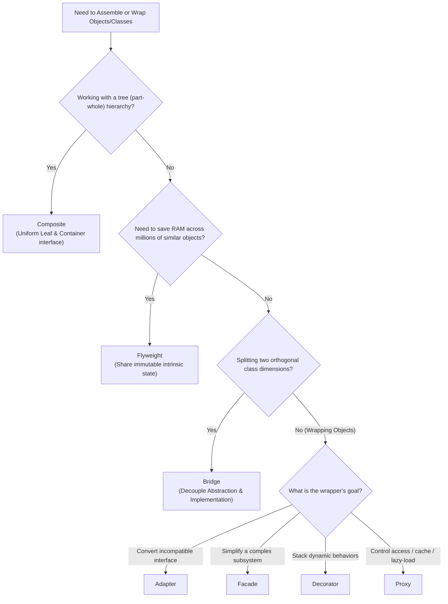
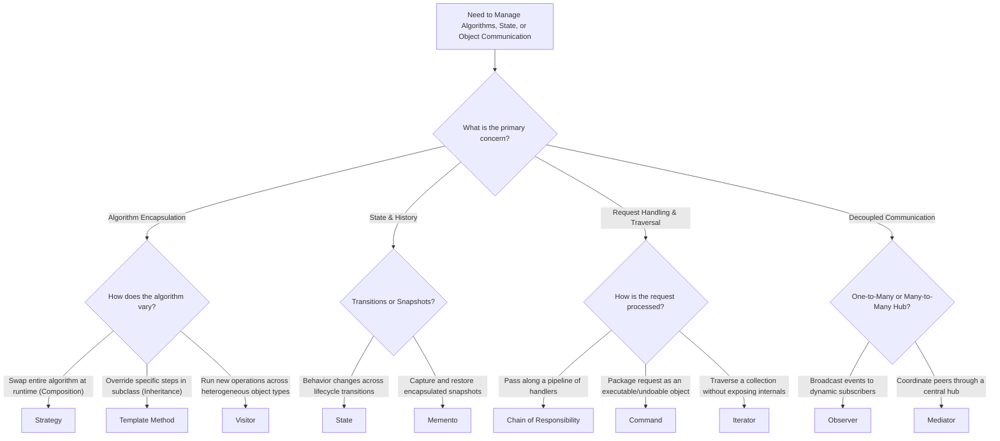

```mermaid
flowchart TD
    Root["Gang of Four (GoF) Design Patterns (22)"]

    Root --> Creational["Creational Patterns (5)<br/>Flexible Object Creation"]
    Root --> Structural["Structural Patterns (7)<br/>Class & Object Composition"]
    Root --> Behavioral["Behavioral Patterns (10)<br/>Object Communication & Responsibility"]

    Creational --> C1["Factory Method"]
    Creational --> C2["Abstract Factory"]
    Creational --> C3["Builder"]
    Creational --> C4["Prototype"]
    Creational --> C5["Singleton"]

    Structural --> S1["Adapter"]
    Structural --> S2["Bridge"]
    Structural --> S3["Composite"]
    Structural --> S4["Decorator"]
    Structural --> S5["Facade"]
    Structural --> S6["Flyweight"]
    Structural --> S7["Proxy"]

    Behavioral --> B1["Chain of Responsibility"]
    Behavioral --> B2["Command"]
    Behavioral --> B3["Iterator"]
    Behavioral --> B4["Mediator"]
    Behavioral --> B5["Memento"]
    Behavioral --> B6["Observer"]
    Behavioral --> B7["State"]
    Behavioral --> B8["Strategy"]
    Behavioral --> B9["Template Method"]
    Behavioral --> B10["Visitor"]
```

# Software Design Patterns

| Metadata      | Value                      |
| ------------- | -------------------------- |
| Author        | Lyzander Marciano Andrylie |
| Creation Date | Nov 12, 2026               |
| Last Updated  | Nov 12, 2026               |

## References

- [Refactoring.Guru: Design Patterns](https://refactoring.guru/design-patterns): Introduction to software design patterns, core anatomy, classification, and trade-offs
- [Refactoring.Guru: The Catalog of Design Patterns](https://refactoring.guru/design-patterns/catalog): Complete catalog of the 22 classic Gang of Four (GoF) design patterns
- [Refactoring.Guru: Design Patterns in Python](https://refactoring.guru/design-patterns/python): Conceptual and real-world Python implementations of all 22 design patterns
- [factory_method.md](./creational/factory_method.md): Creational pattern that provides an interface for creating objects in a superclass while allowing subclasses to alter the type of objects created
- [abstract_factory.md](./creational/abstract_factory.md): Creational pattern that produces families of related objects without specifying their concrete classes
- [builder.md](./creational/builder.md): Creational pattern that constructs complex objects step by step using the same construction code
- [prototype.md](./creational/prototype.md): Creational pattern that copies existing objects without making code dependent on their concrete classes
- [singleton.md](./creational/singleton.md): Creational pattern that ensures a class has only one instance and provides a global access point to it
- [adapter.md](./structural/adapter.md): Structural pattern that allows objects with incompatible interfaces to collaborate
- [bridge.md](./structural/bridge.md): Structural pattern that splits a large class or set of closely related classes into separate abstraction and implementation hierarchies
- [composite.md](./structural/composite.md): Structural pattern that composes objects into tree structures and works with them as if they were individual objects
- [decorator.md](./structural/decorator.md): Structural pattern that attaches new behaviors to objects by placing them inside wrapper objects
- [facade.md](./structural/facade.md): Structural pattern that provides a simplified interface to a library, framework, or complex set of classes
- [flyweight.md](./structural/flyweight.md): Structural pattern that fits more objects into available RAM by sharing common state across multiple objects
- [proxy.md](./structural/proxy.md): Structural pattern that provides a substitute or placeholder for another object to control access to it
- [chain_of_responsibility.md](./behavioural/chain_of_responsibility.md): Behavioral pattern that passes requests along a chain of handlers
- [command.md](./behavioural/command.md): Behavioral pattern that turns a request into a stand-alone object containing all information about the request
- [iterator.md](./behavioural/iterator.md): Behavioral pattern that traverses elements of a collection without exposing its underlying representation
- [mediator.md](./behavioural/mediator.md): Behavioral pattern that restricts direct communications between objects and forces them to collaborate only via a mediator object
- [memento.md](./behavioural/memento.md): Behavioral pattern that saves and restores the previous state of an object without revealing implementation details
- [observer.md](./behavioural/observer.md): Behavioral pattern that defines a subscription mechanism to notify multiple objects about events happening to the object they observe
- [state.md](./behavioural/state.md): Behavioral pattern that lets an object alter its behavior when its internal state changes
- [strategy.md](./behavioural/strategy.md): Behavioral pattern that defines a family of interchangeable algorithms and encapsulates each into a separate class
- [template_method.md](./behavioural/template_method.md): Behavioral pattern that defines the skeleton of an algorithm in a superclass while letting subclasses override specific steps
- [visitor.md](./behavioural/visitor.md): Behavioral pattern that separates algorithms from the object structures on which they operate

## Description

**Design patterns** are typical, reusable architectural solutions to commonly occurring problems in object-oriented software design. Rather than finished code snippets or libraries that can be plugged directly into an application, they serve as customizable blueprints that define how classes and objects interact to solve recurring structural, creational, and behavioral design challenges while keeping codebases flexible and maintainable.

## Concepts

### 1. Fundamentals and Classification of Design Patterns

Popularized by the _Gang of Four_ (Erich Gamma, Richard Helm, Ralph Johnson, and John Vlissides) in _Design Patterns: Elements of Reusable Object-Oriented Software_ (1994), design patterns standardize how engineers reason about object-oriented architecture.

- **Anatomy of a Design Pattern**:
  - **Intent**: A concise summary of both the problem and the solution the pattern provides.
  - **Problem & Motivation**: A concrete scenario illustrating why naive or tightly coupled code fails to scale or adapt to change.
  - **Solution**: The high-level mechanism that resolves the problem through object composition, delegation, or polymorphism.
  - **Structure**: The specification of each class and interface participant, its responsibilities, and how components collaborate.
- **Why Use Design Patterns?**:
  - **Proven Engineering Solutions**: Solve recurring architectural pain points using battle-tested object-oriented principles (such as _Program to an interface, not an implementation_ and _Favor object composition over class inheritance_).
  - **Shared Technical Vocabulary**: Allow developers to communicate complex system designs concisely by naming the pattern rather than explaining low-level class wiring from scratch.
- **Classification Dimensions**:
  - **By Intent (Primary Categorization)**:
    1. **Creational Patterns**: Object creation mechanisms that increase flexibility and reuse of existing code.
    2. **Structural Patterns**: Ways to assemble objects and classes into larger structures while keeping those structures flexible and efficient.
    3. **Behavioral Patterns**: Effective communication, algorithm encapsulation, and assignment of responsibilities between objects.
  - **By Scope**:
    - **Class Patterns**: Rely on static inheritance relationships between classes established at compile/definition time (e.g., `Factory Method`, `Template Method`).
    - **Object Patterns**: Rely on dynamic object composition and associations that can be rewired at runtime (e.g., `Strategy`, `Decorator`, `Abstract Factory`).

| Concept            | Analogy                 | How It Works                                                                                                              |
| :----------------- | :---------------------- | :------------------------------------------------------------------------------------------------------------------------ |
| **Design Pattern** | Architectural Blueprint | High-level description of a solution; you see the target outcome and structure, but implement the exact classes yourself. |
| **Algorithm**      | Cooking Recipe          | Clear, deterministic set of step-by-step instructions that compute a specific output from an input.                       |
| **Library / SDK**  | Prefabricated Furniture | Pre-written, packaged code (`import ...`) that you invoke directly without implementing its internal structure.           |

#### Interaction

---

### 2. Creational Design Patterns: Flexible Object Instantiation

**Creational patterns** abstract the object instantiation process so that client code is not hardcoded to concrete classes (`ConcreteClass()`), making it easy to introduce new object types, product families, or complex configurations without modifying existing client logic.

- **Core Problem Solved**: Direct constructor calls scatter instantiation details across the codebase, tightly coupling business logic to specific implementations.
- **Core Mechanism**: Encapsulate _which_ concrete class is instantiated and _how_ it is assembled behind factory methods, abstract factory interfaces, step-by-step builders, self-cloning prototypes, or controlled single-instance accessors.

| Pattern              | Catalog Reference                                       | Intent                                                                                                                | Typical Use Case                                                                                                                               |
| :------------------- | :------------------------------------------------------ | :-------------------------------------------------------------------------------------------------------------------- | :--------------------------------------------------------------------------------------------------------------------------------------------- |
| **Factory Method**   | [factory_method.md](./creational/factory_method.md)     | Provides an interface for creating objects in a superclass, allowing subclasses to alter the type of objects created. | Frameworks or services where the base workflow is fixed (e.g., logistics planning) but concrete transport/driver types vary (`Truck`, `Ship`). |
| **Abstract Factory** | [abstract_factory.md](./creational/abstract_factory.md) | Produces families of related or dependent objects without specifying their concrete classes.                          | Cross-platform UI toolkits (`Button` + `Checkbox` for Windows vs. macOS) or multi-cloud infrastructure providers.                              |
| **Builder**          | [builder.md](./creational/builder.md)                   | Constructs complex objects step by step, allowing the same construction process to produce different representations. | Assembling objects with many optional parameters or multi-step configurations (e.g., SQL queries, HTTP requests, complex documents).           |
| **Prototype**        | [prototype.md](./creational/prototype.md)               | Copies existing objects without making client code dependent on their concrete classes.                               | Cloning pre-configured objects, heavy initial states, or complex nested object graphs via `copy.copy()` and `copy.deepcopy()`.                 |
| **Singleton**        | [singleton.md](./creational/singleton.md)               | Ensures a class has only one instance while providing a global access point to that instance.                         | Managing a single shared resource such as an in-memory configuration registry or hardware device handle.                                       |

#### Interaction

---

### 3. Structural Design Patterns: Flexible Object & Class Composition

**Structural patterns** explain how to assemble objects and classes into larger, scalable structures while keeping those structures flexible, loosely coupled, and memory-efficient.

- **Core Problem Solved**: Naive inheritance hierarchies quickly become brittle when adapting incompatible 3rd-party interfaces, combining orthogonal features, managing tree hierarchies, or controlling resource-heavy objects.
- **Core Mechanism**: Use object composition, wrapping, and delegation to translate interfaces (`Adapter`), decouple orthogonal dimensions (`Bridge`), unify trees (`Composite`), stack behaviors (`Decorator`), simplify subsystems (`Facade`), share immutable state (`Flyweight`), or intercept access (`Proxy`).

| Pattern       | Catalog Reference                         | Intent                                                                                                                                         | Typical Use Case                                                                                                                                                    |
| :------------ | :---------------------------------------- | :--------------------------------------------------------------------------------------------------------------------------------------------- | :------------------------------------------------------------------------------------------------------------------------------------------------------------------ |
| **Adapter**   | [adapter.md](./structural/adapter.md)     | Allows objects with incompatible interfaces to collaborate by wrapping one object in a translator.                                             | Integrating legacy modules or 3rd-party SDKs (e.g., wrapping an XML data provider to fit a JSON analytics interface).                                               |
| **Bridge**    | [bridge.md](./structural/bridge.md)       | Splits a large class or set of closely related classes into two separate hierarchies—abstraction and implementation—that evolve independently. | Preventing $N \times M$ class explosion when combining orthogonal dimensions (e.g., `RemoteControl` types $\times$ `Device` types, or `Shape` $\times$ `Renderer`). |
| **Composite** | [composite.md](./structural/composite.md) | Composes objects into tree structures and works with these structures as if they were individual objects.                                      | Recursive part-whole hierarchies such as filesystem directories/files, nested UI containers, or nested order boxes.                                                 |
| **Decorator** | [decorator.md](./structural/decorator.md) | Attaches new behaviors to objects dynamically by placing them inside stackable wrapper objects that share the same interface.                  | Layering cross-cutting features such as encryption, compression, retry, or multi-channel notifications (`SMS` + `Slack` + `Email`).                                 |
| **Facade**    | [facade.md](./structural/facade.md)       | Provides a simplified, high-level entry interface to a library, framework, or complex set of subsystem classes.                                | Wrapping a multi-step media encoding, billing, or cloud provisioning subsystem behind a single clean service method.                                                |
| **Flyweight** | [flyweight.md](./structural/flyweight.md) | Fits more objects into available RAM by sharing common intrinsic state across multiple objects instead of duplicating it.                      | Rendering millions of repeated objects (e.g., game particles, forest trees, text characters) that share heavy immutable assets.                                     |
| **Proxy**     | [proxy.md](./structural/proxy.md)         | Provides a substitute or placeholder with the exact same interface as another object to control access to it.                                  | Lazy initialization of heavy services, query result caching, access control checks, or request logging.                                                             |

#### Interaction

---

### 4. Behavioral Design Patterns: Object Communication & Responsibilities

**Behavioral patterns** focus on algorithms, message flow, and the assignment of responsibilities between objects so that components can collaborate effectively without becoming tightly coupled.

- **Core Problem Solved**: Hardcoding complex conditional branches (`if/elif/else`), direct peer-to-peer dependencies, traversal logic, or state transitions inside domain objects makes them monolithic and difficult to test or extend.
- **Core Mechanism**: Encapsulate requests, algorithms, states, traversals, and notification channels into dedicated objects that communicate through well-defined interfaces.

| Pattern                     | Catalog Reference                                                      | Intent                                                                                                                             | Typical Use Case                                                                                                                     |
| :-------------------------- | :--------------------------------------------------------------------- | :--------------------------------------------------------------------------------------------------------------------------------- | :----------------------------------------------------------------------------------------------------------------------------------- |
| **Chain of Responsibility** | [chain_of_responsibility.md](./behavioural/chain_of_responsibility.md) | Passes requests along a chain of handlers where each handler decides either to process the request or pass it to the next handler. | HTTP middleware pipelines (authentication $\rightarrow$ rate limiting $\rightarrow$ validation) and event bubbling.                  |
| **Command**                 | [command.md](./behavioural/command.md)                                 | Turns a request into a stand-alone object containing all information about the request.                                            | GUI action buttons, transactional job queues, macro recording, and reversible undo/redo history.                                     |
| **Iterator**                | [iterator.md](./behavioural/iterator.md)                               | Traverses elements of a collection without exposing its underlying representation (list, stack, tree, graph).                      | Custom collection traversal (DFS/BFS, reverse iteration, paginated API cursors) via Python's `__iter__` and `__next__`.              |
| **Mediator**                | [mediator.md](./behavioural/mediator.md)                               | Restricts direct communications between objects and forces them to collaborate only via a central mediator object.                 | Decoupling interdependent UI form widgets, chat rooms, or air-traffic-style coordination hubs.                                       |
| **Memento**                 | [memento.md](./behavioural/memento.md)                                 | Saves and restores the previous state of an object without revealing the details of its internal implementation.                   | State snapshots, editor undo/redo checkpoints, and transaction rollback recovery.                                                    |
| **Observer**                | [observer.md](./behavioural/observer.md)                               | Defines a subscription mechanism to notify multiple subscriber objects about any events happening to the publisher they observe.   | Event-driven pub/sub listeners, UI state reactivity, and inventory/price alert notifications.                                        |
| **State**                   | [state.md](./behavioural/state.md)                                     | Lets an object alter its behavior when its internal state changes, appearing as if the object changed its class.                   | Finite state machines such as document workflows (`Draft` $\rightarrow$ `Moderation` $\rightarrow$ `Published`) or order lifecycles. |
| **Strategy**                | [strategy.md](./behavioural/strategy.md)                               | Defines a family of algorithms, puts each into a separate class, and makes their objects interchangeable at runtime.               | Swapping routing algorithms (`Road`, `Walking`, `Transit`), payment processors, or sorting/pricing rules dynamically.                |
| **Template Method**         | [template_method.md](./behavioural/template_method.md)                 | Defines the skeleton of an algorithm in a superclass but lets subclasses override specific steps without changing its structure.   | Standardized ETL/data-mining pipelines where file parsing varies (`CSV`, `PDF`, `DOC`) but analysis and reporting steps stay fixed.  |
| **Visitor**                 | [visitor.md](./behavioural/visitor.md)                                 | Separates algorithms from the object structures on which they operate using double dispatch.                                       | Running new operations (XML/JSON export, linting, cost calculation) across a stable hierarchy of heterogeneous AST or graph nodes.   |

#### Interaction

