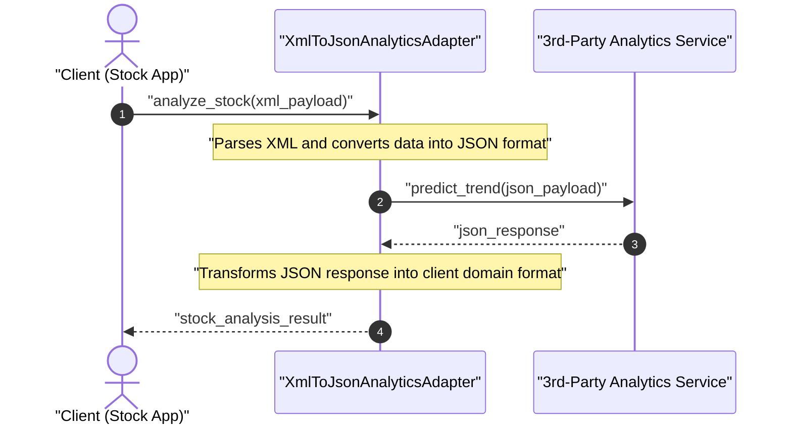
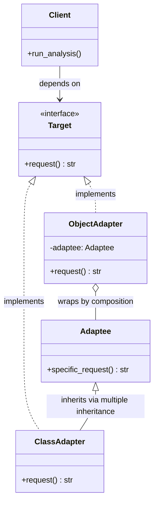

# Adapter Design Pattern

| Metadata      | Value                      |
| ------------- | -------------------------- |
| Author        | Lyzander Marciano Andrylie |
| Creation Date | Nov 12, 2026               |
| Last Updated  | Nov 12, 2026               |

## References

- [Refactoring.Guru - Adapter Pattern](https://refactoring.guru/design-patterns/adapter): Comprehensive explanation of the Adapter pattern, problems solved, structure, and trade-offs.
- [Refactoring.Guru - Adapter in Python](https://refactoring.guru/design-patterns/adapter/python/example): Python-specific implementation examples using object composition and multiple inheritance.
- [design-pattern.md](../design-pattern.md): Overview of software design patterns and catalog categories
- [bridge.md](./bridge.md): Designed up-front to separate abstraction from implementation, whereas Adapter retrofits existing classes
- [decorator.md](./decorator.md): Enhances an object without changing its interface
- [proxy.md](./proxy.md): Provides the exact same interface as its service object
- [facade.md](./facade.md): Defines a new simplified interface for an entire subsystem

## Description

The **Adapter** (also known as a **Wrapper**) is a structural design pattern that allows incompatible interfaces to collaborate by converting the interface of an existing class into another interface expected by clients. It acts as an intermediary translator between a client application and a legacy or third-party component without modifying the source code of either party.

## Concepts

### 1. Intent, Problem, and Solution

The Adapter pattern resolves integration incompatibilities by placing a specialized conversion layer between two components with discordant interfaces or data formats.

- **Intent**: Convert the interface of a class into another interface clients expect. Adapter lets classes work together that could not otherwise because of incompatible interfaces.
- **Problem**:
  - Consider a financial analytics application that ingests stock market feeds from multiple exchanges in XML format and presents real-time dashboards to analysts.
  - The engineering team wants to integrate an advanced, high-performance third-party machine learning analytics library to predict price trajectories.
  - However, the third-party library is vendor-managed and expects input strictly formatted as JSON objects with different field nomenclature, while returning predictive metrics in its own custom structure.
  - Modifying the third-party library is impossible (it is an external dependency), and rewriting the core application to emit JSON would break dozens of existing XML-dependent modules across the system.
- **Solution**:
  - Introduce an **Adapter** class that conforms to the client's expected XML-based target interface while encapsulating an instance of the third-party JSON analytics service.
  - When the client invokes the adapter, the adapter intercepts the incoming XML feed, unmarshals the XML nodes, transforms the data into the JSON schema required by the third-party service, and dispatches the translated call.
  - Upon receiving the result, the adapter translates the third-party response back into a format native to the client application.
- **Object Adapter vs. Class Adapter**:
  - **Object Adapter (Composition)**: The adapter implements the target interface and holds a private reference to the adaptee object (`has-a` relationship). It delegates calls to the wrapped adaptee at runtime. This approach follows the design principle _"favor object composition over class inheritance"_ and allows a single adapter to work with the adaptee and all of its subclasses.
  - **Class Adapter (Multiple Inheritance)**: The adapter inherits from both the target interface and the adaptee class simultaneously (`is-a` relationship with both). It overrides target methods and calls inherited adaptee methods directly. While natively possible in Python and C++, it couples the adapter to a specific concrete class and cannot adapt an entire hierarchy of adaptee subclasses.
- **Applicability**:
  - Use the Adapter pattern when you need to use an existing or third-party class, but its interface does not match the rest of your codebase.
  - Use the pattern when building reusable libraries or frameworks that need to integrate with unpredictable, heterogeneous client components.
  - Use the pattern when retrofitting legacy classes into a modernized system without risking regressions in untouched legacy routines.

| Trade-off Dimension              | Advantage (Pros)                                                                                                          | Disadvantage (Cons)                                                                                 |
| :------------------------------- | :------------------------------------------------------------------------------------------------------------------------ | :-------------------------------------------------------------------------------------------------- |
| **Separation of Concerns (SRP)** | Single Responsibility Principle: Data format conversion and interface translation are decoupled from core business logic. | Introduces extra classes, wrappers, and indirection layers into the codebase.                       |
| **Extensibility (OCP)**          | Open/Closed Principle: New adapters can be introduced for new external services without modifying existing client code.   | Increased overall architecture complexity compared to modifying the service directly when feasible. |
| **Legacy & Vendor Integration**  | Reuses third-party or legacy classes whose source code is immutable or closed-source.                                     | Minor runtime overhead caused by additional method calls and data serialization/deserialization.    |
| **Interface Flexibility**        | Bridges incompatible protocols, naming conventions, and parameter types seamlessly.                                       | Deep chains of nested adapters can make call stack traces and debugging more difficult to trace.    |

#### Interaction



### 2. Structure and Components

The Adapter pattern establishes clear boundaries between the calling client, the expected interface contract, and the foreign service being adapted.

| Component             | Role                     | Responsibility                                                                                                 |
| :-------------------- | :----------------------- | :------------------------------------------------------------------------------------------------------------- |
| `Client`              | Caller / Consumer        | Contains core business workflows and interacts solely with objects conforming to the `Target` interface.       |
| `Target`              | Domain Interface         | Declares the standard domain-specific interface, method signatures, and protocols expected by the client.      |
| `Adaptee` (`Service`) | Existing / Foreign Class | Contains useful functionality but exposes an incompatible method signature, protocol, or data format.          |
| `Adapter`             | Wrapper / Translator     | Implements the `Target` interface and translates client requests into invocations understood by the `Adaptee`. |

- **Client Decoupling**: The client code never couples to concrete service implementations; it only knows about the abstract `Target` interface.
- **Translation Pipeline**: The adapter receives parameters conforming to the `Target` interface, maps or transforms them into the format expected by the `Adaptee`, invokes the adaptee method, and maps the response back.
- **Structural Variants**:
  - In an **Object Adapter**, the adapter encapsulates the adaptee via composition (`self._adaptee = adaptee`), providing runtime flexibility and polymorphism across adaptee subclasses.
  - In a **Class Adapter**, the adapter inherits both classes (`class Adapter(Target, Adaptee)`), accessing adaptee methods through `self`.

#### Interaction



### 3. Python Implementation

The following examples demonstrate how to implement the Adapter pattern in Python using the standard library `abc` module.

#### a. Conceptual Structure Example (Object Composition & Multiple Inheritance)

This conceptual example demonstrates both the preferred **Object Adapter** (using composition) and the **Class Adapter** (using Python's multiple inheritance):

- `Target`: The abstract base class defining `request() -> str` that client code relies on.
- `Adaptee`: The existing class providing useful functionality via `specific_request() -> str`, but returning reversed string data incompatible with client expectations.
- `ObjectAdapter`: Implements `Target` and wraps an `Adaptee` instance via composition (`self._adaptee`), reversing the string and translating the call.
- `ClassAdapter`: Inherits from both `Target` and `Adaptee`, calling `self.specific_request()` directly.
- `client_code`: Client function that operates strictly against the `Target` interface.

```python
from abc import ABC, abstractmethod


# 1. Target Interface
class Target(ABC):
    """
    The Target defines the domain-specific interface used by client code.
    """

    @abstractmethod
    def request(self) -> str:
        """Standard request expected by clients."""
        pass


# 2. Existing Adaptee Class
class Adaptee:
    """
    The Adaptee contains useful behavior, but its interface is incompatible
    with existing client code. It needs adaptation before clients can use it.
    """

    def specific_request(self) -> str:
        """Legacy or foreign method with reversed string payload."""
        return ".eetpadA eht fo roivaheb laicepS"


# 3a. Object Adapter (Composition)
class ObjectAdapter(Target):
    """
    Object Adapter: Implements the Target interface while wrapping an Adaptee
    instance via composition.
    """

    def __init__(self, adaptee: Adaptee) -> None:
        self._adaptee = adaptee

    def request(self) -> str:
        # Translate and reverse the adaptee's specific format
        translated = self._adaptee.specific_request()[::-1]
        return f"ObjectAdapter: (Translated) {translated}"


# 3b. Class Adapter (Multiple Inheritance)
class ClassAdapter(Target, Adaptee):
    """
    Class Adapter: Inherits from both Target and Adaptee using Python's
    multiple inheritance.
    """

    def request(self) -> str:
        # Calls inherited method directly on self
        translated = self.specific_request()[::-1]
        return f"ClassAdapter: (Translated) {translated}"


# 4. Client Code
def client_code(target: Target) -> None:
    """
    The client code supports all classes conforming to the Target interface.
    """
    print(target.request())


if __name__ == "__main__":
    print("--- 1. Direct Target Usage ---")

    class ConcreteTarget(Target):

        def request(self) -> str:
            return "ConcreteTarget: Standard business response."

    client_code(ConcreteTarget())
    # Output:
    # ConcreteTarget: Standard business response.

    print()

    print("--- 2. Incompatible Adaptee Raw Output ---")
    adaptee = Adaptee()
    print(f"Adaptee: {adaptee.specific_request()}")
    # Output:
    # Adaptee: .eetpadA eht fo roivaheb laicepS

    print()

    print("--- 3. Object Adapter (Composition) ---")
    obj_adapter = ObjectAdapter(adaptee)
    client_code(obj_adapter)
    # Output:
    # ObjectAdapter: (Translated) Special behavior of the Adaptee.

    print()

    print("--- 4. Class Adapter (Multiple Inheritance) ---")
    class_adapter = ClassAdapter()
    client_code(class_adapter)
    # Output:
    # ClassAdapter: (Translated) Special behavior of the Adaptee.
```

#### b. Practical Real-World Example

A stock market analytics application integrating an external machine learning service:

- `StockAnalytics`: The abstract target interface defining `analyze_stock(stock_xml: str) -> str`.
- `LegacyXmlAnalytics`: Existing system component that parses XML stock feeds natively using basic heuristics.
- `ModernJsonMLService`: Third-party predictive machine learning library (`Adaptee`) that requires JSON payloads and exposes `predict_trend(json_payload: str) -> str`.
- `XmlToJsonAnalyticsAdapter`: Adapter implementing `StockAnalytics` and encapsulating `ModernJsonMLService`. It parses XML feeds, serializes them into JSON payloads, invokes the ML model, and formats the JSON prediction into the domain report.
- `run_portfolio_analysis`: Client dashboard function that accepts any `StockAnalytics` provider and processes stock feeds.

```python
from abc import ABC, abstractmethod
import json
import xml.etree.ElementTree as ET


# 1. Target Interface
class StockAnalytics(ABC):
    """
    The Target interface expected by the client portfolio dashboard.
    All analytics providers must accept stock XML data.
    """

    @abstractmethod
    def analyze_stock(self, stock_xml: str) -> str:
        """Analyze stock data provided in XML format."""
        pass


# 2. Existing Target Implementation
class LegacyXmlAnalytics(StockAnalytics):
    """
    Standard existing system engine that natively parses and handles XML data.
    """

    def analyze_stock(self, stock_xml: str) -> str:
        root = ET.fromstring(stock_xml)
        symbol = root.findtext("symbol", "UNKNOWN")
        price = root.findtext("price", "0.0")
        return f"[Legacy XML Engine] Processed {symbol} at ${price} via basic heuristics."


# 3. Third-Party Incompatible Service (Adaptee)
class ModernJsonMLService:
    """
    Adaptee: A 3rd-party machine learning predictive service.
    It expects input strictly as a JSON string and returns a JSON payload.
    """

    def predict_trend(self, json_payload: str) -> str:
        data = json.loads(json_payload)
        ticker = data.get("ticker", "UNKNOWN")
        valuation = float(data.get("valuation", 0.0))

        # Predict buy/hold based on algorithmic valuation threshold
        signal = "BUY" if valuation < 200.0 else "HOLD"
        confidence = 0.94 if signal == "BUY" else 0.88

        response = {
            "ticker": ticker,
            "signal": signal,
            "confidence": confidence,
        }
        return json.dumps(response)


# 4. Adapter Class (Object Composition)
class XmlToJsonAnalyticsAdapter(StockAnalytics):
    """
    Adapter: Bridges the XML-oriented client dashboard to the JSON-oriented
    3rd-party machine learning predictive service.
    """

    def __init__(self, ml_service: ModernJsonMLService) -> None:
        self._ml_service = ml_service

    def analyze_stock(self, stock_xml: str) -> str:
        # Step 1: Parse the incoming XML document
        root = ET.fromstring(stock_xml)
        symbol = root.findtext("symbol", "UNKNOWN")
        price = float(root.findtext("price", "0.0"))

        # Step 2: Convert parsed data into JSON format expected by Adaptee
        json_payload = json.dumps({"ticker": symbol, "valuation": price})

        # Step 3: Invoke the 3rd-party Adaptee method
        raw_response = self._ml_service.predict_trend(json_payload)

        # Step 4: Translate the JSON response into client-expected domain string
        result = json.loads(raw_response)
        ticker = result["ticker"]
        signal = result["signal"]
        confidence = result["confidence"] * 100

        return (
            f"[Modern ML Adapter] Stock: {ticker} | "
            f"Signal: {signal} | "
            f"Confidence: {confidence:.0f}%"
        )


# 5. Client Code
def run_portfolio_analysis(service: StockAnalytics, xml_feed: str) -> None:
    """
    Client function operating purely against the StockAnalytics interface.
    It works seamlessly with both native engines and 3rd-party services via adapters.
    """
    report = service.analyze_stock(xml_feed)
    print(report)


if __name__ == "__main__":
    apple_feed = "<stock><symbol>AAPL</symbol><price>182.50</price></stock>"
    google_feed = "<stock><symbol>GOOGL</symbol><price>245.00</price></stock>"

    print("--- 1. Client running legacy XML engine ---")
    legacy_engine = LegacyXmlAnalytics()
    run_portfolio_analysis(legacy_engine, apple_feed)
    # Output:
    # [Legacy XML Engine] Processed AAPL at $182.50 via basic heuristics.

    print()

    print("--- 2. Client running 3rd-party ML engine via Adapter ---")
    ml_service = ModernJsonMLService()
    adapter = XmlToJsonAnalyticsAdapter(ml_service)
    run_portfolio_analysis(adapter, apple_feed)
    # Output:
    # [Modern ML Adapter] Stock: AAPL | Signal: BUY | Confidence: 94%

    run_portfolio_analysis(adapter, google_feed)
    # Output:
    # [Modern ML Adapter] Stock: GOOGL | Signal: HOLD | Confidence: 88%
```
