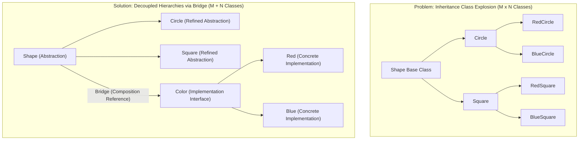
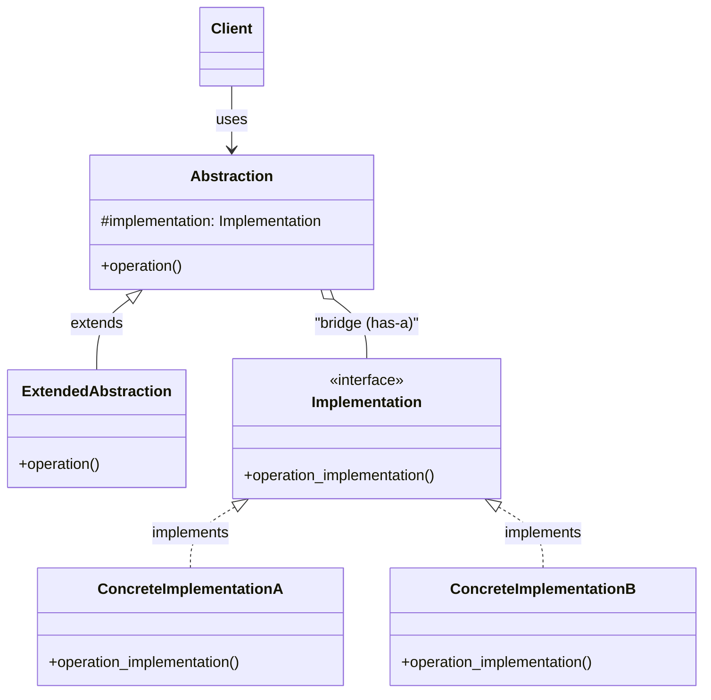

# Bridge Design Pattern

| Metadata      | Value                      |
| ------------- | -------------------------- |
| Author        | Lyzander Marciano Andrylie |
| Creation Date | Nov 12, 2026               |
| Last Updated  | Nov 12, 2026               |

## References

- [Refactoring.Guru – Bridge Design Pattern](https://refactoring.guru/design-patterns/bridge): Core concepts, structural explanation, problems, and solutions
- [Refactoring.Guru – Bridge in Python](https://refactoring.guru/design-patterns/bridge/python/example): Conceptual and real-world Python implementation examples
- [design-pattern.md](../design-pattern.md): Overview of software design patterns and catalog categories
- [adapter.md](./adapter.md): Retrofits incompatible existing classes, whereas Bridge is designed up-front
- [abstract_factory.md](../creational/abstract_factory.md): Can encapsulate the creation and wiring of specific Bridge abstractions and implementations
- [strategy.md](../behavioural/strategy.md): Shares a similar composition structure focused on interchangeable behavioral algorithms

## Description

The **Bridge** pattern is a structural design pattern that decouples an abstraction from its implementation, allowing the two independent hierarchies to vary and evolve independently. It replaces multi-dimensional class inheritance with object composition to prevent combinatorial class explosions.

## Concepts

### 1. Intent, Problem, and Solution

The core intent of the Bridge pattern is to divide a monolithic class or a set of tightly coupled classes into two separate hierarchies: **Abstraction** (high-level control layer) and **Implementation** (platform- or engine-specific layer).

- **Intent**: Provide a structural bridge via object composition so high-level logic and low-level platform operations can be extended without altering one another.
- **The Problem (Cartesian Product Class Explosion)**:
  - When a class hierarchy extends across two independent dimensions (e.g., `Shape` with variations `Circle`, `Square` and `Color` with variations `Red`, `Blue`), inheritance forces you to create subclasses for every combination: `RedCircle`, `BlueCircle`, `RedSquare`, `BlueSquare` ($M \times N$ classes).
  - Adding a new shape or a new color requires multiplying subclasses exponentially across the codebase.
- **The Solution (Composition over Inheritance)**:
  - Extract one dimension into a separate hierarchy.
  - The `Shape` (Abstraction) hierarchy retains a reference—the **bridge**—to an object of the `Color` (Implementation) hierarchy.
  - Instead of doing color-specific rendering itself, `Shape` delegates the rendering work to its linked `Color` instance. Growth becomes additive ($M + N$ classes) instead of multiplicative ($M \times N$).
- **Applicability**:
  - When you need to avoid permanent binding between an abstraction and its implementation (e.g., when the implementation must be selected or switched at runtime).
  - When both the abstractions and their implementations should be extensible independently through subclassing.
  - When changes in the implementation of an abstraction should have zero impact on clients.
  - When dealing with cross-platform graphic renderers, database drivers, or remote device controllers.

#### Pros and Cons

| Advantages (Pros)                                                                 | Disadvantages (Cons)                                                                 |
| :-------------------------------------------------------------------------------- | :----------------------------------------------------------------------------------- |
| **Separation of Concerns**: High-level control logic is decoupled from platforms. | **Initial Complexity**: Introduces additional classes, interfaces, and indirection.  |
| **Open/Closed Principle**: Introduce new abstractions and implementations freely. | **Architectural Overhead**: Overkill for simple hierarchies that will never diverge. |
| **Single Responsibility Principle**: Focus abstraction and implementation roles.  | **Coupling on Assembly**: Client or factory must configure the pairing at startup.   |
| **Runtime Swapping**: Implementations can be dynamically exchanged on the fly.    |                                                                                      |

#### Interaction



### 2. Structure and Components

The Bridge pattern organizes components into distinct functional roles:

| Component                  | Role                                                                                          |
| :------------------------- | :-------------------------------------------------------------------------------------------- |
| **Abstraction**            | Defines high-level control logic and maintains a reference to an `Implementation` object.     |
| **ExtendedAbstraction**    | Extends the high-level interface with refined variants or specialized domain logic.           |
| **Implementation**         | Declares the primitive interface common to all concrete platform/driver implementations.      |
| **ConcreteImplementation** | Contains platform-specific code implementing the `Implementation` interface.                  |
| **Client**                 | Configures the pairing (or receives it via factory) and collaborates purely with Abstraction. |

- **Abstraction**: Provides the primary interface consumed by the client. It stores a pointer/reference to an `Implementation` instance and delegates low-level execution to it.
- **ExtendedAbstraction** (Refined Abstraction): Variants of the control layer that provide specialized or richer business workflows while continuing to delegate low-level primitives through the bridge.
- **Implementation**: The interface common to all low-level implementations. It does not need to mirror the `Abstraction` interface; in fact, it usually supplies primitive primitives that the `Abstraction` combines.
- **ConcreteImplementation**: Implements platform-specific details (e.g., Windows vs. Linux GUI, SQLite vs. Postgres, Sony TV vs. Panasonic TV).
- **Client**: Typically passes an implementation object into the abstraction constructor during initialization and communicates solely with the abstraction thereafter.

#### Interaction



### 3. Python Implementation

Python implements the Bridge pattern through abstract base classes (`abc.ABC` and `@abstractmethod`) to enforce interface contracts without requiring rigid compile-time types.

#### a. Conceptual Structure Example

The conceptual example shows how the `Abstraction` class maintains a reference to an `Implementation` interface and delegates execution, while `ExtendedAbstraction` enriches the control layer independently.

- **`Implementation`**: Abstract base class declaring the low-level platform interface (`operation_implementation`).
- **`ConcreteImplementationA` / `ConcreteImplementationB`**: Concrete implementations targeting distinct platforms.
- **`Abstraction`**: Stores `self.implementation` and runs the base operation workflow.
- **`ExtendedAbstraction`**: Subclasses `Abstraction` with extended behavior while reusing the underlying implementation.
- **`client_code`**: Operates against the `Abstraction` type without knowing which concrete implementation is linked.

```python
from __future__ import annotations
from abc import ABC, abstractmethod


class Implementation(ABC):
    """
    The Implementation interface declares primitive operations common to all
    concrete platform implementations. The Abstraction delegates real work here.
    """

    @abstractmethod
    def operation_implementation(self) -> str:
        pass


class ConcreteImplementationA(Implementation):
    """
    Concrete implementation tailored for Platform A.
    """

    def operation_implementation(self) -> str:
        return "ConcreteImplementationA: Platform-specific execution on Platform A."


class ConcreteImplementationB(Implementation):
    """
    Concrete implementation tailored for Platform B.
    """

    def operation_implementation(self) -> str:
        return "ConcreteImplementationB: Platform-specific execution on Platform B."


class Abstraction:
    """
    The Abstraction defines high-level control logic and maintains a reference
    (bridge) to an instance of the Implementation hierarchy.
    """

    def __init__(self, implementation: Implementation) -> None:
        self.implementation = implementation

    def operation(self) -> str:
        return (
            f"Abstraction: Base operation with:\n"
            f"  {self.implementation.operation_implementation()}"
        )


class ExtendedAbstraction(Abstraction):
    """
    Extends the Abstraction interface without modifying the Implementation classes.
    """

    def operation(self) -> str:
        return (
            f"ExtendedAbstraction: Extended operation with:\n"
            f"  {self.implementation.operation_implementation()}"
        )


def client_code(abstraction: Abstraction) -> None:
    """
    Client code interacts exclusively through the Abstraction interface.
    """
    print(abstraction.operation())


if __name__ == "__main__":
    # Client executes with Platform A
    implementation_a = ConcreteImplementationA()
    abstraction_base = Abstraction(implementation_a)
    client_code(abstraction_base)
    # Output:
    # Abstraction: Base operation with:
    #   ConcreteImplementationA: Platform-specific execution on Platform A.

    print()

    # Client executes with Platform B using ExtendedAbstraction
    implementation_b = ConcreteImplementationB()
    abstraction_extended = ExtendedAbstraction(implementation_b)
    client_code(abstraction_extended)
    # Output:
    # ExtendedAbstraction: Extended operation with:
    #   ConcreteImplementationB: Platform-specific execution on Platform B.
```

#### b. Practical Real-World Example

A classic real-world example models **universal remote controls** (`RemoteControl` and `AdvancedRemoteControl`) operating varied electronic **devices** (`Tv` and `Radio`).

- **`Device`**: Implementation interface declaring low-level hardware methods (`is_enabled`, `enable`, `disable`, `get_volume`, `set_volume`, `get_channel`, `set_channel`).
- **`Tv` & `Radio`**: Concrete implementations managing their internal state independently.
- **`RemoteControl`**: Abstraction exposing user actions (`toggle_power`, `volume_up`, `volume_down`, `channel_up`, `channel_down`) that map to primitive device calls.
- **`AdvancedRemoteControl`**: Refined abstraction introducing additional high-level functions like `mute()` without altering any `Device` classes.

```python
from __future__ import annotations
from abc import ABC, abstractmethod


# ---------------------------------------------------------
# Implementation Hierarchy: Device
# ---------------------------------------------------------


class Device(ABC):
    """
    The Implementation interface declares primitive operations common
    to all concrete hardware devices.
    """

    @abstractmethod
    def is_enabled(self) -> bool:
        pass

    @abstractmethod
    def enable(self) -> None:
        pass

    @abstractmethod
    def disable(self) -> None:
        pass

    @abstractmethod
    def get_volume(self) -> int:
        pass

    @abstractmethod
    def set_volume(self, percent: int) -> None:
        pass

    @abstractmethod
    def get_channel(self) -> int:
        pass

    @abstractmethod
    def set_channel(self, channel: int) -> None:
        pass

    @abstractmethod
    def print_status(self) -> None:
        pass


class Tv(Device):
    """
    Concrete implementation of Device for a Television.
    """

    def __init__(self) -> None:
        self._on: bool = False
        self._volume: int = 30
        self._channel: int = 1

    def is_enabled(self) -> bool:
        return self._on

    def enable(self) -> None:
        self._on = True

    def disable(self) -> None:
        self._on = False

    def get_volume(self) -> int:
        return self._volume

    def set_volume(self, percent: int) -> None:
        self._volume = max(0, min(100, percent))

    def get_channel(self) -> int:
        return self._channel

    def set_channel(self, channel: int) -> None:
        self._channel = channel

    def print_status(self) -> None:
        power = "ON" if self._on else "OFF"
        print(f"[TV] Power: {power} | Volume: {self._volume}% | Channel: {self._channel}")


class Radio(Device):
    """
    Concrete implementation of Device for a Radio.
    """

    def __init__(self) -> None:
        self._on: bool = False
        self._volume: int = 20
        self._channel: int = 1

    def is_enabled(self) -> bool:
        return self._on

    def enable(self) -> None:
        self._on = True

    def disable(self) -> None:
        self._on = False

    def get_volume(self) -> int:
        return self._volume

    def set_volume(self, percent: int) -> None:
        self._volume = max(0, min(100, percent))

    def get_channel(self) -> int:
        return self._channel

    def set_channel(self, channel: int) -> None:
        self._channel = channel

    def print_status(self) -> None:
        power = "ON" if self._on else "OFF"
        print(f"[Radio] Power: {power} | Volume: {self._volume}% | Station Frequency: {self._channel} FM")


# ---------------------------------------------------------
# Abstraction Hierarchy: RemoteControl
# ---------------------------------------------------------


class RemoteControl:
    """
    The Abstraction maintains a reference to a Device implementation
    and defines high-level control logic.
    """

    def __init__(self, device: Device) -> None:
        self.device = device

    def toggle_power(self) -> None:
        if self.device.is_enabled():
            self.device.disable()
        else:
            self.device.enable()

    def volume_down(self) -> None:
        self.device.set_volume(self.device.get_volume() - 10)

    def volume_up(self) -> None:
        self.device.set_volume(self.device.get_volume() + 10)

    def channel_down(self) -> None:
        self.device.set_channel(self.device.get_channel() - 1)

    def channel_up(self) -> None:
        self.device.set_channel(self.device.get_channel() + 1)


class AdvancedRemoteControl(RemoteControl):
    """
    Refined Abstraction adding specialized operations (e.g., mute)
    without modifying the Device implementations.
    """

    def mute(self) -> None:
        self.device.set_volume(0)


# ---------------------------------------------------------
# Client Code
# ---------------------------------------------------------


if __name__ == "__main__":
    print("--- Operating TV with Basic Remote ---")
    tv = Tv()
    remote = RemoteControl(tv)
    remote.toggle_power()
    remote.volume_up()
    remote.channel_up()
    tv.print_status()
    # Output:
    # --- Operating TV with Basic Remote ---
    # [TV] Power: ON | Volume: 40% | Channel: 2

    print("\n--- Operating Radio with Advanced Remote ---")
    radio = Radio()
    advanced_remote = AdvancedRemoteControl(radio)
    advanced_remote.toggle_power()
    advanced_remote.volume_up()
    advanced_remote.mute()
    radio.print_status()
    # Output:
    # --- Operating Radio with Advanced Remote ---
    # [Radio] Power: ON | Volume: 0% | Station Frequency: 1 FM
```
