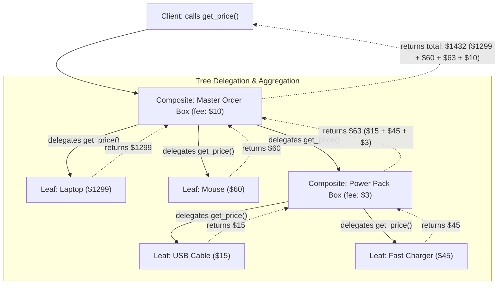
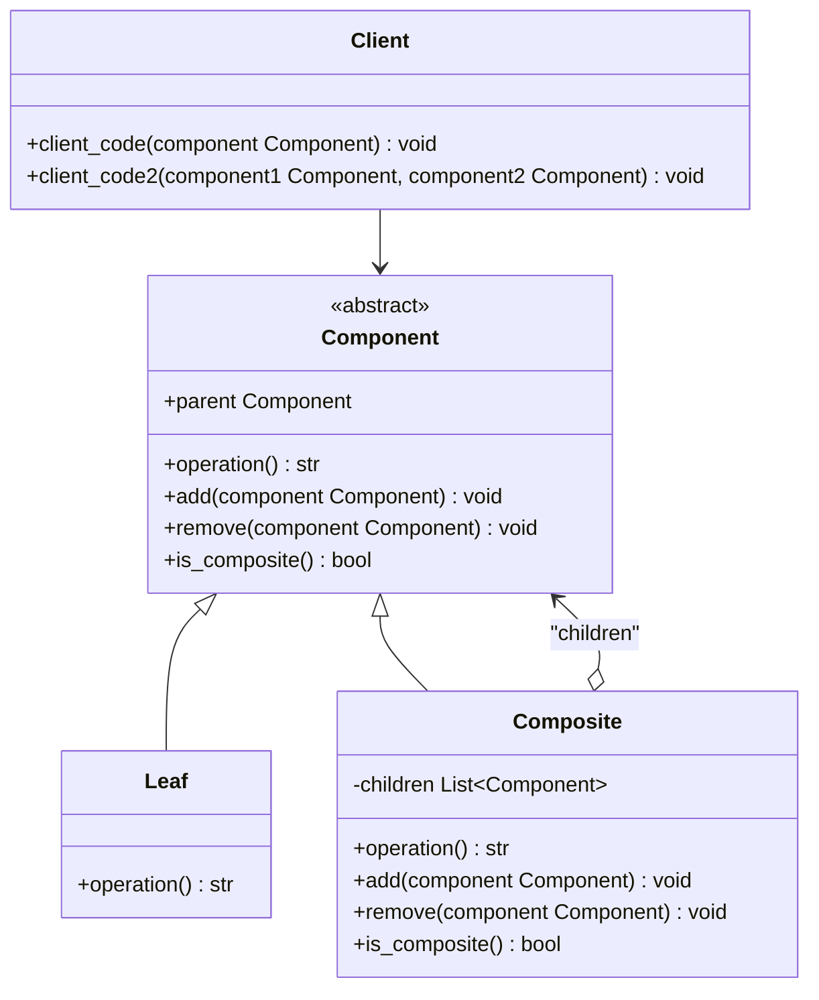

# Composite Design Pattern

| Metadata      | Value                      |
| ------------- | -------------------------- |
| Author        | Lyzander Marciano Andrylie |
| Creation Date | Nov 12, 2026               |
| Last Updated  | Nov 12, 2026               |

## References

- [Refactoring.Guru: Composite Design Pattern](https://refactoring.guru/design-patterns/composite): Theoretical explanation, problem breakdown, real-world analogies, and applicability of the Composite pattern
- [Refactoring.Guru: Composite in Python](https://refactoring.guru/design-patterns/composite/python/example): Implementation guide and conceptual example of the Composite pattern in Python
- [design-pattern.md](../design-pattern.md): Overview of software design patterns and catalog categories
- [builder.md](../creational/builder.md): Can be used for step-by-step construction of recursive Composite trees
- [decorator.md](./decorator.md): Similar recursive structure, but Decorator has only one child and adds responsibilities
- [iterator.md](../behavioural/iterator.md): Traverses Composite trees without exposing internal structure
- [visitor.md](../behavioural/visitor.md): Executes operations over an entire Composite tree

## Description

The **Composite** design pattern is a structural pattern that composes objects into tree hierarchies to represent part-whole structures. It allows client code to treat individual leaf objects and complex container branches uniformly through a common interface without depending on concrete classes or tree depth.

## Concepts

### 1. Intent, Problem, and Solution

- **Intent**: Compose objects into tree structures to represent part-whole hierarchies, allowing clients to treat individual objects and compositions of objects uniformly.
- **Problem**: In an e-commerce or shipping logistics system, an order may contain simple `Product`s as well as packaging `Box`es. A `Box` can hold products directly, but it can also hold smaller nested `Box`es, which in turn contain more products or even smaller boxes. If the client code needs to calculate the total cost of an order, a naive implementation would force the client to inspect the type of every container, unpack nested boxes iteratively, calculate individual prices, and sum up packaging fees manually. This creates tight coupling between the client and concrete container structures, increases codebase complexity, and breaks whenever new item or container types are introduced.
- **Solution**: The Composite pattern introduces a shared `Component` interface common to both simple items (`Product`) and container nodes (`Box`). The interface declares uniform operations like `get_price()`.
  - For a `Product` (leaf), `get_price()` returns its price directly.
  - For a `Box` (composite), `get_price()` iterates through its internal collection of child `Component` objects, invokes `get_price()` on each, adds its own packaging fee, and returns the combined sum.
  - The client simply invokes `get_price()` on the top-level root component. The tree traverses itself recursively down through all branches and leaves without the client ever needing to inspect concrete types or manage nesting depth.
- **Applicability**:
  - Use when you need to represent tree-like, part-whole object structures (such as file systems, graphic scene graphs, nested UI component trees, or product shipping containers).
  - Use when client code must treat primitive objects and complex compositions uniformly, eliminating branching logic like `isinstance()` checks across containers and items.

| Pros                                                                                                                                                         | Cons                                                                                                                                                                                        |
| ------------------------------------------------------------------------------------------------------------------------------------------------------------ | ------------------------------------------------------------------------------------------------------------------------------------------------------------------------------------------- |
| **Uniform polymorphism**: Simplifies client code by allowing complex tree structures to be manipulated identically to primitive elements.                    | **Overgeneralized interface**: It can be challenging to design a cohesive common interface when component subclasses differ significantly in responsibilities or capabilities.              |
| **Open/Closed Principle**: You can introduce new leaf or composite types into the system without breaking existing client code or tree traversal algorithms. | **Weakened static type safety**: Exposing child-management methods (`add`, `remove`) in the base interface means leaf nodes must provide dummy implementations or throw runtime exceptions. |
| **Recursive flexibility**: Supports arbitrarily deep, self-similar hierarchical compositions without modifying client traversal logic.                       | **Interface pollution**: Operations meaningful only to composites or only to leaves must often be accommodated in the shared abstraction.                                                   |

#### Interaction



---

### 2. Structure and Components

The Composite pattern establishes a recursive tree hierarchy composed of four primary roles:

- `Component`: Abstract base class or interface declaring the common operations for both primitive (`Leaf`) and container (`Composite`) nodes in the tree hierarchy. It optionally defines child-management operations (`add`, `remove`, `is_composite`) and parent navigation pointers.
- `Leaf`: Primitive element representing terminal objects in the composition that have no children. A leaf implements the `Component` interface and executes concrete business logic directly.
- `Composite`: Complex container element containing child `Component` objects (`Leaf`s or other `Composite`s). A composite implements operations by delegating calls recursively to all of its children, aggregating their responses and returning the final result.
- `Client`: Interacts with all elements in the tree hierarchy strictly through the `Component` abstraction, remaining decoupled from concrete leaf and container implementations.

| Component   | Role               | Description                                                                                                               |
| ----------- | ------------------ | ------------------------------------------------------------------------------------------------------------------------- |
| `Component` | Common Abstraction | Declares the shared interface for all nodes, specifying core domain operations and optional child-management methods.     |
| `Leaf`      | Terminal Worker    | Represents end objects with no children that perform the actual concrete work.                                            |
| `Composite` | Container Node     | Stores references to child components and delegates operations recursively down the hierarchy before aggregating results. |
| `Client`    | Consumer           | Interacts with tree structures uniformly through the `Component` abstraction without branching on concrete types.         |

#### Interaction



---

### 3. Python Implementation

#### a. Conceptual Structure Example

The conceptual example shows how primitive `Leaf` objects and nested `Composite` branches are manipulated uniformly via a shared `Component` base class:

- `Component`: Declares the common interface, optional parent relationship management, and child-handling defaults (`add`, `remove`, `is_composite`).
- `Leaf`: Implements the base operation by returning its own primitive string identifier without delegating.
- `Composite`: Manages an internal list of children, implements recursive delegation inside `operation()`, and concatenates child results into a composite branch string.
- `client_code`: Accepts any `Component` and executes its primary operation polymorphically.
- `client_code2`: Safely checks whether a component is composite before attaching another child component, requiring no knowledge of concrete classes.

```python
from __future__ import annotations
from abc import ABC, abstractmethod
from typing import List


class Component(ABC):
    """
    The base Component class declares common operations for both simple and
    complex objects of a composition.
    """

    def __init__(self) -> None:
        self._parent: Component | None = None

    @property
    def parent(self) -> Component | None:
        return self._parent

    @parent.setter
    def parent(self, parent: Component | None) -> None:
        self._parent = parent

    def add(self, component: Component) -> None:
        pass

    def remove(self, component: Component) -> None:
        pass

    def is_composite(self) -> bool:
        return False

    @abstractmethod
    def operation(self) -> str:
        """
        The base Component may implement default behavior or leave it to
        concrete classes by declaring the method as abstract.
        """
        pass


class Leaf(Component):
    """
    The Leaf class represents the end objects of a composition. A leaf cannot
    have any children and performs the actual concrete work.
    """

    def operation(self) -> str:
        return "Leaf"


class Composite(Component):
    """
    The Composite class represents complex components that may have children.
    Composite objects delegate the actual work to their children and aggregate
    the results.
    """

    def __init__(self) -> None:
        super().__init__()
        self._children: List[Component] = []

    def add(self, component: Component) -> None:
        self._children.append(component)
        component.parent = self

    def remove(self, component: Component) -> None:
        self._children.remove(component)
        component.parent = None

    def is_composite(self) -> bool:
        return True

    def operation(self) -> str:
        children_str = "+".join(child.operation() for child in self._children)
        return f"Branch({children_str})"


def client_code(component: Component) -> None:
    """The client code works with all components via the base interface."""
    print(f"RESULT: {component.operation()}")


def client_code2(component1: Component, component2: Component) -> None:
    """The client code manages trees via the base interface without concrete checks."""
    if component1.is_composite():
        component1.add(component2)
    print(f"RESULT: {component1.operation()}")


if __name__ == "__main__":
    # Client interacts with a simple leaf
    simple = Leaf()
    print("Client: I've got a simple component:")
    client_code(simple)
    # Output:
    # Client: I've got a simple component:
    # RESULT: Leaf

    # Client interacts with a complex composite tree
    tree = Composite()
    branch1 = Composite()
    branch1.add(Leaf())
    branch1.add(Leaf())

    branch2 = Composite()
    branch2.add(Leaf())

    tree.add(branch1)
    tree.add(branch2)

    print("\nClient: Now I've got a composite tree:")
    client_code(tree)
    # Output:
    # Client: Now I've got a composite tree:
    # RESULT: Branch(Branch(Leaf+Leaf)+Branch(Leaf))

    # Client adds components dynamically without concrete class checks
    print("\nClient: I needn't check the classes even when managing the tree:")
    client_code2(tree, simple)
    # Output:
    # Client: I needn't check the classes even when managing the tree:
    # RESULT: Branch(Branch(Leaf+Leaf)+Branch(Leaf)+Leaf)
```

---

#### b. Practical Real-World Example

This practical example models an order packaging and pricing system:

- `OrderComponent`: The abstract base class defining `get_price()` for computing prices and `show_details()` for hierarchical receipt visualization.
- `Product`: The leaf class representing an individual item with a name and a fixed monetary price.
- `Box`: The composite class representing a container box that has a packaging fee and holds an arbitrary collection of `OrderComponent`s (both products and smaller boxes). It delegates price and detail calculations recursively.
- `print_receipt`: A client function that accepts any `OrderComponent`, displaying its detailed breakdown and total price without needing to distinguish between a single product or a nested delivery carton.

```python
from __future__ import annotations
from abc import ABC, abstractmethod
from typing import List


class OrderComponent(ABC):
    """
    Component interface declaring common operations for both standalone products
    and composite packaging boxes.
    """

    def __init__(self, name: str) -> None:
        self.name = name

    @abstractmethod
    def get_price(self) -> float:
        """Calculate and return price in USD."""
        pass

    @abstractmethod
    def show_details(self, indent: int = 0) -> str:
        """Return formatted string representing the order item hierarchy."""
        pass


class Product(OrderComponent):
    """
    Leaf represents individual products with a fixed price and no children.
    """

    def __init__(self, name: str, price: float) -> None:
        super().__init__(name)
        self.price = price

    def get_price(self) -> float:
        return self.price

    def show_details(self, indent: int = 0) -> str:
        prefix = "  " * indent
        return f"{prefix}- Product: {self.name} (${self.price:.2f})"


class Box(OrderComponent):
    """
    Composite represents a container that can hold Products and nested Boxes.
    It delegates price calculations recursively to its children.
    """

    def __init__(self, name: str, packaging_fee: float = 0.0) -> None:
        super().__init__(name)
        self.packaging_fee = packaging_fee
        self._items: List[OrderComponent] = []

    def add(self, item: OrderComponent) -> None:
        self._items.append(item)

    def remove(self, item: OrderComponent) -> None:
        self._items.remove(item)

    def get_price(self) -> float:
        total = self.packaging_fee
        for item in self._items:
            total += item.get_price()
        return total

    def show_details(self, indent: int = 0) -> str:
        prefix = "  " * indent
        details = [f"{prefix}+ Box: {self.name} (packaging fee: ${self.packaging_fee:.2f})"]
        for item in self._items:
            details.append(item.show_details(indent + 1))
        return "\n".join(details)


def print_receipt(order_item: OrderComponent) -> None:
    """The client function operates uniformly on any OrderComponent."""
    print(order_item.show_details())
    print(f"Total Amount: ${order_item.get_price():.2f}")


if __name__ == "__main__":
    print("--- Single Product Order ---")
    standalone_keyboard = Product("Mechanical Keyboard", 120.0)
    print_receipt(standalone_keyboard)
    # Output:
    # --- Single Product Order ---
    # - Product: Mechanical Keyboard ($120.00)
    # Total Amount: $120.00

    print("\n--- Nested Composite Box Order ---")
    cable = Product("USB-C Cable", 15.0)
    charger = Product("GaN Fast Charger 65W", 45.0)

    # Sub-box for power accessories
    power_box = Box("Power Accessories Pack", packaging_fee=3.0)
    power_box.add(cable)
    power_box.add(charger)

    laptop = Product("Ultrabook Pro 14", 1299.0)
    mouse = Product("Wireless Ergonomic Mouse", 60.0)

    # Master shipping carton containing products and the sub-box
    master_box = Box("Master Delivery Carton", packaging_fee=10.0)
    master_box.add(laptop)
    master_box.add(mouse)
    master_box.add(power_box)

    print_receipt(master_box)
    # Output:
    # --- Nested Composite Box Order ---
    # + Box: Master Delivery Carton (packaging fee: $10.00)
    #   - Product: Ultrabook Pro 14 ($1299.00)
    #   - Product: Wireless Ergonomic Mouse ($60.00)
    #   + Box: Power Accessories Pack (packaging fee: $3.00)
    #     - Product: USB-C Cable ($15.00)
    #     - Product: GaN Fast Charger 65W ($45.00)
    # Total Amount: $1432.00
```
