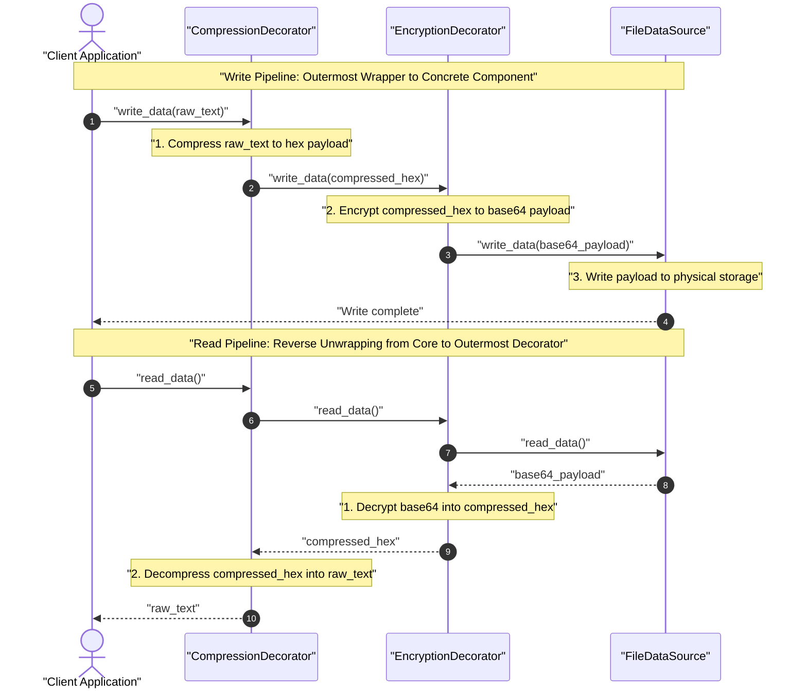
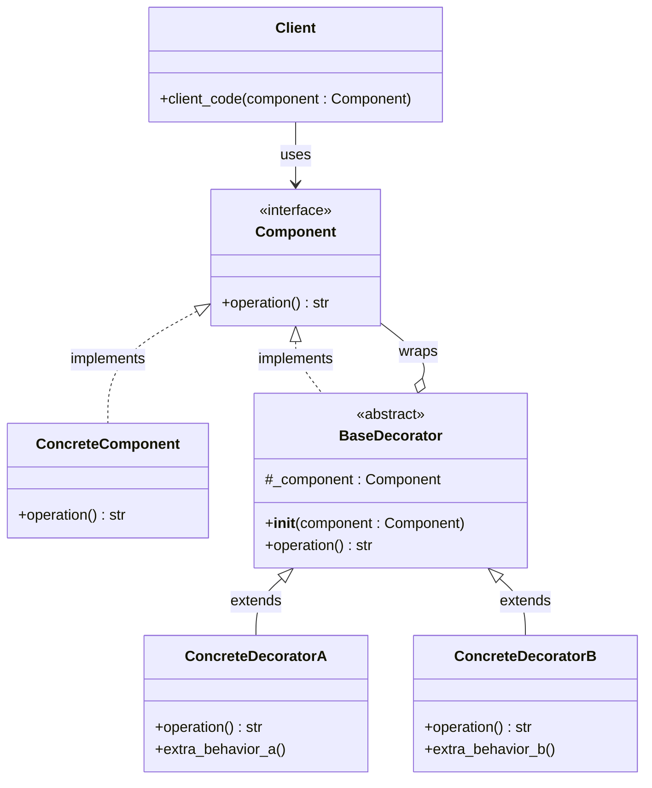

# Decorator Design Pattern

| Metadata      | Value                      |
| ------------- | -------------------------- |
| Author        | Lyzander Marciano Andrylie |
| Creation Date | Nov 12, 2026               |
| Last Updated  | Nov 12, 2026               |

## References

- [Refactoring Guru: Decorator Design Pattern](https://refactoring.guru/design-patterns/decorator): Structural pattern overview, problem analysis, architecture, applicability, and trade-offs
- [Refactoring Guru: Decorator in Python](https://refactoring.guru/design-patterns/decorator/python/example): Conceptual structure and idiomatic Python implementation example
- [design-pattern.md](../design-pattern.md): Overview of software design patterns and catalog categories
- [adapter.md](./adapter.md): Changes an object's interface, whereas Decorator preserves the interface and extends behavior
- [composite.md](./composite.md): Aggregates multiple children, whereas Decorator wraps a single component
- [proxy.md](./proxy.md): Manages the lifecycle and access control of a wrapped object rather than stacking dynamic behaviors
- [strategy.md](../behavioural/strategy.md): Changes the guts of an object from the inside, whereas Decorator changes the skin from the outside

## Description

The **Decorator** design pattern is a structural pattern that lets you dynamically attach new behaviors and responsibilities to objects by placing them inside special wrapper objects. It solves the combinatorial explosion and rigidity of static inheritance by allowing independent behaviors to be layered and stacked recursively at runtime without modifying the underlying component code.

## Concepts

### 1. Intent, Problem, and Solution

#### Intent

The intent of the Decorator pattern (also known as **Wrapper**) is to dynamically augment or alter the behavior of individual objects at runtime without affecting other objects of the same class or modifying existing code.

#### Problem: Combinatorial Subclass Explosion

Software systems frequently require optional, orthogonal behaviors to be attached to a core object. If you rely on traditional class inheritance:

1. **Static and Rigid**: Inheritance is fixed at compile time. An application cannot reconfigure an object's behavior at runtime based on user configuration or contextual conditions.
2. **Subclass Explosion**: Consider a notification library where a base `Notifier` sends basic email alerts. Users subsequently require multi-channel notifications across SMS, Slack, Facebook, and WhatsApp. If modeled via inheritance, every valid permutation demands its own dedicated subclass:
   - `SMSNotifier`
   - `SlackNotifier`
   - `SMSAndSlackNotifier`
   - `SMSAndFacebookNotifier`
   - `SlackAndFacebookAndSMSNotifier`
     With $N$ optional channels, supporting all feature permutations yields an exponential subclass explosion of up to $2^N - 1$ classes.
3. **Single Inheritance Restrictions**: Most object-oriented languages (such as Java, C#, and standard OOP models) forbid multiple implementation inheritance, preventing classes from inheriting concrete logic from multiple sibling hierarchies.

#### Solution: Aggregation and Wrapper Objects

Instead of inheritance, Decorator relies on **object composition and aggregation**:

- **Shared Interface**: The wrapper ("decorator") implements the exact same interface as the target object ("component").
- **Reference to Wrapped Object**: The decorator contains an internal reference field pointing to an instance of the component interface (`wrappee`).
- **Delegation with Added Behavior**: When a client invokes a method on the decorator, the decorator delegates execution to its wrapped component, executing its own custom logic before or after the delegation step.
- **Recursive Stacking**: Because decorators share the same interface as components, a decorator can wrap another decorator. Client code can assemble an arbitrary chain of decorators into a nested pipeline (like layers of an onion) while remaining completely agnostic of the nesting depth.

#### Applicability

- **Dynamic Feature Attachment**: When you need to assign additional responsibilities to objects on the fly without breaking client code that depends on the shared interface.
- **Infeasible Inheritance**: When extending an object's behavior through subclassing is impossible (e.g., classes marked `final` or originating from compiled external libraries) or leads to combinatorial explosion.
- **Decoupled Cross-Cutting Concerns**: When secondary responsibilities (such as logging, caching, encryption, compression, or authorization checks) need to be composed independently of core business domain logic.

#### Trade-offs: Pros and Cons

| Dimension               | Pros                                                                                                                 | Cons                                                                                                                                                        |
| :---------------------- | :------------------------------------------------------------------------------------------------------------------- | :---------------------------------------------------------------------------------------------------------------------------------------------------------- |
| **Runtime Flexibility** | Behaviors can be dynamically attached or combined at runtime rather than fixed at compile time.                      | Hard to remove or reorder a specific wrapper once it is nested deep within a decorator stack.                                                               |
| **Class Architecture**  | Adheres to the Single Responsibility Principle (SRP) by decomposing monolithic classes into modular feature layers.  | Introduces many small, similar wrapper classes that can make codebase navigation more daunting.                                                             |
| **Extensibility**       | Conforms to the Open/Closed Principle (OCP); new decorators can be introduced without modifying existing components. | Decorator initialization code can become verbose with nested constructors (e.g., `DecA(DecB(DecC(target)))`).                                               |
| **Object Identity**     | The client interacts uniformly with wrapped and unwrapped objects through the common interface.                      | A decorator does not possess the exact object identity (`id()` or `===`) of the wrapped target object.                                                      |
| **Execution Ordering**  | Enables fine-grained execution pipelines by determining the exact nesting order.                                     | Decorator pipelines may produce bugs if behavior depends strictly on an implicit wrapping sequence (e.g., compress-then-encrypt vs. encrypt-then-compress). |

#### Interaction



---

### 2. Structure and Components

The Decorator architecture separates core component functionality from auxiliary wrapper behaviors using a unified abstraction:

| Component               | Role                    | Description                                                                                                                                                                                        |
| :---------------------- | :---------------------- | :------------------------------------------------------------------------------------------------------------------------------------------------------------------------------------------------- |
| **`Component`**         | Interface / Abstraction | Declares the common interface implemented by both concrete components and decorators, enabling clients to treat raw and decorated objects uniformly.                                               |
| **`ConcreteComponent`** | Base Object             | Implements the fundamental business logic. This is the core object that gets wrapped and augmented by decorators.                                                                                  |
| **`BaseDecorator`**     | Structural Wrapper      | Implements the `Component` interface and holds a reference field (`wrappee` / `_component`) to a `Component` instance. By default, it delegates all method calls directly to the wrapped instance. |
| **`ConcreteDecorator`** | Behavior Extension      | Subclasses `BaseDecorator` to inject specific responsibilities. It overrides operations to execute extra logic immediately before or after forwarding the call to the wrapped component.           |
| **`Client`**            | Consumer                | Interacts with all objects exclusively via the `Component` interface, remaining agnostic to whether it is operating on a plain component or a heavily layered decorator chain.                     |

- **Component Abstraction**: Defines operations that can be altered or augmented dynamically.
- **Base Decorator Delegation**: The base decorator maintains a composition relationship (`has-a`) with the `Component` interface while simultaneously realizing (`is-a`) that same interface. This allows decorators to wrap concrete components as well as other decorators.
- **Concrete Decorator Behavior**: Concrete decorators can either modify input parameters before delegation, alter return results after delegation, or conditionally bypass delegation entirely.

> [!NOTE]
> **OOP Decorator Pattern vs. Python `@decorator` Syntax**:
> The Gang of Four (GoF) structural Decorator pattern is an object-oriented architectural pattern based on object composition and interface realization at runtime. In contrast, Python's built-in `@decorator` syntax is a language-level syntactic sugar that wraps functions or classes during module definition time (`func = decorator(func)`). While both share the conceptual philosophy of wrapping execution, the structural pattern dynamically wraps object instances adhering to a polymorphic interface.

#### Interaction



---

### 3. Python Implementation

#### a. Conceptual Structure Example

The conceptual example illustrates how `Component`, `ConcreteComponent`, and stackable `Decorator` subclasses interact:

- `Component`: Abstract base class declaring the `operation()` method.
- `ConcreteComponent`: Default implementation returning its raw class representation.
- `Decorator`: Base wrapper class holding a `_component` reference and delegating `operation()`.
- `ConcreteDecoratorA`: Prepends its name to the result of the wrapped component's `operation()`.
- `ConcreteDecoratorB`: Encloses the inner component's operation with its own identifier.
- `client_code`: Client function that accepts any object conforming to the `Component` interface.

```python
from abc import ABC, abstractmethod


class Component(ABC):
    """
    The base Component interface defines operations that can be altered by
    decorators.
    """

    @abstractmethod
    def operation(self) -> str:
        pass


class ConcreteComponent(Component):
    """
    Concrete Components provide default implementations of the operations.
    There might be several variations of these classes.
    """

    def operation(self) -> str:
        return "ConcreteComponent"


class Decorator(Component):
    """
    The base Decorator class follows the same interface as the other components.
    The primary purpose of this class is to define the wrapping interface for
    all concrete decorators. The default implementation of the wrapping code
    stores a wrapped component and provides delegation to it.
    """

    def __init__(self, component: Component) -> None:
        self._component = component

    @property
    def component(self) -> Component:
        """
        The Decorator delegates all work to the wrapped component.
        """
        return self._component

    def operation(self) -> str:
        return self._component.operation()


class ConcreteDecoratorA(Decorator):
    """
    Concrete Decorators call the wrapped object and alter its result in some way.
    """

    def operation(self) -> str:
        """
        Decorators may call parent implementation of the operation, instead of
        calling the wrapped object directly. This approach simplifies extension of
        decorator classes.
        """
        return f"ConcreteDecoratorA({self.component.operation()})"


class ConcreteDecoratorB(Decorator):
    """
    Decorators can execute their behavior either before or after the call to a
    wrapped object.
    """

    def operation(self) -> str:
        return f"ConcreteDecoratorB({self.component.operation()})"


def client_code(component: Component) -> None:
    """
    The client code works with all objects using the Component interface. This
    way it can remain independent of the concrete classes of components it works
    with.
    """
    print(f"RESULT: {component.operation()}")


if __name__ == "__main__":
    # 1. Simple component execution without wrappers
    simple = ConcreteComponent()
    print("Client: I've got a simple component:")
    client_code(simple)
    # Output:
    # Client: I've got a simple component:
    # RESULT: ConcreteComponent

    print()

    # 2. Decorated component execution:
    # Decorators can wrap not only simple components, but other decorators as well.
    decorator1 = ConcreteDecoratorA(simple)
    decorator2 = ConcreteDecoratorB(decorator1)
    print("Client: Now I've got a decorated component:")
    client_code(decorator2)
    # Output:
    # Client: Now I've got a decorated component:
    # RESULT: ConcreteDecoratorB(ConcreteDecoratorA(ConcreteComponent))
```

#### b. Practical Real-World Example

A classic real-world use case for the Decorator pattern is a **Data Source Streaming Pipeline** that transparently applies encryption and compression layers to file storage:

- `DataSource`: The component interface defining `write_data(data)` and `read_data()`.
- `FileDataSource`: Concrete component that reads and writes raw strings to disk.
- `DataSourceDecorator`: Base wrapper class delegating `write_data` and `read_data` to its inner `DataSource`.
- `EncryptionDecorator`: Encrypts data (using Base64 encoding for clear inspection) before writing and decrypts after reading.
- `CompressionDecorator`: Compresses data (using `zlib` hex encoding) before writing and decompresses after reading.

When client code nests `CompressionDecorator(EncryptionDecorator(FileDataSource(...)))`:

- **Write Path**: Data is first compressed into hex bytes by `CompressionDecorator`, then encrypted into Base64 text by `EncryptionDecorator`, and finally persisted to disk by `FileDataSource`.
- **Read Path**: `FileDataSource` reads the raw file, `EncryptionDecorator` decrypts it from Base64 to hex, and `CompressionDecorator` decompresses the hex payload back into the original plain text.

```python
import base64
import os
import zlib
from abc import ABC, abstractmethod


class DataSource(ABC):
    """
    Component: defines operations for reading and writing data.
    """

    @abstractmethod
    def write_data(self, data: str) -> None:
        pass

    @abstractmethod
    def read_data(self) -> str:
        pass


class FileDataSource(DataSource):
    """
    ConcreteComponent: reads and writes raw data directly to a physical file.
    """

    def __init__(self, filename: str) -> None:
        self._filename = filename

    def write_data(self, data: str) -> None:
        with open(self._filename, "w", encoding="utf-8") as f:
            f.write(data)

    def read_data(self) -> str:
        with open(self._filename, "r", encoding="utf-8") as f:
            return f.read()


class DataSourceDecorator(DataSource):
    """
    BaseDecorator: routes all operations to the wrapped data source object.
    """

    def __init__(self, source: DataSource) -> None:
        self._wrappee = source

    def write_data(self, data: str) -> None:
        self._wrappee.write_data(data)

    def read_data(self) -> str:
        return self._wrappee.read_data()


class EncryptionDecorator(DataSourceDecorator):
    """
    ConcreteDecorator: encrypts data before writing and decrypts upon reading.
    Uses Base64 encoding/decoding as an illustrative transformation.
    """

    def write_data(self, data: str) -> None:
        encoded_bytes = base64.b64encode(data.encode("utf-8"))
        super().write_data(encoded_bytes.decode("utf-8"))

    def read_data(self) -> str:
        raw_data = super().read_data()
        decoded_bytes = base64.b64decode(raw_data.encode("utf-8"))
        return decoded_bytes.decode("utf-8")


class CompressionDecorator(DataSourceDecorator):
    """
    ConcreteDecorator: compresses data before passing to the next layer and
    decompresses data retrieved from inner layers.
    """

    def write_data(self, data: str) -> None:
        compressed_bytes = zlib.compress(data.encode("utf-8"))
        super().write_data(compressed_bytes.hex())

    def read_data(self) -> str:
        hex_data = super().read_data()
        decompressed_bytes = zlib.decompress(bytes.fromhex(hex_data))
        return decompressed_bytes.decode("utf-8")


if __name__ == "__main__":
    records = "id,name,role\n101,Alice,Architect\n102,Bob,Engineer"
    target_file = "user_records.txt"

    try:
        # Wrap the raw file source with both encryption and compression:
        # Pipeline on write: CompressionDecorator -> EncryptionDecorator -> FileDataSource
        # Pipeline on read:  FileDataSource -> EncryptionDecorator -> CompressionDecorator
        plain_source = FileDataSource(target_file)
        decorated_source = CompressionDecorator(
            EncryptionDecorator(plain_source)
        )

        print("--- 1. Writing Data Through Decorated Pipeline ---")
        decorated_source.write_data(records)
        print("Data successfully compressed, encrypted, and persisted.")
        # Output:
        # --- 1. Writing Data Through Decorated Pipeline ---
        # Data successfully compressed, encrypted, and persisted.

        print("\n--- 2. Raw File Content on Disk ---")
        raw_content = plain_source.read_data()
        print(f"Stored: {raw_content}")
        # Output:
        # --- 2. Raw File Content on Disk ---
        # Stored: Nzg5Y2NiNGNkMWM5NGJjYzRkZDUyOWNhY2Y0OWU1MzIzNDMwZDQ3MWNjYzk0YzRlZDU3MTJjNGFjZWM4MmM0OTRkMmUwMThhMTllOTM4ZTUyN2U5YjhlNmE1NjdlNmE1YTYxNjAxMDA4ZTQwMTAxNw==

        print("\n--- 3. Reading Data Back Through Decorated Pipeline ---")
        recovered_data = decorated_source.read_data()
        print(f"Decoded:\n{recovered_data}")
        # Output:
        # --- 3. Reading Data Back Through Decorated Pipeline ---
        # Decoded:
        # id,name,role
        # 101,Alice,Architect
        # 102,Bob,Engineer
    finally:
        if os.path.exists(target_file):
            os.remove(target_file)
```
