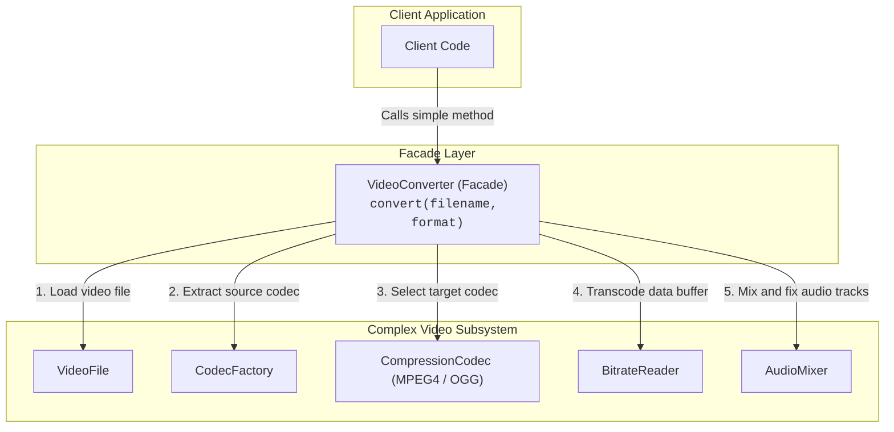
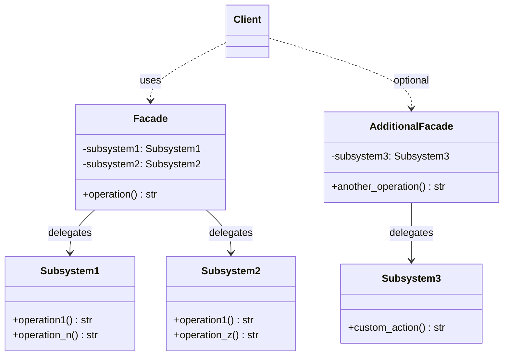

# Facade Design Pattern

| Metadata      | Value                      |
| ------------- | -------------------------- |
| Author        | Lyzander Marciano Andrylie |
| Creation Date | Nov 12, 2026               |
| Last Updated  | Nov 12, 2026               |

## References

- [Refactoring.Guru: Facade Design Pattern](https://refactoring.guru/design-patterns/facade): Detailed overview of the Facade design pattern, including intent, problem, solution, structure, applicability, and trade-offs
- [Refactoring.Guru: Facade in Python](https://refactoring.guru/design-patterns/facade/python/example): Conceptual code example demonstrating the Facade pattern in Python
- [design-pattern.md](../design-pattern.md): Overview of software design patterns and catalog categories
- [adapter.md](./adapter.md): Wraps one object to make its interface compatible, whereas Facade simplifies an entire subsystem
- [abstract_factory.md](../creational/abstract_factory.md): Can be used instead of Facade when you only want to hide how subsystem objects are created
- [mediator.md](../behavioural/mediator.md): Centralizes communication between peer components, whereas Facade only provides a simplified entry point
- [singleton.md](../creational/singleton.md): Facade classes are frequently implemented as Singletons

## Description

The **Facade** is a structural design pattern that provides a simplified, higher-level interface to a complex subsystem, library, or framework. It shields client code from the intricate internal workings, initialization ordering, and dependency management of multiple subsystem classes by exposing a straightforward entry point for common tasks.

## Concepts

### 1. Intent, Problem, and Solution

- **Intent**: Provide a unified, straightforward interface to a set of interfaces in a subsystem. Facade defines a higher-level interface that makes the subsystem easier to use without hiding or replacing the underlying subsystem classes for advanced use cases.
- **Problem**: In software development, business logic often needs to interact with complex third-party frameworks, media processing engines, or legacy libraries. Performing a single business task (such as converting a video file, compiling source code, or configuring an audio pipeline) requires instantiating dozens of internal objects, managing their lifecycles, executing fragile initialization sequences, and configuring bitrates, buffers, and codecs. Directly coupling client code to these low-level details scatters framework dependencies throughout the codebase, making maintenance difficult and testing fragile.
- **Solution**: Introduce a single `Facade` class that acts as a front-facing entry point to the subsystem. The facade exposes convenient shortcut methods for common use cases (e.g., `convert(filename, format)`) and orchestrates the creation, parameter passing, and execution of internal subsystem classes behind the scenes. Clients interact only with the facade, remaining insulated from changes to the underlying subsystem.
- **Applicability**:
  - Use when you need a limited, straightforward interface to a complex subsystem.
  - Use when you want to structure a subsystem into distinct layers, allowing layers to communicate only through their respective facades.
  - Use when you want to decouple client code from external third-party libraries or legacy codebases to make refactoring or library replacements easier.

| Trade-off                        | Description                                                                                                                                 |
| :------------------------------- | :------------------------------------------------------------------------------------------------------------------------------------------ |
| **Pros: Loose Coupling**         | Decouples application logic from the internal implementation details and class hierarchies of complex subsystems.                           |
| **Pros: Simplified Usage**       | Condenses multi-step initialization, configuration, and execution flows into single, clear method invocations.                              |
| **Pros: Clear Boundaries**       | Enforces clean subsystem boundaries and layered architectures by routing external requests through defined entry points.                    |
| **Cons: God Object Risk**        | Without careful boundary management, a facade can gradually accumulate too many responsibilities and become an unmaintainable "god object". |
| **Cons: Restricted Flexibility** | Facade methods only expose a curated subset of subsystem features; clients needing low-level tuning must bypass the facade.                 |

#### Interaction



---

### 2. Structure and Components

The Facade pattern organizes interaction between client applications and complex subsystems through distinct structural roles:

- **Facade**: Provides a convenient, high-level interface to a specific part of subsystem functionality. It knows which subsystem classes are responsible for a request and delegates work to them in the proper sequence.
- **Additional Facade**: An optional auxiliary facade introduced when the primary facade grows too large or when a distinct subsystem layer warrants its own entry point. This prevents a single facade class from deteriorating into a god object.
- **Complex Subsystem Classes**: The underlying classes that implement actual business logic, algorithms, and data processing. Subsystem classes are completely unaware of the facade; they treat the facade as just another client.
- **Client**: Interacts with the subsystem exclusively through the facade instead of orchestrating subsystem objects directly, though advanced clients can still access low-level subsystem classes when customized control is required.

| Component             | Role                            | Responsibility                                                                                                        |
| :-------------------- | :------------------------------ | :-------------------------------------------------------------------------------------------------------------------- |
| **Facade**            | Primary Unified Entry Point     | Coordinates subsystem lifecycles, translates client requests into ordered subsystem calls, and returns clean results. |
| **Additional Facade** | Domain-Specific Entry Point     | Segregates specialized workflows or subsystem layers to preserve single-responsibility boundaries.                    |
| **Subsystem Classes** | Concrete Domain Implementations | Handle actual low-level operations, state tracking, and calculations without referencing the facade.                  |
| **Client**            | High-Level Consumer             | Consumes subsystem capabilities via high-level facade methods, remaining insulated from internal mechanics.           |

#### Interaction



---

### 3. Python Implementation

#### a. Conceptual Structure Example

In this conceptual example:

- **`Facade`**: Coordinates `Subsystem1` and `Subsystem2`. It accepts existing subsystem instances or instantiates default ones, providing a unified `operation()` method.
- **`Subsystem1` & `Subsystem2`**: Independent subsystem classes that implement granular operations (`operation1`, `operation_n`, `operation_z`).
- **`client_code`**: Operates entirely through the `Facade` interface without direct dependencies on the underlying subsystem classes.

```python
from __future__ import annotations


class Facade:
    """
    The Facade class provides a simple interface to the complex logic of one
    or several subsystems. The Facade delegates client requests to the
    appropriate objects within the subsystem and manages their execution order.
    """

    def __init__(
        self,
        subsystem1: Subsystem1 | None = None,
        subsystem2: Subsystem2 | None = None,
    ) -> None:
        self._subsystem1 = subsystem1 or Subsystem1()
        self._subsystem2 = subsystem2 or Subsystem2()

    def operation(self) -> str:
        """
        Coordinates subsystem methods to carry out high-level operations.
        """
        results: list[str] = []
        results.append("Facade initializes subsystems:")
        results.append(self._subsystem1.operation1())
        results.append(self._subsystem2.operation1())
        results.append("Facade orders subsystems to perform the action:")
        results.append(self._subsystem1.operation_n())
        results.append(self._subsystem2.operation_z())
        return "\n".join(results)


class Subsystem1:
    """
    Subsystem classes implement specialized logic. They are unaware of the
    Facade and treat it as just another client.
    """

    def operation1(self) -> str:
        return "Subsystem1: Ready!"

    def operation_n(self) -> str:
        return "Subsystem1: Go!"


class Subsystem2:
    """
    Additional subsystem classes work independently or together with others.
    """

    def operation1(self) -> str:
        return "Subsystem2: Get ready!"

    def operation_z(self) -> str:
        return "Subsystem2: Fire!"


def client_code(facade: Facade) -> None:
    """
    The client code works with complex subsystems through a simple interface
    provided by the Facade.
    """
    print(facade.operation())


if __name__ == "__main__":
    # The client can pass pre-configured subsystems or let the Facade create them
    subsystem1 = Subsystem1()
    subsystem2 = Subsystem2()
    facade = Facade(subsystem1, subsystem2)
    client_code(facade)

# Output:
# Facade initializes subsystems:
# Subsystem1: Ready!
# Subsystem2: Get ready!
# Facade orders subsystems to perform the action:
# Subsystem1: Go!
# Subsystem2: Fire!
```

#### b. Practical Real-World Example

This practical example models a third-party multimedia conversion framework:

- **`VideoFile`**: Encapsulates raw video file metadata and format detection.
- **`Codec` (`MPEG4CompressionCodec`, `OggCompressionCodec`)**: Encapsulates compression formats.
- **`CodecFactory`**: Inspects a `VideoFile` to identify and extract its native codec.
- **`BitrateReader`**: Reads data buffers and transcodes them into the destination codec.
- **`AudioMixer`**: Fixes, balances, and mixes audio channels for the destination container.
- **`VideoConverter`**: The facade class. Instead of forcing clients to manage codecs, audio mixers, and bitrates manually, it provides a clean `convert(filename, target_format)` method.

```python
from __future__ import annotations


class VideoFile:
    """Represents a video file on disk with filename and format."""

    def __init__(self, filename: str) -> None:
        self.filename = filename
        self.codec_type = filename.split(".")[-1].lower()
        print(f"VideoFile: Loaded \"{filename}\" (format: {self.codec_type}).")


class Codec:
    """Base class for video codecs."""

    codec_name: str = "generic"


class MPEG4CompressionCodec(Codec):
    codec_name: str = "mp4"


class OggCompressionCodec(Codec):
    codec_name: str = "ogg"


class CodecFactory:
    """Analyzes a VideoFile to identify and extract its source codec."""

    @staticmethod
    def extract(file: VideoFile) -> Codec:
        print(f"CodecFactory: Analyzing and extracting source codec for \"{file.filename}\"...")
        if file.codec_type == "ogg":
            return OggCompressionCodec()
        return MPEG4CompressionCodec()


class BitrateReader:
    """Handles raw buffer extraction and bitrate transcoding."""

    @staticmethod
    def read(file: VideoFile, source_codec: Codec) -> str:
        print(f"BitrateReader: Reading video stream using {source_codec.__class__.__name__}...")
        return f"raw_buffer_data_of_{file.filename}"

    @staticmethod
    def convert(buffer: str, destination_codec: Codec) -> str:
        print(f"BitrateReader: Transcoding buffer into {destination_codec.__class__.__name__} format...")
        return f"{buffer}_transcoded_to_{destination_codec.codec_name}"


class AudioMixer:
    """Processes, normalizes, and mixes audio tracks."""

    def fix(self, buffer: str) -> str:
        print("AudioMixer: Normalizing audio stream and mixing channels...")
        return f"{buffer}_with_mixed_audio"


class VideoResult:
    """Represents the final converted video output."""

    def __init__(self, filename: str, content: str) -> None:
        self.filename = filename
        self.content = content

    def save(self) -> None:
        print(f"VideoResult: File saved successfully as \"{self.filename}\".")


class VideoConverter:
    """
    Facade class that coordinates the complex video processing subsystem.
    Clients call convert() with simple strings without managing codecs or buffers.
    """

    def convert(self, filename: str, target_format: str) -> VideoResult:
        print(f"=== VideoConverter: Starting conversion for \"{filename}\" to \"{target_format}\" ===")
        file = VideoFile(filename)
        source_codec = CodecFactory.extract(file)

        if target_format.lower() == "mp4":
            destination_codec: Codec = MPEG4CompressionCodec()
        else:
            destination_codec = OggCompressionCodec()

        raw_buffer = BitrateReader.read(file, source_codec)
        transcoded_buffer = BitrateReader.convert(raw_buffer, destination_codec)
        final_buffer = AudioMixer().fix(transcoded_buffer)

        base_name = filename.rsplit(".", 1)[0]
        output_filename = f"{base_name}.{target_format.lower()}"
        print("=== VideoConverter: Conversion complete ===")
        return VideoResult(output_filename, final_buffer)


if __name__ == "__main__":
    # Client interacts only with the VideoConverter facade
    converter = VideoConverter()
    video = converter.convert("funny-cats-video.ogg", "mp4")
    video.save()

# Output:
# === VideoConverter: Starting conversion for "funny-cats-video.ogg" to "mp4" ===
# VideoFile: Loaded "funny-cats-video.ogg" (format: ogg).
# CodecFactory: Analyzing and extracting source codec for "funny-cats-video.ogg"...
# BitrateReader: Reading video stream using OggCompressionCodec...
# BitrateReader: Transcoding buffer into MPEG4CompressionCodec format...
# AudioMixer: Normalizing audio stream and mixing channels...
# === VideoConverter: Conversion complete ===
# VideoResult: File saved successfully as "funny-cats-video.mp4".
```
