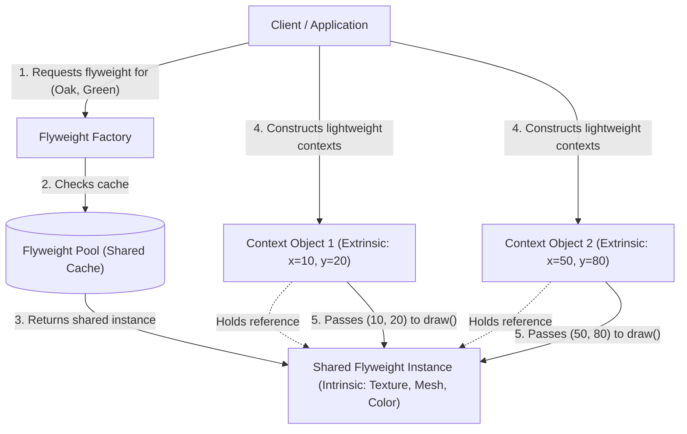
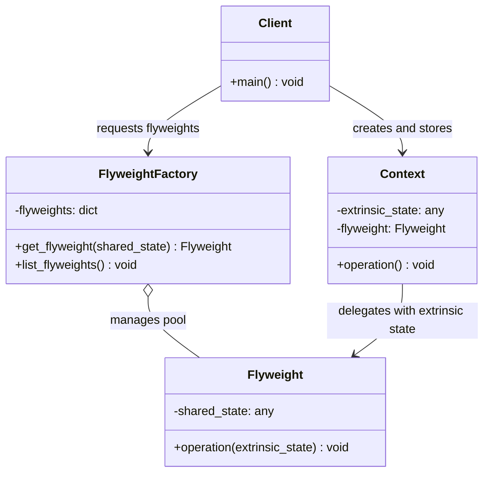

# Flyweight Design Pattern

| Metadata      | Value                      |
| ------------- | -------------------------- |
| Author        | Lyzander Marciano Andrylie |
| Creation Date | Nov 12, 2026               |
| Last Updated  | Nov 12, 2026               |

## References

- [Refactoring.Guru: Flyweight Design Pattern](https://refactoring.guru/design-patterns/flyweight): Architectural guide detailing the Flyweight pattern intent, problem context, and solution structure
- [Refactoring.Guru: Flyweight in Python](https://refactoring.guru/design-patterns/flyweight/python/example): Conceptual code example demonstrating intrinsic and extrinsic state management in Python
- [design-pattern.md](../design-pattern.md): Overview of software design patterns and catalog categories
- [composite.md](./composite.md): Shared leaf nodes in a Composite tree can be implemented as Flyweights to save RAM
- [singleton.md](../creational/singleton.md): Has only one mutable instance, whereas a Flyweight class has multiple instances with different intrinsic states

## Description

The **Flyweight** is a structural design pattern that enables applications to fit massive numbers of objects into limited RAM by sharing common state among multiple objects instead of duplicating data in every instance. It isolates immutable, repeated state into shared flyweight objects while delegating variable, context-specific data to caller contexts or method arguments.

## Concepts

### 1. Intent, Problem, and Solution

- **Intent**: Minimize memory footprint and object creation overhead when dealing with vast quantities of fine-grained objects by sharing invariant parts of state instead of repeatedly allocating them in memory.
- **Problem (RAM Exhaustion)**:
  - In applications like particle systems, document editors, or 3D video game simulations, rendering hundreds of thousands or millions of entities (such as bullets, particles, or trees in a forest) causes severe memory exhaustion.
  - A naive object model stores heavy data (such as high-resolution textures, 3D meshes, glyph sprites, or audio clips) directly inside each individual entity alongside lightweight attributes (such as `x`, `y` coordinates, speed, or orientation).
  - If a single tree object occupies 10 KB due to mesh and sprite data, instantiating 1,000,000 trees consumes approximately 10 GB of RAM, causing Out-Of-Memory (OOM) application crashes or excessive Garbage Collection (GC) pauses.
- **Solution (State Partitioning)**:
  - The Flyweight pattern resolves RAM exhaustion by separating an object's fields into two categories:
    - **Intrinsic State**: Constant, invariant data that remains identical across multiple objects (e.g., species name, color palette, 3D mesh, or sprite texture). This state lives inside the `Flyweight` object. It is strictly immutable and safely shared by thousands of referencing objects.
    - **Extrinsic State**: Dynamic, contextual data that differs per object instance (e.g., coordinates `(x, y, z)`, current health, scale factor, orientation). This state is kept outside the Flyweight, stored inside a lightweight `Context` object or passed dynamically into Flyweight methods at runtime.
- **Applicability**:
  - The application needs to instantiate an enormous volume of similar, fine-grained objects.
  - Device memory or RAM is constrained, and storing duplicated state threatens system stability or throughput.
  - Most object state can be factored out into shared, immutable intrinsic data.
  - Object identity does not depend on pointer comparison (`obj1 is obj2`), because shared flyweights represent logically equivalent state.
- **Pros and Cons**:

| Advantage (Pros)                                                                                                                                                            | Trade-off (Cons)                                                                                                                                                                             |
| :-------------------------------------------------------------------------------------------------------------------------------------------------------------------------- | :------------------------------------------------------------------------------------------------------------------------------------------------------------------------------------------- |
| **Massive RAM Savings**: Reduces memory consumption by orders of magnitude (e.g., from gigabytes to megabytes) by eliminating duplicate state across millions of instances. | **CPU Overhead**: Incurs minor CPU cost for hash lookups in the flyweight factory and passing extrinsic parameters during method calls.                                                      |
| **Lower Garbage Collection Churn**: Drastically decreases object allocation rates, lowering GC frequency and latency.                                                       | **Increased Code Complexity**: Separates state into intrinsic and extrinsic structures across multiple classes (`Flyweight`, `Context`, `FlyweightFactory`), complicating code architecture. |
| **Centralized Invariant Data**: Consolidates shared visual or structural assets into single authoritative objects.                                                          | **Strict Immutability Requirement**: Mutating intrinsic state in a flyweight inadvertently impacts every referencing context throughout the application.                                     |

#### Interaction



### 2. Structure and Components

The Flyweight pattern organizes responsibilities across four collaborating components:

| Component              | Responsibility                                                                                      | State Managed                       |
| :--------------------- | :-------------------------------------------------------------------------------------------------- | :---------------------------------- |
| **`Flyweight`**        | Stores immutable intrinsic state and declares operations that accept extrinsic state as parameters. | Intrinsic State (Shared, Immutable) |
| **`Context`**          | Stores unique extrinsic state and holds a reference to a corresponding shared `Flyweight`.          | Extrinsic State (Context-specific)  |
| **`FlyweightFactory`** | Creates, caches, and pools flyweight instances, ensuring existing flyweights are reused.            | Registry / Cache of Flyweights      |
| **`Client`**           | Calculates or stores extrinsic state, queries the factory for flyweights, and triggers operations.  | Orchestration                       |

- **`Flyweight`**:
  - Encapsulates the immutable intrinsic state shared across many entities (e.g., graphical textures, font definitions, audio data).
  - Accepts extrinsic state via method arguments whenever operations need context-specific information to complete.
- **`Context` (or `UnsharedConcreteFlyweight`)**:
  - Encapsulates the extrinsic state unique to a specific entity instance (e.g., screen coordinates, unique IDs).
  - Maintains a reference to its shared `Flyweight` instance and delegates work to it, passing its extrinsic state into the flyweight's method.
- **`FlyweightFactory`**:
  - Acts as a pool manager or cache for flyweight instances.
  - When a client requests a flyweight matching a given intrinsic state key, the factory checks if one already exists in its internal registry. If found, it returns the cached instance; otherwise, it instantiates and stores a new one before returning it.
- **`Client`**:
  - Maintains or computes extrinsic state.
  - Interacts with the `FlyweightFactory` to obtain shared flyweights and constructs context objects that link extrinsic data with their corresponding flyweights.

#### Interaction



### 3. Python Implementation

#### a. Conceptual Structure Example

- **`Flyweight`**: Stores `_shared_state` (such as brand, model, and color) representing intrinsic car attributes. Its `operation()` accepts `unique_state` (plates and owner) passed as extrinsic data.
- **`FlyweightFactory`**: Manages a dictionary `_flyweights` indexed by a generated sorted key. The `get_flyweight()` method reuses existing cached instances or creates new ones on demand.
- **`add_car_to_police_database`**: Acts as client code that queries the factory with intrinsic vehicle properties and invokes the flyweight's method with extrinsic license plates and owner information.

```python
import json
from typing import Dict, List


class Flyweight:
    """Stores intrinsic state shared across multiple car records."""

    def __init__(self, shared_state: List[str]) -> None:
        self._shared_state = shared_state

    def operation(self, unique_state: List[str]) -> None:
        s = json.dumps(self._shared_state)
        u = json.dumps(unique_state)
        print(f"Flyweight: Displaying shared {s} and unique {u} state.")


class FlyweightFactory:
    """Creates and manages cached Flyweight instances."""

    _flyweights: Dict[str, Flyweight] = {}

    def __init__(self, initial_flyweights: List[List[str]]) -> None:
        for state in initial_flyweights:
            self._flyweights[self.get_key(state)] = Flyweight(state)

    def get_key(self, state: List[str]) -> str:
        """Returns a stable string key for a given shared state."""
        return "_".join(sorted(state))

    def get_flyweight(self, shared_state: List[str]) -> Flyweight:
        """Returns an existing Flyweight or creates a new one if not present."""
        key = self.get_key(shared_state)

        if key not in self._flyweights:
            print("FlyweightFactory: Can not find a flyweight, creating new one.")
            self._flyweights[key] = Flyweight(shared_state)
        else:
            print("FlyweightFactory: Reusing existing flyweight.")

        return self._flyweights[key]

    def list_flyweights(self) -> None:
        print(f"FlyweightFactory: I have {len(self._flyweights)} flyweights:")
        for key in sorted(self._flyweights.keys()):
            print(f"  - {key}")


def add_car_to_police_database(
    factory: FlyweightFactory,
    plates: str,
    owner: str,
    brand: str,
    model: str,
    color: str,
) -> None:
    """Client function passing shared vs unique state."""
    print(f"\nClient: Adding a car ({plates}) to database.")
    flyweight = factory.get_flyweight([brand, model, color])
    # The client passes unique extrinsic state to the flyweight method
    flyweight.operation([plates, owner])


if __name__ == "__main__":
    # Initialize factory with common predefined vehicle types
    factory = FlyweightFactory([
        ["Chevrolet", "Camaro2018", "pink"],
        ["Mercedes Benz", "C300", "black"],
        ["Mercedes Benz", "C500", "red"],
        ["BMW", "M5", "red"],
        ["BMW", "X1", "red"],
    ])

    factory.list_flyweights()

    # Reusing an existing flyweight from the factory pool
    add_car_to_police_database(factory, "CL234IR", "James Doe", "BMW", "M5", "red")

    # Creating a new flyweight that is not yet in the pool
    add_car_to_police_database(factory, "CL234IR", "James Doe", "BMW", "X6", "white")

    print()
    factory.list_flyweights()

# Output:
# FlyweightFactory: I have 5 flyweights:
#   - BMW_M5_red
#   - BMW_X1_red
#   - C300_Mercedes Benz_black
#   - C500_Mercedes Benz_red
#   - Camaro2018_Chevrolet_pink
#
# Client: Adding a car (CL234IR) to database.
# FlyweightFactory: Reusing existing flyweight.
# Flyweight: Displaying shared ["BMW", "M5", "red"] and unique ["CL234IR", "James Doe"] state.
#
# Client: Adding a car (CL234IR) to database.
# FlyweightFactory: Can not find a flyweight, creating new one.
# Flyweight: Displaying shared ["BMW", "X6", "white"] and unique ["CL234IR", "James Doe"] state.
#
# FlyweightFactory: I have 6 flyweights:
#   - BMW_M5_red
#   - BMW_X1_red
#   - BMW_X6_white
#   - C300_Mercedes Benz_black
#   - C500_Mercedes Benz_red
#   - Camaro2018_Chevrolet_pink
```

#### b. Practical Real-World Example

- **`TreeType`**: The shared flyweight holding intrinsic properties (`name`, `color`, and `texture`). In real graphics applications, textures and 3D meshes require substantial memory; sharing them across thousands of trees prevents RAM depletion.
- **`TreeFactory`**: The factory that manages and caches `TreeType` instances, avoiding redundant object creation for trees with identical visual profiles.
- **`Tree`**: The context object containing extrinsic position coordinates (`x`, `y`) and maintaining a reference to its shared `TreeType`.
- **`Forest`**: The client container storing individual `Tree` context instances. It delegates the rendering process to each tree, passing coordinates into the flyweight's `draw()` method.

```python
from typing import Dict, List


class TreeType:
    """Flyweight: stores intrinsic state (name, color, texture)."""

    def __init__(self, name: str, color: str, texture: str) -> None:
        self.name = name
        self.color = color
        self.texture = texture

    def draw(self, x: int, y: int) -> None:
        print(f"Drawing [{self.name}] ({self.color}, {self.texture}) at coordinates ({x}, {y})")


class TreeFactory:
    """Flyweight Factory: manages and reuses TreeType instances."""

    _tree_types: Dict[str, TreeType] = {}

    @classmethod
    def get_tree_type(cls, name: str, color: str, texture: str) -> TreeType:
        key = f"{name}_{color}_{texture}"
        if key not in cls._tree_types:
            print(f"TreeFactory: Creating new TreeType for \"{key}\"")
            cls._tree_types[key] = TreeType(name, color, texture)
        return cls._tree_types[key]

    @classmethod
    def total_types(cls) -> int:
        return len(cls._tree_types)


class Tree:
    """Context: stores extrinsic state (x, y) and references a shared TreeType."""

    def __init__(self, x: int, y: int, tree_type: TreeType) -> None:
        self.x = x
        self.y = y
        self.tree_type = tree_type

    def draw(self) -> None:
        # Delegates drawing to flyweight while passing extrinsic coordinates
        self.tree_type.draw(self.x, self.y)


class Forest:
    """Client: manages a collection of Tree context objects."""

    def __init__(self) -> None:
        self.trees: List[Tree] = []

    def plant_tree(self, x: int, y: int, name: str, color: str, texture: str) -> Tree:
        tree_type = TreeFactory.get_tree_type(name, color, texture)
        tree = Tree(x, y, tree_type)
        self.trees.append(tree)
        return tree

    def draw(self) -> None:
        for tree in self.trees:
            tree.draw()


if __name__ == "__main__":
    forest = Forest()

    # Planting multiple trees of identical species shares the same TreeType instance
    forest.plant_tree(10, 20, "Oak", "Green", "RoughBark")
    forest.plant_tree(15, 25, "Oak", "Green", "RoughBark")
    forest.plant_tree(50, 75, "Pine", "DarkGreen", "NeedleBark")
    forest.plant_tree(100, 120, "Birch", "White", "SmoothBark")
    forest.plant_tree(105, 125, "Birch", "White", "SmoothBark")

    print(f"\nTotal planted trees: {len(forest.trees)}")
    print(f"Unique TreeType instances in memory: {TreeFactory.total_types()}\n")

    forest.draw()

# Output:
# TreeFactory: Creating new TreeType for "Oak_Green_RoughBark"
# TreeFactory: Creating new TreeType for "Pine_DarkGreen_NeedleBark"
# TreeFactory: Creating new TreeType for "Birch_White_SmoothBark"
#
# Total planted trees: 5
# Unique TreeType instances in memory: 3
#
# Drawing [Oak] (Green, RoughBark) at coordinates (10, 20)
# Drawing [Oak] (Green, RoughBark) at coordinates (15, 25)
# Drawing [Pine] (DarkGreen, NeedleBark) at coordinates (50, 75)
# Drawing [Birch] (White, SmoothBark) at coordinates (100, 120)
# Drawing [Birch] (White, SmoothBark) at coordinates (105, 125)
```
