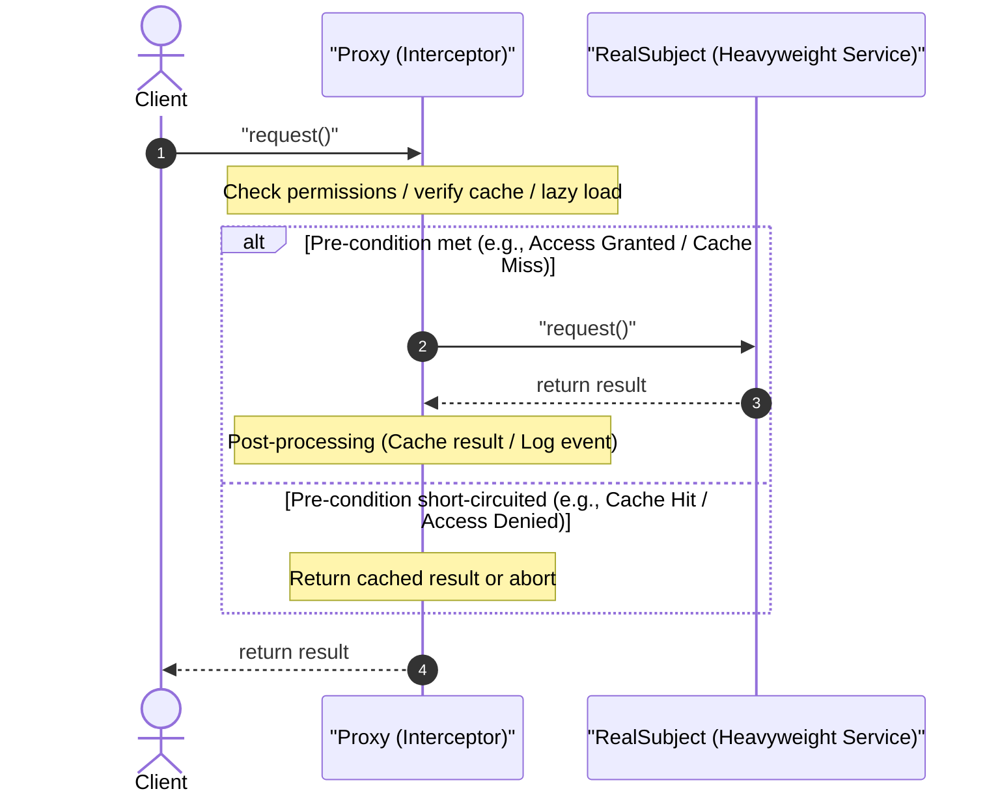
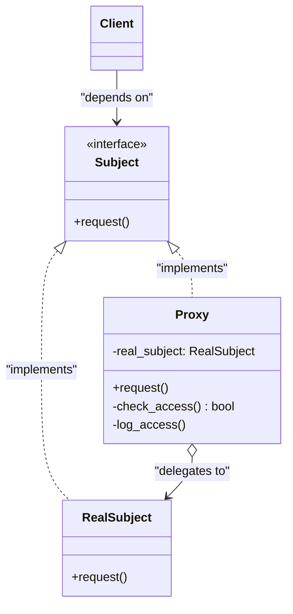

# Proxy Design Pattern

| Metadata      | Value                      |
| ------------- | -------------------------- |
| Author        | Lyzander Marciano Andrylie |
| Creation Date | Nov 12, 2026               |
| Last Updated  | Nov 12, 2026               |

## References

- [Proxy Pattern (Refactoring Guru)](https://refactoring.guru/design-patterns/proxy): Overview, intent, problem, solution, applicability, and structure of the Proxy design pattern
- [Proxy in Python (Refactoring Guru)](https://refactoring.guru/design-patterns/proxy/python/example): Conceptual structure and implementation of the Proxy design pattern in Python
- [design-pattern.md](../design-pattern.md): Overview of software design patterns and catalog categories
- [adapter.md](./adapter.md): Provides a different interface to the wrapped object, whereas Proxy provides the exact same interface
- [decorator.md](./decorator.md): Similar composition structure, but Proxy manages the service lifecycle on its own while Decorator is controlled by the client
- [facade.md](./facade.md): Simplifies a complex subsystem interface rather than mirroring a single service interface

## Description

Proxy is a structural design pattern that provides a surrogate or placeholder for another object to control access to it. By exposing the exact same interface as the underlying service object, a proxy intercepts incoming client requests to execute auxiliary operations—such as lazy initialization, access control, caching, or logging—before or after passing requests to the real service.

## Concepts

### 1. Intent, Problem, and Solution

- **Intent**: Provide a surrogate or placeholder object that mirrors the interface of a target service object to transparently manage access, lifecycle, caching, or security.
- **Problem**: In software systems, certain objects are resource-intensive to instantiate or operate (such as heavy database connections, large files, or remote network clients). Direct client access creates several drawbacks:
  - **Eager Resource Drain**: Allocating heavyweight objects upon startup consumes CPU and memory even when the client never utilizes them.
  - **Lack of Access Control**: Third-party or shared core classes cannot be easily modified to introduce permission validation or authentication checks.
  - **Redundant Work**: Repeated executions of identical, expensive queries or API requests waste network bandwidth and degrade system throughput without a caching layer.
- **Solution**: Define a `Proxy` class that implements the same interface as the `RealSubject`. The client interacts with the proxy transparently. When invoked, the proxy executes cross-cutting tasks (e.g., checking user credentials, querying an in-memory cache, or delaying initialization until the first call) and forwards execution to the `RealSubject` only when necessary.

#### Types of Proxies

| Proxy Type                              | Primary Responsibility                                                | Common Use Case                                                                 |
| :-------------------------------------- | :-------------------------------------------------------------------- | :------------------------------------------------------------------------------ |
| **Virtual Proxy (Lazy Initialization)** | Delays instantiation of heavyweight objects until first use           | Loading high-resolution images or opening massive database connection pools     |
| **Protection Proxy (Access Control)**   | Verifies client credentials and authorization rules before delegating | Restricting administrative operations or sensitive business domains             |
| **Caching Proxy (Memoization)**         | Stores operation results to serve repeat requests locally             | Caching third-party API payloads, heavy queries, or downloaded assets           |
| **Remote Proxy (Ambassador)**           | Handles network serialization, socket communication, and RPC plumbing | Interacting with microservices or distributed RPC objects across networks       |
| **Logging / Auditing Proxy**            | Records invocation parameters, timestamps, and request histories      | Tracking audit trails and profiling performance without altering business logic |

#### Applicability

- **Lazy loading (virtual proxy)**: When a resource-heavy service object is not always required at startup.
- **Access control (protection proxy)**: When access to a sensitive service must be restricted to authorized callers.
- **Local execution of remote services (remote proxy)**: When a service resides on a remote server and the client requires a local interface.
- **Caching results (caching proxy)**: When repeated operations produce identical results and recomputing them is costly.
- **Smart references and logging**: When you must track active references, monitor usage metrics, or lock resources safely.

#### Trade-offs

| Advantages                                                                                                 | Disadvantages                                                                                         |
| :--------------------------------------------------------------------------------------------------------- | :---------------------------------------------------------------------------------------------------- |
| **Transparent Control**: Controls service lifecycle and execution without client awareness                 | **Added Complexity**: Introduces additional classes and indirections into the codebase                |
| **Open/Closed Principle**: Introduces new proxies without modifying the real service or client             | **Potential Latency Overhead**: Poorly tuned proxy checks can add request latency                     |
| **Fail-safe Operation**: Proxy functions even if the real service is offline, slow, or not yet initialized | **Interface Coupling**: Changes to the subject interface require updating both proxy and real service |

#### Interaction



---

### 2. Structure and Components

The Proxy design pattern decouples the consumer from direct service creation through an abstract contract implemented identically by both the actual service and the intermediary wrapper.

| Component                      | Role           | Description                                                                                           |
| :----------------------------- | :------------- | :---------------------------------------------------------------------------------------------------- |
| `Subject` (`ServiceInterface`) | Interface      | Defines the common contract shared by both `RealSubject` and `Proxy`                                  |
| `RealSubject` (`Service`)      | Business Logic | The concrete service class containing core, resource-heavy, or sensitive business logic               |
| `Proxy`                        | Intermediary   | Holds a reference to `RealSubject`, implements `Subject`, and controls access before/after delegation |
| `Client`                       | Consumer       | Interacts with either `RealSubject` or `Proxy` interchangeably through the `Subject` interface        |

- **`Subject`**: Establishes the uniform method signatures. This allows the client to consume the `Proxy` as if it were the `RealSubject`.
- **`RealSubject`**: Focuses purely on primary domain logic without concerns for caching, access enforcement, or logging overhead.
- **`Proxy`**: Manages the lifecycle of the `RealSubject` (creating it lazily or accepting it via dependency injection) and executes auxiliary logic before and after forwarding requests.
- **`Client`**: Remains decoupled from the real implementation details, enabling dynamic swapping of service instances and proxies at runtime.

#### Interaction



---

### 3. Python Implementation

#### a. Conceptual Structure Example

The following conceptual example demonstrates how a `Proxy` controls access and logs requests to a `RealSubject` while presenting the uniform `Subject` interface to `client_code`.

- **`Subject`**: Abstract Base Class defining the contract via `@abstractmethod def request()`.
- **`RealSubject`**: Encapsulates core business handling.
- **`Proxy`**: Maintains an internal reference to `RealSubject`, verifies permissions with `check_access()`, delegates execution, and logs timestamps with `log_access()`.
- **`client_code`**: Operates on any `Subject` instance without knowing whether it is invoking the real service or a proxy.

```python
from abc import ABC, abstractmethod


class Subject(ABC):
    """
    The Subject interface declares common operations for both RealSubject and
    the Proxy. As long as the client works with RealSubject using this interface,
    you can pass it a proxy instead of a real subject.
    """

    @abstractmethod
    def request(self) -> None:
        pass


class RealSubject(Subject):
    """
    The RealSubject contains core business logic that may be slow, expensive,
    or sensitive. A Proxy manages these concerns without changing RealSubject.
    """

    def request(self) -> None:
        print("RealSubject: Handling request.")


class Proxy(Subject):
    """
    The Proxy has an interface identical to the RealSubject. It maintains a
    reference to RealSubject to delegate execution after pre-processing checks.
    """

    def __init__(self, real_subject: RealSubject) -> None:
        self._real_subject = real_subject

    def request(self) -> None:
        if self.check_access():
            self._real_subject.request()
            self.log_access()

    def check_access(self) -> bool:
        print("Proxy: Checking access prior to firing a real request.")
        return True

    def log_access(self) -> None:
        print("Proxy: Logging the time of request.")


def client_code(subject: Subject) -> None:
    """
    The client code works with all objects via the Subject interface to support
    both real subjects and proxies seamlessly.
    """
    subject.request()


if __name__ == "__main__":
    print("Client: Executing the client code with a real subject:")
    real_subject = RealSubject()
    client_code(real_subject)
    # Output:
    # Client: Executing the client code with a real subject:
    # RealSubject: Handling request.

    print("\nClient: Executing the same client code with a proxy:")
    proxy = Proxy(real_subject)
    client_code(proxy)
    # Output:
    # Client: Executing the same client code with a proxy:
    # Proxy: Checking access prior to firing a real request.
    # RealSubject: Handling request.
    # Proxy: Logging the time of request.
```

#### b. Practical Real-World Example

The following practical example implements a **Caching Proxy** for a simulated video downloading service. Direct network downloads are expensive and slow, so the proxy caches downloaded payloads and metadata in memory so subsequent identical calls return immediately without touching the external network.

- **`VideoDownloader`**: Abstract interface declaring `get_video_info()` and `download_video()`.
- **`RealVideoDownloader`**: Simulates slow external network latency when fetching video streams and metadata.
- **`CachedVideoDownloader`**: Intercepts requests, evaluates local cache hits/misses, delegates to `RealVideoDownloader` only on cache misses, and stores retrieved assets.
- **`client_code`**: Dispatches requests through `VideoDownloader`, achieving transparent performance acceleration on repeated calls.

```python
from abc import ABC, abstractmethod
from typing import Dict


class VideoDownloader(ABC):
    """
    Subject interface defining video retrieval operations.
    """

    @abstractmethod
    def get_video_info(self, video_id: str) -> str:
        pass

    @abstractmethod
    def download_video(self, video_id: str) -> bytes:
        pass


class RealVideoDownloader(VideoDownloader):
    """
    RealSubject performing expensive network operations.
    """

    def get_video_info(self, video_id: str) -> str:
        print(f"RealVideoDownloader: Fetching metadata for '{video_id}' from remote API...")
        return f"Metadata for video '{video_id}'"

    def download_video(self, video_id: str) -> bytes:
        print(f"RealVideoDownloader: Downloading video binary for '{video_id}' over network...")
        return f"BinaryStream({video_id})".encode("utf-8")


class CachedVideoDownloader(VideoDownloader):
    """
    Proxy providing in-memory caching for video info and downloaded media.
    """

    def __init__(self, downloader: VideoDownloader) -> None:
        self._downloader = downloader
        self._metadata_cache: Dict[str, str] = {}
        self._video_cache: Dict[str, bytes] = {}

    def get_video_info(self, video_id: str) -> str:
        if video_id not in self._metadata_cache:
            print(f"CachedVideoDownloader: Cache miss for metadata '{video_id}'. Querying service...")
            self._metadata_cache[video_id] = self._downloader.get_video_info(video_id)
        else:
            print(f"CachedVideoDownloader: Cache hit for metadata '{video_id}'. Returning cached data.")
        return self._metadata_cache[video_id]

    def download_video(self, video_id: str) -> bytes:
        if video_id not in self._video_cache:
            print(f"CachedVideoDownloader: Cache miss for video '{video_id}'. Querying service...")
            self._video_cache[video_id] = self._downloader.download_video(video_id)
        else:
            print(f"CachedVideoDownloader: Cache hit for video '{video_id}'. Returning cached bytes.")
        return self._video_cache[video_id]


def client_code(downloader: VideoDownloader) -> None:
    """
    Client interacts solely with VideoDownloader abstraction.
    """
    print("--- First Request (Cold Cache: Triggers Network Calls) ---")
    info1 = downloader.get_video_info("design-patterns-proxy")
    print(f"Received info: {info1}")
    bytes1 = downloader.download_video("design-patterns-proxy")
    print(f"Received payload: {len(bytes1)} bytes")

    print("\n--- Second Request (Warm Cache: Served from Memory) ---")
    info2 = downloader.get_video_info("design-patterns-proxy")
    print(f"Received info: {info2}")
    bytes2 = downloader.download_video("design-patterns-proxy")
    print(f"Received payload: {len(bytes2)} bytes")


if __name__ == "__main__":
    real_service = RealVideoDownloader()
    caching_proxy = CachedVideoDownloader(real_service)

    client_code(caching_proxy)
    # Output:
    # --- First Request (Cold Cache: Triggers Network Calls) ---
    # CachedVideoDownloader: Cache miss for metadata 'design-patterns-proxy'. Querying service...
    # RealVideoDownloader: Fetching metadata for 'design-patterns-proxy' from remote API...
    # Received info: Metadata for video 'design-patterns-proxy'
    # CachedVideoDownloader: Cache miss for video 'design-patterns-proxy'. Querying service...
    # RealVideoDownloader: Downloading video binary for 'design-patterns-proxy' over network...
    # Received payload: 35 bytes
    #
    # --- Second Request (Warm Cache: Served from Memory) ---
    # CachedVideoDownloader: Cache hit for metadata 'design-patterns-proxy'. Returning cached data.
    # Received info: Metadata for video 'design-patterns-proxy'
    # CachedVideoDownloader: Cache hit for video 'design-patterns-proxy'. Returning cached bytes.
    # Received payload: 35 bytes
```
