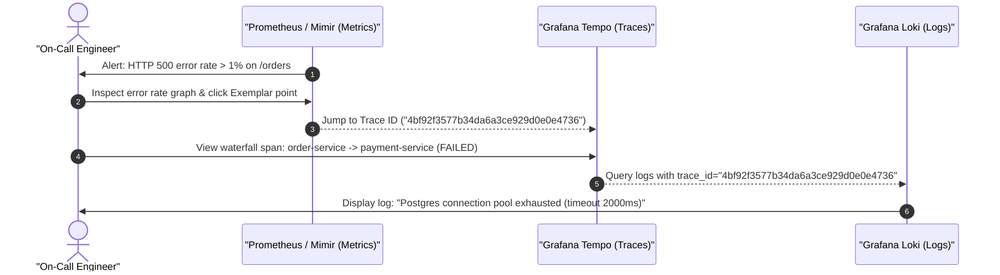
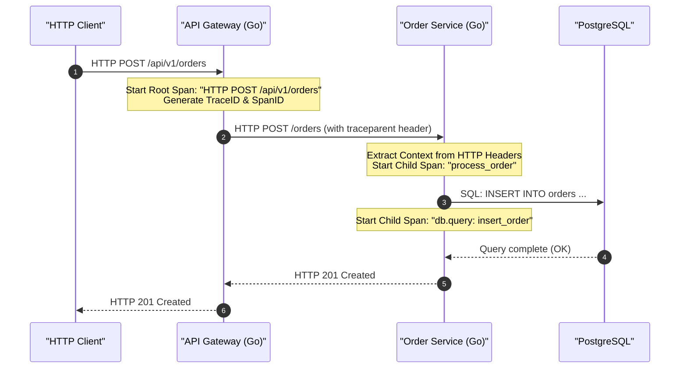
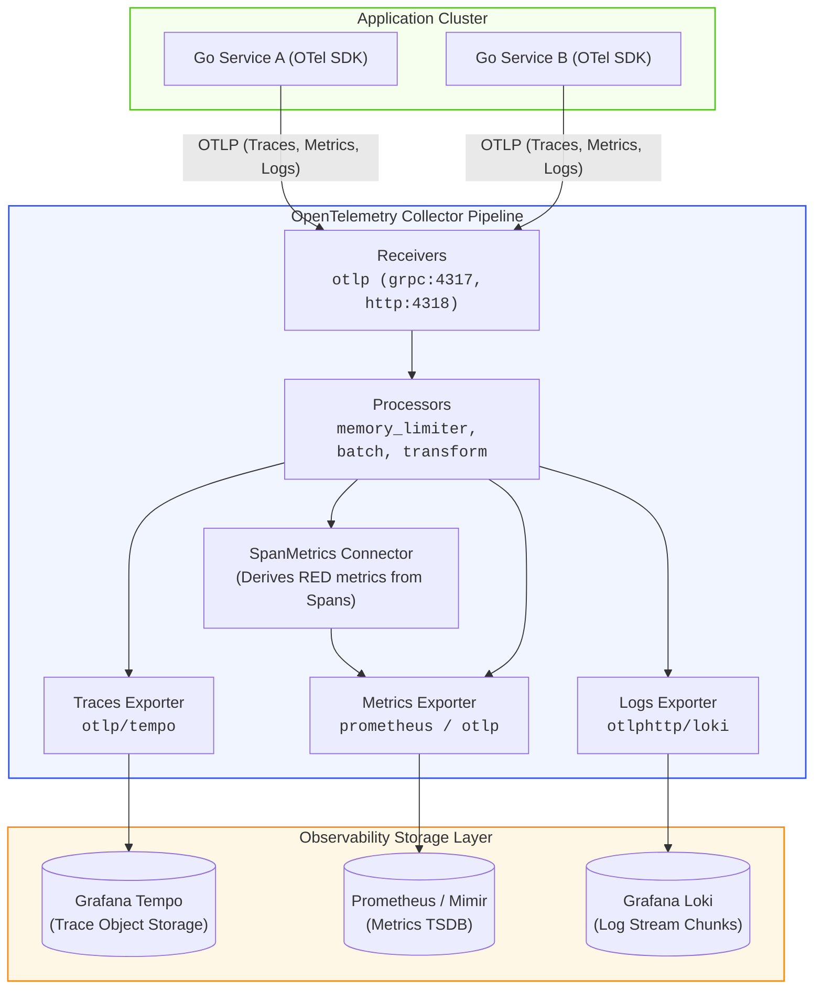

# Service Observability with OpenTelemetry, Prometheus, and Grafana Loki

| Metadata      | Value                      |
| ------------- | -------------------------- |
| Author        | Lyzander Marciano Andrylie |
| Creation Date | Nov 12, 2026               |
| Last Updated  | Nov 12, 2026               |

## References

- [OpenTelemetry Go Documentation](https://opentelemetry.io/docs/languages/go/): Official OpenTelemetry Go SDK guide for tracing, metrics, and context propagation
- [Grafana Loki Documentation](https://grafana.com/docs/loki/latest/): Architecture, log stream indexing model, and LogQL syntax
- [Prometheus Documentation](https://prometheus.io/docs/introduction/overview/): Dimensional metrics data model, instrument types, and PromQL fundamentals
- [W3C Trace Context Specification](https://www.w3.org/TR/trace-context/): Standard HTTP headers (`traceparent`, `tracestate`) for distributed context propagation
- [outbox.md](./outbox.md): Reliable message publication across distributed systems requiring end-to-end trace propagation
- [dlq.md](./dlq.md): Dead-letter queue processing requiring tracing and error monitoring
- [backpressure.md](./backpressure.md): Rate monitoring and saturation metrics in distributed pipelines

## Description

Service observability is the capability to infer the internal health, latency profiles, and failure modes of distributed systems by analyzing external outputs across three correlated telemetry signals: distributed traces, numerical metrics, and structured logs. It eliminates operational guesswork by linking macro-level symptom alerts (metrics) to individual request journeys (traces) and granular event contexts (logs).

## Concepts

### 1. The Triad of Telemetry: Correlating Traces, Metrics, and Logs

Metrics alert on symptoms, traces isolate bottlenecks across service boundaries, and logs reveal exact root causes; unifying all three via shared identifiers transforms isolated data into an actionable diagnostic graph.

- **Metrics (What is broken?)**: Aggregable, fixed-size numerical timeseries over fixed time windows. Ideal for real-time dashboards, alerting (SLIs/SLOs), and trend analysis without proportional storage scaling.
- **Traces (Where is the problem?)**: Directed Acyclic Graphs (DAGs) of timed operations (spans) representing a single request moving across process and network boundaries.
- **Logs (Why did it happen?)**: Discrete, timestamped event strings or structured JSON objects detailing internal application decisions, input states, and runtime stack traces.
- **The Exemplar & Correlation Bridge**: During metric observations with an active sampled trace, the SDK attaches the current `trace_id` as an **exemplar** to the corresponding histogram bucket reservoir without increasing metric cardinality. During incidents or latency spikes, clicking an exemplar directly opens the matching distributed trace in Tempo/Jaeger, which in turn queries Grafana Loki logs bearing that exact `trace_id`.
  - **Reservoir Storage**: To avoid unbounded memory growth, each histogram bucket holds an Exemplar Reservoir (typically storing only the most recent 1–2 samples per bucket over a scrape interval).

| Signal | Primary Data Structure | Cardinality Tolerance | Storage Cost Growth Factor | Primary Diagnostic Role |
| :--- | :--- | :--- | :--- | :--- |
| **Metrics** | Counter, Gauge, Histogram buckets | Strictly low | Proportional to label combinations | Rapid symptom detection & alerting |
| **Traces** | Spans with DAG parent-child hierarchy | High (unique per request) | Proportional to request traffic & sampling | Latency breakdown & distributed bottlenecks |
| **Logs** | Chronological byte streams / JSON payloads | High inside payload, strictly low in labels | Proportional to event volume and verbosity | Granular error details & code-level state |

#### Interaction



---

### 2. Distributed Tracing with OpenTelemetry in Go

Spans model nested units of execution, carrying trace context across network boundaries to construct an end-to-end distributed execution graph.

- **Trace and Span Hierarchy**: A trace consists of a single root span created when a request enters the edge service, followed by child spans created by downstream functions, databases, and microservices.
- **W3C Trace Context**: Distributed context is propagated across HTTP/gRPC boundaries using standard HTTP headers:
  - `traceparent`: Encodes version, 16-byte `trace_id`, 8-byte `parent_span_id`, and 1-byte trace flags (e.g., `00-4bf92f3577b34da6a3ce929d0e0e4736-00f067aa0ba902b7-01`).
  - `tracestate`: Vendor-specific state key-value pairs.
- **Context Passing in Go**: `context.Context` is the universal vehicle for in-process trace propagation. Never discard or recreate `context.Background()` inside an active request pipeline.
- **Sampling Strategies**:
  - **Head-Based Sampling**: The root service decides whether to record the trace when it starts (e.g., 5% random sampling). Low collector overhead, but may miss rare intermittent errors.
  - **Tail-Based Sampling**: The OpenTelemetry Collector buffers all spans in a trace and decides whether to persist it after completion, ensuring 100% of errors and slow requests are saved.

> [!IMPORTANT]
> Always end child spans with `defer span.End()` immediately after creation. Failing to end a span causes memory leaks in the tracer's in-memory batch processor and drops telemetry.

#### Interaction



#### a. End-to-End Tracing Implementation in Go

This copy-pasteable example demonstrates initializing the OpenTelemetry TracerProvider with an OTLP HTTP exporter, propagating context across an HTTP handler, and recording child spans with error status codes.

```go
package main

import (
	"context"
	"errors"
	"fmt"
	"log"
	"net/http"
	"time"

	"go.opentelemetry.io/otel"
	"go.opentelemetry.io/otel/attribute"
	"go.opentelemetry.io/otel/codes"
	"go.opentelemetry.io/otel/exporters/otlp/otlptrace/otlptracehttp"
	"go.opentelemetry.io/otel/propagation"
	"go.opentelemetry.io/otel/sdk/resource"
	sdktrace "go.opentelemetry.io/otel/sdk/trace"
	semconv "go.opentelemetry.io/otel/semconv/v1.26.0"
	"go.opentelemetry.io/otel/trace"
)

// initTracer configures and registers the OpenTelemetry TracerProvider and W3C Propagator.
func initTracer(ctx context.Context, serviceName string) (*sdktrace.TracerProvider, error) {
	// 1. Configure OTLP HTTP exporter to ship span batches to the OpenTelemetry Collector
	exporter, err := otlptracehttp.New(ctx,
		otlptracehttp.WithEndpoint("localhost:4318"),
		otlptracehttp.WithInsecure(),
	)
	if err != nil {
		return nil, fmt.Errorf("create trace exporter: %w", err)
	}

	// 2. Resource: Represents the entity producing telemetry (e.g., service name, environment, host).
	// These static attributes are stamped automatically onto every span, metric, and log line,
	// enabling backend filters (e.g. Tempo service dropdown) without manual tagging on every call.
	res, err := resource.New(ctx,
		resource.WithAttributes(
			semconv.ServiceNameKey.String(serviceName),
			attribute.String("environment", "production"),
		),
	)
	if err != nil {
		return nil, fmt.Errorf("create resource: %w", err)
	}

	// 3. Initialize TracerProvider with in-memory batching and head-based sampling policy
	tp := sdktrace.NewTracerProvider(
		sdktrace.WithBatcher(exporter),
		sdktrace.WithResource(res),
		sdktrace.WithSampler(sdktrace.AlwaysSample()),
	)

	// 4. Register TracerProvider globally across the process
	otel.SetTracerProvider(tp)

	// 5. Register W3C TraceContext propagator globally:
	// Enables extracting/injecting 'traceparent' and 'tracestate' HTTP headers across network boundaries
	otel.SetTextMapPropagator(propagation.NewCompositeTextMapPropagator(
		propagation.TraceContext{},
		propagation.Baggage{},
	))

	return tp, nil
}

// orderHandler represents Order Service receiving a request from API Gateway.
// Corresponds to Steps 3, 4, 5, 6, and 7 in the interaction sequence diagram.
func orderHandler(w http.ResponseWriter, r *http.Request) {
	// [Interaction Step 3 -> 4: Context Extraction]
	// Extract incoming W3C 'traceparent' header injected by upstream (e.g., API Gateway).
	// If valid, ctx now contains the remote parent TraceID & SpanID.
	propagator := otel.GetTextMapPropagator()
	ctx := propagator.Extract(r.Context(), propagation.HeaderCarrier(r.Header))

	// [Interaction Step 4: Start Server Child Span]
	// Start server span bound to the extracted parent context, inheriting the same TraceID.
	tracer := otel.GetTracerProvider().Tracer("order-service")
	ctx, span := tracer.Start(ctx, "HTTP "+r.Method+" "+r.URL.Path,
		trace.WithSpanKind(trace.SpanKindServer),
		trace.WithAttributes(
			attribute.String("http.route", "/orders"),
			attribute.String("http.method", r.Method),
		),
	)
	// Essential: span.End() records completion timestamp and flushes span to the batcher.
	defer span.End()

	// [Interaction Step 5: In-Process Context Propagation]
	// Pass ctx carrying the active server span to downstream operations (e.g., database query).
	if err := executeDatabaseOperation(ctx, tracer); err != nil {
		// [Error Recording]: Mark span as failed in waterfall traces (e.g., Tempo / Jaeger)
		span.RecordError(err)
		span.SetStatus(codes.Error, err.Error())
		http.Error(w, "internal server error", http.StatusInternalServerError)
		return
	}

	// [Interaction Step 7: Finalize Success Status & Emit HTTP Response]
	span.SetStatus(codes.Ok, "success")
	w.WriteHeader(http.StatusCreated)
	w.Write([]byte(`{"status":"created"}`))
}

// executeDatabaseOperation executes a database query under a dedicated client child span.
// Corresponds to Steps 5 & 6 in the interaction sequence diagram.
func executeDatabaseOperation(ctx context.Context, tracer trace.Tracer) error {
	// [Interaction Step 5: Start DB Child Span]
	// SpanKindClient indicates an outbound boundary call; inherits parent trace context from ctx.
	ctx, span := tracer.Start(ctx, "db.execute: insert_order",
		trace.WithSpanKind(trace.SpanKindClient),
		trace.WithAttributes(
			attribute.String("db.system", "postgresql"),
			attribute.String("db.statement", "INSERT INTO orders (id) VALUES ($1)"),
		),
	)
	defer span.End()

	// Simulate transient timeout / query execution
	time.Sleep(20 * time.Millisecond)

	// [Interaction Step 6: Query Result Evaluation & Error Tagging]
	err := errors.New("pq: connection pool timeout")
	if err != nil {
		span.RecordError(err)
		span.SetStatus(codes.Error, err.Error())
		return err
	}
	return nil
}

func main() {
	ctx := context.Background()
	tp, err := initTracer(ctx, "order-service")
	if err != nil {
		log.Fatalf("failed to init tracer: %v", err)
	}

	// [Graceful Telemetry Flush]:
	// Flushes all in-memory span batches to the OTLP collector before the application process exits.
	defer func() {
		shutdownCtx, cancel := context.WithTimeout(context.Background(), 5*time.Second)
		defer cancel()
		if err := tp.Shutdown(shutdownCtx); err != nil {
			log.Printf("tracer shutdown error: %v", err)
		}
	}()

	http.HandleFunc("/orders", orderHandler)
	log.Println("Server running on :8080")
	// http.ListenAndServe(":8080", nil)
}
```

---

### 3. Dimensional Metrics with OpenTelemetry and Prometheus

Low-cardinality aggregated counters and histograms track throughput, error ratios, and latency percentiles under the RED method.

- **The RED Method**:
  - **Rate**: Number of requests served per second (`http_requests_total`).
  - **Errors**: Number of failing requests per second (`http_requests_total{status=~"5.."}`).
  - **Duration**: Time taken per request, segmented into histogram buckets (`http_request_duration_seconds_bucket`).
- **OpenTelemetry Metric Instruments**:
  - **Counter**: Monotonically increasing sum (e.g., total requests, bytes sent).
  - **UpDownCounter**: Additive value that can increase or decrease (e.g., active workers, in-flight requests).
  - **Histogram**: Samples observations into pre-configured boundaries (e.g., 5ms, 10ms, 25ms, 100ms, 250ms, 1s) to compute p50, p95, and p99 percentiles without storing raw samples.
  - **Gauge**: Instantaneous non-additive snapshot value (e.g., temperature, memory usage percentage).

> [!WARNING]
> **Cardinality Explosion**: Never attach unbounded variables (such as `user_id`, `order_id`, `email`, or dynamic UUIDs) as metric labels. A table of $100{,}000$ unique user IDs with 5 endpoints and 4 HTTP status codes generates $2{,}000{,}000$ distinct timeseries, immediately crashing Prometheus or Mimir out of memory.

| Metric Type | Metric Name | Standard Labels | Metric Purpose |
| :--- | :--- | :--- | :--- |
| **Counter** | `http_requests_total` | `method`, `route`, `status_code` | Measures throughput and error ratios |
| **Histogram** | `http_request_duration_seconds` | `method`, `route`, `le` (bucket boundary) | Computes p50, p95, and p99 latency percentiles |
| **UpDownCounter** | `active_connections` | `protocol`, `remote_target` | Tracks concurrent resource utilization |
| **Gauge** | `jvm_memory_used_bytes` / `go_memstats_alloc_bytes` | `area`, `generation` | Reports point-in-time heap consumption |

#### a. OpenTelemetry Metrics Implementation in Go

This implementation sets up an in-process Prometheus exporter and registers standard RED instruments to monitor HTTP endpoints.

```go
package main

import (
	"context"
	"fmt"
	"log"
	"math/rand"
	"net/http"
	"strconv"
	"time"

	"github.com/prometheus/client_golang/prometheus/promhttp"
	"go.opentelemetry.io/otel/attribute"
	"go.opentelemetry.io/otel/exporters/prometheus"
	otelmetric "go.opentelemetry.io/otel/metric"
	sdkmetric "go.opentelemetry.io/otel/sdk/metric"
)

// MetricsMiddleware holds RED metric instruments for HTTP monitoring.
type MetricsMiddleware struct {
	requestCounter  otelmetric.Int64Counter
	latencyDuration otelmetric.Float64Histogram
}

// initMetrics configures the Prometheus exporter and registers RED instruments.
func initMetrics() (*MetricsMiddleware, error) {
	// 1. Initialize OpenTelemetry Prometheus exporter (bridges OTel SDK -> Prom pull registry)
	exporter, err := prometheus.New()
	if err != nil {
		return nil, fmt.Errorf("failed to create prometheus exporter: %w", err)
	}

	// 2. Build MeterProvider bound to the Prometheus metric reader
	meterProvider := sdkmetric.NewMeterProvider(
		sdkmetric.WithReader(exporter),
	)

	// 3. Acquire named Meter for this component
	meter := meterProvider.Meter("http-service-metrics")

	// 4. Register RED 'Rate' & 'Errors' instrument: Monotonically increasing counter
	counter, err := meter.Int64Counter(
		"http_requests_total",
		otelmetric.WithDescription("Total number of HTTP requests processed"),
		otelmetric.WithUnit("{request}"),
	)
	if err != nil {
		return nil, err
	}

	// 5. Register RED 'Duration' instrument: Latency histogram with explicit bucket boundaries
	// Pre-allocated boundaries compute p50/p95/p99 without unboundedly storing raw request durations
	histogram, err := meter.Float64Histogram(
		"http_request_duration_seconds",
		otelmetric.WithDescription("HTTP request duration in seconds"),
		otelmetric.WithUnit("s"),
		otelmetric.WithExplicitBucketBoundaries(0.005, 0.01, 0.025, 0.05, 0.1, 0.25, 0.5, 1.0, 2.5),
	)
	if err != nil {
		return nil, err
	}

	return &MetricsMiddleware{
		requestCounter:  counter,
		latencyDuration: histogram,
	}, nil
}

// WrapHandler wraps an http.HandlerFunc to record request count and duration per route.
func (m *MetricsMiddleware) WrapHandler(route string, next http.HandlerFunc) http.HandlerFunc {
	return func(w http.ResponseWriter, r *http.Request) {
		// [Operation Step 1: Start Latency Timer]
		start := time.Now()
		rw := &statusResponseWriter{ResponseWriter: w, statusCode: http.StatusOK}

		// [Operation Step 2: Execute Downstream Handler]
		next(rw, r)

		// [Operation Step 3: Measure Elapsed Duration]
		duration := time.Since(start).Seconds()

		// [Operation Step 4: Formulate Low-Cardinality Dimensional Labels]
		// Strictly bounded: method, route pattern (not raw URL with dynamic IDs), and status code
		attrs := []attribute.KeyValue{
			attribute.String("method", r.Method),
			attribute.String("route", route),
			attribute.String("status_code", strconv.Itoa(rw.statusCode)),
		}

		// [Operation Step 5: Record RED Metric Observations]
		// Passing r.Context() allows the SDK to attach an active trace_id as an Exemplar to histogram buckets
		m.requestCounter.Add(r.Context(), 1, otelmetric.WithAttributes(attrs...))
		m.latencyDuration.Record(r.Context(), duration, otelmetric.WithAttributes(attrs...))
	}
}

// statusResponseWriter intercepts WriteHeader to record the actual HTTP status code.
type statusResponseWriter struct {
	http.ResponseWriter
	statusCode int
}

func (rw *statusResponseWriter) WriteHeader(code int) {
	rw.statusCode = code
	rw.ResponseWriter.WriteHeader(code)
}

func apiHandler(w http.ResponseWriter, r *http.Request) {
	time.Sleep(time.Duration(10+rand.Intn(40)) * time.Millisecond)
	w.WriteHeader(http.StatusOK)
	w.Write([]byte(`{"status":"ok"}`))
}

func main() {
	metrics, err := initMetrics()
	if err != nil {
		log.Fatalf("failed to init metrics: %v", err)
	}

	mux := http.NewServeMux()
	mux.HandleFunc("/api/v1/resource", metrics.WrapHandler("/api/v1/resource", apiHandler))

	// Expose Prometheus scrapable endpoint on /metrics
	mux.Handle("/metrics", promhttp.Handler())

	log.Println("Metrics server listening on :8081 (scrape /metrics)")
	// http.ListenAndServe(":8081", mux)
}
```

---

### 4. Structured Logging & Ingestion with Grafana Loki in Go

Loki does not build an inverted full-text index across message bodies; it indexes low-cardinality metadata labels to identify log streams and parses structured payloads dynamically at query time.

- **Loki Stream Indexing Model**:
  - A stream is defined by a unique set of key-value labels (e.g., `{app="order-service", env="prod", region="us-east-1"}`).
  - Log lines belonging to the same stream are compressed into chunks (using Snappy or Gzip) and saved into object storage (AWS S3, Google Cloud Storage, or MinIO).
  - Queries first select chunks via label selectors (`{app="order-service"}`), then stream and decompress chunks through parallel LogQL pipeline filters.
- **Trace Context Extraction (`trace_id` & `span_id`)**:
  - To bridge logs and traces, the active trace ID and span ID must be extracted from `context.Context` and appended to the JSON log payload.
  - In Grafana, configuring a **Derived Field** or data link on `trace_id` enables a one-click transition from any log line directly to the full distributed trace waterfall in Tempo.
- **The LogQL Query Language**:
  - Stream Selector: `{app="order-service", env="prod"}`
  - Line Filter: `|= "error"` or `!= "healthcheck"`
  - Parser Expression: `| json | duration > 200ms`
  - Range Vector Aggregation: `rate({app="order-service"} |= "connection refused" [5m])`

| Aspect | Grafana Loki | Elasticsearch / OpenSearch |
| :--- | :--- | :--- |
| **Index Mechanism** | Indexes only stream label sets; zero indexing on log content | Inverted index across all parsed tokens in every field |
| **Memory & Storage Footprint** | Small index footprint; raw logs compressed 5x–10x in object storage | Large index footprint (often exceeds raw data volume) |
| **Write Throughput** | Very high; append-only streaming chunks | Moderate; inverted index mutations require CPU and IOPS |
| **Trace Correlation** | Fast lookup when filtered by stream labels + `trace_id` regex/JSON parser | Fast lookup via indexed `trace_id` term query |

> [!CAUTION]
> **Do NOT use `trace_id`, `user_id`, or `order_id` as Loki stream labels**. Loki stream labels must strictly be low-cardinality identifiers (application name, environment, namespace). Adding a unique ID per request as a stream label creates millions of streams, exhausting the Loki ingester's chunk memory and stalling the ring.

#### a. Context-Aware Structured Logging with `log/slog` in Go

This example implements a custom `slog.Handler` that automatically inspects `context.Context` for active OpenTelemetry spans, appending `trace_id` and `span_id` as top-level structured fields without polluting stream labels.

```go
package main

import (
	"context"
	"log/slog"
	"os"

	"go.opentelemetry.io/otel/trace"
)

// OTelContextHandler wraps an existing slog.Handler to automatically inject active TraceID & SpanID.
type OTelContextHandler struct {
	slog.Handler
}

// NewOTelContextHandler constructs a trace-enriching slog handler decorator.
func NewOTelContextHandler(next slog.Handler) *OTelContextHandler {
	return &OTelContextHandler{Handler: next}
}

// Handle intercepts log records, inspects context.Context for an active span, and enriches log fields.
func (h *OTelContextHandler) Handle(ctx context.Context, record slog.Record) error {
	// [Operation Step 1: Extract Active Span from Context]
	span := trace.SpanFromContext(ctx)

	// [Operation Step 2: Validate Span & Extract W3C Trace Identifiers]
	if span.SpanContext().IsValid() {
		sc := span.SpanContext()

		// [Operation Step 3: Inject Trace Identifiers into JSON Payload]
		// Crucial: These are emitted inside the JSON body (NOT as Loki stream labels).
		// This avoids Loki cardinality explosions while enabling one-click trace jumps in Grafana.
		record.AddAttrs(
			slog.String("trace_id", sc.TraceID().String()),
			slog.String("span_id", sc.SpanID().String()),
			slog.Bool("trace_sampled", sc.IsSampled()),
		)
	}

	// [Operation Step 4: Delegate to Base Formatter]
	// Passes enriched record down to the underlying JSON/Text handler
	return h.Handler.Handle(ctx, record)
}

func (h *OTelContextHandler) WithAttrs(attrs []slog.Attr) slog.Handler {
	return &OTelContextHandler{Handler: h.Handler.WithAttrs(attrs)}
}

func (h *OTelContextHandler) WithGroup(name string) slog.Handler {
	return &OTelContextHandler{Handler: h.Handler.WithGroup(name)}
}

// initLogger constructs a production JSON logger with the OTelContextHandler decorator.
func initLogger() *slog.Logger {
	baseHandler := slog.NewJSONHandler(os.Stdout, &slog.HandlerOptions{
		Level: slog.LevelInfo,
	})
	otelHandler := NewOTelContextHandler(baseHandler)
	return slog.New(otelHandler)
}

func main() {
	logger := initLogger()

	// 1. Startup Log (No active trace context):
	// Emits standard JSON log payload without trace identifiers.
	logger.Info("application starting up", slog.String("version", "1.4.0"))
	// Output:
	// {"time":"2026-11-12T00:00:00Z","level":"INFO","msg":"application starting up","version":"1.4.0"}

	// 2. Simulate Active Request Context carrying W3C traceparent (e.g., extracted from HTTP header):
	traceID, _ := trace.TraceIDFromHex("4bf92f3577b34da6a3ce929d0e0e4736")
	spanID, _ := trace.SpanIDFromHex("00f067aa0ba902b7")
	sc := trace.NewSpanContext(trace.SpanContextConfig{
		TraceID:    traceID,
		SpanID:     spanID,
		TraceFlags: trace.FlagsSampled,
	})
	ctx := trace.ContextWithRemoteSpanContext(context.Background(), sc)

	// 3. Request-Scoped Log (With active trace context):
	// OTelContextHandler automatically injects trace_id and span_id matching Grafana Tempo waterfall spans.
	logger.ErrorContext(ctx, "database transaction failed",
		slog.String("component", "order_processor"),
		slog.Int("retry_count", 3),
	)
	// Output:
	// {"time":"2026-11-12T00:00:00Z","level":"ERROR","msg":"database transaction failed","component":"order_processor","retry_count":3,"trace_id":"4bf92f3577b34da6a3ce929d0e0e4736","span_id":"00f067aa0ba902b7","trace_sampled":true}
}
```

---

### 5. OpenTelemetry Collector & Unified Observability Pipeline

The OpenTelemetry Collector standardizes data ingestion, batching, scrubbing, and multi-destination dispatching outside application runtimes.

- **Collector Architecture Components**:
  - **Receivers (Push/Pull)**: Ingest telemetry using OTLP (gRPC on port `4317`, HTTP on port `4318`), Prometheus scraping, or Jaeger formats.
  - **Processors (Transform & Protect)**:
    - `memory_limiter`: Drops or backpressures data when host RAM hits configured thresholds.
    - `batch`: Flushes data in batches (e.g., every 5s or 8192 items) to minimize network IOPS.
    - `tail_sampling`: Samples traces intelligently after spans complete.
    - `transform` (OTTLL): Mutates or redacts PII before telemetry leaves infrastructure.
  - **Exporters (Egress)**: Ships data to Prometheus/Mimir (metrics), Grafana Tempo (traces), and Grafana Loki (logs).
  - **Connectors**: Bridges signals within the collector, such as `spanmetrics` (generating RED metric timeseries automatically from distributed trace spans).

#### Interaction



#### a. OpenTelemetry Collector Pipeline Configuration

The following production `otel-collector-config.yaml` configures unified OTLP receivers, a batch processor, a memory limiter, and exporters forwarding to Grafana Tempo, Prometheus, and Grafana Loki.

```yaml
# 1. Receivers: Ingest telemetry from Go services using the standard OpenTelemetry Protocol (OTLP)
receivers:
  otlp:
    protocols:
      grpc:
        endpoint: 0.0.0.0:4317 # Default high-performance binary gRPC listener
      http:
        endpoint: 0.0.0.0:4318 # HTTP/JSON listener for web clients & firewalled environments

# 2. Processors: Transform, buffer, and protect collector nodes from overload
processors:
  # Memory Limiter: Primary defense against OOM crashes; backpressures receivers at 75% memory
  memory_limiter:
    check_interval: 1s
    limit_percentage: 75
    spike_limit_percentage: 20

  # Batch Processor: Batches spans, metrics, and logs to optimize compression and network throughput
  batch:
    send_batch_size: 8192
    timeout: 5s

# 3. Connectors: Internal pipes bridging distinct telemetry signals
connectors:
  # SpanMetrics: Automatically extracts RED metrics (rate, error, duration) from incoming trace spans
  spanmetrics:
    histogram:
      explicit:
        buckets: [5ms, 10ms, 25ms, 50ms, 100ms, 250ms, 500ms, 1s, 2.5s]
    dimensions:
      - name: http.status_code
      - name: http.route

# 4. Exporters: Dispatch processed telemetry to dedicated storage engines
exporters:
  # Traces: Sent to Grafana Tempo object storage
  otlp/tempo:
    endpoint: tempo:4317
    tls:
      insecure: true

  # Metrics: Exposes a pull endpoint scraped by Prometheus on port 8889
  prometheus:
    endpoint: 0.0.0.0:8889
    namespace: otel

  # Logs: Ships structured JSON logs to Grafana Loki via the OTLP HTTP ingestion endpoint
  otlphttp/loki:
    endpoint: http://loki:3100/otlp
    tls:
      insecure: true

# 5. Service Pipelines: Connects Receivers -> Processors -> Exporters per signal
service:
  pipelines:
    traces:
      receivers: [otlp]
      processors: [memory_limiter, batch]
      exporters: [otlp/tempo, spanmetrics] # spanmetrics connector extracts RED metrics here
    metrics:
      receivers: [otlp, spanmetrics]       # Ingests both direct OTel metrics and derived spanmetrics
      processors: [memory_limiter, batch]
      exporters: [prometheus]
    logs:
      receivers: [otlp]
      processors: [memory_limiter, batch]
      exporters: [otlphttp/loki]
```
