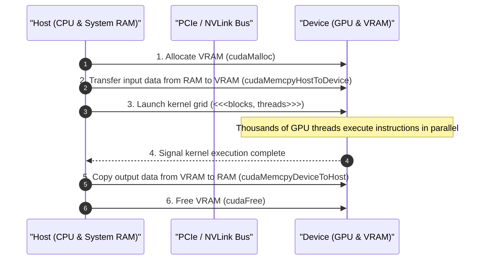
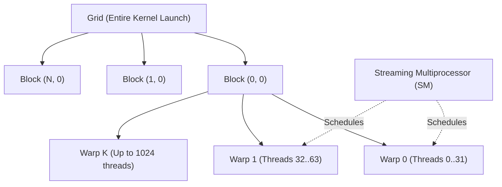

# Introduction to CUDA & GPU Parallel Computing

| Metadata      | Value       |
| ------------- | ----------- |
| Author        | Lyzander    |
| Creation Date | Nov 6, 2026 |
| Last Updated  | Nov 6, 2026 |

## References

- [NVIDIA CUDA C++ Programming Guide](https://docs.nvidia.com/cuda/cuda-c-programming-guide/): Official guide covering kernel development, execution configuration, and hardware architecture
- [NVIDIA CUDA C++ Best Practices Guide](https://docs.nvidia.com/cuda/cuda-c-best-practices-guide/): Strategies for optimizing memory throughput, thread occupancy, and kernel execution

## Description

Compute Unified Device Architecture (CUDA) is NVIDIA's parallel computing platform and programming model that exposes the massively parallel processing power of NVIDIA GPUs for general-purpose computing (GPGPU). It allows software engineers to offload data-parallel computations from latency-optimized CPUs to throughput-optimized GPUs across thousands of hardware cores.

## Concepts

### 1. The GPU vs. CPU Paradigm: Throughput vs. Latency

CPUs and GPUs are engineered with fundamentally different hardware philosophies:

- **CPU (Latency-Optimized)**:
  - Designed to execute a small sequence of instructions as fast as possible.
  - Large silicon footprint dedicated to branch prediction, deep cache hierarchies (L1, L2, L3), and out-of-order execution logic.
  - Features a small number of complex, high-clock-rate cores (e.g., 8–64 cores).
- **GPU (Throughput-Optimized)**:
  - Designed to execute millions of identical mathematical operations in parallel across huge datasets.
  - Silicon is dominated by Arithmetic Logic Units (ALUs) rather than complex control logic and massive caches.
  - Features thousands of smaller, power-efficient cores operating under the **SIMT (Single Instruction, Multiple Threads)** execution model.
- **Heterogeneous Computing Model (Host vs. Device)**:
  - **Host**: The CPU and host RAM, responsible for OS tasks, I/O, memory allocation, and orchestrating execution.
  - **Device**: The GPU and dedicated high-bandwidth device memory (GDDR/HBM), responsible for executing compute-heavy routines called **kernels**.

#### Interaction



---

### 2. The Execution Hierarchy: Threads, Warps, Blocks, and Grids

CUDA structures parallel computation through an explicit multidimensional hierarchy that maps cleanly onto physical GPU hardware.

- **Thread**: The smallest unit of execution. Every thread runs the exact same kernel code, but operates on different data using unique built-in spatial IDs (`threadIdx`).
- **Warp (Physical Scheduling Unit)**: A lockstep group of **32 threads**.
  - All 32 threads within a warp execute the exact same instruction at any given clock cycle.
  - **Warp Divergence (Gotcha)**: If threads within a warp take different execution branches (e.g., `if (threadIdx.x % 2 == 0)`), both branches execute sequentially while inactive threads are masked, reducing parallel execution efficiency.
- **Thread Block**: A cooperative group of threads (up to 1,024 threads) assigned to execute on a single Streaming Multiprocessor (SM).
  - Threads within the same block can synchronize execution barriers (`__syncthreads()`) and share low-latency on-chip Shared Memory.
- **Grid**: The entire collection of thread blocks launched to execute a single kernel call.
- **Hardware Mapping**:
  - The GPU contains multiple **Streaming Multiprocessors (SMs)**.
  - Each SM schedules and executes multiple active warps concurrently via hardware warp schedulers to hide memory access latency.

#### Hierarchy Relationship



#### Basic Kernel Implementation: Vector Addition

```cpp
#include <iostream>
#include <cuda_runtime.h>

// CUDA Kernel: executed on the GPU, called from the CPU
__global__ void vectorAdd(const float* a, const float* b, float* c, int n) {
    // Compute unique global thread index
    int idx = blockDim.x * blockIdx.x + threadIdx.x;
    if (idx < n) {
        c[idx] = a[idx] + b[idx];
    }
}

int main() {
    const int N = 1000000;
    const size_t size = N * sizeof(float);

    // 1. Allocate Host memory
    float *h_a = new float[N];
    float *h_b = new float[N];
    float *h_c = new float[N];
    for (int i = 0; i < N; ++i) {
        h_a[i] = 1.0f;
        h_b[i] = 2.0f;
    }

    // 2. Allocate Device memory
    float *d_a, *d_b, *d_c;
    cudaMalloc(&d_a, size);
    cudaMalloc(&d_b, size);
    cudaMalloc(&d_c, size);

    // 3. Copy inputs to Device
    cudaMemcpy(d_a, h_a, size, cudaMemcpyHostToDevice);
    cudaMemcpy(d_b, h_b, size, cudaMemcpyHostToDevice);

    // 4. Configure Grid and Block dimensions
    int threadsPerBlock = 256;
    int blocksPerGrid = (N + threadsPerBlock - 1) / threadsPerBlock;

    // 5. Launch Kernel
    vectorAdd<<<blocksPerGrid, threadsPerBlock>>>(d_a, d_b, d_c, N);
    cudaDeviceSynchronize();

    // 6. Copy result back to Host
    cudaMemcpy(h_c, d_c, size, cudaMemcpyDeviceToHost);

    // 7. Cleanup
    cudaFree(d_a);
    cudaFree(d_b);
    cudaFree(d_c);
    delete[] h_a;
    delete[] h_b;
    delete[] h_c;

    std::cout << "Vector addition completed successfully." << std::endl;
    return 0;
}
```

---

### 3. Memory Hierarchy: Balancing Bandwidth and Latency

Understanding the GPU memory hierarchy is essential to achieve high compute utilization and avoid memory bandwidth bottlenecks.

- **Registers**:
  - Fastest storage on chip, private to each individual thread. Zero cycle latency overhead.
  - High register usage per thread restricts the total number of concurrent active warps that can fit on an SM (reducing occupancy).
- **Shared Memory (L1 Cache Space)**:
  - On-chip, software-managed scratchpad memory shared across all threads within a block (~100x faster than Global Memory).
  - Subject to **bank conflicts** if multiple threads within a warp access different memory words mapped to the same internal 32-bit bank simultaneously.
- **Global Memory (VRAM / HBM / GDDR)**:
  - Largest capacity (e.g., 16 GB to 96+ GB), but highest latency (hundreds of clock cycles).
  - **Memory Coalescing**: Consecutive threads in a warp should access contiguous 32-bit, 64-bit, or 128-bit memory addresses so the memory controller can service the request in a single memory transaction.
- **Constant Memory**:
  - Read-only memory space cached on-chip for data that does not change during kernel execution (e.g., convolution weights or physical constants). Broadcasts a single value to all threads in a warp in 1 cycle.
- **Unified Memory (UM)**:
  - Creates a single managed address space (`cudaMallocManaged`) accessible by both CPU and GPU with automatic page migration over the system bus.

#### Memory Space Comparison

| Memory Space        | Scope              | Lifetime    | Location               | Access Speed                          |
| :------------------ | :----------------- | :---------- | :--------------------- | :------------------------------------ |
| **Registers**       | Single Thread      | Thread      | On-chip                | Immediate (~1 cycle)                  |
| **Shared Memory**   | Thread Block       | Block       | On-chip                | Very Fast (~1–3 cycles)               |
| **Constant Memory** | All Threads        | Application | On-chip Cache / Device | Fast when broadcast cached (~1 cycle) |
| **Global Memory**   | All Threads & Host | Application | Off-chip (VRAM)        | Slow (~200–400 cycles without cache)  |
| **Unified Memory**  | Host & Device      | Application | Virtual Managed        | Managed paging over PCIe / NVLink     |
