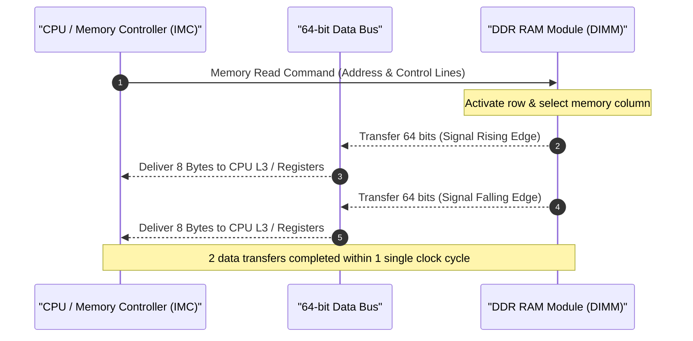
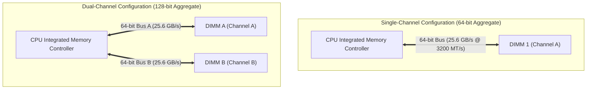

# Memory Bandwidth (RAM Bandwidth) Architecture & Calculation Guide

| Metadata      | Value                      |
| ------------- | -------------------------- |
| Author        | Lyzander Marciano Andrylie |
| Creation Date | Nov 6, 2026                |
| Last Updated  | Nov 8, 2026                |

## References

- [Memory bandwidth - Wikipedia](https://en.wikipedia.org/wiki/Memory_bandwidth): Theoretical calculation, DDR memory evolution, and channel architectures
- [Crucial Memory Speeds and Compatibility](https://www.crucial.com/support/memory-speeds-compatability): DDR4 and DDR5 memory speed baselines, pinouts, and architectural changes
- [JEDEC Memory Standards](https://www.jedec.org/): Specifications for DDR SDRAM signaling, transfer rates, and bus width definitions
- [cuda.md](../gpu/cuda.md): NVIDIA parallel computing architecture, GPU memory hierarchy, and throughput optimization

## Description

Memory bandwidth is the maximum theoretical rate at which data can be transferred (read or written) between system RAM (main memory) and the processor (CPU or integrated GPU) per second, measured in gigabytes per second (GB/s). It defines the upper throughput ceiling of the system memory bus, determining whether processor compute pipelines remain fed or stall waiting for data.

## Concepts

### 1. Fundamentals of Memory Bandwidth: Transfer Rate vs. Clock Frequency

Understanding memory bandwidth requires distinguishing between raw electrical clock frequency (MHz) and effective data transfer rate (MT/s).

- **Data Representation in Bits and Bytes**:
  - All digital transfers occur as binary digits (**bits**).
  - Memory capacity and bandwidth are expressed in **Bytes** (where $1\text{ Byte} = 8\text{ bits}$).
  - A standard desktop/laptop RAM module (DIMM/SO-DIMM) operates with a **64-bit wide data bus**. Every single data transfer moves 64 bits (8 Bytes) of information simultaneously across the bus.
- **SDR vs. DDR (Double Data Rate)**:
  - **SDR SDRAM (Legacy)**: Transferred data only once per clock cycle on the rising edge of the signal. A 100 MHz clock yielded 100 MT/s.
  - **DDR SDRAM (Modern Standard)**: Transfers data **twice per clock cycle**—once on the rising edge and once on the falling edge.
  - An I/O bus clock frequency of 1600 MHz achieves **3200 MT/s** (MegaTransfers per second).
- **MT/s vs. MHz (Industry Mislabeling Gotcha)**:
  - **MT/s (MegaTransfers per second)** measures actual transfer operations performed per second ($1\text{ MT} = 10^6\text{ transfers}$).
  - **MHz (Megahertz)** measures the raw electrical clock oscillations per second.
  - Memory manufacturers and retailers frequently market modules as "DDR4 3200 MHz" or "DDR5 6000 MHz". Technically, their internal clock frequencies are only 1600 MHz and 3000 MHz; the true transfer rate is **3200 MT/s** and **6000 MT/s**.

#### Interaction

---

### 2. Theoretical Bandwidth Formula & JEDEC Designations

Theoretical maximum memory bandwidth represents the peak throughput achievable under ideal, continuous sequential memory streaming conditions without protocol overhead or cache misses.

#### The Standard Formula

$$\text{Bandwidth (GB/s)} = \frac{\text{Transfer Rate (MT/s)} \times \text{Bus Width (bits)} \times \text{Channels}}{8 \text{ bits/byte} \times 1{,}000}$$

For standard PC hardware with a 64-bit memory bus per channel:

$$\text{Bandwidth (GB/s)} = \frac{\text{Transfer Rate (MT/s)} \times 64 \times \text{Channels}}{8{,}000} = \text{Transfer Rate (MT/s)} \times 0.008 \times \text{Channels}$$

#### Worked Example: DDR4-3200 Single-Channel

- **Transfer Rate**: $3{,}200\text{ MT/s} = 3{,}200{,}000{,}000\text{ transfers/sec}$.
- **Bus Width**: $64\text{ bits}$ per transfer.
- **Bits per second**: $3{,}200{,}000{,}000 \times 64 = 204{,}800{,}000{,}000\text{ bits/sec}$.
- **Bytes per second**: $\frac{204{,}800{,}000{,}000}{8} = 25{,}600{,}000{,}000\text{ Bytes/sec} = 25.6\text{ GB/s}$.
- **JEDEC Industry Module Label**: `PC4-25600`. The suffix `25600` directly denotes the theoretical peak throughput of $25{,}600\text{ MB/s}$ ($25.6\text{ GB/s}$).

### 3. Channel Architectures: Multiplying the Data Highway

Memory channels describe the physical, independent communication buses routing between the CPU Integrated Memory Controller (IMC) and physical RAM slots.

- **Single-Channel (64-bit total width)**:
  - A single physical 64-bit link.
  - Any CPU core requesting data from memory shares this single data path.
- **Dual-Channel (128-bit aggregate width)**:
  - Two independent 64-bit memory buses operating simultaneously.
  - Doubles the effective aggregate bandwidth at the exact same memory frequency (e.g., DDR4-3200 jumps from $25.6\text{ GB/s}$ to $51.2\text{ GB/s}$).
  - Requires placing matched RAM sticks into corresponding motherboard channel slots (typically slots `A2` and `B2`).
- **Quad / Octa-Channel (256-bit to 512-bit aggregate width)**:
  - Enterprise server and High-End Desktop (HEDT) platforms (such as AMD Threadripper, EPYC, and Intel Xeon).
  - Scaled to provide hundreds of GB/s to feed 64 to 128+ CPU cores simultaneously.
- **Channel Installation Gotcha**:
  - Installing two RAM modules into adjacent slots of the same channel (e.g., `A1` and `A2`) runs the system in **single-channel mode**, accidentally halving theoretical bandwidth.

#### Channel Topology Comparison

---

### 4. Generational Architecture: DDR4 vs. DDR5

DDR5 replaces the monolithic 64-bit channel with dual independent sub-channels per DIMM to increase memory concurrency and access efficiency.

- **Dual Sub-Channels**: DDR5 splits each DIMM into two independent 32-bit channels (+8-bit ECC), enabling two concurrent memory accesses per stick (four across dual-DIMM).
- **Doubled Burst Length**: DDR5 doubles burst length to BL16 ($16 \times 32\text{ bits} = 64\text{ Bytes}$), maintaining standard 64-byte cache line retrieval over the narrower 32-bit bus.
- **On-DIMM PMIC**: Moves power regulation from the motherboard to the module, dropping base voltage to 1.1V for improved power efficiency and signal integrity.

| Metric                    | DDR4 SDRAM                       | DDR5 SDRAM                            | Architectural Impact                     |
| :------------------------ | :------------------------------- | :------------------------------------ | :--------------------------------------- |
| **Standard Speeds**       | 2133–3600 MT/s                   | 4800–8500+ MT/s                       | Higher raw throughput                    |
| **Bus Topology**          | $1 \times \text{64-bit}$ channel | $2 \times \text{32-bit}$ sub-channels | Concurrent memory operations per stick   |
| **Burst Length**          | BL8 (64 Bytes)                   | BL16 (64 Bytes / sub-channel)         | Preserves 64-byte cache line alignment   |
| **Operating Voltage**     | $1.2\text{ V}$                   | $1.1\text{ V}$                        | Lower power and heat                     |
| **Single-DIMM Bandwidth** | $17.0\text{–}28.8\text{ GB/s}$   | $38.4\text{–}68.0+\text{ GB/s}$       | $\sim 2\times$ base bandwidth per module |
| **Dual-DIMM Bandwidth**   | $34.0\text{–}57.6\text{ GB/s}$   | $76.8\text{–}136.0+\text{ GB/s}$      | Prevents starvation on high-core CPUs    |

#### a. Hardware Transfer Unit: The Cache Line

A **cache line** is the fixed-size, minimum unit of memory (standardized at **64 bytes** on modern x86 and ARM processors) transferred between RAM and the CPU cache hierarchy (L1/L2/L3).

- **Spatial Locality**: The CPU never fetches individual bytes from DRAM. When an instruction requests data, the memory controller fetches the entire aligned 64-byte block, ensuring subsequent sequential accesses (e.g., contiguous arrays or structs) hit L1 cache immediately (~1 ns) rather than waiting on slow RAM (~60–100 ns).
- **Software Engineering Gotchas**:
  - **Random Access / Cache Misses**: Non-sequential memory access patterns pull 64 bytes on every fetch but use only a fraction, wasting bus bandwidth.
  - **False Sharing**: When two threads on separate CPU cores concurrently modify independent variables that happen to reside within the **same 64-byte line**, hardware cache coherency protocols (MESI) constantly invalidate and bounce the line between cores.

#### b. DRAM Access Granularity: Burst Length (BL)

**Burst Length (BL)** is the number of consecutive data transfers (or "beats") that a DRAM chip streams in response to a single read or write command without re-issuing address signals.

- **Why Bursting Matters**: Sending address and control commands across the bus carries latency overhead. To maximize throughput, the memory controller provides a single starting address, and DRAM streams a continuous sequence of data beats over consecutive rising and falling clock edges.
- **Cache Line Synchronization**: Burst length is specifically sized so that **$1\text{ Memory Command} = 1\text{ Full Cache Line (64 Bytes)}$**:
  - **DDR4 (BL8)**: $8\text{ beats} \times 8\text{ Bytes (64-bit bus)} = \mathbf{64\text{ Bytes}}$.
  - **DDR5 (BL16)**: $16\text{ beats} \times 4\text{ Bytes (32-bit sub-channel)} = \mathbf{64\text{ Bytes}}$.
- **Burst Chop (BC)**: An optional mode (e.g., **BC4** in DDR4 or **BC8** in DDR5) that truncates the burst duration in half when a full cache line transfer is not needed, freeing the bus earlier for subsequent commands.

---

### 5. Workload Impact & The "Memory Wall"

The "Memory Wall" occurs when CPU execution units stall in idle cycles (pipeline bubbles) waiting on DRAM cache line fills because compute capability outpaces memory bandwidth.

- **Bandwidth vs. Latency**: Bandwidth is total data throughput (pipe width); latency is time to receive the first byte (transit delay).
- **High Sensitivity (Bandwidth-Bound)**:
  - **Machine Learning & AI**: LLM weight streaming and dense matrix calculations during inference.
  - **Integrated GPUs (APUs)**: Systems without dedicated VRAM (e.g., Apple Silicon, AMD Radeon 780M, Intel Arc) sharing system RAM for framebuffers.
  - **High-Resolution Media**: 4K/8K uncompressed video rendering, timeline scrubbing, and export pipelines.
  - **HPC & 3D Simulations**: Fluid dynamics and physics simulations streaming large grid arrays.
  - **High-FPS Competitive Gaming**: 1080p high-refresh gaming (240Hz+) where CPU-bound 1% low frame times depend on memory throughput.
- **Low Sensitivity (Compute/GPU-Bound)**:
  - **4K AAA Gaming**: Bottlenecked by dedicated GPU compute rather than system RAM.
  - **General Productivity**: Office applications, document editing, and web browsing.
