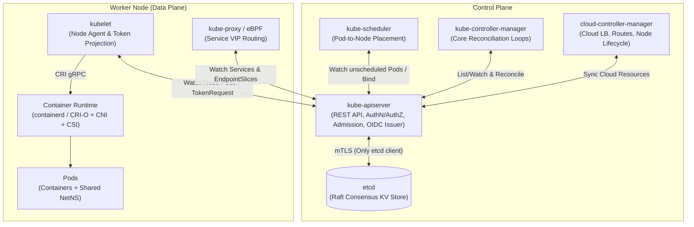
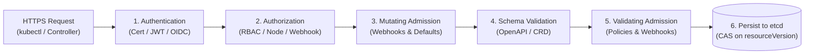
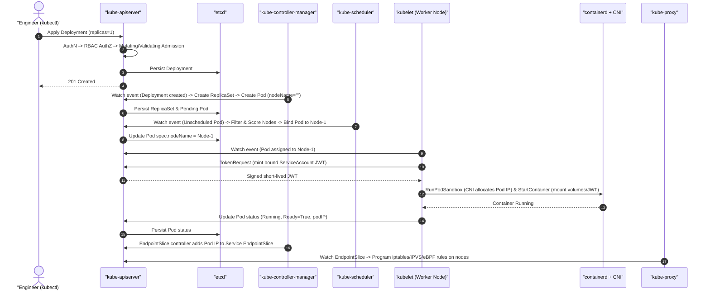

# Kubernetes Architecture: Control Plane, Worker Nodes & Reconciliation Model

| Metadata      | Value                      |
| ------------- | -------------------------- |
| Author        | Lyzander Marciano Andrylie |
| Creation Date | Nov 20, 2026               |
| Last Updated  | Nov 20, 2026               |

## References

- [Kubernetes Official Documentation: Cluster Architecture](https://kubernetes.io/docs/concepts/architecture/): Canonical component topology, control plane, nodes, and communication paths
- [Kubernetes Official Documentation: API Concepts & Admission Control](https://kubernetes.io/docs/reference/access-authn-authz/admission-controllers/): Request lifecycle, optimistic concurrency (`resourceVersion`), and mutating/validating webhooks
- [Kubernetes Official Documentation: ServiceAccount Token Volume Projection](https://kubernetes.io/docs/tasks/configure-pod-container/configure-service-account/#serviceaccount-token-volume-projection): Bound, time-limited, audience-scoped JWT tokens via `TokenRequest` API
- [etcd Documentation: Raft Consensus Architecture](https://etcd.io/docs/latest/learning/design-learner/): Distributed quorum consensus and MVCC key-value persistence backing Kubernetes
- [kubernetes.md](./kubernetes.md): Beginner-friendly introduction to Kubernetes core concepts (Pods, Deployments, Services, Ingress, ConfigMaps, and `kubectl`)
- [workload_identity.md](./workload_identity.md): Bridging Kubernetes ServiceAccount OIDC tokens to AWS STS, Google STS, and Cloud IAM
- [oidc.md](../auth/oidc.md): OpenID Connect discovery (`/.well-known/openid-configuration`) and JWKS served by `kube-apiserver`
- [jwt.md](../auth/jwt.md): Signed JWT structure used by Kubernetes bound ServiceAccount tokens
- [tls.md](../auth/tls.md): mTLS and X.509 PKI securing control-plane-to-node and internal cluster communication

## Description

**Kubernetes (K8s)** is a declarative container orchestration platform that automates scheduling, scaling, networking, and self-healing across a fleet of machines. It solves operational fragility in distributed deployments by continuously reconciling **actual cluster state** (`status`) against user-declared **desired state** (`spec`) through independent, level-triggered control loops.

## Concepts

### 1. Declarative State & Level-Triggered Reconciliation

Kubernetes does not run imperative deployment scripts; every cluster operation mutates a versioned API object stored in `etcd`, and specialized controllers converge reality toward that object.

- **Desired (`spec`) vs Actual (`status`)**: Users write `spec` (e.g., `replicas: 3`); controllers observe running infrastructure and write `status` (e.g., `readyReplicas: 2`), then take corrective action until `status` matches `spec`.
- **Level-Triggered (Not Edge-Triggered)**: Controllers evaluate the **current state of the world** rather than relying solely on individual event notifications. If a controller crashes and restarts, it re-lists state from the API server and self-heals missed events.
- **Hub-and-Spoke Topology**: Every component—control plane daemons, `kubelet`, `kubectl`, and operators—talks **only** to `kube-apiserver`. No component reads or writes `etcd` directly except `kube-apiserver`.
- **List-Watch & Informer Cache**: Instead of polling, controllers issue an initial `LIST` followed by a long-lived HTTP/2 `WATCH` stream keyed by `resourceVersion`, maintaining a local in-memory cache to avoid overloading `kube-apiserver` and `etcd`.

#### Interaction



---

### 2. Control Plane Components

The **Control Plane** makes global scheduling and lifecycle decisions, persists cluster state, and enforces security boundaries. In production, it runs across an odd number of nodes (typically 3 or 5) for high availability.

| Component                  | Statefulness          | Core Responsibility                                                                 | Failure Impact                                                      |
| :------------------------- | :-------------------- | :---------------------------------------------------------------------------------- | :------------------------------------------------------------------ |
| `kube-apiserver`           | Stateless (scale out) | REST front-end, AuthN/AuthZ, Admission, `etcd` gateway, OIDC Discovery/JWKS         | API calls & reconciliation pause; running Pods keep serving traffic |
| `etcd`                     | Stateful (Raft)       | Strongly consistent KV store for all cluster objects, secrets, and `resourceVersion` | Loss of quorum makes cluster read-only / stalls all state mutations |
| `kube-scheduler`           | Stateless (leader)    | Assigns unscheduled Pods (`spec.nodeName == ""`) to suitable nodes                  | New Pods stay `Pending`; existing Pods keep running                 |
| `kube-controller-manager`  | Stateless (leader)    | Runs core loops (Deployment, ReplicaSet, Node, EndpointSlice, ServiceAccount, Job)  | Self-healing, scaling, and endpoint updates stop until recovery     |
| `cloud-controller-manager` | Stateless (leader)    | Bridges K8s to cloud APIs (LoadBalancers, cloud node termination, VPC routes)       | Cloud LB provisioning & terminated-node cleanup stall               |

#### a. `kube-apiserver` Request Pipeline

Every API write traverses a strict sequential pipeline inside `kube-apiserver` before reaching `etcd`:

1. **Authentication (AuthN)**: Identifies the caller via X.509 client certificates, bound ServiceAccount JWTs, external OIDC tokens, or webhook authenticators. Returns `username`, `uid`, and `groups`.
2. **Authorization (AuthZ)**: Evaluates whether the authenticated identity may perform the verb (`get`, `list`, `create`, `patch`, `delete`) on the target resource via **RBAC**, Node Authorizer, or Webhook.
3. **Mutating Admission**: Runs built-in mutators and `MutatingWebhookConfiguration` hooks sequentially (e.g., injecting sidecars, setting default storage classes, injecting `AWS_ROLE_ARN` and projected OIDC token volumes).
4. **Object Schema Validation**: Validates the mutated object against OpenAPI / CRD structural schemas.
5. **Validating Admission**: Runs built-in validators and `ValidatingWebhookConfiguration` / CEL `ValidatingAdmissionPolicy` rules in parallel; any rejection aborts the request without modifying `etcd`.
6. **Persistence (`etcd`)**: Writes the serialized object using optimistic concurrency (`resourceVersion` compare-and-swap) and emits watch events to subscribed controllers.

##### Interaction



#### b. `etcd` & Raft Quorum

- **Quorum Formula**: An `etcd` cluster of $N$ nodes requires $\lfloor N/2 \rfloor + 1$ healthy members to elect a leader and commit writes, tolerating at most $f = \lfloor (N - 1)/2 \rfloor$ failures (3 nodes tolerate 1 failure; 5 nodes tolerate 2; 4 nodes offer no extra fault tolerance over 3 while increasing write latency).
- **MVCC & Compaction**: `etcd` retains historical revisions so `WATCH` streams can resume from a `resourceVersion`. Periodic compaction and defragmentation prevent hitting the default 2 GiB (max 8 GiB) database quota.
- **Secret Encryption at Rest**: By default, `Secret` objects are stored Base64-encoded (not encrypted) in `etcd`; production clusters enable `EncryptionConfiguration` with KMS v2 envelope encryption.

#### c. `kube-scheduler` Placement Pipeline

When a Pod has no `spec.nodeName`, `kube-scheduler` runs a two-stage plugin framework:

- **Filtering (Predicates)**: Eliminates infeasible nodes (insufficient CPU/memory `requests`, unmatched `nodeSelector` or `nodeAffinity`, untolerated `taints`, unavailable `hostPort`, incompatible volume topology).
- **Scoring (Priorities)**: Ranks remaining feasible nodes (resource balance, `podAntiAffinity`, `topologySpreadConstraints`, container image locality).
- **Binding**: Writes a `Binding` subresource to `kube-apiserver` setting `spec.nodeName`; `kube-scheduler` never contacts nodes directly.

---

### 3. Worker Node (Data Plane) Components

**Worker Nodes** run containerized application workloads and expose three standardized plugin interfaces: **CRI** (Container Runtime), **CNI** (Networking), and **CSI** (Storage).

- **`kubelet`**:
  - Runs directly on the host OS (typically managed by `systemd`), not as a Kubernetes Pod.
  - Watches `kube-apiserver` for Pods assigned to its node, translates each `PodSpec` into CRI calls to create sandboxes and containers, mounts CSI/ConfigMap/Secret/Projected volumes, and reports `Node` and `Pod` status heartbeats.
  - Executes **startup**, **liveness** (restarts unhealthy containers), and **readiness** (controls whether the Pod IP is added to `EndpointSlice` traffic rotation) probes.
  - Requests and automatically rotates **projected ServiceAccount JWT tokens** via `kube-apiserver`'s `TokenRequest` API.
- **Container Runtime (`containerd` / `CRI-O`) & Linux Primitives**:
  - Pulls OCI images and invokes a low-level OCI runtime (`runc` or `crun`) to launch isolated Linux processes.
  - **Linux Namespaces** provide isolation: all containers in a Pod share the **Network (`net`)** and **IPC (`ipc`)** namespaces created by a lightweight `pause` (sandbox) container—so they share one IP and talk over `localhost`—while keeping separate **Mount (`mnt`)**, **UTS**, and (by default) **PID** namespaces.
  - **cgroups v2** enforce CPU shares/quotas (`requests`/`limits`), memory limits (triggering the kernel OOM killer if exceeded), and PID caps.
- **`kube-proxy` (or eBPF Dataplane)**:
  - Watches `Service` and `EndpointSlice` objects and programs local packet forwarding rules so traffic sent to a virtual `ClusterIP` or `NodePort` is load-balanced across ready backend Pod IPs.
  - Modes: `iptables` (legacy, $O(n)$ rule traversal), `IPVS` ($O(1)$ hash tables), `nftables` (modern Linux successor to iptables), or **eBPF** (e.g., Cilium replacing `kube-proxy` with socket-level load balancing).

---

### 4. Core Workload, Networking & Storage Primitives

Kubernetes builds resilient applications by layering decoupled objects rather than coupling compute, networking, and storage to a single server.

| Primitive            | Abstraction Role                                                                    | Key Behavior / Gotcha                                                             |
| :------------------- | :---------------------------------------------------------------------------------- | :-------------------------------------------------------------------------------- |
| **Pod**              | Atomic scheduling unit (1+ co-located containers sharing IP, port space, volumes)   | Ephemeral; replaced rather than repaired in place (`Pod IP` changes on recreate)  |
| **Deployment**       | Manages `ReplicaSet`s for stateless apps with declarative rolling updates/rollbacks | Sets `maxSurge` / `maxUnavailable`; never manages persistent per-Pod identity     |
| **StatefulSet**      | Manages stateful workloads requiring stable DNS (`pod-0`, `pod-1`) & PVC bindings   | Ordered creation/termination; deleting a `StatefulSet` does not auto-delete PVCs  |
| **DaemonSet**        | Ensures one Pod copy runs on every matching node (log collectors, CNI, node agents) | Bypasses normal spreading; honors node `taints`/`tolerations`                     |
| **Service**          | Stable virtual IP (`ClusterIP`, `NodePort`, `LoadBalancer`) + CoreDNS A/SRV record  | Routes via label selectors to `EndpointSlice`s; `ClusterIP` is non-pingable (VIP) |
| **NetworkPolicy**    | L3/L4 firewall rules selecting Pods by labels/namespaces/CIDRs                      | No-op unless the cluster CNI enforces it (e.g., Calico, Cilium); default allow    |

- **Kubernetes Flat Network Model**: Every Pod receives a unique cluster-routable IP, and Pods on any node can reach Pods on any other node without NAT. The CNI plugin implements this via overlay encapsulation (VXLAN/Geneve), BGP routing, or native cloud VPC IPs (e.g., AWS VPC CNI, GKE VPC-native alias IPs).
- **Cluster DNS (`CoreDNS`)**: Resolves `<service>.<namespace>.svc.cluster.local` to the Service's `ClusterIP` (or directly to Pod IPs for Headless Services with `clusterIP: None`).

---

### 5. In-Cluster Identity, RBAC & Projected ServiceAccount Tokens

Kubernetes separates **human identities** from **workload identities** and governs in-cluster API access with strictly additive RBAC.

- **Human Users vs `ServiceAccount`s**:
  - Kubernetes has no `User` API object; humans authenticate externally (X.509 certs, OIDC IdP, cloud IAM authenticators like `aws-iam-authenticator` or `gke-gcloud-auth-plugin`).
  - Workloads use namespaced `ServiceAccount` objects whose authenticated username is `system:serviceaccount:<namespace>:<sa-name>` and group membership includes `system:serviceaccounts:<namespace>`.
- **RBAC (Strictly Additive — No Explicit Deny)**:
  - `Role` (namespace-scoped) and `ClusterRole` (cluster-scoped) define allow rules over `(apiGroups, resources, resourceNames, verbs)`.
  - `RoleBinding` and `ClusterRoleBinding` bind a role to subjects (`User`, `Group`, `ServiceAccount`).
  - If no rule matches, access is denied by default.
- **Bound Projected ServiceAccount Tokens (`TokenRequest` API)**:
  - Modern Kubernetes (1.22+) replaces legacy non-expiring Secret tokens with **short-lived, audience-scoped, Pod-bound JWTs** requested by `kubelet` from `kube-apiserver` and mounted into a `tmpfs` projected volume.
  - Tokens are bound to the Pod's UID (invalidated immediately if the Pod is deleted), expire automatically (default 1 hour, configurable), and are transparently rotated by `kubelet` at ~80% of TTL (or 24 hours max).
  - Because `kube-apiserver` signs these JWTs with its asymmetric private key and publishes its OIDC Discovery + JWKS documents, **these exact projected tokens also power passwordless AWS STS and Google STS authentication** (see [workload_identity.md](./workload_identity.md)).

```yaml
apiVersion: v1
kind: ServiceAccount
metadata:
  name: order-worker
  namespace: payments
automountServiceAccountToken: false # Opt-in per Pod for least privilege
---
apiVersion: rbac.authorization.k8s.io/v1
kind: Role
metadata:
  name: config-reader
  namespace: payments
rules:
  - apiGroups: [""]
    resources: ["configmaps"]
    verbs: ["get", "list", "watch"]
---
apiVersion: rbac.authorization.k8s.io/v1
kind: RoleBinding
metadata:
  name: order-worker-config-reader
  namespace: payments
subjects:
  - kind: ServiceAccount
    name: order-worker
    namespace: payments
roleRef:
  apiGroup: rbac.authorization.k8s.io
  kind: Role
  name: config-reader
```

```yaml
# Mounting a short-lived, audience-scoped ServiceAccount JWT into a Pod
apiVersion: v1
kind: Pod
metadata:
  name: order-worker-0
  namespace: payments
spec:
  serviceAccountName: order-worker
  containers:
    - name: worker
      image: ghcr.io/example/order-worker:1.4.2
      volumeMounts:
        - name: cloud-oidc-token
          mountPath: /var/run/secrets/tokens
          readOnly: true
  volumes:
    - name: cloud-oidc-token
      projected:
        sources:
          - serviceAccountToken:
              path: oidc-token
              audience: sts.amazonaws.com
              expirationSeconds: 3600
```

> [!TIP]
> Set `automountServiceAccountToken: false` on the `default` ServiceAccount (or on Pods that never call `kube-apiserver`). This prevents a compromised container from automatically receiving a cluster API credential at `/var/run/secrets/kubernetes.io/serviceaccount/token`.

---

### 6. End-to-End Lifecycle: `kubectl apply` to Running Pod

Tracing a `Deployment` creation shows how every control-plane and worker-node component collaborates asynchronously through `kube-apiserver` without direct peer-to-peer coupling.

#### Interaction



```shell
# Inspect cluster control plane health, node readiness, and OIDC discovery endpoint
kubectl get --raw='/readyz?verbose'
kubectl get nodes -o wide
kubectl get --raw='/.well-known/openid-configuration' | jq '{issuer, jwks_uri}'
```
