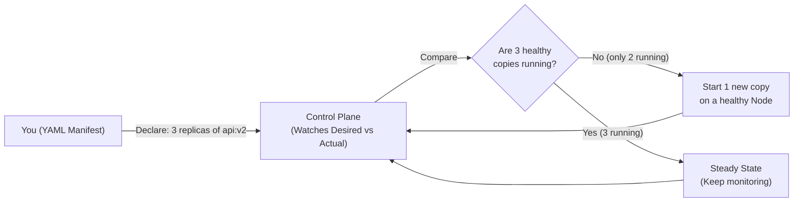
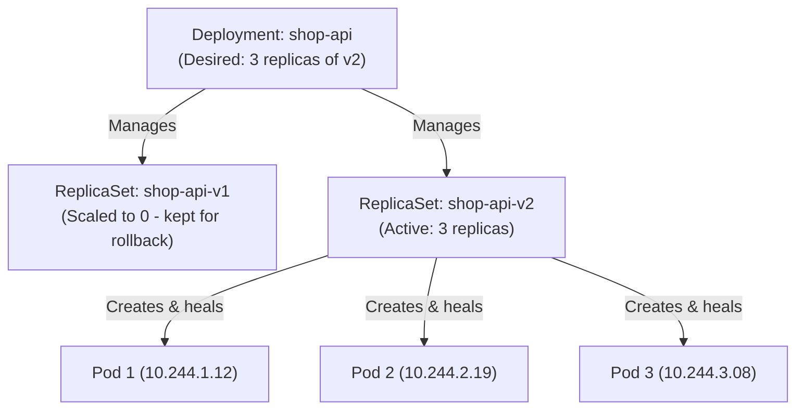
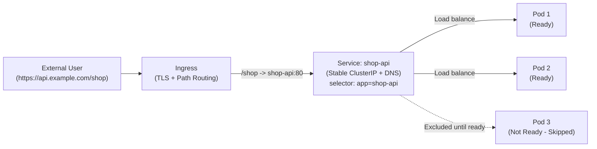

# Kubernetes: Core Concepts & Mental Model

| Metadata      | Value                      |
| ------------- | -------------------------- |
| Author        | Lyzander Marciano Andrylie |
| Creation Date | Nov 22, 2026               |
| Last Updated  | Nov 22, 2026               |

## References

- [Kubernetes Official Documentation: Overview](https://kubernetes.io/docs/concepts/overview/): High-level introduction to what Kubernetes is and why container orchestration exists
- [Kubernetes Official Documentation: Workloads & Pods](https://kubernetes.io/docs/concepts/workloads/): Pods, Deployments, ReplicaSets, StatefulSets, DaemonSets, and Jobs
- [Kubernetes Official Documentation: Services, Load Balancing & Networking](https://kubernetes.io/docs/concepts/services-networking/): Services (`ClusterIP`, `NodePort`, `LoadBalancer`), DNS, and Ingress routing
- [Kubernetes Official Documentation: Configuration & Storage](https://kubernetes.io/docs/concepts/configuration/): ConfigMaps, Secrets, resource requests/limits, and PersistentVolumeClaims
- [Kubernetes Official Documentation: kubectl Quick Reference](https://kubernetes.io/docs/reference/kubectl/quick-reference/): Everyday CLI commands for deploying and debugging workloads
- [architecture.md](./architecture.md): Deeper dive into Control Plane internals (`kube-apiserver`, `etcd`, scheduler, controllers) and worker node daemons
- [workload_identity.md](./workload_identity.md): Granting Pods passwordless access to AWS and Google Cloud APIs via STS and IAM

## Description

**Kubernetes (K8s)** is a container orchestration platform that automatically deploys, scales, networks, and heals containerized applications across a group of servers. Instead of manually SSHing into servers to restart crashed containers or update app versions, you describe the **desired state** of your system in YAML and Kubernetes continuously works to keep reality matching that state.

## Concepts

### 1. Why Kubernetes Exists: From Containers to Desired State

A **container** (such as Docker) packages your application and its dependencies into one portable unit, but running containers in production raises operational problems that a single container runtime does not solve.

- **The Production Problem**:
  - What happens if a container crashes at 3 AM or its host machine loses power?
  - How do you run 5 copies of an API across different servers and split traffic evenly among them?
  - How do you deploy `v2` without dropping live user requests—and instantly roll back if `v2` has a bug?
- **The Thermostat Mental Model (Desired vs Actual State)**:
  - You do **not** run imperative commands like *"start container #3 on server B."*
  - Instead, you declare a **desired state** (e.g., *"keep 3 healthy copies of `shop-api:v2` running"*). Like a thermostat holding a room at 22 °C, Kubernetes continuously compares **actual state** against **desired state** and automatically fixes any drift.
- **Cluster, Control Plane & Nodes in Plain English**:
  - **Cluster**: Your entire pool of machines managed as one unified system.
  - **Worker Nodes**: The physical or virtual servers that actually run your application containers.
  - **Control Plane**: The "brain" that accepts your YAML files, picks which Worker Node runs each app, and replaces anything that crashes (see [architecture.md](./architecture.md) once you want the component-level internals).

#### Interaction



---

### 2. Pods: The Smallest Deployable Unit

Kubernetes never schedules a bare container directly—it always wraps one or more containers inside a **Pod**.

- **Why a Wrapper Around Containers?**: Think of a Pod as a tiny shared virtual host (or apartment) for containers that must live together:
  - Every Pod gets **one unique IP address** inside the cluster.
  - Containers inside the same Pod share that network stack (they talk to each other over `localhost`) and can share mounted folders.
- **Common Pod Patterns**:
  - **Single-Container Pod (90%+ of workloads)**: One Pod runs one application container (e.g., your Go/Python/Node API).
  - **Sidecar Container**: A helper container running alongside the main app in the same Pod (e.g., a log forwarder or TLS proxy).
  - **Init Container**: A setup container that runs to completion *before* the main app starts (e.g., waiting for a database or fetching initial config).
- **Pods Are Ephemeral ("Cattle, Not Pets")**:
  - Kubernetes never repairs a dead Pod in place. If a Node dies or a Pod is evicted, Kubernetes creates a **brand-new Pod with a brand-new IP address**.
  - Because Pod IPs change constantly, you never hardcode a Pod IP—and you rarely create standalone `Pod` objects directly in production.

```yaml
apiVersion: v1
kind: Pod
metadata:
  name: hello-web
  labels:
    app: hello-web
spec:
  containers:
    - name: nginx
      image: nginx:1.27
      ports:
        - containerPort: 80
```

> [!NOTE]
> If you delete a standalone `Pod`, it stays deleted forever. To get automatic self-healing and scaling, wrap your Pod template inside a **Deployment** (next section).

---

### 3. Deployments & Workloads: Self-Healing, Scaling & Rollouts

A **Deployment** is the object you actually write for stateless web apps, APIs, and background workers—it manages Pod lifecycles, replica counts, and zero-downtime upgrades for you.

- **The 3-Layer Chain (`Deployment → ReplicaSet → Pod`)**:
  1. **Deployment**: Describes your desired version (`image`), replica count (`replicas`), and update strategy.
  2. **ReplicaSet** (managed automatically—don't edit directly): Ensures the exact number of matching Pods stay alive at all times. If a Pod crashes or its Node dies, the ReplicaSet immediately spawns a replacement.
  3. **Pods**: Run your actual containers.
- **Zero-Downtime Rolling Updates & Rollbacks**:
  - Changing `image: shop-api:1.0` to `shop-api:2.0` tells the Deployment to create a new `ReplicaSet` for `2.0`, gradually start new Pods and verify they are healthy before terminating old `1.0` Pods.
  - Because the old `ReplicaSet` is retained (scaled to `0`), `kubectl rollout undo` reverts to `1.0` in seconds.
- **Other Workload Controllers**: Choose the controller that fits your app's lifecycle:

| Workload Type   | Best For                                                           | Plain-English Behavior                                              |
| :-------------- | :----------------------------------------------------------------- | :------------------------------------------------------------------ |
| **Deployment**  | Stateless web apps, REST/gRPC APIs, queue workers                  | Keeps $N$ interchangeable Pods running; supports rolling updates    |
| **StatefulSet** | Databases, Kafka, Redis clusters needing stable identity & storage | Gives Pods fixed names (`db-0`, `db-1`) and dedicated durable disks |
| **DaemonSet**   | Node-level agents (log collectors, monitoring, security agents)    | Runs exactly one Pod on every Worker Node automatically             |
| **Job**         | One-off batch tasks (DB migrations, report generation)             | Runs Pod(s) until they exit with code `0`, then stops               |
| **CronJob**     | Scheduled recurring tasks (nightly backups, cleanup scripts)       | Creates a `Job` on a cron schedule (`0 2 * * *`)                    |

#### Interaction



```yaml
apiVersion: apps/v1
kind: Deployment
metadata:
  name: shop-api
spec:
  replicas: 3
  selector:
    matchLabels:
      app: shop-api # Links Deployment to Pods carrying this label
  template:
    metadata:
      labels:
        app: shop-api
    spec:
      containers:
        - name: api
          image: ghcr.io/example/shop-api:2.0.0
          ports:
            - containerPort: 8080
```

---

### 4. Labels, Services & Ingress: How Traffic Reaches Your Pods

Because Pods come and go with changing IP addresses, Kubernetes decouples **where traffic is sent** from **which Pods exist right now** using **Labels**, **Services**, and **Ingress**.

- **Labels & Selectors (The Glue of Kubernetes)**:
  - **Labels** are simple key-value tags attached to objects (e.g., `app: shop-api`, `tier: backend`).
  - **Selectors** are queries (`app=shop-api`). Deployments, Services, and Policies all use selectors instead of hardcoded Pod names or IPs.
- **Service (Stable Virtual IP + Internal DNS + Load Balancer)**:
  - Gives a group of Pods one **permanent IP address** and an **automatic DNS name** (`<service-name>.<namespace>.svc.cluster.local`, or simply `<service-name>` inside the same namespace).
  - Continuously watches matching Pods and routes traffic **only to Pods passing their readiness check**.
- **Ingress (HTTP/HTTPS Front Door)**:
  - Acts as a smart Layer-7 reverse proxy (backed by an Ingress Controller like NGINX, Envoy, or a cloud ALB) that routes external domain names and URL paths to internal Services and terminates HTTPS/TLS certificates.
  - Saves cost and complexity: one external LoadBalancer + Ingress can route dozens of services (`api.example.com/orders` → `orders-svc`, `api.example.com/users` → `users-svc`).

| Networking Object | Exposure Scope            | When to Use                                                                 |
| :---------------- | :------------------------ | :-------------------------------------------------------------------------- |
| **ClusterIP**     | Internal to cluster only  | Default; microservice-to-microservice calls (`http://shop-api:80`)          |
| **NodePort**      | Every Node IP (`30000+`)  | Quick local testing (Minikube/Kind) or bare-metal without a cloud LB        |
| **LoadBalancer**  | Public / VPC external IP  | Cloud environments needing direct TCP/UDP external access or an Ingress IP  |
| **Ingress**       | HTTP/HTTPS host/path URLs | Exposing multiple web apps/APIs behind one domain, TLS cert, and path rules |

#### Interaction



```yaml
apiVersion: v1
kind: Service
metadata:
  name: shop-api
spec:
  type: ClusterIP
  selector:
    app: shop-api # Routes to all healthy Pods with label app: shop-api
  ports:
    - port: 80 # Port callers connect to (http://shop-api:80)
      targetPort: 8080 # Port the container listens on
---
apiVersion: networking.k8s.io/v1
kind: Ingress
metadata:
  name: shop-ingress
spec:
  rules:
    - host: api.example.com
      http:
        paths:
          - path: /shop
            pathType: Prefix
            backend:
              service:
                name: shop-api
                port:
                  number: 80
```

---

### 5. Namespaces, ConfigMaps, Secrets & Storage

Production apps need isolation between teams/environments, configuration kept separate from container images, and durable disks when data must outlive a Pod.

- **Namespaces (Virtual Folders Inside a Cluster)**:
  - Partition one physical cluster into logical workspaces (e.g., `dev`, `staging`, `payments`, `kube-system`).
  - Resource names only need to be unique *within* a Namespace; you can also attach per-Namespace resource quotas and access rules.
- **ConfigMaps vs Secrets (Decoupling Config from Images)**:
  - Build your container image **once**, then inject environment-specific settings at runtime as environment variables or mounted files.
  - **ConfigMap**: Plain-text, non-sensitive configuration (`LOG_LEVEL=info`, `nginx.conf`).
  - **Secret**: Sensitive values (database passwords, TLS private keys, API tokens).
- **Volumes & PersistentVolumeClaims (Surviving Restarts)**:
  - Files written to a container's default filesystem disappear permanently when the container restarts.
  - **`emptyDir`**: Temporary folder created with the Pod; useful for scratch caches or sharing files between containers in one Pod, deleted when the Pod is removed.
  - **`PersistentVolumeClaim (PVC)`**: A Pod's request for durable storage (e.g., *"give me 20 GiB of SSD"*). Kubernetes dynamically provisions a cloud disk (AWS EBS / GCP Persistent Disk) that stays intact even if the Pod crashes and moves to another Node.

| Object          | Purpose                                | Lifespan / Scope                           | Key Gotcha                                                           |
| :-------------- | :------------------------------------- | :----------------------------------------- | :------------------------------------------------------------------- |
| **Namespace**   | Isolate apps, quotas, and permissions  | Cluster-level grouping                     | Does **not** block network traffic by itself (needs `NetworkPolicy`) |
| **ConfigMap**   | Non-sensitive env vars or config files | Independent of Pods                        | Max size 1 MiB; env vars do not auto-reload when ConfigMap changes   |
| **Secret**      | Passwords, tokens, TLS certs           | Independent of Pods                        | Base64-encoded in YAML (not encrypted); never commit raw Secrets     |
| **PVC (Volume)**| Durable disk storage for stateful data | Outlives Pods until PVC is deleted         | Cloud block disks (`ReadWriteOnce`) attach to only one Node at a time|

```yaml
apiVersion: v1
kind: ConfigMap
metadata:
  name: shop-config
data:
  LOG_LEVEL: "info"
  CURRENCY: "USD"
---
apiVersion: apps/v1
kind: Deployment
metadata:
  name: shop-api
spec:
  replicas: 2
  selector:
    matchLabels:
      app: shop-api
  template:
    metadata:
      labels:
        app: shop-api
    spec:
      containers:
        - name: api
          image: ghcr.io/example/shop-api:2.0.0
          envFrom:
            - configMapRef:
                name: shop-config # Injects LOG_LEVEL and CURRENCY as env vars
          env:
            - name: DB_PASSWORD
              valueFrom:
                secretKeyRef:
                  name: shop-db-secret
                  key: password
```

> [!TIP]
> Avoid storing static AWS or GCP API keys inside Kubernetes `Secret`s. Use workload identity federation so Pods receive short-lived, auto-rotated cloud credentials instead (see [workload_identity.md](./workload_identity.md)).

---

### 6. Health Checks, Resource Limits & Essential `kubectl` Workflow

Two container settings prevent most beginner production outages—**Probes** and **Resource Requests/Limits**—and a handful of `kubectl` commands handle 90% of daily work.

#### a. Probes (How Kubernetes Knows If Your App Is Healthy)

Kubernetes only knows whether your process exited; **probes** let it check whether your app is actually working.

| Probe              | Question It Answers                           | What Happens When It Fails                                             |
| :----------------- | :-------------------------------------------- | :--------------------------------------------------------------------- |
| **startupProbe**   | *"Has the app finished booting?"*             | Delays `liveness`/`readiness` checks; restarts container after timeout |
| **readinessProbe** | *"Is this Pod ready to serve live traffic?"*  | Removes Pod IP from `Service` load balancing (does **not** restart it) |
| **livenessProbe**  | *"Is the app still alive or deadlocked?"*     | Kills and restarts the container automatically                         |

#### b. Resource Requests vs Limits (Preventing Noisy Neighbors)

- **`requests` (Guaranteed Floor)**: Tells Kubernetes how much CPU and memory the Pod needs to be placed on a Node. If no Node has enough free capacity, the Pod stays `Pending`.
- **`limits` (Hard Ceiling)**: Caps maximum usage so one buggy container cannot starve other apps on the same Node:
  - Exceeding **CPU limit**: Container is **throttled** (slowed down, stays alive).
  - Exceeding **Memory limit**: Kernel kills the container immediately with **`OOMKilled` (exit code 137)**.
- **Units Cheat Sheet**: `1000m` (millicores) = `1` vCPU (`250m` = 0.25 CPU); `Mi` = mebibytes (`256Mi` ≈ 268 MB), `Gi` = gibibytes.

```yaml
containers:
  - name: api
    image: ghcr.io/example/shop-api:2.0.0
    resources:
      requests:
        cpu: "250m"
        memory: "256Mi"
      limits:
        cpu: "500m"
        memory: "512Mi"
    readinessProbe:
      httpGet:
        path: /healthz/ready
        port: 8080
      initialDelaySeconds: 5
      periodSeconds: 10
    livenessProbe:
      httpGet:
        path: /healthz/live
        port: 8080
      initialDelaySeconds: 15
      periodSeconds: 20
```

#### c. Essential `kubectl` Commands & Debugging Loop

When something goes wrong (`Pending`, `ImagePullBackOff`, `CrashLoopBackOff`), follow the three-step triage loop: **list → describe → logs**.

```shell
# 1. Deploy or update resources from a YAML file (idempotent)
kubectl apply -f deployment.yaml

# 2. Check overall status of Deployments, Pods, and Services
kubectl get deployments,pods,svc

# 3. Inspect events and failure reasons (scheduling errors, bad image names, OOMKilled)
kubectl describe pod <pod-name>

# 4. Read application stdout/stderr logs (--previous shows logs from a crashed container)
kubectl logs <pod-name>
kubectl logs <pod-name> --previous

# 5. Open a shell inside a running container or tunnel a Service to your local machine
kubectl exec -it <pod-name> -- /bin/sh
kubectl port-forward svc/shop-api 8080:80

# 6. Watch a rollout and undo it if the new version breaks
kubectl rollout status deployment/shop-api
kubectl rollout undo deployment/shop-api
```
