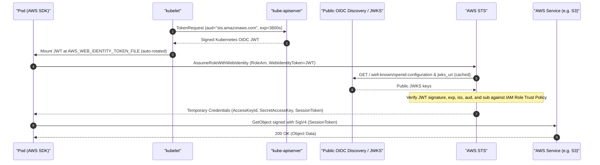
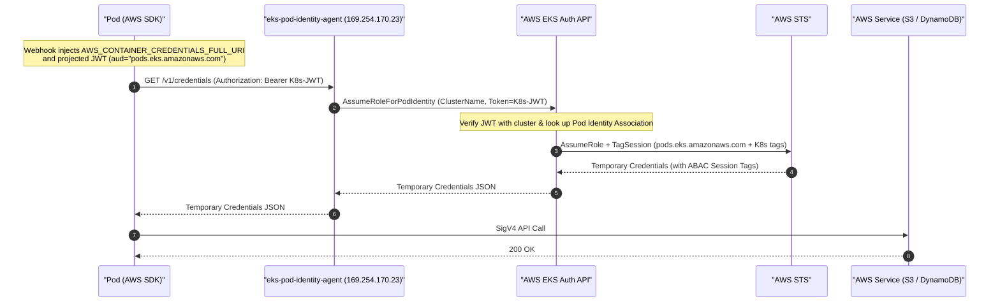
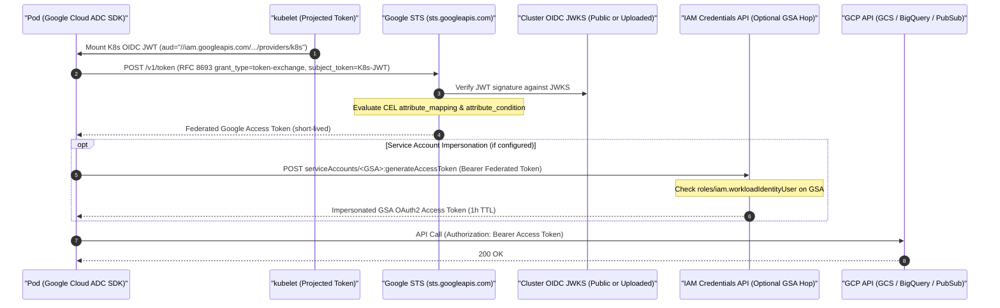
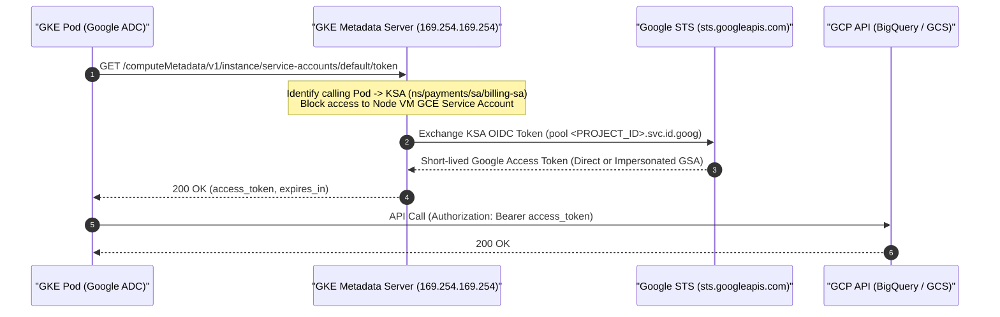

# Kubernetes Workload Identity: AWS STS, Google STS & Cloud IAM Integration

| Metadata      | Value                      |
| ------------- | -------------------------- |
| Author        | Lyzander Marciano Andrylie |
| Creation Date | Nov 20, 2026               |
| Last Updated  | Nov 20, 2026               |

## References

- [AWS EKS Documentation: IAM Roles for Service Accounts (IRSA)](https://docs.aws.amazon.com/eks/latest/userguide/iam-roles-for-service-accounts.html): OIDC identity provider setup, IAM trust policies, and `sts:AssumeRoleWithWebIdentity`
- [AWS EKS Documentation: EKS Pod Identity](https://docs.aws.amazon.com/eks/latest/userguide/pod-identities.html): EKS-native pod identity agent, `pods.eks.amazonaws.com` trust policies, and automatic ABAC session tags
- [AWS STS API Reference: AssumeRoleWithWebIdentity](https://docs.aws.amazon.com/STS/latest/APIReference/API_AssumeRoleWithWebIdentity.html): Exchanging an OIDC JWT for temporary AWS credentials (`AccessKeyId`, `SecretAccessKey`, `SessionToken`)
- [Google Cloud Documentation: Workload Identity Federation](https://cloud.google.com/iam/docs/workload-identity-federation): External OIDC Workload Identity Pools, CEL attribute mapping, RFC 8693 STS token exchange, and direct resource access
- [Google Cloud Documentation: Workload Identity Federation for GKE](https://cloud.google.com/kubernetes-engine/docs/how-to/workload-identity): Native `<PROJECT_ID>.svc.id.goog` pool, GKE Metadata Server, and KSA-to-IAM bindings
- [RFC 8693: OAuth 2.0 Token Exchange](https://datatracker.ietf.org/doc/html/rfc8693): Standard STS token exchange grant (`urn:ietf:params:oauth:grant-type:token-exchange`) used by Google STS
- [architecture.md](./architecture.md): Kubernetes Control Plane, `kubelet` projected ServiceAccount tokens, and in-cluster RBAC
- [oidc.md](../auth/oidc.md): OpenID Connect discovery (`/.well-known/openid-configuration`), JWKS verification, and workload OIDC federation
- [jwt.md](../auth/jwt.md): Signed JWT claims (`iss`, `sub`, `aud`, `exp`) and cryptographic validation
- [oauth.md](../auth/oauth.md): OAuth 2.0 bearer access tokens issued by Google STS / IAM Credentials API

## Description

**Kubernetes Workload Identity Federation** bridges a Pod's short-lived Kubernetes **ServiceAccount JWT** to short-lived cloud **IAM** credentials through **AWS Security Token Service (STS)** or **Google Security Token Service (STS)**. It eliminates static long-lived cloud access keys and overly broad node-level IAM roles by binding least-privilege cloud permissions directly to individual Kubernetes `ServiceAccount` identities.

## Concepts

### 1. Cloud IAM Foundations & Why Static Credentials Fail

Every cloud API call is evaluated by **Identity and Access Management (IAM)** along four axes: **Principal** (who is calling), **Action** (what operation), **Resource** (which target), and **Condition** (context such as IP, tag, or OIDC claim).

- **AWS IAM Model**:
  - **Principals**: IAM Users (static, discouraged for workloads), **IAM Roles** (assumed temporarily via STS), and Federated Principals.
  - **Policies**: JSON documents specifying `Effect` (`Allow` / `Deny`), `Action`, `Resource`, and `Condition`. An **IAM Role** has two distinct policies:
    1. **Trust Policy (Resource-Based)**: Defines *who* is allowed to call `sts:AssumeRole*` on this role (e.g., a specific Kubernetes OIDC `sub`).
    2. **Permissions Policy (Identity-Based)**: Defines *what* AWS APIs the caller can invoke once assumed (e.g., `s3:GetObject`).
  - **Evaluation Rule**: **Default Deny → Explicit Allow → Explicit Deny always overrides Allow** (also bounded by Permission Boundaries, Session Policies, and Organizations SCPs).
- **Google Cloud IAM Model**:
  - **Principals**: Google Accounts, **Google Service Accounts (GSAs)**, and Federated Workload Identity principals (`principal://iam.googleapis.com/...` or `principalSet://...`).
  - **Roles & Allow Policies**: A **Role** is a named bundle of permissions (e.g., `roles/storage.objectViewer`). An **Allow Policy** binds `(Principal, Role, optional CEL Condition)` to a node in the **Resource Hierarchy** (`Organization → Folder → Project → Resource`), with permissions inherited downward.
  - **Evaluation Rule**: **Default Deny → Inherited/Direct Allow → IAM Deny Policy always overrides Allow**.
- **Why Naive Kubernetes Credential Patterns Fail**:
  - **Static Keys in `Secret`s** (`AWS_ACCESS_KEY_ID` / GCP JSON key): No automatic rotation, easily leaked in Git/logs/`etcd` backups, and unlimited blast radius until manually revoked.
  - **Node-Level IAM (EC2 Instance Profile / GCE VM Service Account)**: Every Pod on a shared worker node can query the Instance Metadata Service (`169.254.169.254`), forcing the node role to hold the union of permissions for all workloads scheduled on it.

| Dimension                   | AWS IAM                                                      | Google Cloud IAM                                                |
| :-------------------------- | :----------------------------------------------------------- | :-------------------------------------------------------------- |
| **Workload Identity Unit**  | IAM Role (assumed via STS)                                   | Direct Federated Principal (`principal://...`) or GSA           |
| **Policy Attachment**       | Identity-based (on Role) + Resource-based (Trust/Bucket)     | Resource-hierarchy Allow/Deny Policies (Org → Project → Bucket) |
| **STS Exchange Protocol**   | `sts:AssumeRoleWithWebIdentity` / `AssumeRoleForPodIdentity` | RFC 8693 OAuth 2.0 Token Exchange (`sts.googleapis.com`)        |
| **Returned Credential**     | Temporary SigV4 tuple (`AccessKeyId`, `SecretKey`, `Token`)  | Short-lived OAuth 2.0 Bearer Access Token (`ya29....`)          |
| **Default / Max Token TTL** | Default 1h (configurable 15m–12h via role `MaxSessionDuration`) | Default 1h (configurable up to 12h via org policy for GSA)   |

---

### 2. Kubernetes as an OIDC Provider (The Cryptographic Trust Bridge)

Kubernetes eliminates pre-shared secrets with cloud providers by acting as an **OpenID Connect (OIDC) Provider** that signs short-lived JWTs for Pods and publishes its public verification keys.

- **API Server Configuration**: `kube-apiserver` is configured with `--service-account-issuer=<HTTPS_ISSUER_URL>`, `--service-account-signing-key-file` (private key), and `--api-audiences`.
- **Public Discovery & JWKS**: External cloud STS services must be able to fetch `<issuer>/.well-known/openid-configuration` and `jwks_uri` over HTTPS:
  - **Managed Clusters (EKS / GKE)**: The cloud provider hosts a publicly accessible OIDC issuer URL and JWKS automatically.
  - **Self-Managed / Private Clusters**: Operators publish the static discovery JSON and JWKS JSON to a public HTTPS host (e.g., S3 + CloudFront or GCS bucket) while keeping `kube-apiserver` private.
- **Projected ServiceAccount Token (`TokenRequest` API)**: `kubelet` requests a Pod-bound, audience-scoped JWT from `kube-apiserver`, mounts it on disk (via a `projected` volume), and rotates it automatically at ~80% of its `expirationSeconds` TTL.
- **Standard Claims Used by Cloud STS**:
  - `iss`: Identifies the specific Kubernetes cluster.
  - `sub`: Identifies the exact workload as `system:serviceaccount:<namespace>:<serviceaccount-name>`.
  - `aud`: Scopes the token exclusively to the target STS (e.g., `sts.amazonaws.com` or GCP WIF provider URI).
  - `kubernetes.io`: Structured claims (`namespace`, `pod.name`, `pod.uid`, `serviceaccount.name`) usable in GCP CEL attribute mappings.

```json
{
  "aud": ["sts.amazonaws.com"],
  "exp": 1795174800,
  "iat": 1795171200,
  "iss": "https://oidc.eks.us-east-1.amazonaws.com/id/EXAMPLED539D4633E53DE1B716D3041E",
  "kubernetes.io": {
    "namespace": "payments",
    "pod": {
      "name": "billing-api-6d8f9b7c4-xk2pq",
      "uid": "a1b2c3d4-5678-90ab-cdef-1234567890ab"
    },
    "serviceaccount": {
      "name": "billing-sa",
      "uid": "f9e8d7c6-5432-10fe-dcba-0987654321fe"
    }
  },
  "nbf": 1795171200,
  "sub": "system:serviceaccount:payments:billing-sa"
}
```

---

### 3. AWS Integration: AWS STS, IRSA & EKS Pod Identity

AWS supports two workload identity mechanisms for Kubernetes: **IRSA** (standards-based OIDC federation working on EKS and any external Kubernetes cluster) and **EKS Pod Identity** (EKS-native agent flow with automatic ABAC session tags).

#### a. IRSA (IAM Roles for Service Accounts) — OIDC + `sts:AssumeRoleWithWebIdentity`

IRSA uses standard OIDC trust between AWS IAM and the Kubernetes cluster's OIDC issuer, making it portable across EKS, self-managed clusters, and even GKE Pods accessing AWS.

- **Setup Components**:
  1. Register the cluster's `iss` URL as an **IAM OIDC Identity Provider** in AWS IAM with audience `sts.amazonaws.com`.
  2. Attach a **Trust Policy** to the target IAM Role allowing `sts:AssumeRoleWithWebIdentity` **only** when both `:aud` equals `sts.amazonaws.com` and `:sub` equals `system:serviceaccount:<namespace>:<sa-name>`.
  3. Annotate the Kubernetes `ServiceAccount` with `eks.amazonaws.com/role-arn: arn:aws:iam::<ACCOUNT_ID>:role/<ROLE_NAME>`.
  4. The mutating webhook (`amazon-eks-pod-identity-webhook`) injects `AWS_ROLE_ARN`, `AWS_WEB_IDENTITY_TOKEN_FILE`, and the `projected` token volume into every Pod using that ServiceAccount (on self-managed K8s, mount the projected volume and set both env vars directly).
- **SDK Refresh**: AWS SDKs automatically detect `AWS_ROLE_ARN` + `AWS_WEB_IDENTITY_TOKEN_FILE` in the default credential chain, call STS, sign AWS requests with SigV4, and re-read the rotated token file before STS credentials expire.
- **Limits**: AWS accounts have a default quota of 100 IAM OIDC identity providers, and IAM role trust policies have a 2,048-character (4,096 expandable) limit—making one role shared across dozens of clusters awkward.

##### Interaction



```json
{
  "Version": "2012-10-17",
  "Statement": [
    {
      "Effect": "Allow",
      "Principal": {
        "Federated": "arn:aws:iam::111122223333:oidc-provider/oidc.eks.us-east-1.amazonaws.com/id/EXAMPLED539D4633E53DE1B716D3041E"
      },
      "Action": "sts:AssumeRoleWithWebIdentity",
      "Condition": {
        "StringEquals": {
          "oidc.eks.us-east-1.amazonaws.com/id/EXAMPLED539D4633E53DE1B716D3041E:aud": "sts.amazonaws.com",
          "oidc.eks.us-east-1.amazonaws.com/id/EXAMPLED539D4633E53DE1B716D3041E:sub": "system:serviceaccount:payments:billing-sa"
        }
      }
    }
  ]
}
```

```yaml
apiVersion: v1
kind: ServiceAccount
metadata:
  name: billing-sa
  namespace: payments
  annotations:
    eks.amazonaws.com/role-arn: arn:aws:iam::111122223333:role/payments-billing-role
    eks.amazonaws.com/token-expiration: "3600"
```

#### b. EKS Pod Identity (EKS-Native Agent & ABAC Session Tags)

**EKS Pod Identity** removes per-cluster OIDC IAM Identity Providers and per-cluster Trust Policy edits by delegating authentication to an AWS-managed **EKS Auth API** (`eks-auth:AssumeRoleForPodIdentity`) fronted by a node DaemonSet.

- **Key Advantages Over IRSA**:
  - **Single Reusable Trust Policy**: The IAM Role trusts `pods.eks.amazonaws.com` once—no cluster OIDC IDs inside the trust policy, so the same IAM Role can be shared cleanly across many EKS clusters.
  - **Automatic Session Tags (ABAC)**: EKS automatically attaches `aws:PrincipalTag/eks-cluster-name`, `kubernetes-namespace`, `kubernetes-service-account`, and `kubernetes-pod-name` to the STS session, enabling attribute-based IAM policies (e.g., allow access only to `s3://bucket/${aws:PrincipalTag/kubernetes-namespace}/*`).
  - **No ServiceAccount Annotations Required**: Mappings live in the EKS control plane as **Pod Identity Associations** `(Cluster, Namespace, ServiceAccount) → IAM Role ARN`.
- **Constraint**: Strictly **EKS-only** (requires the `eks-pod-identity-agent` DaemonSet and EKS Auth backend); cannot be used on self-managed Kubernetes or GKE.

##### Interaction



```json
{
  "Version": "2012-10-17",
  "Statement": [
    {
      "Effect": "Allow",
      "Principal": {
        "Service": "pods.eks.amazonaws.com"
      },
      "Action": ["sts:AssumeRole", "sts:TagSession"],
      "Condition": {
        "StringEquals": {
          "aws:SourceAccount": "111122223333"
        },
        "ArnEquals": {
          "aws:SourceArn": "arn:aws:eks:us-east-1:111122223333:cluster/prod-cluster"
        }
      }
    }
  ]
}
```

---

### 4. Google Cloud Integration: Google STS, IAM & Workload Identity

Google Cloud uses **Google Security Token Service (`sts.googleapis.com`)** implementing **OAuth 2.0 Token Exchange (RFC 8693)** to convert Kubernetes OIDC JWTs into short-lived Google OAuth 2.0 access tokens.

- **Two Permission Patterns**:
  1. **Direct Resource Access (Preferred where supported)**: Grant IAM roles directly to the federated principal (`principal://iam.googleapis.com/projects/<NUM>/locations/global/workloadIdentityPools/<POOL>/subject/<SUB>`). Eliminates Google Service Account (GSA) management and removes an extra network hop.
  2. **Service Account Impersonation (Full API Compatibility)**: Exchange the STS federated access token at `iamcredentials.googleapis.com:generateAccessToken` for a **GSA** access token (requires granting `roles/iam.workloadIdentityUser` on the GSA). Required for GCP APIs that do not yet support federated principals or require GSA signing (e.g., GCS Signed URLs).

#### a. Workload Identity Federation (External / Self-Managed / EKS → GCP)

Allows Pods running in **self-managed Kubernetes, on-prem clusters, or AWS EKS** to call Google Cloud APIs without downloading any GCP JSON service account keys.

- **Setup Components**:
  1. Create a **Workload Identity Pool** and an **OIDC Provider** configured with the cluster's `issuer-uri` (or uploaded JWKS JSON if the cluster is completely air-gapped/private!), `allowed-audiences`, **CEL attribute mappings**, and an **attribute condition** restricting which namespaces/SAs can federate.
  2. Grant the target GCP IAM role directly to `principal://...` (or grant `roles/iam.workloadIdentityUser` on a GSA).
  3. Mount the Kubernetes projected JWT and a non-secret **GCP Credential Configuration JSON** (`type: "external_account"`), and point `GOOGLE_APPLICATION_CREDENTIALS` to that JSON file.
- **Offline JWKS Advantage**: Unlike AWS IRSA (which requires AWS STS to fetch JWKS over the public internet), GCP Workload Identity Federation allows uploading a static JWKS file directly into the GCP provider config—enabling private Kubernetes clusters with no public OIDC endpoint to federate into GCP (requires manual/automated JWKS sync on key rotation).

##### Interaction



```shell
# Create a GCP Workload Identity Pool & OIDC Provider for an external Kubernetes cluster
gcloud iam workload-identity-pools create k8s-external-pool \
  --location="global" \
  --display-name="External Kubernetes Pool"

gcloud iam workload-identity-pools providers create-oidc k8s-prod-provider \
  --location="global" \
  --workload-identity-pool="k8s-external-pool" \
  --issuer-uri="https://oidc.k8s.example.com" \
  --allowed-audiences="https://iam.googleapis.com/projects/123456789012/locations/global/workloadIdentityPools/k8s-external-pool/providers/k8s-prod-provider" \
  --attribute-mapping="google.subject=assertion.sub,attribute.namespace=assertion['kubernetes.io']['namespace']" \
  --attribute-condition="attribute.namespace == 'payments'"

# Grant direct Bucket access to the federated Kubernetes ServiceAccount
gcloud storage buckets add-iam-policy-binding gs://payments-ledger-bucket \
  --role="roles/storage.objectViewer" \
  --member="principal://iam.googleapis.com/projects/123456789012/locations/global/workloadIdentityPools/k8s-external-pool/subject/system:serviceaccount:payments:billing-sa"
```

```json
{
  "type": "external_account",
  "audience": "//iam.googleapis.com/projects/123456789012/locations/global/workloadIdentityPools/k8s-external-pool/providers/k8s-prod-provider",
  "subject_token_type": "urn:ietf:params:oauth:token-type:jwt",
  "token_url": "https://sts.googleapis.com/v1/token",
  "credential_source": {
    "file": "/var/run/secrets/tokens/gcp-oidc-token",
    "format": { "type": "text" }
  }
}
```

#### b. GKE Workload Identity Federation for GKE (Native GKE Integration)

On **Google Kubernetes Engine (GKE)**, Google automates the OIDC pool and intercepts metadata requests directly on every worker node so standard Google Cloud SDKs work with zero credential config files.

- **Automatic Cluster Pool**: Enabling Workload Identity creates a fixed project-wide pool `<PROJECT_ID>.svc.id.goog`. Every Kubernetes ServiceAccount maps cleanly to:
  `principal://iam.googleapis.com/projects/<PROJECT_NUMBER>/locations/global/workloadIdentityPools/<PROJECT_ID>.svc.id.goog/subject/ns/<NAMESPACE>/sa/<KSA_NAME>`
- **GKE Metadata Server (`169.254.169.254`)**: A node-level DaemonSet intercepts all Pod traffic to the Compute Engine metadata endpoint (`169.254.169.254`), preventing Pods from ever reaching the node VM's GCE service account.
- **Transparent Token Brokering**: Standard Google Application Default Credentials (ADC) inside the Pod request a token from `169.254.169.254`; the GKE Metadata Server identifies the calling Pod, exchanges its KSA token with Google STS (and impersonates a GSA if the KSA carries the `iam.gke.io/gcp-service-account` annotation), and returns a short-lived GCP access token.

##### Interaction



```shell
# Direct IAM binding on GKE (no GSA or KSA annotation required)
gcloud storage buckets add-iam-policy-binding gs://payments-ledger-bucket \
  --role="roles/storage.objectViewer" \
  --member="principal://iam.googleapis.com/projects/123456789012/locations/global/workloadIdentityPools/my-gcp-project.svc.id.goog/subject/ns/payments/sa/billing-sa"
```

---

### 5. Cross-Cloud Comparison & Multi-Cloud Federation

Choosing the right mechanism depends on whether workloads stay within one managed Kubernetes provider or span multiple clouds and on-premises clusters.

| Mechanism                       | Supported Clusters        | Pod Credential Path                       | Trust Anchor                              | STS Endpoint & Protocol                 | ABAC / Attribute Conditions           |
| :------------------------------ | :------------------------ | :---------------------------------------- | :---------------------------------------- | :-------------------------------------- | :------------------------------------ |
| **AWS IRSA**                    | EKS, self-managed, GKE    | Projected JWT + `AWS_ROLE_ARN`            | IAM OIDC Provider (`iss` + JWKS)          | `sts:AssumeRoleWithWebIdentity`         | Condition on `sub` / `aud`            |
| **AWS EKS Pod Identity**        | EKS only                  | Local agent `169.254.170.23` + JWT        | `pods.eks.amazonaws.com` + Association    | `eks-auth:AssumeRoleForPodIdentity`     | Automatic K8s session tags (ABAC)     |
| **GCP Workload Identity Fed.**  | Self-managed, EKS, on-prem| Projected JWT + `external_account` JSON   | Workload Identity Pool + OIDC Provider    | `sts.googleapis.com` (RFC 8693)         | Rich CEL mappings & conditions        |
| **GKE Workload Identity**       | GKE only                  | GKE Metadata Server (`169.254.169.254`)   | Managed `<PROJECT_ID>.svc.id.goog` pool   | `sts.googleapis.com` (managed by agent) | IAM CEL conditions on resources/attrs |

- **Multi-Cloud Pattern (EKS → GCP or GKE → AWS)**:
  - **EKS Pod → GCP**: Register the EKS cluster's OIDC issuer URL in a GCP Workload Identity Pool (or federate via an AWS IAM Role using GCP's AWS provider type) and mount an `external_account` JSON; zero GCP JSON keys leave GCP.
  - **GKE Pod → AWS**: Register GKE's OIDC issuer (`https://container.googleapis.com/v1/projects/<PROJ>/locations/<LOC>/clusters/<CLUSTER>`) as an AWS IAM OIDC Identity Provider and use standard IRSA (`sts:AssumeRoleWithWebIdentity`) with projected tokens—zero static AWS keys in GKE.

---

### 6. Security Pitfalls & Production Hardening

Workload identity federation removes static keys, but misconfigured trust policies or exposed node metadata endpoints still allow privilege escalation.

| Pitfall                                 | Failure Mechanism                                                                       | Production Hardening                                                                       |
| :-------------------------------------- | :-------------------------------------------------------------------------------------- | :----------------------------------------------------------------------------------------- |
| **Wildcard `sub` / Confused Deputy**    | Trust policy omits `sub` or matches `system:serviceaccount:*:*`; any Pod assumes role   | Pin exact `StringEquals` on both `:aud` and `:sub` (AWS) or CEL `attribute_condition` (GCP)|
| **IMDS SSRF / Node Role Leakage**       | Pod ignores IRSA and calls `169.254.169.254` to steal EC2/GCE node credentials          | Enforce AWS **IMDSv2** with `http_put_response_hop_limit = 1`; enable GKE Metadata Server  |
| **Audience Reuse (`aud` Confusion)**    | Reusing K8s API server audience for STS lets a stolen token call `kube-apiserver`       | Use dedicated audiences (`sts.amazonaws.com`, `pods.eks.amazonaws.com`, GCP provider URI)  |
| **Excessive K8s RBAC -> Cloud Pivot**   | User with `create pods` or `create serviceaccounts/token` in `payments` mints its cloud role | Restrict `TokenRequest` and Pod creation RBAC in namespaces mapped to sensitive IAM roles |
| **Stale SDK Credential Caching**        | Legacy SDKs read `AWS_WEB_IDENTITY_TOKEN_FILE` once at startup and fail after 1h expiry | Use current AWS/GCP SDKs supporting automatic credential refresh; test rotation past TTL   |
| **Default ServiceAccount Over-Binding** | Binding cloud IAM roles to `system:serviceaccount:<ns>:default` exposes all pods in NS  | Create one dedicated `ServiceAccount` per workload and disable `automountServiceAccountToken` |

> [!CAUTION]
> **Kubernetes RBAC Is Part of Your Cloud IAM Trust Boundary**: Any identity granted RBAC permission to create Pods or call the `serviceaccounts/token` (`TokenRequest`) subresource in namespace `payments` can mint a valid OIDC JWT for `system:serviceaccount:payments:billing-sa` and assume its AWS or GCP IAM privileges. Audit Kubernetes RBAC and cloud IAM bindings together.
