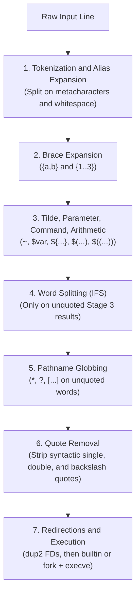

# Bash: Mental Model, Parsing Pipeline & Linux Shell Architecture

| Metadata      | Value                      |
| ------------- | -------------------------- |
| Author        | Lyzander Marciano Andrylie |
| Creation Date | Nov 14, 2026               |
| Last Updated  | Nov 14, 2026               |

## References

- [roadmap.sh: Shell / Bash Developer Roadmap](https://roadmap.sh/shell-bash/): Structured topic map covering shell syntax, expansions, I/O redirection, process control, and scripting idioms
- [GNU Bash Reference Manual](https://www.gnu.org/software/bash/manual/bash.html): Authoritative specification for Bash tokenization, 7-stage expansion order, built-ins, and job control
- [00_mental_model_and_parsing.sh](./examples/00_mental_model_and_parsing.sh): Runnable lab verifying assignment tokenization, brace-before-parameter expansion, `IFS` splitting/globbing, and exit-status truthiness
- [execution_and_processes.md](./execution_and_processes.md): Shell startup modes, shebang `execve(2)` mechanics, command lookup order, `fork()`/`execve()`, and subshell isolation
- [variables_expansions_and_types.md](./variables_expansions_and_types.md): Shell vs kernel `environ`, quoting modes, positional parameters, zero-fork parameter expansion, and arrays/maps
- [control_flow_and_functions.md](./control_flow_and_functions.md): `[ ]` vs `[[ ]]` vs `(( ))`, inode file tests, `case` fallthrough, safe line reading, dynamic scoping, and namerefs
- [streams_redirection_and_ipc.md](./streams_redirection_and_ipc.md): `dup2(2)` left-to-right FD wiring, custom FDs, here-docs, `pipe(2)`/`SIGPIPE`, process substitution, and stream filters
- [error_handling_signals_and_jobs.md](./error_handling_signals_and_jobs.md): 8-bit exit codes, `set -Eeuo pipefail` gotchas, `trap` signal handling, `wait -n` worker pools, and `set -x` debugging
- [directory_structure.md](../directory_structure.md): Standard Linux filesystem hierarchy (`/bin`, `/usr/bin`, `/tmp`, `/proc`) where shell commands and virtual endpoints live
- [file_descriptors.md](../file_descriptors.md): Kernel descriptor tables, open file descriptions, and `dup2()`/`pipe()` primitives underlying shell redirection
- [file_permissions.md](../file_permissions.md): Execute (`x`) permission requirements for invoking scripts and accessing directories
- [inodes.md](../inodes.md): Filesystem metadata, symlinks, and directory entry resolution inspected by shell file test operators

## Description

**Bash (Bourne-Again SHell)** is both a POSIX-compliant interactive command interpreter and a Unix process-orchestration language built around launching binaries, wiring kernel file descriptors, and passing byte strings. Unlike AST-compiled general-purpose languages with strict static grammars, Bash parses text into commands on the fly through a strict seven-stage expansion pipeline before invoking built-ins or `fork()` + `execve()`.

## Concepts

### 1. Everything Is a String & Tokenization Mechanics

Bash has no primitive integer, float, or boolean objects in memory; every variable stores a null-terminated byte string inside Bash's internal `shell_variables` hash table, and whitespace acts as the primary syntactic delimiter between command tokens.

- **AST-Compiled Languages vs. Command-Oriented Shells**:
  - In Python, Go, or C, the lexer recognizes `=` as an assignment operator token regardless of surrounding spaces (`x = 1`).
  - In Bash, unquoted spaces, tabs, and newlines are **metacharacters** that split a line into discrete **words** (tokens) before command interpretation begins.
- **Why `x=1` Works and `x = 1` Fails**:
  - `x=1` is a single token matching the `NAME=VALUE` grammar rule, so Bash intercepts it as an internal variable assignment without searching `$PATH`.
  - `x = 1` splits into three separate tokens: command name `x`, first argument `"="`, and second argument `"1"`. Bash attempts to execute a binary or function named `x`, failing with exit status `127` (`command not found`).
- **Quoting Boundaries**:
  - Quotes do not construct string objects as in C or Python; instead, quotes are **tokenization delimiters** that suppress whitespace splitting and metacharacter interpretation while building a single word argument (later stripped in Stage 6).
  - Adjacent quoted and unquoted segments without whitespace fuse into a single word token (e.g., `echo "hello "'world'` passes one argument: `hello world`).

| Syntax Form       | Tokenized Words        | Bash Interpretation                                   | Exit Behavior                                  |
| :---------------- | :--------------------- | :---------------------------------------------------- | :--------------------------------------------- |
| `x=1`             | `["x=1"]`              | Assignment to shell variable `x`                      | `0` (unless command substitution inside fails) |
| `x = 1`           | `["x", "=", "1"]`      | Execute command `x` with `argv[1]="="`, `argv[2]="1"` | `127` (`x: command not found`)                 |
| `x="hello world"` | `["x=hello world"]`    | Single assignment token; quotes preserve spaces       | `0`                                            |
| `x=hello world`   | `["x=hello", "world"]` | Per-command env prefix `x=hello` for command `world`  | Runs `world` with `x=hello` in its `envp`      |

```shell
x=1
printf 'Valid assignment x=1 -> x=%s\n' "$x"

# Running (x = 1) in a subshell captures the runtime error safely
(x = 1)
# Output:
# Valid assignment x=1 -> x=1
# bash: line 1: x: command not found   (exit code: 127)
```

---

### 2. The Inverted Boolean Paradigm

Every command, function, or pipeline in Bash terminates by returning an unsigned 8-bit integer exit status (`0..255`) to its parent via `waitpid(2)`, where `0` means truthy (`EXIT_SUCCESS`) and any non-zero value `1..255` means falsy (`EXIT_FAILURE`).

- **Why `0` Is True**:
  - In C, Python, and Go, `0` / `false` represents falsiness and `1` / `true` represents truthiness.
  - In Unix process semantics, there is only one way for a process to succeed (`0` / `EXIT_SUCCESS` in `<stdlib.h>`), whereas there are 255 distinct non-zero codes (`1..255`) to classify different failure modes (bad arguments, permission denied, file not found, signal termination).
- **How `if` Actually Works**:
  - `if` in Bash does **not** evaluate a boolean expression; `if <command_list>; then ... fi` executes `<command_list>` and inspects `$?` (its exit code).
  - Commands like `test`, `[ ... ]`, `[[ ... ]]`, and `(( ... ))` are simply commands or keywords whose sole job is to compute a condition and exit `0` or `1`.
  - Any ordinary command—such as `grep -q` or `ping -c 1`—can sit directly after `if`, `while`, `&&`, or `||`.

| Concept                  | Python / Go / C Semantics        | Bash Process Semantics                        |
| :----------------------- | :------------------------------- | :-------------------------------------------- |
| **Truthy / Success**     | `True` / `true` / `!= 0`         | Exit status `0` (`EXIT_SUCCESS`)              |
| **Falsy / Failure**      | `False` / `false` / `0`          | Exit status `1..255` (`EXIT_FAILURE`)         |
| **Negation (`!`)**       | Logical boolean flip             | Exit flip (`0` becomes `1`, `1..255` -> `0`)  |
| **`if` condition check** | Evaluates boolean expression AST | Runs a command list and branches on `$? == 0` |

```shell
if true; then
    printf 'true exited with %d -> "if" branch taken (EXIT_SUCCESS)\n' "$?"
fi

false || printf 'false exited with %d -> non-zero is falsy (EXIT_FAILURE)\n' "$?"

printf 'ERROR: connection refused\n' > app.log
if grep -q "ERROR" app.log; then
    printf 'grep -q matched -> exit 0 -> "if" branch taken\n'
fi

if ! grep -q "CRITICAL" app.log; then
    printf 'grep -q missed -> exit 1 -> negated "!" turns 1 into 0\n'
fi
# Output:
# true exited with 0 -> "if" branch taken (EXIT_SUCCESS)
# false exited with 1 -> non-zero is falsy (EXIT_FAILURE)
# grep -q matched -> exit 0 -> "if" branch taken
# grep -q missed -> exit 1 -> negated "!" turns 1 into 0
```

> [!IMPORTANT]
> Inside arithmetic contexts `(( ... ))` and `$(( ... ))`, C semantics apply: evaluating `0` sets the command exit status to `1` (falsy), while evaluating any non-zero integer sets the exit status to `0` (truthy).

---

### 3. The 7-Stage Bash Command Evaluation Pipeline

Before Bash executes a single built-in or calls `fork()` + `execve()`, every simple command passes sequentially through seven strict transformation stages.

#### Interaction



- **Stage-by-Stage Execution Mechanics**:
  1. **Tokenization & Alias Expansion**: Splits input on operators (`|`, `&`, `&&`, `||`, `;`, `<`, `>`) and unquoted whitespace; expands aliases if the first token is an alias in an interactive shell (or `shopt -s expand_aliases`).
  2. **Brace Expansion (`{a,b}`, `{1..3}`)**: Generates arbitrary strings before variables exist. Because this runs in Stage 2 and parameter expansion runs in Stage 3, `{1..$n}` sees literal `$n` (not an integer) and outputs the literal string `{1..$n}` (which Stage 3 then turns into `{1..3}`).
  3. **Tilde, Parameter, Command & Arithmetic Expansion**: Expands `~`, `$var` / `${var}`, `$(cmd)`, and `$((1 + 2))` in a single left-to-right pass.
  4. **Word Splitting (`IFS`)**: Scans the output of **unquoted** Stage 3 expansions and splits them on characters in `$IFS` (default: space, tab, newline). Results wrapped in `"..."` skip this stage completely.
  5. **Pathname Globbing**: Scans **unquoted** words for `*`, `?`, and `[...]` and replaces matching words with sorted filesystem filenames via `readdir()`. If nothing matches, the pattern stays literal unless `shopt -s nullglob` is enabled.
  6. **Quote Removal**: Strips remaining syntactic `'`, `"`, and `\` characters that were not produced by an expansion.
  7. **Redirections & Command Execution**: Applies `<`, `>`, `2>&1` via `open()`/`dup2()`, then invokes the shell function, built-in, or external binary via `fork()` + `execve()`.

> [!WARNING]
> Never write `eval "echo {1..$n}"` on untrusted input to work around Stage 2 brace order: `eval` re-runs the entire 7-stage parser on the expanded string, enabling arbitrary command injection if `$n` contains `;` or `$(...)`. Use a C-style loop `for ((i = 1; i <= n; i++)); do ...; done` instead.

```shell
n=3
echo {1..3}
echo {1..$n}

# Unquoted variable triggers Stage 4 (IFS split) then Stage 5 (glob *)
touch alpha.txt beta.txt
raw_input="hello   world *"
printf 'Unquoted:' && printf ' [%s]' $raw_input && printf '\n'
printf 'Quoted:  ' && printf ' [%s]' "$raw_input" && printf '\n'
# Output:
# 1 2 3
# {1..3}
# Unquoted: [hello] [world] [alpha.txt] [beta.txt]
# Quoted:   [hello   world *]
```

---

### 4. High-Level Programmer-to-Bash Syntax Translation Table

Mapping familiar constructs from Python, Go, or C onto Bash reveals where syntax looks similar on the surface while running on fundamentally different kernel and interpreter primitives.

| Concept            | Python / Go / C Idiom              | Idiomatic Bash Equivalent                  | Low-Level Shell / Linux Semantics                                            |
| :----------------- | :--------------------------------- | :----------------------------------------- | :--------------------------------------------------------------------------- |
| **Variable**       | `x = 42`                           | `x=42`                                     | Stored as byte string `"42"` in `shell_variables`; no spaces around `=`      |
| **Env Var**        | `os.Setenv("K", "v")`              | `export K="v"`                             | Marked for inclusion in `envp[]` passed across `fork()` + `execve()`         |
| **String Format**  | `f"hi {name}"`                     | `printf -v out 'hi %s' "$name"`            | Zero-fork formatting into variable `out`; safer than `echo`                  |
| **String Slice**   | `s[:-4]` / `s.removesuffix(".gz")` | `${s:0:${#s}-4}` / `${s%.gz}`              | Zero-fork in-process C pointer/pattern manipulation                          |
| **Indexed Array**  | `items = ["a b", "c"]`             | `items=("a b" "c")`; `"${items[@]}"`       | Sparse integer-indexed array; `"${arr[@]}"` preserves per-element boundaries |
| **Hash Map**       | `m = {"k": "v"}`                   | `declare -A m=([k]="v")`; `"${m[$k]:-}"`   | Unordered associative array (Bash 4+); safe default guards against `set -u`  |
| **If / Else**      | `if cond:`                         | `if [[ "$a" == "$b" ]]; then ... fi`       | Runs keyword/command; branches on exit code `0` vs `1..255`                  |
| **Integer Math**   | `if x + 1 > 5:`                    | `if (( x + 1 > 5 )); then ... fi`          | 64-bit signed integer arithmetic; non-zero result -> exit `0`                |
| **For-Each Loop**  | `for x in items:`                  | `for x in "${items[@]}"; do ... done`      | Always quote `"${items[@]}"` to prevent Stage 4 `IFS` splitting              |
| **Line Reading**   | `for line in open(f):`             | `while IFS= read -r line; do ... done < f` | `IFS=` keeps whitespace; `-r` keeps `\`; `< f` avoids pipeline subshell      |
| **Function Call**  | `fn(a, b)`                         | `fn "$a" "$b"`                             | Space-separated positional arguments `$1`, `$2`, `"$@"` (no parentheses)     |
| **Return Value**   | `return result`                    | `return 0` / `res=$(fn)` / `local -n out`  | `return` sets 8-bit status only; `$(fn)` forks subshell; `-n` mutates caller |
| **Error Handling** | Exceptions / `if err != nil`       | `set -Eeuo pipefail` + `trap on_err ERR`   | Aborts on non-zero exit, unset var, or pipe failure; catches `ERR`/`EXIT`    |
| **Concurrency**    | Goroutines / `pthread_create`      | `worker &` + `wait -n`                     | OS `fork()` child processes; `wait -n` reaps next exiting PID                |

---

### 5. Documentation Suite & Executable Lab Roadmap

Each concept note in this Linux Bash series pairs architecture diagrams and edge-case tables with a self-contained, executable verification script under `examples/` that cleans up its own temporary directory via `mktemp -d` and `trap ... EXIT`.

| Order | Topic Guide                                                                | Executable Lab Script                                                           | Focus & Kernel Primitives Covered                                                       |
| :---: | :------------------------------------------------------------------------- | :------------------------------------------------------------------------------ | :-------------------------------------------------------------------------------------- |
| **0** | [bash.md](./bash.md)                                                       | [00_mental_model_and_parsing.sh](./examples/00_mental_model_and_parsing.sh)     | Tokenization, inverted booleans, 7-stage evaluation pipeline, and language mapping      |
| **1** | [execution_and_processes.md](./execution_and_processes.md)                 | [01_execution_and_subshells.sh](./examples/01_execution_and_subshells.sh)       | Startup files, shebang `execve(2)`, command lookup order, `fork()`/`exec`, subshells    |
| **2** | [variables_expansions_and_types.md](./variables_expansions_and_types.md)   | [02_variables_and_arrays.sh](./examples/02_variables_and_arrays.sh)             | `environ(7)` / `/proc/self/environ`, quoting modes, `"$@"`, parameter expansion, arrays |
| **3** | [control_flow_and_functions.md](./control_flow_and_functions.md)           | [03_control_flow_and_functions.sh](./examples/03_control_flow_and_functions.sh) | `[ ]` vs `[[ ]]` vs `(( ))`, `stat(2)` tests, `case`, dynamic scoping, namerefs         |
| **4** | [streams_redirection_and_ipc.md](./streams_redirection_and_ipc.md)         | [04_streams_and_ipc.sh](./examples/04_streams_and_ipc.sh)                       | `dup2(2)` FD wiring, custom FDs, here-docs, `pipe(2)`/`SIGPIPE`, process substitution   |
| **5** | [error_handling_signals_and_jobs.md](./error_handling_signals_and_jobs.md) | [05_strict_mode_traps_and_jobs.sh](./examples/05_strict_mode_traps_and_jobs.sh) | `waitpid(2)` exit codes, `set -Eeuo pipefail` gotchas, `trap`, `wait -n`, `set -x`      |

```shell
# Run the mental model & parsing lab script
chmod +x ./examples/00_mental_model_and_parsing.sh
./examples/00_mental_model_and_parsing.sh
```
