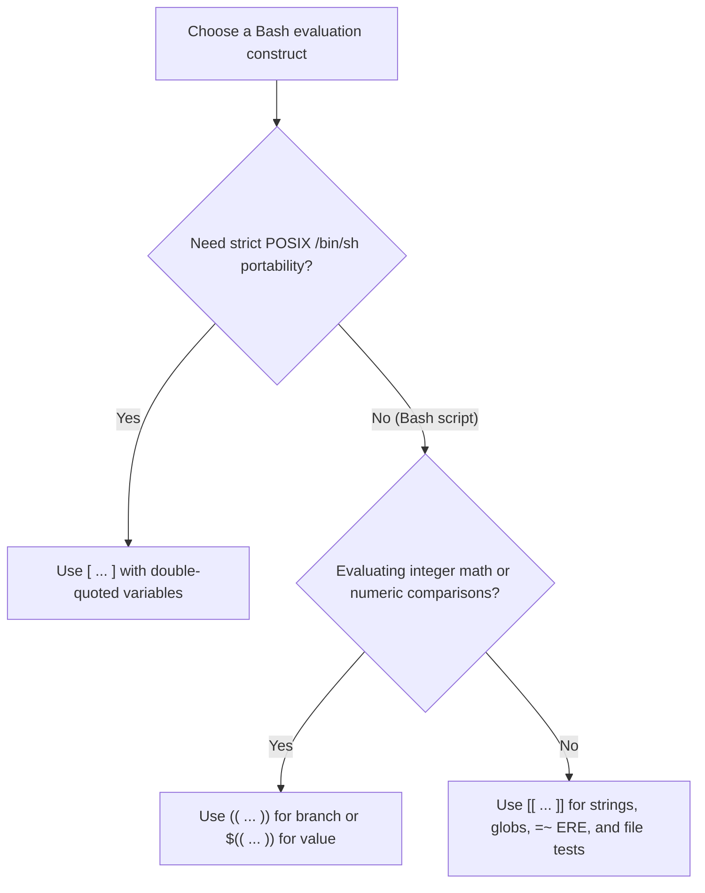
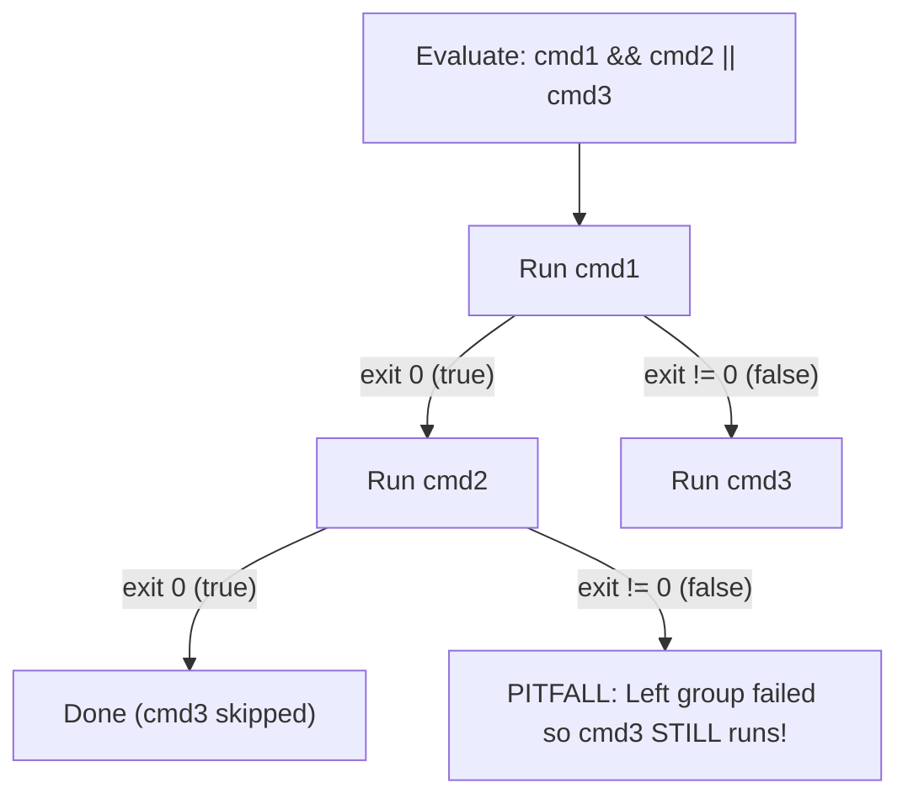
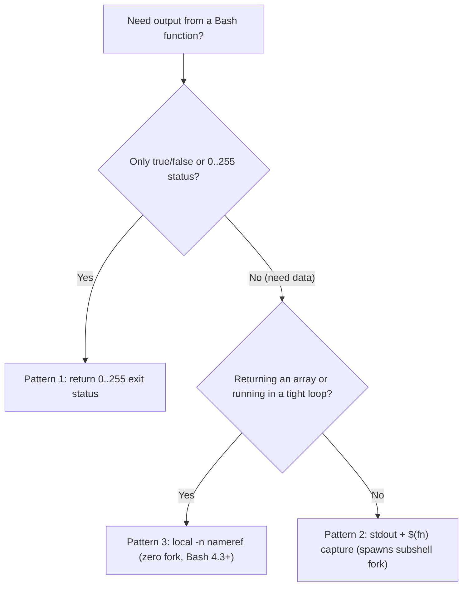

# Bash Control Flow, Tests & Functions

| Metadata      | Value                      |
| ------------- | -------------------------- |
| Author        | Lyzander Marciano Andrylie |
| Creation Date | Nov 14, 2026               |
| Last Updated  | Nov 14, 2026               |

## References

- [roadmap.sh: Shell / Bash Roadmap](https://roadmap.sh/shell-bash/): Core shell scripting curriculum covering conditionals, loops, and functions
- [GNU Bash Manual: Conditional Constructs](https://www.gnu.org/software/bash/manual/html_node/Conditional-Constructs.html): Specification for `[ ... ]`, `[[ ... ]]`, `(( ... ))`, `if`, and `case`
- [GNU Bash Manual: Shell Functions](https://www.gnu.org/software/bash/manual/html_node/Shell-Functions.html): Function definitions, positional parameters, `local` scoping, and `return` semantics
- [03_control_flow_and_functions.sh](./examples/03_control_flow_and_functions.sh): Runnable lab demonstrating test constructs, inode checks, `case` fallthrough, safe file reading, dynamic scoping, and function return patterns
- [bash.md](./bash.md): Core Bash mental model, inverted boolean exit codes, and the 7-stage evaluation pipeline
- [variables_expansions_and_types.md](./variables_expansions_and_types.md): Quoting, parameter expansion, arrays, `nameref` attributes, and arithmetic evaluation
- [streams_redirection_and_ipc.md](./streams_redirection_and_ipc.md): File descriptor redirections, pipes, and subshell stream behavior
- [error_handling_signals_and_jobs.md](./error_handling_signals_and_jobs.md): Exit status encoding, `set -Eeuo pipefail` gotchas, and `trap` handlers

## Description

Bash control flow branches on command exit statuses rather than boolean expressions, using three distinct test constructs (`[ ]`, `[[ ]]`, `(( ))`) that differ in parsing rules, word-splitting safety, and integer semantics. Mastering these constructs alongside `case` fallthrough modes, safe `read` loops, dynamic `local` scoping, and zero-fork nameref returns prevents subtle bugs and unnecessary `fork()` overhead in production shell scripts.

## Concepts

### 1. The Three Evaluation Constructs: `[ ]` vs `[[ ]]` vs `(( ))`

Every test construct in Bash ultimately produces an exit status (`0` for true, `1` for false), but each lives at a different layer of the shell parser.

- **`[ ... ]` (POSIX `test` Builtin / Command)**:
  - Parsed as an ordinary simple command whose final argument must be `]`.
  - Arguments undergo full word splitting and pathname globbing _before_ `[` receives them; an unquoted empty `$var` disappears completely, causing syntax errors like `[ = foo ]`.
  - Unescaped `<` and `>` inside `[ ... ]` are interpreted as file redirections, not string comparisons.
- **`[[ ... ]]` (Bash Extended Conditional Keyword)**:
  - A shell parser keyword, not a command; the shell skips word splitting and pathname expansion on variables inside `[[ ... ]]`.
  - Supports C-style `&&`, `||`, `!`, and unescaped `(...)` grouping directly inside the brackets.
  - `==` and `!=` perform **glob pattern matching** when the right-hand side is unquoted (`[[ $s == hello* ]]`), and literal string matching when quoted (`[[ $s == "hello*" ]]`).
  - `=~` performs **POSIX Extended Regular Expression (ERE)** matching and populates the `BASH_REMATCH[@]` array (`BASH_REMATCH[0]` = full match, `BASH_REMATCH[1..n]` = capture groups).
- **`(( ... ))` and `$(( ... ))` (C-Style Arithmetic)**:
  - Evaluates signed integer arithmetic (64-bit on 64-bit Linux). Variable names do not need a `$` prefix inside arithmetic context.
  - `(( ... ))` is a compound command whose exit status bridges C truthiness to Bash exit codes: a **non-zero** result exits `0` (true), and a **zero** result exits `1` (false).
  - `$(( ... ))` is an arithmetic expansion that substitutes the computed integer string into a command's arguments.

| Feature                       | `[ ... ]`                            | `[[ ... ]]`                        | `(( ... ))`                                 |
| :---------------------------- | :----------------------------------- | :--------------------------------- | :------------------------------------------ |
| **Parser Kind**               | Builtin command (`test`)             | Shell compound keyword             | Arithmetic compound command                 |
| **Portability**               | POSIX (`/bin/sh`)                    | Bash, Zsh, Ksh                     | Bash, Zsh, Ksh (POSIX defines `$(( ))`)     |
| **Word Splitting / Globbing** | Yes (must quote `"$var"`)            | No (safe unquoted `$var`)          | N/A (integer identifiers only)              |
| **Logical Operators**         | `-a`, `-o` (deprecated)              | `&&`, `\|\|`, `!`, `( ... )`       | `&&`, `\|\|`, `!`, `( ... )`                |
| **String `<` / `>`**          | Redirects streams unless `\<` / `\>` | Lexicographical comparison         | Numeric integer comparison                  |
| **Pattern / Regex**           | None                                 | `==` (glob), `=~` (`BASH_REMATCH`) | None                                        |
| **Truthiness Rule**           | Expression evaluates true -> `0`     | Expression evaluates true -> `0`   | Arithmetic result `!= 0` -> `0`; `0` -> `1` |

```shell
empty=""
spaced="hello world"

# [ ]: must quote variables
if [ -n "$spaced" ] && [ -z "$empty" ]; then
  echo "[ ]: quoted variables succeeded"
fi

# [[ ]]: immune to word splitting; unquoted RHS performs globbing; =~ populates BASH_REMATCH
if [[ -n $spaced && $spaced == hello* ]]; then
  echo "[[ ]]: unquoted \$spaced matched glob 'hello*'"
fi

tag="release-42"
if [[ $tag =~ ^([a-z]+)-([0-9]+)$ ]]; then
  echo "[[ =~ ]]: full='${BASH_REMATCH[0]}', name='${BASH_REMATCH[1]}', num='${BASH_REMATCH[2]}'"
fi

# (( )): 0 is falsy (exit 1), non-zero is truthy (exit 0)
(( 0 )) || echo "(( 0 )): zero evaluated to exit status $?"
if (( 2 + 3 == 5 )); then
  echo "(( 2 + 3 == 5 )): non-zero (1) evaluated to exit status 0"
fi
# Output:
# [ ]: quoted variables succeeded
# [[ ]]: unquoted $spaced matched glob 'hello*'
# [[ =~ ]]: full='release-42', name='release', num='42'
# (( 0 )): zero evaluated to exit status 1
# (( 2 + 3 == 5 )): non-zero (1) evaluated to exit status 0
```

#### Interaction



---

### 2. Comparison & Inode File Test Operators

Bash separates string equality from numeric equality and exposes kernel `stat(2)` / `lstat(2)` inode checks as unary and binary primary operators inside `[ ]` and `[[ ]]`.

- **String vs. Integer Semantics**:
  - `[ "010" -eq 10 ]` evaluates **true** because `-eq` parses decimal integers, whereas `[[ "010" == "10" ]]` evaluates **false** because `==` compares literal character sequences.
  - Inside `[[ ... ]]`, `<` and `>` sort lexicographically according to the active locale (`LC_COLLATE` / `LC_ALL`).
- **Symlink Resolution in File Tests**:
  - `-L` (and its alias `-h`) issues `lstat(2)` to inspect the symlink itself.
  - Almost all other file operators (`-e`, `-f`, `-d`, `-s`, `-r`, `-w`, `-x`, `-nt`, `-ot`) issue `stat(2)`, automatically dereferencing symlinks to inspect the target inode.

#### String Operators

| Operator  | Context                    | Meaning                        | Notes                                                                        |
| :-------- | :------------------------- | :----------------------------- | :--------------------------------------------------------------------------- |
| `=`, `==` | `[ ]`, `[[ ]]`             | String / pattern equality      | In `[[ ]]`, unquoted RHS is a glob pattern; quote `"$rhs"` for literal match |
| `!=`      | `[ ]`, `[[ ]]`             | String / pattern inequality    | Same RHS glob rule applies in `[[ ]]`                                        |
| `<`       | `[[ ]]` (or `\<` in `[ ]`) | Lexicographically less than    | Locale-dependent (`LC_COLLATE`); raw `<` redirects in `[ ]`                  |
| `>`       | `[[ ]]` (or `\>` in `[ ]`) | Lexicographically greater than | Locale-dependent (`LC_COLLATE`); raw `>` redirects in `[ ]`                  |
| `-z "$s"` | `[ ]`, `[[ ]]`             | String length is zero          | True for `""` or unset                                                       |
| `-n "$s"` | `[ ]`, `[[ ]]`             | String length is non-zero      | Safest check for non-empty strings                                           |

#### Integer Operators

| Operator         | `[ ]` / `[[ ]]` | `(( ))` Equivalent | Meaning                   |
| :--------------- | :-------------- | :----------------- | :------------------------ |
| Equal            | `a -eq b`       | `a == b`           | Signed integer equality   |
| Not equal        | `a -ne b`       | `a != b`           | Signed integer inequality |
| Less than        | `a -lt b`       | `a < b`            | Strictly less than        |
| Less or equal    | `a -le b`       | `a <= b`           | Less than or equal        |
| Greater than     | `a -gt b`       | `a > b`            | Strictly greater than     |
| Greater or equal | `a -ge b`       | `a >= b`           | Greater than or equal     |

#### Filesystem & Inode `stat(2)` Operators

| Operator              | Kernel Check              | True Condition                                                               |
| :-------------------- | :------------------------ | :--------------------------------------------------------------------------- |
| `-e path`             | `stat(2)`                 | Path exists (any inode type, target exists if symlink)                       |
| `-f path`             | `stat(2)` (`S_ISREG`)     | Path exists and is a regular file                                            |
| `-d path`             | `stat(2)` (`S_ISDIR`)     | Path exists and is a directory                                               |
| `-L path` / `-h path` | `lstat(2)` (`S_ISLNK`)    | Path is a symbolic link (even if dangling)                                   |
| `-r path`             | `access(R_OK)` / euid     | Readable by current process                                                  |
| `-w path`             | `access(W_OK)` / euid     | Writable by current process                                                  |
| `-x path`             | `access(X_OK)` / euid     | Executable (file) or searchable (directory)                                  |
| `-s path`             | `stat(2)` (`st_size > 0`) | File exists and size is greater than zero bytes                              |
| `-p path`             | `stat(2)` (`S_ISFIFO`)    | Path is a named pipe (FIFO)                                                  |
| `-S path`             | `stat(2)` (`S_ISSOCK`)    | Path is a Unix domain socket                                                 |
| `f1 -nt f2`           | `stat(2)` (`st_mtim`)     | `f1` modification time is newer than `f2` (or `f1` exists and `f2` does not) |
| `f1 -ot f2`           | `stat(2)` (`st_mtim`)     | `f1` modification time is older than `f2` (or `f2` exists and `f1` does not) |

```shell
[[ -d "$TMP_DIR/sub" ]] && echo "-d sub: directory"
[[ ! -s "$TMP_DIR/empty.txt" ]] && echo "-s empty.txt: size is 0"
[[ -s "$TMP_DIR/newer.txt" ]] && echo "-s newer.txt: non-empty regular file"
[[ -L "$TMP_DIR/link.txt" && -f "$TMP_DIR/link.txt" ]] && echo "-L & -f link.txt: symlink pointing to a regular file"
[[ "$TMP_DIR/newer.txt" -nt "$TMP_DIR/older.txt" ]] && echo "-nt: newer.txt mtime > older.txt mtime"
# Output:
# -d sub: directory
# -s empty.txt: size is 0
# -s newer.txt: non-empty regular file
# -L & -f link.txt: symlink pointing to a regular file
# -nt: newer.txt mtime > older.txt mtime
```

---

### 3. Branching & Short-Circuit Lists

Bash provides structured multi-way branching (`if` and `case`) alongside shell boolean lists (`&&` and `||`) whose associativity differs fundamentally from ternary operators in C-family languages.

- **`if` / `elif` / `else` / `fi`**:
  - Executes any command or pipeline after `if` or `elif` and enters the `then` block only when that command exits `0`.
  - Returns the exit status of the last command executed in the chosen branch (or `0` if no branch ran).
- **`case $var in ... esac` Terminators**:
  - Patterns use shell globbing (`*`, `?`, `[abc]`, `pat1|pat2`), not regex.
  - Three clause terminators control execution flow after a branch body completes:

| Terminator | Bash Version | Behavior After Branch Body                                                                  |
| :--------- | :----------- | :------------------------------------------------------------------------------------------ |
| `;;`       | POSIX        | **Break**: stops evaluating `case` immediately (standard `break`).                          |
| `;&`       | Bash 4.0+    | **Unconditional fallthrough**: executes the next branch body _without_ testing its pattern. |
| `;;&`      | Bash 4.0+    | **Continue testing**: keeps testing subsequent patterns and executes any that match.        |

- **Why `cmd1 && cmd2 || cmd3` Is NOT a Ternary `if/else`**:
  - `&&` and `||` have **equal precedence** and are **left-associative**: `cmd1 && cmd2 || cmd3` parses as `(cmd1 && cmd2) || cmd3`.
  - If `cmd1` succeeds (`0`) and `cmd2` fails (non-zero), the grouped left operand `(cmd1 && cmd2)` returns non-zero, causing `cmd3` to run unexpectedly.
  - Use `if cmd1; then cmd2; else cmd3; fi` whenever `cmd2` can return a non-zero exit status.

```shell
describe_code() {
  local code="$1"
  case "$code" in
    start)
      echo "  [;;] matched 'start' (stops here)"
      ;;
    warn)
      echo "  [;&] matched 'warn' -> unconditional fallthrough"
      ;&
    never_tested_target)
      echo "  [;&] executed next body without pattern check"
      ;;
    alpha*)
      echo "  [;;&] matched 'alpha*' -> continuing pattern tests"
      ;;&
    *beta)
      echo "  [;;&] also matched '*beta'"
      ;;&
    exact)
      echo "  [;;&] should not print for alphabeta"
      ;;
  esac
}

describe_code "warn"
describe_code "alphabeta"

check_true() { return 0; }
fail_step() { return 1; }
check_true && fail_step || echo "  PITFALL: fallback C ran because B failed, even though A succeeded!"
# Output:
#   [;&] matched 'warn' -> unconditional fallthrough
#   [;&] executed next body without pattern check
#   [;;&] matched 'alpha*' -> continuing pattern tests
#   [;;&] also matched '*beta'
#   PITFALL: fallback C ran because B failed, even though A succeeded!
```

#### Interaction



---

### 4. Loops & Canonical File Reading

Safe iteration in Bash requires preserving word boundaries, handling empty globs, and preventing subshell variable loss when reading files line by line.

- **Array & Glob Iteration**:
  - `for item in "${arr[@]}"; do ... done`: Double-quoted `"${arr[@]}"` expands each element as an intact token, preserving embedded spaces and newlines.
  - **Empty Glob Trap**: By default, an unmatched glob such as `for f in *.log` iterates once with `f="*.log"`. Enable `shopt -s nullglob` (or guard with `[[ -e $f ]] || continue`) so unmatched globs expand to zero items.
- **C-Style & Conditional Loops**:
  - `for (( i = 0; i < n; i++ )); do ... done`: Evaluates loop bounds in arithmetic context with zero subprocess forks (unlike `$(seq 1 "$n")`).
  - `while cmd` loops while `cmd` exits `0`; `until cmd` loops while `cmd` exits non-zero.
  - `break [n]` and `continue [n]` accept an integer depth `n` (default `1`) to exit or advance an outer nested loop.
- **Canonical Line-by-Line Reader**:
  - `while IFS= read -r line || [[ -n "$line" ]]; do ... done < file`
  - `IFS=` (scoped only to `read`): Prevents `read` from stripping leading and trailing whitespace (`$IFS` characters).
  - `-r`: Treats backslashes (`\`) literally instead of interpreting escape sequences or trailing `\` line continuations.
  - `|| [[ -n "$line" ]]`: Ensures a final line without a trailing `\n` is still processed; `read` fills `$line` up to EOF and returns exit status `1`, which `[[ -n "$line" ]]` catches.
  - `< file` after `done`: Redirects into the loop in the **current shell**, whereas `cat file | while ...` runs the loop inside a subshell where variable updates are discarded on exit.

```shell
printf '  leading and trailing  \nback\\slash\\tliteral\\n\nno-final-newline' > "$TMP_DIR/lines.txt"
line_no=0
while IFS= read -r line || [[ -n "$line" ]]; do
  (( ++line_no ))
  printf '  line %d: [%s]\n' "$line_no" "$line"
done < "$TMP_DIR/lines.txt"
# Output:
#   line 1: [  leading and trailing  ]
#   line 2: [back\slash\tliteral\n]
#   line 3: [no-final-newline]
```

---

### 5. Functions, Dynamic Scoping & The Three Return Patterns

Bash functions execute inside the caller's process by default, share the caller's call stack for `local` variables, and require deliberate return patterns because `return` only carries an 8-bit integer status.

- **Definition & Positional Parameters**:
  - Prefer POSIX-compatible `fn_name() { ... }` over `function fn_name { ... }`.
  - Inside a function, `$1`..`$n`, `"$@"`, and `$#` reflect the function's arguments, while `$0` still holds the script/shell name (use `${FUNCNAME[0]}` for the active function name).
- **Dynamic Scoping (`local`)**:
  - Unlike lexical scoping in C, Go, or Python, Bash `local` uses **dynamic scoping**: a `local` variable is visible to—and mutable by—any callee function invoked while that frame is on the call stack.
  - If a callee omits `local`, assigning to that variable name overwrites the caller's `local` variable. Declaring `local var=...` in the callee shadows the caller's copy without mutating it.
  - When the caller returns, its `local` stack frame is popped and the outer scope remains untouched.

> [!WARNING]
> Always declare loop counters and temporary variables (`local i line item`) inside every helper function. An un-localized `i` in a helper silently corrupts a `local i` loop counter in its caller.

#### The Three Function Output Patterns

| Pattern                | Mechanism                 | Subshell `fork()`? | Payload Type                  | Best Use Case & Pitfall                                                                                                            |
| :--------------------- | :------------------------ | :----------------- | :---------------------------- | :--------------------------------------------------------------------------------------------------------------------------------- |
| **`return 0..255`**    | Exit status (`$?`)        | No                 | 8-bit unsigned int (`0..255`) | Predicates (`is_valid`), success/failure flags; values `>= 256` wrap modulo 256.                                                   |
| **`res=$(fn)`**        | Stdout capture            | **Yes (`fork()`)** | Arbitrary string / lines      | Pipelines and clean value return; strips trailing `\n`, cannot mutate caller vars, slow inside tight loops.                        |
| **`local -n _out=$1`** | Nameref alias (Bash 4.3+) | No                 | Strings, indexed/assoc arrays | High-frequency calls or returning arrays without `fork()`; prefix nameref (`_out`) so caller variable name never collides with it. |

```shell
callee_mutate() {
  echo "  callee_mutate sees caller secret='$secret'"
  secret="mutated-by-callee"
}

callee_shadow() {
  local secret="shadowed-in-callee"
  echo "  callee_shadow sees local secret='$secret'"
}

caller_fn() {
  local secret="caller-initial"
  echo "  caller_fn start: secret='$secret'"
  callee_mutate
  echo "  caller_fn after callee_mutate: secret='$secret'"
  callee_shadow
  echo "  caller_fn after callee_shadow: secret='$secret'"
}

caller_fn
echo "  outer scope secret='${secret:-<unset>}'"

# Pattern 2: Stdout capture via $(...) spawns a subshell fork
compute_via_stdout() {
  printf '%s (subshell BASHPID=%s)' "$(( $1 * 2 ))" "$BASHPID"
}
parent_pid="$BASHPID"
captured=$(compute_via_stdout 21)
echo "Pattern 2 (stdout capture): parent BASHPID=$parent_pid, result='$captured'"

# Pattern 3: Nameref mutation (local -n) runs in the same process (zero fork)
compute_via_nameref() {
  local -n _out="$1"
  local input="$2"
  _out="$(( input * 2 )) (same-process BASHPID=$BASHPID)"
}
result=""
compute_via_nameref result 21
echo "Pattern 3 (local -n nameref): parent BASHPID=$parent_pid, result='$result'"
# Output:
#   caller_fn start: secret='caller-initial'
#   callee_mutate sees caller secret='caller-initial'
#   caller_fn after callee_mutate: secret='mutated-by-callee'
#   callee_shadow sees local secret='shadowed-in-callee'
#   caller_fn after callee_shadow: secret='mutated-by-callee'
#   outer scope secret='<unset>'
# Pattern 2 (stdout capture): parent BASHPID=24, result='42 (subshell BASHPID=32)'
# Pattern 3 (local -n nameref): parent BASHPID=24, result='42 (same-process BASHPID=24)'
```

#### Interaction


