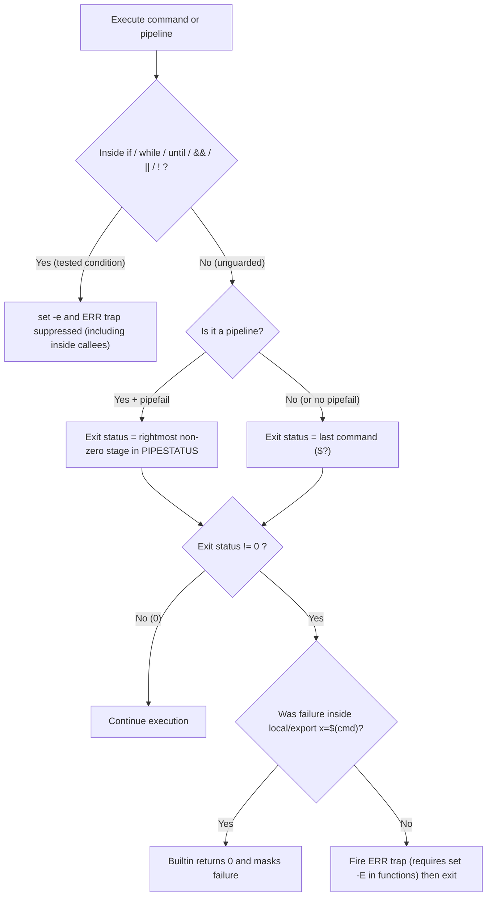
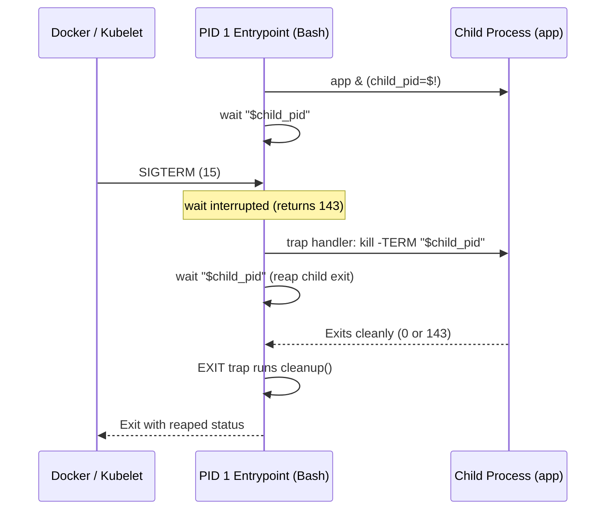

# Bash Error Handling, Signals & Job Control

| Metadata      | Value                      |
| ------------- | -------------------------- |
| Author        | Lyzander Marciano Andrylie |
| Creation Date | Nov 14, 2026               |
| Last Updated  | Nov 14, 2026               |

## References

- [roadmap.sh: Shell / Bash Roadmap](https://roadmap.sh/shell-bash/): Core shell scripting curriculum covering exit codes, strict mode, traps, job control, and debugging
- [GNU Bash Manual: The Set Builtin](https://www.gnu.org/software/bash/manual/html_node/The-Set-Builtin.html): Official semantics for `-E`, `-e`, `-u`, `-x`, and `-o pipefail`
- [GNU Bash Manual: Signals](https://www.gnu.org/software/bash/manual/html_node/Signals.html): Signal handling behavior in interactive and non-interactive shells, `wait`, and `trap`
- [GNU Bash Manual: Job Control](https://www.gnu.org/software/bash/manual/html_node/Job-Control.html): Process groups, background jobs, `jobs`, `fg`, `bg`, `disown`, and `wait`
- [Linux Programmer's Manual: waitpid(2)](https://man7.org/linux/man-pages/man2/waitpid.2.html): Kernel exit status word encoding (`WEXITSTATUS`, `WTERMSIG`)
- [Linux Programmer's Manual: signal(7)](https://man7.org/linux/man-pages/man7/signal.7.html): Standard POSIX signal numbers, default dispositions, and uncatchable signals
- [05_strict_mode_traps_and_jobs.sh](./examples/05_strict_mode_traps_and_jobs.sh): Executable demonstration of 8-bit exit wrapping, strict-mode traps, `ERR`/`EXIT` diagnostics, `wait -n` worker pooling, and `PS4` tracing
- [bash.md](./bash.md): Bash language overview, startup files, and quoting rules
- [execution_and_processes.md](./execution_and_processes.md): Subshells, `fork`/`exec`, process hierarchy, and command lookup
- [control_flow_and_functions.md](./control_flow_and_functions.md): Conditionals, loops, functions, and variable scoping (`local`)
- [streams_redirection_and_ipc.md](./streams_redirection_and_ipc.md): File descriptors, pipes, process substitution, and `SIGPIPE` stream teardown

## Description

Bash error handling, signal trapping, and job control govern how shell scripts detect failures, clean up resources on interruption, and coordinate concurrent child processes. Mastering these mechanics eliminates silent failures, orphaned temporary files, zombie processes, and swallowed container shutdown signals.

## Concepts

### 1. Exit Code Anatomy & Kernel `waitpid(2)` Encoding

Every Unix command returns an exit status to its parent process through `waitpid(2)`, where Bash exposes the least significant 8 bits as `$?`.

- **8-Bit Unsigned Range (`0..255`)**:
  - `WEXITSTATUS(status)` masks the user-supplied exit code with `0xFF` (`status & 255`).
  - Values outside `0..255` wrap modulo `256`: `exit 256` becomes `0` (false success), `exit 257` becomes `1`, and `exit -1` becomes `255`.
- **Signal Termination Encoding (`128 + N`)**:
  - When a process is terminated by signal `N` (`WIFSIGNALED(status)` is true), Bash sets `$?` to `128 + N`.
  - If a script returns an explicit `exit 130` itself, callers cannot distinguish it from a `SIGINT` termination without inspecting `waitpid(2)` status directly.

| Exit Code | Meaning / Cause                | Typical Trigger                                     |
| :-------- | :----------------------------- | :-------------------------------------------------- |
| `0`       | Success                        | Normal completion (`return 0`, `true`)              |
| `1`       | General error                  | Validation failure, uncaught runtime error, `false` |
| `2`       | Misuse of shell builtin        | Invalid CLI option, syntax/argument error           |
| `126`     | Command invoked cannot execute | File exists without execute bit (`chmod +x`)        |
| `127`     | Command not found              | Binary missing from `$PATH` or bad path             |
| `130`     | `128 + 2` (`SIGINT`)           | Interrupted via `Ctrl+C` (`kill -INT`)              |
| `137`     | `128 + 9` (`SIGKILL`)          | Force-killed by user or kernel OOM killer           |
| `141`     | `128 + 13` (`SIGPIPE`)         | Downstream pipe reader closed before writer ended   |
| `143`     | `128 + 15` (`SIGTERM`)         | Graceful termination request (`kill`, container)    |

```shell
# Verify 8-bit modulo-256 exit code truncation
(exit 256)
printf 'exit 256 -> %d\n' "$?"
# Output:
# exit 256 -> 0

(exit 257) || rc=$?
printf 'exit 257 -> %d\n' "$rc"
# Output:
# exit 257 -> 1
```

---

### 2. Production Strict Mode (`set -Eeuo pipefail`) & Its Silent Gotchas

Strict mode turns silent shell mistakes into immediate, traceable failures, but Bash disables `errexit` in several conditional contexts and masks failures inside variable declarations.

| Option        | Long Name  | Behavior                                                                          |
| :------------ | :--------- | :-------------------------------------------------------------------------------- |
| `-e`          | `errexit`  | Exit immediately when an unguarded simple command returns non-zero                |
| `-E`          | `errtrace` | Inherit `ERR` traps into functions, command substitutions, and subshells          |
| `-u`          | `nounset`  | Treat unset variables and parameters as errors (use `${VAR:-}` for optional vars) |
| `-o pipefail` | `pipefail` | Pipeline returns the exit code of the rightmost failing stage (or `0` if all ok)  |

#### a. When `set -e` Is Silently Ignored

- **Tested Contexts**: Bash suppresses `set -e` for any command executed as the condition of `if`, `while`, or `until`, on the left-hand side of `&&` or `||`, or prefixed by `!`.
- **Transitive Suppression**: Suppression propagates into **every function and subshell** invoked inside that tested context—even if the callee executes `set -Eeuo pipefail` internally.
- **Workaround**: To capture a strict-mode failure without disabling `set -e` inside the target call, temporarily toggle `set +e`, invoke the command, capture `$?`, and restore `set -e`.

#### b. Declaration Masking, Zero-Result Arithmetic, and `SIGPIPE`

- **Gotcha 1 — Declaration Masking (`local`, `export`, `readonly`, `declare`)**:
  - `local val=$(false)` runs `$(false)` first (exit `1`), then runs the `local` builtin, which returns `0` and overwrites `$?`, hiding the failure from `set -e`.
  - Always split declaration from assignment: `local val; val=$(cmd)`.
- **Gotcha 2 — Arithmetic `(( ... ))` Evaluating to Zero**:
  - Under `(( expr ))`, if `expr` evaluates numerically to `0`, Bash returns exit status `1`, triggering `set -e`.
  - `count=0; (( count++ ))` evaluates to the pre-increment value `0` and returns `1`; use `(( ++count ))`, `(( count += 1 ))`, or `count=$(( count + 1 ))`.
- **Gotcha 3 — `SIGPIPE` (`141`) Under `pipefail`**:
  - Pipelines such as `yes | head -n 1` or `cat big.log | grep -q "needle"` close the pipe read end early; the upstream writer receives `SIGPIPE` and exits `141`, causing `pipefail` to fail the entire pipeline.
  - Guard expected early-exit writers explicitly or read directly without unnecessary `cat` processes.
- **Capturing Per-Stage Statuses (`PIPESTATUS`)**:
  - `"${PIPESTATUS[@]}"` holds the exit code of every command in the most recent foreground pipeline, but **any** subsequent command overwrites it.
  - Copy it immediately into a separate array inside an `if`/`else` branch or right after the pipeline.

#### Interaction



```shell
#!/usr/bin/env bash
set -Eeuo pipefail

# Capture per-stage exit codes before any other command overwrites PIPESTATUS
if true | false | true; then
    pipe_statuses=("${PIPESTATUS[@]}")
else
    pipe_statuses=("${PIPESTATUS[@]}")
fi
printf 'PIPESTATUS=(%s)\n' "${pipe_statuses[*]}"
# Output:
# PIPESTATUS=(0 1 0)

# Declaration masking vs split assignment
masked_local() {
    local val=$(false)
    printf 'masked exit=%d\n' "$?"
}
masked_local
# Output:
# masked exit=0

split_local() {
    local val
    val=$(false)
}
set +e
(
    set -Eeuo pipefail
    split_local
)
rc=$?
set -e
printf 'split exit=%d\n' "$rc"
# Output:
# split exit=1

# Arithmetic post-increment vs pre-increment from 0
count=0
(( count++ )) || printf 'post-increment returned %d\n' "$?"
count=0
(( ++count ))
printf 'pre-increment returned %d, count=%d\n' "$?" "$count"
# Output:
# post-increment returned 1
# pre-increment returned 0, count=1
```

> [!WARNING]
> Writing `( risky_fn ) || rc=$?` suppresses `set -e` and `ERR` traps inside `risky_fn` for the entire call tree. Use `set +e; ( ... ); rc=$?; set -e` whenever a subshell must still fail fast internally while allowing the parent to inspect `$?`.

---

### 3. Linux Signals & `trap` Lifecycle

`trap` binds shell handlers to both kernel-delivered OS signals and Bash pseudo-signals to guarantee resource cleanup, stack diagnostics, and container shutdown forwarding.

#### a. OS Signals vs. Bash Pseudo-Signals

| Name      | Signal / Type | Default / Behavior                                     | Can `trap` Catch? | Common Use Case                                     |
| :-------- | :------------ | :----------------------------------------------------- | :---------------- | :-------------------------------------------------- |
| `SIGINT`  | OS (`2`)      | Interrupt from keyboard (`Ctrl+C`)                     | Yes               | Cancel active work and run cleanup                  |
| `SIGTERM` | OS (`15`)     | Graceful termination (`kill`, Kubernetes, Docker)      | Yes               | Forward shutdown signal to child processes          |
| `SIGHUP`  | OS (`1`)      | Terminal hangup or daemon config reload                | Yes               | Reload configuration or clean up session workers    |
| `SIGQUIT` | OS (`3`)      | Quit with core dump (`Ctrl+\`)                         | Yes               | Emergency abort with diagnostic dump                |
| `SIGKILL` | OS (`9`)      | Immediate kernel termination                           | **No**            | Unblockable kill (`kill -9`); skips `EXIT` traps    |
| `SIGSTOP` | OS (`19`)     | Suspend process execution                              | **No**            | Unblockable pause (`Ctrl+Z` uses catchable `TSTP`)  |
| `EXIT`    | Pseudo-signal | Fires once whenever the shell exits (normal or error)  | Yes               | Guaranteed `rm -rf "$TMP_DIR"` cleanup              |
| `ERR`     | Pseudo-signal | Fires whenever an unguarded command exits non-zero     | Yes               | Stack trace logging (`set -E` needed for functions) |
| `DEBUG`   | Pseudo-signal | Fires before every simple command, `for`, `case`, `((` | Yes               | Custom step debuggers, `$BASH_COMMAND` inspection   |
| `RETURN`  | Pseudo-signal | Fires when a shell function or sourced script returns  | Yes               | Function-level profiling or exit auditing           |

#### b. Deferred Cleanup, `ERR` Diagnostics, and Container Signal Forwarding

- **Deferred Cleanup (`trap cleanup EXIT`)**:
  - Always capture `local exit_code=$?` as the **very first statement** inside `cleanup()` so cleanup commands or `local` assignments do not overwrite `$?`.
  - Removing `TMP_DIR` on `EXIT` handles normal exit, `set -e` aborts, and caught `SIGINT`/`SIGTERM` exits (when handlers call `exit`).
- **Stack Trace Diagnostics (`ERR` + `set -E`)**:
  - Without `set -E`, an `ERR` trap registered at top level does **not** run inside shell functions or subshells.
  - Pair `set -E` with `trap 'on_err "$LINENO" "$BASH_COMMAND"' ERR` and read `${BASH_SOURCE[@]}`, `${FUNCNAME[@]}`, and `$LINENO` to print exact failure context.
  - Capture `local rc=$?` before any other `local` declaration inside `on_err`, because `local line=$1` resets `$?` to `0`.
- **Container Signal Forwarding (`wait "$child_pid"`)**:
  - When Bash runs a foreground process synchronously (`exec` omitted and no `&`), Bash waits for that child to finish before executing any pending `trap` handler—causing `SIGTERM` from `docker stop` or Kubernetes to appear ignored until the `SIGKILL` timeout expires.
  - **Pattern**: Start the worker in the background (`app & child_pid=$!`), trap `SIGTERM` and `SIGINT` to send `kill -TERM "$child_pid"`, and block on `wait "$child_pid"`.
  - When a trapped signal arrives during `wait`, Bash immediately interrupts `wait` with exit code `128 + N`, runs the trap handler, and requires a second `wait "$child_pid"` to reap the child's final exit status.

#### Interaction



```shell
# ERR trap diagnostic helper with EXIT cleanup
TMP_DIR=$(mktemp -d)
cleanup() {
    local exit_code=$?
    rm -rf "$TMP_DIR"
    printf '[EXIT trap] cleaned up %s (script exit=%d)\n' "$TMP_DIR" "$exit_code"
}
trap cleanup EXIT

on_err() {
    local rc=$?
    local line=$1
    local cmd=$2
    printf '[ERR trap] rc=%d source=%s line=%s func=%s cmd=%q\n' \
        "$rc" "${BASH_SOURCE[1]:-${BASH_SOURCE[0]}}" "$line" "${FUNCNAME[1]:-main}" "$cmd" >&2
}
trap 'on_err "$LINENO" "$BASH_COMMAND"' ERR
```

---

### 4. Job Control & Bounded Parallel Concurrency

Bash manages asynchronous children through process groups (`PGID`), `$!`, job table builtins, and `wait -n` for bounded worker pools.

- **Background Execution & Identifiers**:
  - Appending `&` launches a command asynchronously in a subshell and stores its PID in `$!`.
  - In interactive shells (job control enabled via `set -m`), each background pipeline receives its own process group (`PGID`), allowing terminal signals (`Ctrl+C`, `Ctrl+Z`) to target only the foreground `PGID`.
  - Non-interactive scripts disable `set -m` by default: background jobs share the script's `PGID` and ignore `SIGINT`/`SIGQUIT` unless explicitly trapped.

| Command / Builtin | Scope              | Purpose                                                                      |
| :---------------- | :----------------- | :--------------------------------------------------------------------------- |
| `jobs -l`         | Current shell      | List active/stopped jobs with jobspec (`%1`), PID, and status                |
| `jobs -rp`        | Current shell      | Print PIDs of running background jobs only (useful for counting slots)       |
| `fg [%n]`         | Interactive (`-m`) | Move background/stopped job to foreground and connect terminal input         |
| `bg [%n]`         | Interactive (`-m`) | Resume a stopped (`SIGTSTP`) job in the background                           |
| `disown [-h] %n`  | Current shell      | Remove job from shell job table (`-h` keeps it in table but blocks `SIGHUP`) |
| `nohup cmd &`     | Any shell          | Immunize `cmd` against `SIGHUP` and redirect stdout/stderr if on a TTY       |
| `wait`            | Current shell      | Block until **all** background children exit; always returns `0`             |
| `wait "$pid"`     | Current shell      | Block until specific `$pid` exits and propagate its exact exit status        |
| `wait -n`         | Bash 4.3+          | Block until **any single** background child exits and return its exit code   |
| `wait -n -p pid`  | Bash 5.1+          | Same as `wait -n`, while storing the reaped child's PID in `pid`             |

- **Bounded $N$-Worker Pool Pattern**:
  - Maintain a `running` counter: before launching each task with `&`, loop `while (( running >= max_jobs ))` calling `wait -n` (or `wait -n -p done_pid` on Bash 5.1+) and decrementing `running`.
  - Always capture `wait -n` failures with `|| pool_rc=$?` so one failing worker does not abort the pool before remaining active workers are reaped in a final `while (( running > 0 ))` drain loop.

```shell
# Bounded parallel pool (max 2 concurrent jobs across 5 tasks)
reap_one_worker() {
    local has_wait_p=$1
    local done_pid=""
    local job_rc=0

    if (( has_wait_p )); then
        wait -n -p done_pid || job_rc=$?
        printf 'worker pid=%s exited rc=%d\n' "$done_pid" "$job_rc"
    else
        wait -n || job_rc=$?
        printf 'worker slot freed rc=%d\n' "$job_rc"
    fi
    return "$job_rc"
}
# Output (when task 4 returns 2 and others return 0):
# worker pid=35 exited rc=0
# worker pid=36 exited rc=0
# worker pid=39 exited rc=0
# worker pid=40 exited rc=2
# worker pid=43 exited rc=0
# pool aggregated exit=2
```

---

### 5. Debugging & Static Analysis

Combine static linting, syntax dry-runs, scoped execution tracing, and stack inspection to catch bugs before scripts reach production.

| Tool / Flag      | Phase   | What It Checks / Emits                                                          |
| :--------------- | :------ | :------------------------------------------------------------------------------ |
| `bash -n script` | Pre-run | Parses syntax only (unclosed quotes, bad blocks) without executing any commands |
| `bash -u script` | Runtime | Fails immediately on unset variable expansion (equivalent to `set -u`)          |
| `set -x` / `-x`  | Runtime | Prints expanded commands to `stderr` prefixed by `$PS4` before execution        |
| `PS4`            | Runtime | Trace prompt template; single-quote so `${LINENO}` expands dynamically per line |
| `caller [n]`     | Runtime | Prints `<line> <subroutine> <filename>` for stack frame `n` (default `0`)       |
| `shellcheck`     | Static  | Flags quoting, `SC2155` declaration masking, useless `cat`, and POSIX pitfalls  |

- **Informative `PS4` Formatting**:
  - Export `PS4='+ [${BASH_SOURCE[0]##*/}:${LINENO}:${FUNCNAME[0]:-main}()] '` in single quotes so Bash evaluates file basename, line number, and active function on every traced step.
  - Scope tracing tightly around suspect sections with `set -x` and `{ set +x; } 2>/dev/null` to keep trace logs readable and suppress the `+ set +x` line.
- **Targeted `shellcheck` Suppressions**:
  - Place `# shellcheck disable=SCXXXX` directly above the specific line with a short explanation (for example, `# shellcheck disable=SC2034` for a variable read via nameref or trap).

```shell
# Scoped xtrace with informative PS4
traced_helper() {
    local name=$1
    local msg="hello,$name"
    printf 'helper output: %s\n' "$msg"
}

OLD_PS4=$PS4
export PS4='+ [${BASH_SOURCE[0]##*/}:${LINENO}:${FUNCNAME[0]:-main}()] '
set -x
traced_helper "world"
{ set +x; } 2>/dev/null
PS4=$OLD_PS4
# Output:
# + [05_strict_mode_traps_and_jobs.sh:164:main()] traced_helper world
# + [05_strict_mode_traps_and_jobs.sh:156:traced_helper()] local name=world
# + [05_strict_mode_traps_and_jobs.sh:157:traced_helper()] local msg=hello,world
# + [05_strict_mode_traps_and_jobs.sh:158:traced_helper()] printf 'helper output: %s\n' hello,world
# helper output: hello,world
```
