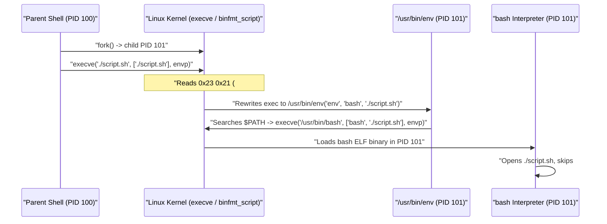
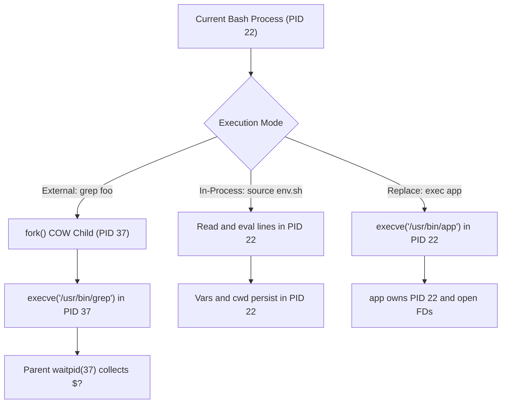

# Bash Execution Model & Linux Process Lifecycle

| Metadata      | Value                      |
| ------------- | -------------------------- |
| Author        | Lyzander Marciano Andrylie |
| Creation Date | Nov 14, 2026               |
| Last Updated  | Nov 14, 2026               |

## References

- [Shell / Bash Roadmap](https://roadmap.sh/shell-bash/): Structured learning path for shell execution, scripting, and Linux tooling
- [Linux Programmer's Manual: execve(2)](https://man7.org/linux/man-pages/man2/execve.2.html): Kernel binary/shebang execution, argument passing, and descriptor inheritance
- [Linux Programmer's Manual: fork(2)](https://man7.org/linux/man-pages/man2/fork.2.html): Child process creation, Copy-On-Write memory, and parent/child state separation
- [GNU Bash Reference Manual: Bash Startup Files](https://www.gnu.org/software/bash/manual/html_node/Bash-Startup-Files.html): Login, interactive, non-interactive, and POSIX mode configuration file resolution
- [GNU Bash Reference Manual: Command Execution Environment](https://www.gnu.org/software/bash/manual/html_node/Command-Execution-Environment.html): Shell execution environment, subshell inheritance, and built-in semantics
- [01_execution_and_subshells.sh](./examples/01_execution_and_subshells.sh): Runnable lab demonstrating command lookup precedence, `/proc/$BASHPID/status`, subshells, and pipeline variable scoping
- [bash.md](./bash.md): Bash mental model, 7-stage evaluation pipeline, and syntax translation table
- [variables_expansions_and_types.md](./variables_expansions_and_types.md): Environment exports, parameter expansions, arrays, and variable attributes
- [streams_redirection_and_ipc.md](./streams_redirection_and_ipc.md): Redirections, anonymous pipes, FIFOs, and process substitution mechanics
- [error_handling_signals_and_jobs.md](./error_handling_signals_and_jobs.md): Exit codes, `set -Eeuo pipefail`, `trap`, signals, and job control
- [file_descriptors.md](../file_descriptors.md): Kernel file descriptor tables, `dup2()`, and `FD_CLOEXEC` across `fork()` and `execve()`
- [file_permissions.md](../file_permissions.md): Execute (`+x`) and read (`+r`) inode permission bits required by scripts and binaries

## Description

Understanding Bash execution requires separating shell-level parsing from Linux kernel process primitives (`fork(2)`, `execve(2)`, `waitpid(2)`). Every command either mutates the current shell process directly (keywords, functions, built-ins, `source`) or spawns an isolated Copy-On-Write child process whose state changes vanish when it exits.

## Concepts

### 1. Shell Flavors & Startup Modes

Linux systems ship multiple shells with different POSIX strictness and startup file rules; which config files Bash reads depends on whether the session is **interactive** and whether it is a **login** shell.

- **Common Linux Shell Flavors**:
  - **`sh` (POSIX Shell)**: A standardized specification rather than one binary; on Debian/Ubuntu `/bin/sh` symlinks to `dash`, while on some distros it symlinks to `bash` running in POSIX compatibility mode (`--posix`).
  - **`bash` (Bourne Again SHell)**: Default interactive login shell on many Linux distributions; adds `[[ ]]`, arrays, associative arrays, `(( ))`, process substitution `<(cmd)`, and `shopt` options on top of POSIX.
  - **`dash` (Debian Almquist SHell)**: Minimal, strict POSIX shell with fast startup and low memory footprint; ideal for `/bin/sh` boot scripts, fails on Bashisms like `[[` or `source`.
  - **`zsh` (Z Shell)**: Extended interactive shell (default on macOS) with advanced completion and `lastpipe`-like right-hand pipeline execution in the current shell by default.
- **Mode Detection Signals**:
  - **Interactive (`i` in `$-`)**: Standard input and error are connected to a terminal (or `-i` was passed); enables job control (`set -m`), prompts (`PS1`), and line editing.
  - **Login (`shopt -q login_shell`)**: Invoked with `argv[0]` starting with `-` (e.g., `-bash` from `login`/`sshd`) or passed `-l` / `--login`.
  - **Non-Interactive Script**: `$-` lacks `i`, job control (`m`) is disabled, and `expand_aliases` is off by default.

| Startup Mode              | Typical Trigger                 | Startup Files Sourced (In Order)                                                     | Exit Cleanup         |
| :------------------------ | :------------------------------ | :----------------------------------------------------------------------------------- | :------------------- |
| **Interactive Login**     | SSH login, `su -`, `bash -l`    | `/etc/profile` -> first existing of `~/.bash_profile`, `~/.bash_login`, `~/.profile` | `~/.bash_logout`     |
| **Interactive Non-Login** | New GUI terminal tab, `bash`    | `/etc/bash.bashrc` (distro-dependent) -> `~/.bashrc`                                 | None                 |
| **Non-Interactive**       | `bash script.sh`, `./script.sh` | File named in `$BASH_ENV` (if set and readable); ignores `~/.bashrc`                 | `EXIT` trap (if set) |
| **POSIX / `sh` Mode**     | `sh`, `bash --posix`            | Login: `/etc/profile` then `~/.profile`; Interactive: file in `$ENV`                 | None                 |

> [!NOTE]
> Most `~/.bash_profile` templates explicitly source `~/.bashrc` so interactive login shells also receive aliases, functions, and prompt settings. Non-interactive scripts never read `~/.bashrc`, preventing broken scripts from user prompt customizations.

```shell
# Inspect current shell mode, flags, and /bin/sh target
bash -c 'echo "flags=$-"; shopt -q login_shell && echo "login=yes" || echo "login=no"; readlink -f /bin/sh'
# Output:
# flags=hBc
# login=no
# /bin/dash
```

---

### 2. Kernel Shebang Execution & Permissions

Executing `./script.sh` directly delegates interpreter discovery to the Linux kernel inside `execve(2)`, whereas running `bash script.sh` bypasses the kernel's shebang loader entirely.

- **Kernel `#!` Magic Bytes**:
  - When `execve("./script.sh", argv, envp)` runs, the kernel inspects the first two bytes (`0x23 0x21`, ASCII `#!`) in `fs/binfmt_script.c`.
  - It reads the remainder of line 1 (up to `BINPRM_BUF_SIZE`, 256 bytes on modern Linux), strips whitespace, and treats the first token as the interpreter path.
- **Single-Argument Kernel Limit**:
  - Linux splits only **one** optional argument after the interpreter path; any additional flags and spaces are passed as a single combined argument string.
  - `#!/usr/bin/env bash` looks up `bash` on `$PATH` (portable across `/bin/bash`, `/usr/bin/bash`, `/opt/homebrew/bin/bash`), unlike hardcoded `#!/bin/bash`.
  - Passing flags with `env` (e.g., `#!/usr/bin/env bash -euo pipefail`) fails on Linux without `env -S` (`#!/usr/bin/env -S bash -euo pipefail`), because `env` receives `"bash -euo pipefail"` as one filename.
- **Permission Bit Differences (`chmod +x` vs `bash script.sh`)**:
  - **`./script.sh`**: Calls `execve()` directly; the file **must** have both read (`+r`, so the interpreter can read it) and execute (`+x`, so the kernel permits `execve()`) permissions.
  - **`bash script.sh`**: Calls `execve("/usr/bin/bash", ["bash", "script.sh"], envp)`. Only `+r` is needed on `script.sh`; Bash opens it with `open(2)` and treats line 1 `#!...` as an ordinary comment.

#### Interaction



---

### 3. Command Resolution Hierarchy & Why Built-ins Exist

Before searching `$PATH`, Bash resolves a command name through a strict five-tier precedence chain, ensuring critical state-mutating operations run inside the shell process itself.

- **Strict Lookup Order (Highest to Lowest Precedence)**:
  1. **Aliases (`alias`)**: Textual token substitution during parsing (disabled in non-interactive scripts unless `shopt -s expand_aliases`).
  2. **Shell Keywords**: Parser syntax tokens (`[[`, `if`, `for`, `while`, `case`, `((`, `{`, `time`) that alter parsing rules before normal word expansion.
  3. **Shell Functions**: In-memory command routines defined via `fn() { ...; }`.
  4. **Shell Built-ins**: Compiled C routines inside the `bash` binary (`cd`, `export`, `read`, `exec`, `local`, `echo`, `printf`, `source`, `builtin`).
  5. **Hash Table & `$PATH` Binary Search**: Cached path lookup (`hash`) followed by scanning directories in `$PATH` left-to-right for an executable file.
- **Why `cd`, `export`, `read`, and `local` MUST Be Built-ins**:
  - When Linux runs an external binary via `fork()`, the child receives a copied `task_struct` containing its own `fs_struct` (current working directory `cwd`) and Copy-On-Write memory pages (environment array `environ`).
  - If `cd` were `/usr/bin/cd`, calling `chdir(2)` inside that child would change only the child's `cwd` before it immediately exited, leaving the parent shell's directory unchanged.
  - Similarly, an external `export` could only call `setenv(3)` on its own memory copy and could never inject variables into the parent shell.
- **Inspecting and Bypassing Precedence**:
  - `type -a <cmd>`: Lists every matching definition in lookup order (function, builtin, `/usr/bin/...`).
  - `command -v <cmd>`: Prints the single resolved path or name that Bash will actually invoke (POSIX-portable).
  - `builtin <cmd>`: Forces Bash to invoke the built-in, bypassing any function of the same name.
  - `command <cmd>`: Skips aliases and functions, executing a built-in or `$PATH` binary directly.

```shell
# Excerpt from examples/01_execution_and_subshells.sh
type -a "[[" "cd" "echo" "ls"
# Output:
# [[ is a shell keyword
# cd is a shell builtin
# echo is a shell builtin
# echo is /usr/bin/echo
# echo is /bin/echo
# ls is /usr/bin/ls
# ls is /bin/ls

echo() { printf '[custom function] %s\n' "$*"; }
echo "hello"         # hits function
builtin echo "hello" # skips function, calls C builtin
# Output:
# [custom function] hello
# hello
```

---

### 4. Process Execution Modes

Bash executes targets through three distinct kernel process models depending on whether you invoke a regular command, `source`, or `exec`.

- **External Command (`cmd`)**:
  - Shell calls `fork()` (or `clone(2)`), creating a child process with Copy-On-Write (COW) memory pages—pages are shared read-only until either process writes and triggers a page fault copy.
  - Child sets up any command redirections via `dup2(2)`, then calls `execve()` to wipe its address space and load the new ELF binary.
  - Parent suspends in `waitpid(2)` (unless backgrounded with `&`) and reads the child's 8-bit exit status (`0..255`).
- **In-Process Evaluation (`source script.sh` or `. script.sh`)**:
  - No `fork()` or `execve()` occurs; the current shell opens the file and executes each line in its own PID and memory space.
  - Variable assignments, `cd`, function definitions, `shopt` settings, and `trap` handlers persist in the caller.
- **In-Place Image Replacement (`exec cmd`)**:
  - Skips `fork()` and calls `execve()` directly inside the current shell's PID.
  - Keeps the exact same PID (`$$`), parent PID (`PPid`), and open file descriptors (except those marked `FD_CLOEXEC`), while discarding shell variables and functions.
  - Calling `exec > out.log 2>&1` with **no command** permanently applies the redirections to the current shell process itself.

| Execution Mode     | `fork()` Called? | `execve()` Called? | PID Behavior   | Vars / `cwd` Persist? | Open FDs Inherited?       | Common Use Case                            |
| :----------------- | :--------------: | :----------------: | :------------- | :-------------------: | :------------------------ | :----------------------------------------- |
| **External `cmd`** |       Yes        |        Yes         | New child PID  |          No           | Yes (unless `FD_CLOEXEC`) | Running tools (`grep`, `python3`, `git`)   |
| **`source` / `.`** |        No        |         No         | Same shell PID |          Yes          | Yes (same FD table)       | Loading `.env`, helper libraries, `venv`   |
| **`exec cmd`**     |        No        |        Yes         | Same shell PID |          No           | Yes (unless `FD_CLOEXEC`) | Container `entrypoint.sh`, wrapper scripts |

#### Interaction



```shell
# Verify exec replaces the shell image while keeping the exact same PID
bash -c 'echo "parent=$$"; exec bash -c "echo exec_pid=\$BASHPID"'
# Output:
# parent=22
# exec_pid=22
```

---

### 5. Subshells `( ... )` vs Compound Grouping `{ ...; }` & The Pipeline Subshell Trap

Syntactic parentheses vs curly braces control whether Bash forks a Copy-On-Write subshell or stays in the current process—a distinction that causes the most common variable-scoping bug in Bash pipelines.

- **Compound Grouping `{ ...; }` (Same Process)**:
  - Runs commands inside the **current** shell process; variable mutations, `cd`, and traps survive after `}`.
  - Syntax requirements: `{` is a keyword that requires trailing whitespace (`{ cmd; }`), and `}` must be preceded by `;` or a newline.
- **Explicit Subshell `( ... )` (Forked Child)**:
  - Forks a child shell process; inherits variables, functions, `cwd`, FDs, and umask via COW, but any changes to them are discarded when the subshell exits.
  - Used intentionally to isolate temporary `cd`, `umask`, or `set` option changes without cleaning up manually.
- **PID & Nesting Inspection (`$$`, `$BASHPID`, `$BASH_SUBSHELL`, `/proc`)**:
  - **`$$`**: Always expands to the **original parent shell's PID**, even inside nested subshells (useful for unique temp filenames, misleading for subshell debugging).
  - **`$BASHPID`** (Bash 4+): Expands to the **actual Linux PID** of the currently executing shell or subshell, matching `Pid:` in `/proc/$BASHPID/status`.
  - **`$BASH_SUBSHELL`**: Integer nesting depth (`0` in main shell and `{ ...; }`, `1` inside `( ... )` or `$( ... )`, `2` inside `( ( ... ) )`).
- **Implicit Subshell Triggers**:
  - Command substitution `$(cmd)` / `` `cmd` ``
  - Process substitution `<(cmd)` / `>(cmd)`
  - Background jobs `cmd &`
  - Pipeline stages `cmd1 | cmd2` (every stage runs in its own forked subshell by default)

| Construct             | Spawns Subshell (`fork`)? | `$$` Changes? | `$BASHPID` Changes? | `$BASH_SUBSHELL` | State (`var`, `cd`) Persists? |
| :-------------------- | :-----------------------: | :-----------: | :-----------------: | :--------------: | :---------------------------: |
| **`{ cmd1; cmd2; }`** |            No             |      No       |         No          |       `0`        |              Yes              |
| **`( cmd1; cmd2 )`**  |            Yes            |      No       |         Yes         |  Increments +1   |              No               |
| **`$(cmd)`**          |            Yes            |      No       |         Yes         |  Increments +1   |              No               |
| **`cmd1 \| cmd2`**    |     Yes (each stage)      |      No       |         Yes         |  Increments +1   | No (unless `lastpipe` active) |

#### The Pipeline Subshell Trap & Its 3 Fixes

Because `cmd1 | cmd2` forks a subshell for `cmd2` by default, any variable assigned inside a piped `while read` loop modifies only the child's COW memory and disappears when the pipe finishes.

```shell
# Bug: `while` runs in a subshell; `count` remains 0 in the parent shell
count=0
printf 'alpha\nbeta\ngamma\n' | while IFS= read -r line; do
    count=$((count + 1))
done
echo "count=$count"
# Output: count=0
```

- **Fix 1 — Input Redirection (`< "$file"`)**: Redirects a file directly into the `while` loop's FD 0 in the **current** shell (zero subshells spawned; POSIX-portable).
- **Fix 2 — Process Substitution (`< <(cmd)`)**: Forks only `cmd` and connects its stdout via `/dev/fd/N`, allowing the `while` loop to run in the **current** shell (Bash/Zsh/Ksh; not POSIX `sh`).
- **Fix 3 — `shopt -s lastpipe` (Bash 4.2+)**: Executes the **final** stage of a pipeline in the current shell, **provided job control is off (`set +m`)**—already the default in non-interactive scripts, though `set +m` must be explicit in interactive shells.

```shell
# Excerpt from examples/01_execution_and_subshells.sh (all 3 fixes print count=3)
# Fix 1: Input redirection
count=0
while IFS= read -r _line; do count=$((count + 1)); done < "$data_file"

# Fix 2: Process substitution
count=0
while IFS= read -r _line; do count=$((count + 1)); done < <(printf 'alpha\nbeta\ngamma\n')

# Fix 3: lastpipe with job control disabled
set +m
shopt -s lastpipe
count=0
printf 'alpha\nbeta\ngamma\n' | while IFS= read -r _line; do count=$((count + 1)); done
```

#### Actual Lab Output (`01_execution_and_subshells.sh`)

```text
=== 2. $$ vs $BASHPID vs $BASH_SUBSHELL and /proc/$BASHPID/status ===
Main shell       : $$=22  BASHPID=22  BASH_SUBSHELL=0  [Pid: 22 PPid: 1]
Group { ...; }   : $$=22  BASHPID=22  BASH_SUBSHELL=0  [Pid: 22 PPid: 1]
Subshell (...)   : $$=22  BASHPID=37  BASH_SUBSHELL=1  [Pid: 37 PPid: 22]
Nested ((...))   : $$=22  BASHPID=42  BASH_SUBSHELL=2  [Pid: 42 PPid: 37]
Cmd subst $(...) : $$=22  BASHPID=47  BASH_SUBSHELL=1  [Pid: 47 PPid: 22]

=== 3. State Mutation: { ...; } vs ( ... ) ===
Inside { ...; }  : state=mutated-in-group  PWD=/tmp/tmp.P5UmvoONNF
After  { ...; }  : state=mutated-in-group  PWD=/tmp/tmp.P5UmvoONNF
Inside ( ... )   : state=mutated-in-subshell  PWD=/home/lyzander/documents/note
After  ( ... )   : state=mutated-in-group  PWD=/tmp/tmp.P5UmvoONNF (unchanged)

=== 4. The Pipeline Subshell Trap & Its 3 Fixes ===
Buggy pipe (printf | while)        : count=0 (lost in subshell)
Fix 1 (< "$file" redirection)      : count=3
Fix 2 (< <(cmd) process subst)     : count=3
Fix 3 (shopt -s lastpipe + set +m) : count=3
```
