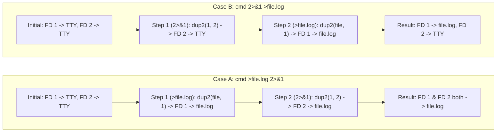
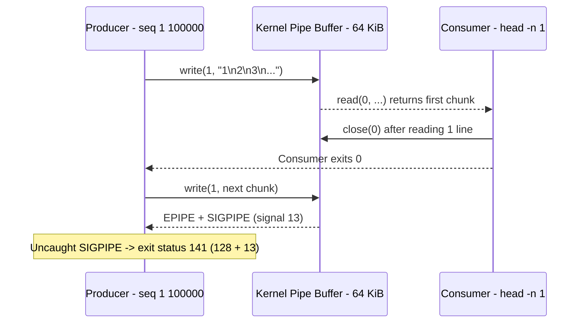

# Bash Streams, Redirection, and Inter-Process Communication (IPC)

| Metadata      | Value                      |
| ------------- | -------------------------- |
| Author        | Lyzander Marciano Andrylie |
| Creation Date | Nov 14, 2026               |
| Last Updated  | Nov 14, 2026               |

## References

- [roadmap.sh: Shell / Bash Roadmap](https://roadmap.sh/shell-bash/): Learning path for shell scripting, I/O redirection, pipelines, and Unix stream processing
- [GNU Bash Manual: Redirections](https://www.gnu.org/software/bash/manual/html_node/Redirections.html): Official specification for file descriptor duplication, here-documents, here-strings, and process substitution
- [Linux Programmer's Manual: dup(2)](https://man7.org/linux/man-pages/man2/dup.2.html): Kernel `dup()`, `dup2()`, and `dup3()` system calls for duplicating file descriptors
- [Linux Programmer's Manual: pipe(7)](https://man7.org/linux/man-pages/man7/pipe.7.html): Kernel pipe capacity, `PIPE_BUF` atomicity, EOF rules, and `SIGPIPE` semantics
- [04_streams_and_ipc.sh](./examples/04_streams_and_ipc.sh): Runnable lab demonstrating `dup2()` ordering, dynamic FDs, here-docs, process substitution, FIFOs, and null-delimited pipelines
- [bash.md](./bash.md): Bash mental model, 7-stage evaluation order, and high-level syntax translation
- [execution_and_processes.md](./execution_and_processes.md): Process creation (`fork`/`execve`), subshells, and pipeline process boundaries
- [error_handling_signals_and_jobs.md](./error_handling_signals_and_jobs.md): `pipefail`, `PIPESTATUS`, `SIGPIPE` handling, `trap`, and background job control
- [file_descriptors.md](../file_descriptors.md): Kernel three-tier FD architecture (`fdtable`, `struct file`, `struct inode`) and `/proc/<pid>/fd`

## Description

Bash streams and redirections let a script rewire a process's per-process file descriptor table via `open(2)` and `dup2(2)` before executing a command, separating normal output from diagnostics and routing data without modifying program code. Combined with kernel pipes (`pipe(2)`), named FIFOs, and `/dev/fd` process substitution, independent commands compose into concurrent streaming pipelines without intermediate temporary files.

## Concepts

### 1. File Descriptors & `dup2(2)` Left-to-Right Redirection Semantics

Every POSIX process starts with three standard file descriptors (`0`, `1`, `2`) pointing to entries in the kernel's system-wide open file table (`struct file`), and Bash evaluates redirections strictly **from left to right** before running the command.

- **Standard & Custom File Descriptors**:
  - `0` (`stdin`): Standard input stream read by commands.
  - `1` (`stdout`): Standard output stream for primary program results.
  - `2` (`stderr`): Standard error stream for warnings, errors, and diagnostics.
  - `3..9`: Static user-defined FDs available in scripts (risks collision if nested functions hardcode the same integer).
  - `{fd}` (`>= 10`): Dynamic FD allocation introduced in Bash 4.1; Bash picks the lowest unused FD `>= 10` and stores the integer in `$fd`.
- **Inspecting Live Descriptors**:
  - `/proc/self/fd/` exposes symbolic links from every open FD in the inspecting process to its underlying file, TTY, or `pipe:[inode]`.
  - `/proc/$$/fdinfo/<fd>` reports kernel open-file state: current byte offset (`pos`), octal access/status flags (`flags`), and mount ID (`mnt_id`).
- **Why Left-to-Right Order Changes Behavior (`dup2(oldfd, newfd)`)**:
  - `dup2(oldfd, newfd)` makes `newfd` point to the **same `struct file` pointer** currently referenced by `oldfd`, closing `newfd` first if it was open.
  - **`cmd >file.log 2>&1` (Both to `file.log`)**:
    1. `>file.log` opens `file.log` and calls `dup2(tmp_fd, 1)` -> FD `1` points to `file.log`.
    2. `2>&1` calls `dup2(1, 2)` -> FD `2` copies FD `1`'s **new** pointer (`file.log`). Both streams write to `file.log` and share one `f_pos` offset.
  - **`cmd 2>&1 >file.log` (`stderr` to original `stdout`, `stdout` to `file.log`)**:
    1. `2>&1` calls `dup2(1, 2)` -> FD `2` copies FD `1`'s **original** pointer (e.g., the TTY or an outer pipe).
    2. `>file.log` calls `dup2(tmp_fd, 1)` -> FD `1` is reassigned to `file.log`, while FD `2` keeps pointing to the original TTY/pipe.
  - **Bash 4+ Shortcuts**: `&>file.log` is equivalent to `>file.log 2>&1`, and `&>>file.log` is equivalent to `>>file.log 2>&1`.

| Redirection Syntax      | Kernel Action (Left to Right)                                     | Final `stdout` (FD 1) | Final `stderr` (FD 2) |
| :---------------------- | :---------------------------------------------------------------- | :-------------------- | :-------------------- |
| `>file.log`             | `open("file.log", O_WRONLY\|O_CREAT\|O_TRUNC)` -> `dup2(tmp, 1)`  | `file.log`            | Original `stderr`     |
| `>>file.log`            | `open("file.log", O_WRONLY\|O_CREAT\|O_APPEND)` -> `dup2(tmp, 1)` | `file.log` (append)   | Original `stderr`     |
| `<input.txt`            | `open("input.txt", O_RDONLY)` -> `dup2(tmp, 0)`                   | Original `stdout`     | Original `stderr`     |
| `>file.log 2>&1`        | `dup2(file, 1)` then `dup2(1, 2)`                                 | `file.log`            | `file.log`            |
| `2>&1 >file.log`        | `dup2(1, 2)` then `dup2(file, 1)`                                 | `file.log`            | Original `stdout`     |
| `&>file.log`            | Shorthand for `>file.log 2>&1`                                    | `file.log`            | `file.log`            |
| `>file.log 2>/dev/null` | `dup2(file, 1)` then `dup2(null_fd, 2)`                           | `file.log`            | Discarded             |

#### Interaction



```shell
emit_streams() {
    printf 'stdout: payload line\n'
    printf 'stderr: diagnostic warning\n' >&2
}

# Both stdout and stderr land in combined.log
emit_streams >combined.log 2>&1
cat combined.log
# Output:
# stdout: payload line
# stderr: diagnostic warning

# Only stdout lands in stdout_only.log; stderr goes to original stdout
{ emit_streams 2>&1 >stdout_only.log; } >orig_stdout.log
cat stdout_only.log
# Output:
# stdout: payload line
cat orig_stdout.log
# Output:
# stderr: diagnostic warning
```

---

### 2. Custom File Descriptors & In-Process `exec` Redirection

Redirections attached to a regular command modify only that command's execution environment, whereas `exec` without a command mutates the **current shell's** descriptor table persistently.

- **Persistent Shell Redirections**:
  - `exec 3>audit.log`: Opens `audit.log` on FD `3` in the current shell so subsequent commands can log with `>&3` without reopening the file on every write.
  - `exec 4<config.txt`: Opens `config.txt` for reading on FD `4`.
  - `exec {rw_fd}<>data.txt`: Allocates a dynamic read-write FD (`>= 10`) and stores its number in `$rw_fd`, eliminating hardcoded FD collisions in reusable libraries.
- **Reading, Writing, and Closing**:
  - **Write**: `printf '%s\n' "entry" >&"$rw_fd"` writes directly to `$rw_fd`.
  - **Read**: `IFS= read -r -u "$rw_fd" line` reads one line from `$rw_fd` using `read`'s `-u` flag.
  - **Close**: `exec {rw_fd}>&-` (or `<&-` for read FDs) closes the descriptor and decrements the kernel `struct file` reference count (`f_count`).
- **Shared Offset Gotcha (`<>`)**:
  - Opening a file with `exec {myfd}<>file` creates a **single** `struct file` entry with one shared `f_pos` cursor.
  - Writing 11 bytes advances `f_pos` to `11` (EOF). Calling `read -r -u "$myfd"` immediately afterward reads at offset `11` and hits EOF; reopen a fresh read descriptor (`exec {rfd}<file`) to read from offset `0`.

> [!TIP]
> Prefer `exec {fd}>file` over hardcoded `exec 3>file` in functions and libraries. Hardcoded numbers like `3` silently overwrite each other when two functions or sourced scripts pick the same slot.

```shell
exec {myfd}<>"fd_demo.txt"
printf 'Allocated FD %d -> %s\n' "$myfd" "$(readlink "/proc/self/fd/$myfd")"
# Output:
# Allocated FD 10 -> /tmp/tmp.6ilBZR1HWV/fd_demo.txt

printf 'alpha\nbeta\n' >&"$myfd"
grep '^pos:' "/proc/$$/fdinfo/$myfd"
# Output:
# pos:	11

# Shared f_pos is at EOF; open a separate read FD to read from offset 0
exec {rfd}<"fd_demo.txt"
while IFS= read -r -u "$rfd" line; do
    printf 'Read via FD %d: %s\n' "$rfd" "$line"
done
# Output:
# Read via FD 11: alpha
# Read via FD 11: beta

exec {myfd}>&-
exec {rfd}<&-
```

---

### 3. Here-Documents & Here-Strings

Here-documents and here-strings feed inline multi-line blocks or single strings directly into a command's `stdin` (FD `0`) without creating explicit files on disk.

- **Quoting & Tab-Stripping Rules**:
  - `<<EOF`: Unquoted delimiter enables parameter (`$var`), command (`$(...)`), and arithmetic (`$((...))`) expansion inside the body.
  - `<<'EOF'` (or `<<"EOF"` / `<<\EOF`): Quoted delimiter disables **all** expansions, treating every character literally (ideal for generating scripts or remote SSH payloads).
  - `<<-EOF`: Strips leading **literal tab** (`\t`) characters from every line in the body and from the closing `EOF` line so indented blocks stay readable; leading spaces are **not** stripped.
  - `<<< "$var"`: Here-string expands `"$var"` and passes it as `stdin` with a single trailing newline appended.
- **Kernel Backing (Pipes vs Temporary Files)**:
  - **Bash 5.0 and earlier**: Always wrote here-documents and here-strings to an unlinked temporary file in `$TMPDIR` (default `/tmp`), failing if `$TMPDIR` was full or read-only.
  - **Bash 5.1 and newer**: Uses an anonymous kernel `pipe(2)` whenever the expanded payload fits within the pipe buffer capacity (typically 64 KiB on Linux), eliminating disk I/O; falls back to an unlinked temporary file only when the payload exceeds pipe capacity.

| Construct  | Expansions Inside Body | Whitespace Stripping   | Trailing Newline Added | Primary Use Case                                  |
| :--------- | :--------------------- | :--------------------- | :--------------------- | :------------------------------------------------ |
| `<<EOF`    | Yes                    | None                   | Preserves body lines   | Multi-line templates using shell variables        |
| `<<'EOF'`  | No (verbatim)          | None                   | Preserves body lines   | Embedded SQL, JSON, or remote scripts with `$`    |
| `<<-EOF`   | Yes (unless `'EOF'`)   | Leading `\t` tabs only | Preserves body lines   | Indented multi-line blocks inside functions/loops |
| `<<< "$s"` | Yes (`"$s"` expanded)  | None                   | Appends one `\n`       | Feeding a variable string to `read`, `grep`, `tr` |

```shell
env_name="production"

cat <<EOF
[expanded <<EOF] env=$env_name
EOF
# Output:
# [expanded <<EOF] env=production

cat <<'EOF'
[literal <<'EOF'] env=$env_name
EOF
# Output:
# [literal <<'EOF'] env=$env_name

tr '[:lower:]' '[:upper:]' <<< "here-string: $env_name"
# Output:
# HERE-STRING: PRODUCTION

readlink /proc/self/fd/0 <<< 'probe'
# Output:
# pipe:[80161]
```

---

### 4. Anonymous Pipes (`|`, `|&`) & Named Pipes (`mkfifo`)

Pipes connect the `stdout` of a producer process directly to the `stdin` of a consumer process through an in-memory kernel ring buffer (`pipe(2)`), synchronizing speeds automatically without disk writes.

- **Anonymous Pipe Mechanics (`|`, `|&`)**:
  - `cmd1 | cmd2`: Creates a unidirectional pipe via `pipe(2)` (default 64 KiB / 16 memory pages on Linux x86_64; writes up to `PIPE_BUF` = 4096 bytes are guaranteed atomic), binds `cmd1` FD `1` to the write end and `cmd2` FD `0` to the read end, and runs both commands concurrently in subshells.
  - `cmd1 |& cmd2`: Bash 4+ shorthand for `cmd1 2>&1 | cmd2`, merging both `stdout` and `stderr` into the pipe.
  - **Backpressure**: When the 64 KiB kernel buffer fills, the producer's `write(2)` blocks in the kernel until the consumer calls `read(2)` and frees space.
  - **EOF Semantics**: The consumer receives EOF (`read(2)` returns `0`) **only when every FD pointing to the pipe's write end is closed** across all processes. Leaving a background child inheriting the write FD causes the consumer to hang indefinitely.
- **`SIGPIPE` & Exit Status `141`**:
  - When a downstream consumer closes its read end early (for example, `head -n 1` exits after reading 1 line), the kernel marks the pipe as broken.
  - On the producer's next `write(2)`, the kernel returns `EPIPE` and delivers `SIGPIPE` (signal `13`) to the producer, terminating it with exit code `128 + 13 = 141`.
  - Under `set -o pipefail`, a pipeline like `seq 1 100000 | head -n 1` returns `141` (non-zero!) instead of `0`, even though `head` succeeded.
- **Named Pipes (`mkfifo`)**:
  - `mkfifo path` creates a persistent directory entry (type `p` in `ls -l`) backed by the same in-memory kernel pipe buffer; bytes never hit disk.
  - Opening a FIFO blocks until **both** a reader and a writer have opened it (unless opened with `O_NONBLOCK`), enabling unrelated processes—not just parent-forked pipeline siblings—to stream data.

| Property             | Anonymous Pipe (`cmd1 \| cmd2`)   | Named Pipe (`mkfifo path`)                         |
| :------------------- | :-------------------------------- | :------------------------------------------------- |
| **Filesystem Entry** | None (anonymous `pipe:[inode]`)   | Persistent path entry (`p` inode)                  |
| **Process Scope**    | Parent-created sibling subshells  | Any unrelated processes with path permissions      |
| **Open Blocking**    | Ready immediately after `pipe(2)` | Blocks on `open()` until reader and writer connect |
| **Cleanup**          | Kernel frees when all FDs close   | Path remains until `rm`; buffer frees on close     |

#### Interaction



```shell
# SIGPIPE demonstration (with pipefail disabled to inspect PIPESTATUS)
seq 1 100000 | head -n 1 >/dev/null
printf 'PIPESTATUS: %s\n' "${PIPESTATUS[*]}"
# Output:
# PIPESTATUS: 141 0

# Named pipe (FIFO): background producer -> main-shell consumer
mkfifo job.fifo
(
    printf 'job-1:ready\n'
    printf 'job-2:done\n'
) >job.fifo &
producer_pid=$!

while IFS= read -r msg; do
    printf 'Consumed from FIFO: %s\n' "$msg"
done <job.fifo
wait "$producer_pid"
# Output:
# Consumed from FIFO: job-1:ready
# Consumed from FIFO: job-2:done
```

---

### 5. Process Substitution (`<(cmd)` and `>(cmd)`)

Process substitution exposes the input or output of an asynchronous command as a **filename argument** (`/dev/fd/<n>`), letting tools that expect file paths consume or produce live streams without temporary files.

- **How It Works**:
  - `<(cmd)` creates a kernel pipe, spawns `cmd` with its `stdout` attached to the write end, and substitutes `/dev/fd/<n>` (pointing to the read end) on the outer command's argument list.
  - `>(cmd)` binds `cmd`'s `stdin` to the read end and substitutes `/dev/fd/<n>` for a command to write into (such as `tee >(gzip > archive.gz) | wc -l`).
  - **Non-Seekable Limitation**: Because `/dev/fd/<n>` resolves to `pipe:[inode]`, target programs cannot `lseek(2)` backward or read file size from `stat(2)`.
- **Avoiding Pipeline Subshell Variable Loss**:
  - In `printf 'a\nb\n' | while read -r x; do ((++count)); done`, Bash runs `while` in a subshell, so `count` resets to `0` after the loop exits.
  - Redirecting from process substitution—`while IFS= read -r x; do ((++count)); done < <(printf 'a\nb\n')`—runs the `while` loop in the **current shell**, preserving `count` and array mutations.

> [!NOTE]
> Process substitution is a Bash/Zsh/Ksh extension and is **not** available in POSIX `/bin/sh` (`dash`). Scripts using `<(...)` or `>(...)` must declare `#!/usr/bin/env bash`.

```shell
# Inspect the /dev/fd symlink created by <(cmd)
ls -l <(echo hello)
# Output:
# lr-x------ 1 lyzander lyzander 64 Nov 14 14:12 /dev/fd/63 -> 'pipe:[86257]'

# Compare two command streams directly without temp files
diff -u <(printf 'a\nb\n') <(printf 'a\nc\n') || true
# Output:
# --- /dev/fd/63	2026-11-14 14:12:36.198315138 +0700
# +++ /dev/fd/62	2026-11-14 14:12:36.198315138 +0700
# @@ -1,2 +1,2 @@
#  a
# -b
# +c

# Preserve loop state in the current shell
count=0
while IFS= read -r item; do
    (( ++count ))
    printf 'Item %d: %s\n' "$count" "$item"
done < <(printf 'apple\nbanana\n')
printf 'Count preserved in current shell: %d\n' "$count"
# Output:
# Item 1: apple
# Item 2: banana
# Count preserved in current shell: 2
```

---

### 6. Unix Stream Filters & Null-Delimited Pipelines

Unix stream filters transform line- or record-oriented text over `stdin`/`stdout`, while **NUL-delimited (`\0`)** pipelines protect file paths containing spaces, tabs, quotes, or embedded newlines.

- **Core Unix Stream Filter Toolkit**:

| Tool      | Primary Role                              | Key Flags & Critical Gotchas                                                         |
| :-------- | :---------------------------------------- | :----------------------------------------------------------------------------------- |
| `grep -E` | Extended regex line filtering             | `-q` exits `0`/`1` silently for `if` tests; `-F` treats pattern as literal string    |
| `sed -E`  | Stream regex substitution & line editing  | `-E` enables ERE (`+`, `?`, `(...)`); `-n` + `p` prints only matched lines           |
| `awk`     | Field-splitting & stateful aggregation    | Default splits on whitespace; use `-F','` for delimiters and `BEGIN`/`END` blocks    |
| `cut`     | Fast byte/character/single-char splitting | `-d':' -f1,3`; does **not** collapse repeated spaces (use `awk` for whitespace)      |
| `sort`    | Lexicographic or numeric sorting          | `-n` numeric, `-r` reverse, `-z` NUL-delimited, `LC_ALL=C sort` for byte-order speed |
| `uniq -c` | Collapse & count adjacent identical lines | **Only checks adjacent lines**; almost always requires `sort` immediately before it  |
| `tr`      | Character-level translate or delete       | Operates on single characters (`'[:lower:]' '[:upper:]'`), not multi-char strings    |
| `tee`     | Duplicate `stdin` to file(s) and `stdout` | `-a` appends; combine with `>(...)` to split one stream into parallel filters        |

- **Why Newline-Delimited File Pipelines Break**:
  - POSIX filenames allow **every byte except `/` and NUL (`\0`)**, including spaces, tabs, quotes, and literal `\n` characters.
  - Piping `find ... | xargs cmd` splits on whitespace and quotes, breaking `"alpha report.log"` into two missing paths `"alpha"` and `"report.log"`.
- **Null-Delimited Safety Rules**:
  - Emit NUL-terminated records with `find ... -print0` (and sort safely with `sort -z`).
  - Consume with `xargs -0` for bulk commands, or `while IFS= read -r -d '' filepath; do ...; done` in Bash (`-d ''` sets the record delimiter to NUL `\0`, `IFS=` preserves leading/trailing spaces, `-r` prevents backslash interpretation).

```shell
# Safely process filenames containing spaces (and even newlines)
mkdir -p logs
touch "logs/alpha report.log" "logs/beta  summary.log"
find logs -maxdepth 1 -name '*.log' -print0 | sort -z | while IFS= read -r -d '' filepath; do
    printf 'Safely processed file: %s\n' "${filepath##*/}"
done
# Output:
# Safely processed file: alpha report.log
# Safely processed file: beta  summary.log

# Stream filter aggregation: extract log level, count occurrences, sort descending
cat <<'EOF' | sed -E 's/^\[([A-Z]+)\] .*/\1/' | awk '{print $1}' | sort | uniq -c | sort -nr
[INFO] server started
[WARN] cache miss
[INFO] request served
[ERROR] timeout
[INFO] connection closed
EOF
# Output:
#       3 INFO
#       1 WARN
#       1 ERROR
```
