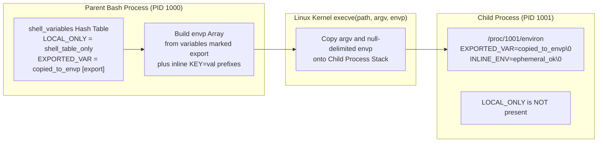

# Bash Variables, Quoting, Expansions & Data Types

| Metadata      | Value                      |
| ------------- | -------------------------- |
| Author        | Lyzander Marciano Andrylie |
| Creation Date | Nov 14, 2026               |
| Last Updated  | Nov 14, 2026               |

## References

- [roadmap.sh: Shell / Bash Roadmap](https://roadmap.sh/shell-bash/): Core shell programming concepts, parameter expansion, and scripting fundamentals
- [GNU Bash Reference Manual: Shell Parameters](https://www.gnu.org/software/bash/manual/html_node/Shell-Parameters.html): Variable assignment, positional parameters, and special shell parameters
- [GNU Bash Reference Manual: Shell Parameter Expansion](https://www.gnu.org/software/bash/manual/html_node/Shell-Parameter-Expansion.html): In-process string manipulation, default fallbacks, slicing, and case conversion
- [Linux Programmer's Manual: environ(7)](https://man7.org/linux/man-pages/man7/environ.7.html): Process environment block (`envp`), inheritance across `execve(2)`, and `/proc` inspection
- [02_variables_and_arrays.sh](./examples/02_variables_and_arrays.sh): Executable lab demonstrating kernel environment passing, quoting, parameter expansions, and arrays
- [bash.md](./bash.md): Shell mental model, tokenization mechanics, and the 7-stage command evaluation pipeline
- [execution_and_processes.md](./execution_and_processes.md): Process boundaries, `fork()`/`execve()` inheritance, and subshell isolation
- [control_flow_and_functions.md](./control_flow_and_functions.md): Function variable scoping (`local`), conditionals, and loop iteration
- [error_handling_signals_and_jobs.md](./error_handling_signals_and_jobs.md): Strict `set -u` (`nounset`) semantics, error propagation, and signal traps

## Description

Bash stores all scalar values as null-terminated C strings inside an internal hash table and exposes a subset of them across Linux `execve(2)` process boundaries via the kernel `environ` array. Mastering quoting boundaries, zero-fork `${...}` parameter expansions, and indexed or associative arrays prevents word-splitting bugs while eliminating unnecessary `fork()`/`execve()` calls to external text utilities.

## Concepts

### 1. Shell Variables vs Kernel Environment Variables

Bash maintains a clear boundary between private shell-local state and process-wide environment variables passed to child executables through the Linux kernel.

- **Bash Internal Storage (`shell_variables`)**:
  - Every assignment (`VAR="value"`) creates or updates an entry in Bash's internal `shell_variables` hash table in user-space heap memory.
  - By default, variables carry no export attribute and remain invisible to external programs invoked by the shell.
- **Kernel Environment Block (`environ` / `envp`)**:
  - When Bash invokes an external binary, it calls `fork()` followed by `execve(path, argv, envp)`.
  - Only variables marked with the export attribute (`export VAR` or `declare -x VAR`) are serialized as `"KEY=VALUE"` strings into the `envp` pointer array passed to `execve(2)`.
  - The Linux kernel copies `envp` into the new process's user-space stack above `argv`, exposing it to user programs via `extern char **environ` and to diagnostics via `/proc/<pid>/environ` as a null-byte (`\0`) delimited buffer.
  - **One-Way Inheritance**: A child process receives a copy of `envp` and can never mutate the parent shell's `shell_variables` or `environ`.
- **Lifecycle Commands & Scoping**:
  - `export KEY=val` / `declare -x KEY=val`: Sets the variable in `shell_variables` and flags it for inclusion in future `envp` arrays.
  - `export -n KEY` / `declare +x KEY`: Strips the export flag while keeping `KEY` in `shell_variables`.
  - `unset KEY`: Removes `KEY` from both `shell_variables` and future `envp` blocks.
  - `KEY=val cmd args`: Assigns `KEY=val` exclusively in the temporary `envp` passed to `cmd` without altering the current shell's `shell_variables` (valid for external commands and most builtins; special builtins like `eval` retain side effects unless POSIX mode is off, and shell functions vary by POSIX mode).

> [!NOTE]
> `/proc/self/environ` reflects the initial `envp` snapshot captured when the current process called `execve(2)`. Running `export FOO=bar` updates Bash's in-memory export list for **subsequent child processes**, not the current shell's own `/proc/self/environ`.

#### Interaction



```shell
LOCAL_ONLY="shell_table_only"
export EXPORTED_VAR="copied_to_envp"

# Inspect the child process's kernel environ block (null-byte delimited)
bash -c 'tr "\0" "\n" < /proc/$$/environ | grep -E "^(LOCAL_ONLY|EXPORTED_VAR|INLINE_ENV)=" || true'
# Output: EXPORTED_VAR=copied_to_envp

# Single-command inline environment prefix (does not pollute parent shell)
INLINE_ENV="ephemeral_ok" bash -c 'tr "\0" "\n" < /proc/$$/environ | grep -E "^(EXPORTED_VAR|INLINE_ENV)=" | sort'
# Output:
# EXPORTED_VAR=copied_to_envp
# INLINE_ENV=ephemeral_ok

printf 'Parent INLINE_ENV=%s\n' "${INLINE_ENV:-unset}"
# Output: Parent INLINE_ENV=unset
```

---

### 2. Quoting Semantics & Byte Preservation

Quoting controls which characters Bash treats as metacharacters during tokenization and whether expansions undergo post-expansion word splitting and pathname globbing.

| Quoting Mode        | Syntax    | Variable / Command Expansion |   Escape Sequences (`\`)   | Word Splitting (`IFS`) & Globbing (`*`, `?`) | Primary Use Case                                                      |
| :------------------ | :-------- | :--------------------------: | :------------------------: | :------------------------------------------: | :-------------------------------------------------------------------- |
| **Unquoted**        | `word`    |             Yes              |        Single char         |                   **Yes**                    | Command names, explicit glob patterns (`*.log`), deliberate splitting |
| **Weak (Double)**   | `"word"`  |             Yes              | `\$`, `\"`, `\\`, `` \` `` |                    **No**                    | General variable interpolation (`"$file"`) preserving whitespace      |
| **Strong (Single)** | `'word'`  |            **No**            |           **No**           |                    **No**                    | 100% literal strings, regexes, SQL/awk scripts, remote `ssh` args     |
| **ANSI-C**          | `$'word'` |            **No**            |     **Full C escapes**     |                    **No**                    | Control characters (`\n`, `\t`, `\r`, `\x41`, `\u00e9`)               |

- **Unquoted Expansion Hazards**:
  - After `${var}` or `$(cmd)` expands, unquoted text enters Stage 4 (`IFS` word splitting, defaulting to space, tab, newline) and Stage 5 (pathname globbing).
  - A variable holding `"report *.txt"` splits into multiple arguments and expands `*.txt` into matching filenames unless double-quoted (`"$var"`).
- **Strong vs Weak Quoting**:
  - Single quotes `'...'` disable every metacharacter including `\`—therefore a single quote cannot appear inside `'...'` (concatenate `'don'\''t'` or use `$'don\'t'`).
  - Double quotes `"..."` preserve literal spaces, tabs, newlines, and glob metacharacters (`*`, `?`, `[`) while still evaluating `$`, `` `...` ``, and escaped `\"`, `\$`, `\\`.
- **ANSI-C Quoting (`$'...'`)**:
  - Interprets backslash escapes per ISO C (`\n` newline, `\t` tab, `\033` octal, `\x1b` hex, `\'` literal quote) directly into raw bytes without spawning `printf` or `echo -e`.

```shell
service="auth api"

printf 'Single : %s\n' '$service \n literal'
# Output: Single : $service \n literal

printf 'Double : %s\n' "service=$service"
# Output: Double : service=auth api

printf 'ANSI-C : %s' $'line1\n\tline2\x21\n'
# Output:
# ANSI-C : line1
# 	line2!
```

---

### 3. Positional & Special Parameters

Bash binds command-line arguments and runtime process metadata to read-only numbered and symbolic parameters automatically populated by the shell.

| Parameter       | Meaning                                                       | Quoting / Edge-Case Behavior                                                                |
| :-------------- | :------------------------------------------------------------ | :------------------------------------------------------------------------------------------ |
| `$0`            | Script path or shell name (`argv[0]`)                         | Reflects invocation path in scripts, or shell name (e.g., `-bash`) in interactive mode      |
| `$1` .. `$9`    | First nine positional arguments                               | Unquoted `$1` splits on `IFS`; always quote `"$1"`                                          |
| `${10}`, `${N}` | Tenth and subsequent positional arguments                     | Braces are mandatory above 9 (`$10` parses as `${1}0`)                                      |
| `$#`            | Count of positional parameters                                | Integer count (`0` when no arguments remain)                                                |
| `"$@"`          | All positional arguments as **separate** strings              | Preserves exact argument boundaries (`"$1" "$2" ...`); expands to nothing when `$#=0`       |
| `"$*"`          | All positional arguments joined into **one** string           | Joined by the first character of `IFS` (space by default; empty string if `IFS=""`)         |
| `$?`            | Exit status (`0`–`255`) of the most recent foreground command | Overwritten by almost every command; save immediately (`rc=$?`) before inspecting           |
| `$$`            | PID of the top-level shell process                            | Remains the parent shell PID even inside `(...)` subshells; use `$BASHPID` for subshell PID |
| `$!`            | PID of the most recently launched background job (`&`)        | Empty until a background job is started; pass to `wait "$!"`                                |
| `$_`            | Last argument of the previous simple command                  | Updated after each command; unreliable across expansions—avoid in production scripts        |
| `shift [n]`     | Discards `n` arguments from the front (default `n=1`)         | Shifts `$2` into `$1`, decrements `$#`; returns non-zero if `n > $#`                        |

- **Why `"$@"` Is Mandatory for Argument Forwarding**:
  - Unquoted `$@` and `$*` both re-split every argument on `IFS` and perform pathname globbing, breaking filenames with spaces.
  - Quoted `"$*"` collapses all arguments into a single string (`$#=1`), destroying boundaries.
  - Only `"$@"` forwards each argument verbatim, preserving spaces, empty strings `""`, and glob characters.

```shell
inspect_args() {
    local label="$1"
    shift
    printf '%s -> $#=%d |' "$label" "$#"
    local arg
    for arg in "$@"; do
        printf ' [%s]' "$arg"
    done
    printf '\n'
}

wrapper() {
    inspect_args 'Forwarding "$@"' "$@"
    inspect_args 'Forwarding "$*"' "$*"
}

wrapper "first arg" "second arg" "third"
# Output:
# Forwarding "$@" -> $#=3 | [first arg] [second arg] [third]
# Forwarding "$*" -> $#=1 | [first arg second arg third]
```

---

### 4. Zero-Fork Parameter Expansion Engine

Parameter expansion executes entirely in user-space C inside the Bash binary, avoiding the `fork()`, `execve()`, and pipe setup overhead of spawning `sed`, `awk`, `cut`, `basename`, or `tr` in loops.

| Category            | Syntax                  | Semantics                                                                         |
| :------------------ | :---------------------- | :-------------------------------------------------------------------------------- |
| **Default (Read)**  | `${var:-default}`       | Return `default` if `var` is unset **or empty** (`""`); safe under `set -u`       |
| **Default (Unset)** | `${var-default}`        | Return `default` **only** if `var` is unset (empty `""` returns `""`)             |
| **Assign Default**  | `${var:=default}`       | Assign `default` to `var` if unset or empty, then return it                       |
| **Alternate Value** | `${var:+alt}`           | Return `alt` if `var` is set **and non-empty**; otherwise return `""`             |
| **Required Check**  | `${var:?err_msg}`       | Print `err_msg` to `stderr` and abort non-interactive shell if unset/empty        |
| **String Length**   | `${#var}`               | Character count (UTF-8 aware per `LC_CTYPE`)                                      |
| **Substring Slice** | `${var:off:len}`        | Substring starting at 0-based `off` of length `len` (`len` optional)              |
| **Negative Slice**  | `${var: -len}`          | Last `len` characters (**space before `-` is mandatory**)                         |
| **Prefix Strip**    | `${var#pat}` / `##`     | Strip shortest (`#`) or longest (`##`) leading glob `pat`                         |
| **Suffix Strip**    | `${var%pat}` / `%%`     | Strip shortest (`%`) or longest (`%%`) trailing glob `pat`                        |
| **Replace**         | `${var/pat/rep}` / `//` | Replace first (`/`) or all (`//`) glob matches (`#pat` anchors start, `%pat` end) |
| **Case Upper**      | `${var^}` / `^^`        | Uppercase first character (`^`) or all characters (`^^`)                          |
| **Case Lower**      | `${var,}` / `,,`        | Lowercase first character (`,`) or all characters (`,,`)                          |
| **Indirect / Ref**  | `${!ptr}` / `-n`        | Dereference variable name stored in `ptr` (`${!ptr}`), or alias via `declare -n`  |

> [!WARNING]
> Always insert a space before a negative offset: `${token: -4}` extracts the last 4 characters, whereas `${token:-4}` parses as "return `4` if `token` is unset or empty."

- **Pattern Matching Uses Shell Globs, Not Regex**:
  - Strip (`#`, `%`) and replace (`/`) operators match `*`, `?`, and `[...]` glob patterns—not PCRE or POSIX extended regex.
  - Common path idioms require zero subshells: `${path##*/}` acts as `basename`, `${path%/*}` acts as `dirname`, and `${file%%.*}` removes multi-part extensions like `.tar.gz`.
- **Indirect `${!var}` vs Nameref `declare -n`**:
  - `${!ptr}` performs read-only one-hop lookup of the variable name stored in `ptr`.
  - `declare -n ref=target` (Bash 4.3+) creates a true bi-directional alias: reading or writing `$ref` reads or mutates `target` directly, enabling functions to modify caller arrays or maps without `eval`.

```shell
filepath="/var/log/app/service.tar.gz"
printf 'len=%d base=%s dir=%s stem=%s\n' \
    "${#filepath}" "${filepath##*/}" "${filepath%/*}" "${filepath%%.*}"
# Output: len=27 base=service.tar.gz dir=/var/log/app stem=/var/log/app/service

printf 'replace=%s\n' "${filepath//\//_}"
# Output: replace=_var_log_app_service.tar.gz

token="abcdef1234"
printf 'head=%s tail=%s\n' "${token:0:6}" "${token: -4}"
# Output: head=abcdef tail=1234

env_name="prodCluster"
printf 'upper=%s lower=%s\n' "${env_name^^}" "${env_name,,}"
# Output: upper=PRODCLUSTER lower=prodcluster

target_host="10.0.1.42"
declare -n host_ref="target_host"
host_ref="10.0.1.99"
printf 'target_host=%s\n' "$target_host"
# Output: target_host=10.0.1.99
```

---

### 5. Data Types, `declare` Attributes, Indexed Arrays & Associative Hash Maps

Although Bash defaults to untyped strings, `declare` (or `local` inside functions) attaches metadata flags to variables in `shell_variables` to enforce integer arithmetic, immutability, case normalization, and collection structures.

#### a. `declare` Type & Storage Attributes

| Flag         | Meaning            | Runtime Behavior                                                                                                  |
| :----------- | :----------------- | :---------------------------------------------------------------------------------------------------------------- |
| `declare -i` | Integer            | Evaluates RHS arithmetic expressions automatically (`declare -i n=2+3` -> `5`); non-numeric strings coerce to `0` |
| `declare -r` | Read-only          | Equivalent to `readonly`; subsequent writes or `unset` fail with an error                                         |
| `declare -l` | Lowercase coercion | Automatically converts assigned characters to lowercase on every write                                            |
| `declare -u` | Uppercase coercion | Automatically converts assigned characters to uppercase on every write                                            |
| `declare -n` | Nameref            | Binds variable name to target variable for pass-by-reference mutation                                             |
| `declare -x` | Export             | Marks variable for inclusion in child `envp` blocks (same as `export`)                                            |
| `declare -a` | Indexed array      | 0-based sparse dynamic array (keys are non-negative integers)                                                     |
| `declare -A` | Associative array  | Unordered string-keyed hash table (must be declared explicitly before use)                                        |

#### b. Indexed Arrays vs Associative Hash Maps

| Feature                | Indexed Array (`-a`)                              | Associative Array (`-A`)                              |
| :--------------------- | :------------------------------------------------ | :---------------------------------------------------- |
| **Declaration**        | `arr=("a" "b")` or `declare -a arr`               | `declare -A map=([k1]="v1" [k2]="v2")` (mandatory)    |
| **Underlying Model**   | Sparse doubly-linked/indexed integer-keyed list   | Unordered open/chained hash table of string keys      |
| **All Values**         | `"${arr[@]}"` (preserves each element boundary)   | `"${map[@]}"` (unordered values)                      |
| **All Keys / Indices** | `"${!arr[@]}"` (active integer indices only)      | `"${!map[@]}"` (all string keys, unordered)           |
| **Element Count**      | `${#arr[@]}` (count of populated indices)         | `${#map[@]}` (number of key-value pairs)              |
| **Slicing**            | `"${arr[@]:offset:count}"`                        | Not meaningful (unordered hash map)                   |
| **Append / Insert**    | `arr+=("c")` or `arr[10]="sparse"`                | `map["$key"]="val"`                                   |
| **Delete Element**     | `unset 'arr[1]'` (creates sparse gap, no reindex) | `unset 'map[$key]'` (quote brackets against globbing) |

- **Critical Array Gotchas**:
  - **Always Quote `unset 'arr[1]'`**: Without single quotes, Bash treats `arr[1]` as a pathname glob pattern during Stage 5; if a file named `arr1` exists in the working directory, `unset arr[1]` deletes the wrong thing or silently fails.
  - **Sparse Indices Break C-Style Loops**: Deleting `arr[1]` leaves indices `0, 2, 3` without shifting elements down. Always iterate over `"${!arr[@]}"` rather than `0..${#arr[@]}-1`.
  - **Safe Associative Lookup Under `set -u`**: Accessing `${map[$k]}` for a missing key aborts the script under `set -u` (`nounset`). Guard lookups with `${map[$k]:-missing}` or check key existence via `[[ -v map[$k] ]]` (Bash 4.3+).
  - **Neither Array Type Can Be Exported**: `envp` only supports flat `KEY=VALUE` strings; `export` does not transfer indexed or associative arrays across `execve(2)`.

```shell
# Indexed array with slicing and sparse deletion
arr=("alpha" "beta gamma" "delta" "epsilon")
arr+=("zeta")
printf 'count=%d slice=[%s] [%s]\n' "${#arr[@]}" "${arr[@]:1:2}"
# Output: count=5 slice=[beta gamma] [delta]

unset 'arr[1]'
printf 'indices=%s\n' "${!arr[*]}"
# Output: indices=0 2 3 4

# Associative hash map with safe lookup under set -u
declare -A ports=(
    [http]="80"
    [https]="443"
    [ssh]="22"
)
k="grpc"
printf 'http=%s %s=%s\n' "${ports[http]}" "$k" "${ports[$k]:-missing}"
# Output: http=80 grpc=missing

unset 'ports[ssh]'
printf 'remaining=%d\n' "${#ports[@]}"
# Output: remaining=2
```
