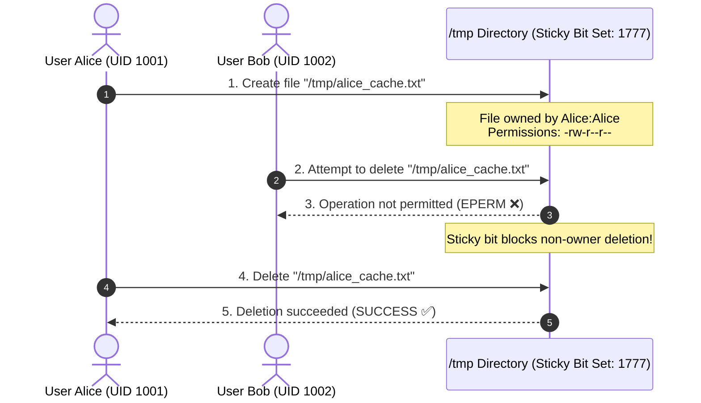
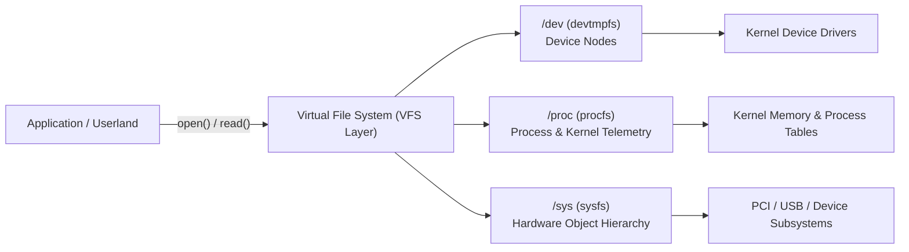
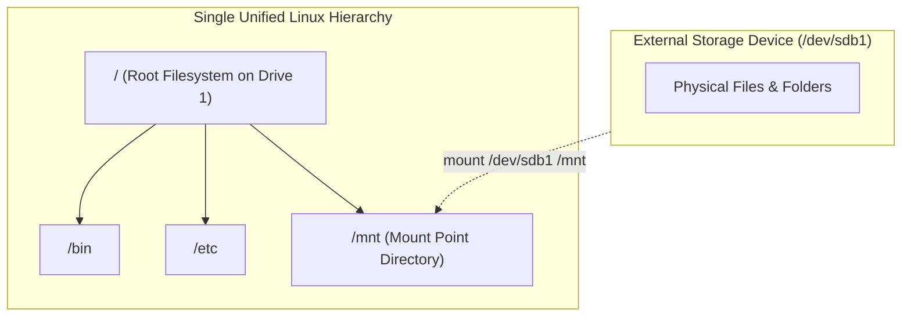

```mermaid
flowchart TD
    Root["/ (Root Directory)"] --> Bin["/bin -> usr/bin"]
    Root --> Boot["/boot (Kernel & GRUB)"]
    Root --> Dev["/dev (Device Nodes)"]
    Root --> Etc["/etc (Host Configurations)"]
    Root --> Home["/home (User Directories)"]
    Root --> Lib["/lib -> usr/lib"]
    Root --> Media["/media (Auto-Mounts)"]
    Root --> Mnt["/mnt (Manual Mounts)"]
    Root --> Opt["/opt (Third-Party Add-ons)"]
    Root --> Proc["/proc (Process Pseudo-FS)"]
    Root --> RootUser["/root (Superuser Home)"]
    Root --> Sbin["/sbin -> usr/bin"]
    Root --> Srv["/srv (Service Payloads)"]
    Root --> Sys["/sys (Kernel Hardware Model)"]
    Root --> Tmp["/tmp (Ephemeral Storage)"]
    Root --> Usr["/usr (Universal System Resources)"]
    Root --> Var["/var (Variable Data & Logs)"]
```

# Linux Directory Structure & Filesystem Hierarchy Standard (FHS)

| Metadata      | Value                      |
| ------------- | -------------------------- |
| Author        | Lyzander Marciano Andrylie |
| Creation Date | Nov 1, 2026                |
| Last Updated  | Nov 14, 2026               |

## References

- [Linux Directory Structure Explained for Beginners](https://linuxhandbook.com/linux-directory-structure/): Practical introduction to the Linux directory tree, directory responsibilities, and system usage.
- [Filesystem Hierarchy Standard 3.0](https://refspecs.linuxfoundation.org/FHS_3.0/fhs-3.0.html): Linux Foundation standard defining directory structures and file locations for Linux distributions.
- [bash.md](./bash/bash.md): Bash mental model, 7-stage command evaluation pipeline, and Linux shell architecture across FHS binaries and `/proc`
- [file_permissions.md](./file_permissions.md): Discretionary access control model, symbolic and octal modes, special bits, and creation masks.
- [inodes.md](./inodes.md): Filesystem inode architecture, dentry mapping, hard/symbolic links, and allocation models.
- [file_descriptors.md](./file_descriptors.md): Process file descriptor tables, standard streams, and kernel I/O abstraction.
- [conda.md](../tools/conda/conda.md): Isolated user-space environment prefixes and package directory layouts.

## Description

The Linux Directory Structure is a single, unified inverted-tree hierarchy governed by the Filesystem Hierarchy Standard (FHS) where all files, directories, storage devices, and virtual kernel interfaces originate from a single root directory (`/`). It establishes standard locations for executables, configurations, runtime telemetry, and user profiles across UNIX-like operating systems.

## Concepts

### 1. The Root Directory (`/`): The Unified Tree Anchor

Unlike Windows operating systems that assign distinct drive letters (`C:`, `D:`) to each physical disk or partition, Linux mounts every physical drive, network share, and virtual memory interface into a single unified directory tree originating at `/` (root).

- **Unified Tree Topology**: Every path in the operating system is either absolute (beginning with `/`) or relative to the current working directory.
- **FHS Classification Grid**: The Filesystem Hierarchy Standard divides files into two orthogonal dimensions:
  - **Shareable vs. Unshareable**: Shareable files can reside on one host and be safely mounted over the network by other hosts (e.g., `/usr`, `/opt`), whereas unshareable files contain host-specific state (e.g., `/etc`, `/boot`, `/var/log`).
  - **Static vs. Variable**: Static files change only through administrative intervention or package updates (e.g., `/bin`, `/lib`, `/usr`), whereas variable files are written and modified continuously during system execution (e.g., `/var`, `/tmp`, `/run`).
- **Destructive Command Danger**: Because `/` contains all mounted storage, running `rm -rf /` instructs the system to recursively delete all contents of all accessible filesystems. Modern GNU `coreutils` guards against this by defaulting to `--preserve-root`.

| FHS Dimension   | Static (Read-Only Candidate) | Variable (Read-Write Dynamic)  |
| :-------------- | :--------------------------- | :----------------------------- |
| **Shareable**   | `/usr`, `/opt`, `/usr/share` | `/var/mail`, `/var/spool`      |
| **Unshareable** | `/etc`, `/boot`              | `/var/log`, `/var/run`, `/tmp` |

```shell
# Inspect the top-level root hierarchy and mountpoints
tree -L 1 -d /

# Display all mounted filesystems and their root attachment points
findmnt --real
```

#### Interaction



---

### 2. Essential Binaries, Libraries & Boot Assets (`/bin`, `/sbin`, `/lib`, `/boot`): System Startup Baseline

The primary root filesystem historically stored the minimal set of executables and shared libraries necessary to mount remote filesystems, recover broken configurations, and boot into single-user emergency repair mode.

- **`/bin` (Essential User Binaries)**: Houses fundamental utilities required for all users (`ls`, `cat`, `cp`, `mv`, `rm`, `sh`, `bash`).
- **`/sbin` (Essential System Binaries)**: Stores system administration tools reserved for root or `sudo` users (`fdisk`, `fsck`, `ip`, `iptables`, `reboot`, `shutdown`).
- **`/lib` & `/lib64` (Essential Shared Libraries)**: Holds shared library dependencies (such as `libc.so`) and Linux kernel modules (`/lib/modules/<kernel-version>/`) needed by binaries in `/bin` and `/sbin`.
- **`/boot` (Static Boot Loader Files)**: Stores the Linux kernel image (`vmlinuz`), the initial RAM disk (`initramfs` or `initrd`), and boot loader configuration files (`grub/grub.cfg`). `/boot` is frequently placed on a dedicated boot partition at the start of the drive to ensure BIOS/UEFI firmware compatibility.

| Directory | Target Audience | Primary Function                               | Example Files                                |
| :-------- | :-------------- | :--------------------------------------------- | :------------------------------------------- |
| `/bin`    | All users       | Core command-line shell utilities              | `/bin/cat`, `/bin/ls`, `/bin/sh`             |
| `/sbin`   | System admins   | Low-level disk, network, and recovery commands | `/sbin/fsck`, `/sbin/reboot`, `/sbin/ip`     |
| `/lib`    | System binaries | Shared objects and kernel modules              | `/lib/x86_64-linux-gnu/libc.so.6`            |
| `/boot`   | Bootloader      | Kernel images and boot initialization          | `/boot/vmlinuz-6.8.0`, `/boot/grub/grub.cfg` |

```shell
# Inspect kernel images and bootloader files
ls -lh /boot

# Check shared library dependencies of an essential binary
ldd /bin/ls
```

#### a. The Usr-Merge Transition: Consolidating Early-Boot Binaries into /usr

Modern Linux distributions (Debian, Ubuntu, Fedora, Arch Linux, Red Hat Enterprise Linux) implement the **Usr-Merge** architectural standard.

- **Historical Split**: In early UNIX systems, hard drives were small; `/bin` and `/lib` had to stay on a small local disk partition, while `/usr` was mounted over NFS.
- **Modern Convergence**: Modern systems load an `initramfs` image into RAM, which mounts `/usr` before launching system services. Having separate `/bin`, `/sbin`, and `/lib` became redundant.
- **Symlink Architecture**: In modern distros, `/bin`, `/sbin`, `/lib`, and `/lib64` are symlinks targeting their respective directories under `/usr`.

```shell
# Verify usr-merge symlinks on modern systems
ls -ld /bin /sbin /lib /lib64
# Output shows:
# lrwxrwxrwx 1 root root 7 /bin -> usr/bin
# lrwxrwxrwx 1 root root 8 /sbin -> usr/sbin (or usr/bin)
# lrwxrwxrwx 1 root root 7 /lib -> usr/lib
```

#### b. Core Mechanics: What "Images" Mean in Linux

An **image** is a frozen, byte-for-byte snapshot or packaged blueprint bundled into a single file (similar to how a photograph captures a complete scene in a single frame).

| Image Type                         | What It Is                                                            | Purpose in Linux                                                                 | Primary Location   |
| :--------------------------------- | :-------------------------------------------------------------------- | :------------------------------------------------------------------------------- | :----------------- |
| **Kernel Image (`vmlinuz`)**       | Compressed binary of the core Linux OS engine                         | Loaded into RAM by the bootloader to start the operating system                  | `/boot`            |
| **RAM Disk Image (`initramfs`)**   | Minimal root filesystem packed with essential drivers                 | Temporary in-memory filesystem used to find and mount the real hard drive        | `/boot`            |
| **Disk Image (`.iso`, `.img`)**    | Exact virtual copy of an entire storage drive or partition            | Used for OS installation media, virtual machine disks, or simulated loop devices | Storage / USB      |
| **Container Image (Docker / OCI)** | Static bundle of a mini-root filesystem (`/bin`, `/etc`) and app code | Serves as the template to spin up isolated application containers                | `/var/lib/docker/` |

---

### 3. Host Configuration & Service Data (`/etc`, `/srv`): Local Rules and Services

System-wide settings and publicly served application data follow strict separation between configuration, executable code, and user payloads.

- **`/etc` (Host-Specific System Configurations)**:
  - FHS requires that `/etc` contains strictly plain-text configuration files and shell scripts; no binary executables are permitted.
  - Controls local network routes, authentication databases, daemon service configurations, and startup targets.
  - System administrators edit files in `/etc` to alter machine-wide behavior (e.g., `/etc/hosts` for local DNS mappings).
- **`/srv` (Site-Specific Service Data)**:
  - Dedicated storage for site-specific data served by network services (e.g., `/srv/www` for web pages, `/srv/ftp` for FTP shares, `/srv/git` for source repositories).
  - Keeps application payload data separate from web server application code (which resides in `/usr`) and log files (which reside in `/var`).

| Path               | Purpose                | Key Content                                                        |
| :----------------- | :--------------------- | :----------------------------------------------------------------- |
| `/etc/passwd`      | User account database  | User IDs, group IDs, home directory paths, default shells          |
| `/etc/shadow`      | Encrypted passwords    | User password hashes and expiration metadata (restricted to root)  |
| `/etc/fstab`       | Filesystem mount table | Static filesystem mount points and mount options processed at boot |
| `/etc/hosts`       | Static host lookup     | Manual IP-to-hostname mappings                                     |
| `/etc/resolv.conf` | DNS resolver config    | Nameserver IP addresses for DNS queries                            |
| `/etc/systemd/`    | Systemd service units  | Custom daemon unit files overriding vendor defaults                |
| `/srv/`            | Web & service payloads | Data for FTP, HTTP, and version-control servers                    |

```shell
# Check static filesystem mount table
cat /etc/fstab

# Validate hostname and DNS resolver configurations
cat /etc/hosts
cat /etc/resolv.conf
```

#### a. Core Mechanics: "Site-Specific" and "Payload" in Linux Services

In system administration and the Filesystem Hierarchy Standard, **"site"** refers to your specific organization, company, or deployment, and **"payload"** refers to the actual cargo or content served to users.

- **Site-Specific**: Distinguishes unique organizational data from generic operating system tools.
  - _Generic OS Software (`/usr`)_: Programs like Nginx, Python, or Apache are identical across millions of Linux systems worldwide and can be reinstalled from distribution repositories.
  - _Site-Specific Data (`/srv`)_: Content unique to your deployment (e.g., company web pages, internal Git repositories, private FTP files) that must be preserved and restored from private backups.
- **Payload**: The actual business assets or content delivered by a service, as opposed to the vehicle or daemon delivering it. For example, in a web server, the executable binary (`nginx`) is the delivery mechanism, while the HTML, CSS, video, and PDF files delivered to clients constitute the payload.

##### Service Layer Separation (The Delivery Analogy)

| Directory        | Layer / Role                | Delivery Analogy                  | Web Server Example                         |
| :--------------- | :-------------------------- | :-------------------------------- | :----------------------------------------- |
| **`/usr/sbin/`** | **Software Engine**         | The delivery truck itself         | The Nginx executable program               |
| **`/etc/`**      | **Configuration**           | The driver's route & rules        | `nginx.conf` (port bindings, domain names) |
| **`/var/log/`**  | **Runtime State & History** | The driver's trip receipts & logs | `access.log` and `error.log`               |
| **`/srv/`**      | **Site-Specific Payload**   | The actual cargo inside the truck | Website HTML files, images, downloads      |

---

### 4. User Environments & Dynamic State (`/home`, `/root`, `/var`, `/tmp`): User Data, Logs, and Scratch Space

Data with variable lifespans and permissions is segregated to protect system stability and maintain multi-user security boundaries.

- **`/home` (User Personal Workspaces)**:
  - Contains individual user subdirectories (`/home/<username>`) storing personal documents, repositories, and user-specific dotfile configurations (`~/.bashrc`, `~/.config/`).
  - Standard user permissions restrict user Alice (`/home/alice`) from reading or modifying files in user Bob's directory (`/home/bob`).
- **`/root` (Superuser Home Directory)**:
  - The home directory for the root administrator account.
  - Kept in `/root` rather than `/home/root` so the superuser can log in even if `/home` resides on a separate disk partition or network share that failed to mount.
- **`/var` (Variable Runtime Data)**:
  - Persistent runtime data generated while the system operates.
  - Subdirectories include `/var/log` (system and service logs), `/var/cache` (APT, YUM, or application cache data), `/var/lib` (state databases, Docker container layers), and `/var/spool` (print jobs and outgoing mail).
- **`/tmp` (Temporary Scratch Storage)**:
  - System-wide temporary file directory accessible to all users and daemons.
  - Files are ephemeral: wiped automatically during system reboot or cleared periodically by `systemd-tmpfiles`.
  - Configured with the **Sticky Bit** (`chmod 1777`), ensuring users can only delete or rename their own files even though all users have write access to the directory.

| Directory | Volatility | Persistence Across Reboots | Default Access Permissions                        |
| :-------- | :--------- | :------------------------- | :------------------------------------------------ |
| `/home`   | Low        | Permanent                  | Restricted to individual owner (`0700` or `0750`) |
| `/root`   | Low        | Permanent                  | Root superuser only (`0700`)                      |
| `/var`    | Medium     | Permanent                  | Daemon/service specific (`0755` / `0750`)         |
| `/tmp`    | High       | Ephemeral (Purged on boot) | World-writable with sticky bit (`1777`)           |
| `/run`    | Very High  | None (In-memory `tmpfs`)   | Root and system daemons (`0755`)                  |

```shell
# Inspect permissions and sticky bit ('t') on /tmp
ls -ld /tmp
# Output: drwxrwxrwt ... /tmp

# Check recent system authorization logs
tail -n 20 /var/log/auth.log 2>/dev/null || tail -n 20 /var/log/secure 2>/dev/null

# Clean expired temporary files using systemd
systemd-tmpfiles --clean
```

#### Interaction



---

### 5. Secondary Software Hierarchy (`/usr`, `/opt`): Managed Packages vs. Self-Contained Applications

User-facing software is separated into distribution-managed packages, locally compiled source binaries, and third-party vendor installations.

- **`/usr` (Universal System Resources)**:
  - Houses the vast majority of user binaries, documentation, and shared libraries managed by distribution package managers (e.g., APT, RPM, Pacman).
  - Designed historically as read-only data shareable over network read-only mounts. In modern systems, it is **read-only and executable (`r-x`) for standard users**, with write access restricted exclusively to the package manager running as `root`. On modern immutable Linux distributions (e.g., Fedora Silverblue, SteamOS), `/usr` is mounted physically read-only (`ro`) at the filesystem level to prevent system tampering.
  - Subdirectories replicate the top-level structure:
    - `/usr/bin`: Primary user executables.
    - `/usr/sbin`: Non-essential administrative binaries.
    - `/usr/lib`: Shared libraries for `/usr/bin` and `/usr/sbin`.
    - `/usr/share`: Architecture-independent shared assets (man pages, icons, timezone databases).
    - `/usr/include`: Standard C/C++ header files (`.h`, `.hpp`) containing function declarations, data structures, and macros (e.g., `<stdio.h>`, `<unistd.h>`, `<openssl/ssl.h>`). Compilers (`gcc`, `clang`) read these headers when compiling source code to know the signatures and memory layouts needed to call shared libraries in `/usr/lib`.
    - `/usr/local`: Reserved for software compiled and installed locally by the system administrator (e.g., `./configure && make && sudo make install`), preventing local builds from overwriting package-manager files.
- **`/opt` (Optional Add-on Packages)**:
  - Reserved for self-contained, proprietary, or standalone third-party software packages that do not split their files across the standard `/bin`, `/lib`, and `/share` layout.
  - Packages store their executables, libraries, assets, and dependencies inside a single isolated folder (e.g., `/opt/google/chrome`, `/opt/zoom`, `/opt/datadog-agent`).
  - To make an `/opt` executable accessible in standard shell execution, administrators create symlinks in `/usr/local/bin` or append the application folder to `$PATH`.

| Aspect                | `/usr`                                | `/usr/local`                       | `/opt`                               |
| :-------------------- | :------------------------------------ | :--------------------------------- | :----------------------------------- |
| **Managed By**        | OS Package Manager (APT, DNF, Pacman) | Local Sysadmin (Source builds)     | Third-Party Vendor Installers        |
| **File Structure**    | Split (`bin/`, `lib/`, `share/`)      | Split (`bin/`, `lib/`, `share/`)   | Self-contained single subdirectory   |
| **Override Priority** | Lowest in default `$PATH`             | Higher priority than `/usr`        | Requires explicit `$PATH` or symlink |
| **Typical Software**  | Python, Curl, Systemd, GCC            | Custom-compiled Nginx, Go binaries | Google Chrome, Slack, Datadog        |

```shell
# Inspect vendor application bundles in /opt
ls -l /opt

# Inspect locally compiled tools in /usr/local
ls -l /usr/local/bin

# Link an opt binary into standard PATH
sudo ln -s /opt/google/chrome/chrome /usr/local/bin/google-chrome
```

---

### 6. Virtual Filesystems & Device Nodes (`/dev`, `/proc`, `/sys`): The "Everything is a File" Abstraction

UNIX and Linux expose hardware devices, process activity, and kernel configurations through standard filesystem system calls (`open`, `read`, `write`, `close`).

- **`/dev` (Device Nodes)**:
  - Populated dynamically by the kernel and `udevd` (mounted as `devtmpfs`).
  - Contains special character and block device nodes representing connected hardware.
  - **Block Devices**: Buffered storage interfaces operating on fixed-size blocks (e.g., `/dev/sda`, `/dev/nvme0n1p1`).
  - **Character Devices**: Unbuffered streams of sequential bytes (e.g., serial ports, terminal inputs `/dev/tty`).
- **`/proc` (Process Information Pseudo-FS)**:
  - An in-memory virtual filesystem (`procfs`) exposing kernel state and running process telemetry. Consumes 0 bytes of persistent disk storage.
  - Each active process has a numeric directory corresponding to its Process ID (`/proc/<pid>/`) containing its environment (`/proc/<pid>/environ`), command line (`/proc/<pid>/cmdline`), and memory status (`/proc/<pid>/status`).
  - Global hardware and memory telemetry files reside at the root of `/proc` (e.g., `/proc/cpuinfo`, `/proc/meminfo`).
- **`/sys` (System Hardware Object Model)**:
  - An in-memory virtual filesystem (`sysfs`) exposing device drivers, buses, power states, and kernel subsystems in a structured tree.
  - Administrators read and write to `/sys` files to inspect hardware properties and tune device behavior at runtime.

| Pseudo-Device / File | Subsystem | Functionality & Common Use                                             |
| :------------------- | :-------- | :--------------------------------------------------------------------- |
| `/dev/null`          | Device    | Discards all written data; returns EOF immediately on read             |
| `/dev/zero`          | Device    | Produces an infinite stream of null bytes (`0x00`)                     |
| `/dev/urandom`       | Device    | High-throughput cryptographically secure pseudorandom byte generator   |
| `/proc/cpuinfo`      | Kernel    | CPU model, core topology, clock speeds, and hardware instruction flags |
| `/proc/meminfo`      | Kernel    | Real-time RAM utilization, buffers, cache sizes, and swap state        |
| `/sys/class/net/`    | Hardware  | Configurable network interfaces, link speeds, and MTU controls         |

```shell
# Read CPU and memory metrics directly from procfs
cat /proc/cpuinfo | grep "model name" | head -n 1
grep -E "MemTotal|MemAvailable" /proc/meminfo

# Discard standard error output using /dev/null
ls /nonexistent 2> /dev/null

# Generate a 10MB zero-filled dummy file using /dev/zero
dd if=/dev/zero of=/tmp/test.img bs=1M count=10
```

#### Interaction



---

### 7. Storage Mount Points (`/media`, `/mnt`): Temporary and Removable Storage

External file systems, network volumes, and disk partitions must be attached to an existing directory before their contents can be accessed.

#### a. Core Mechanics: What "Mounting" and "Mount Points" Mean

Unlike Windows which assigns independent drive letters (`C:\`, `D:\`, `E:\`) to distinct disks, Linux maintains a **single unified tree hierarchy**. Storage devices cannot be accessed in isolation; they must be grafted directly into an existing branch of the tree.

- **Mounting**: The operation of attaching a formatted storage filesystem (such as a hard drive partition, USB stick, or network share) to a specific directory in the hierarchy.
- **Mount Point**: The target directory where the filesystem is grafted (e.g., `/mnt`, `/media/usb`, or `/boot`).
  - _Before mounting_: The mount point is simply an empty folder on the parent filesystem.
  - _After mounting_: Accessing the mount point directory routes file read/write operations directly to the mounted physical device.
  - _After unmounting (`umount`)_: The physical device is safely detached, and the mount point folder reverts to its original empty state.
- **Masking Behavior**: If files exist inside a directory before a device is mounted over it, those original files become temporarily inaccessible (masked) until the device is unmounted; they are not deleted.

##### Interaction



#### b. Mount Directory Conventions: /mnt vs. /media

- **`/mnt` (Manual Mount Point)**:
  - Designated for system administrators to manually mount filesystems on a temporary basis (e.g., mounting an external rescue disk or an NFS share during diagnostic work).
  - Typically managed directly using the `mount` and `umount` commands.
- **`/media` (Removable Media Auto-Mounts)**:
  - Managed by desktop volume daemons (such as `udisks2`) for automated removable storage insertion.
  - When a user inserts a USB flash drive, external hard drive, SD card, or optical disk, the system automatically creates a subfolder (`/media/<username>/<device-label>`) and mounts the volume.
  - Automatically unmounted and cleaned up when the device is safely ejected.

| Property               | `/mnt`                                                  | `/media`                                   |
| :--------------------- | :------------------------------------------------------ | :----------------------------------------- |
| **Target User**        | System Administrator                                    | Desktop / End User                         |
| **Mount Mechanism**    | Manual invocation (`mount /dev/sdX1 /mnt`)              | Automated via `udisks2` / Desktop Manager  |
| **Directory Lifespan** | Static / Existing mount target                          | Dynamically created and deleted on eject   |
| **Typical Usage**      | Partition recovery, network file sharing, chroot repair | USB drives, camera SD cards, external HDDs |

```shell
# Manually mount an external drive partition to /mnt
sudo mount /dev/sdb1 /mnt

# Verify active mount points
findmnt /mnt

# Safely unmount after maintenance
sudo umount /mnt
```
