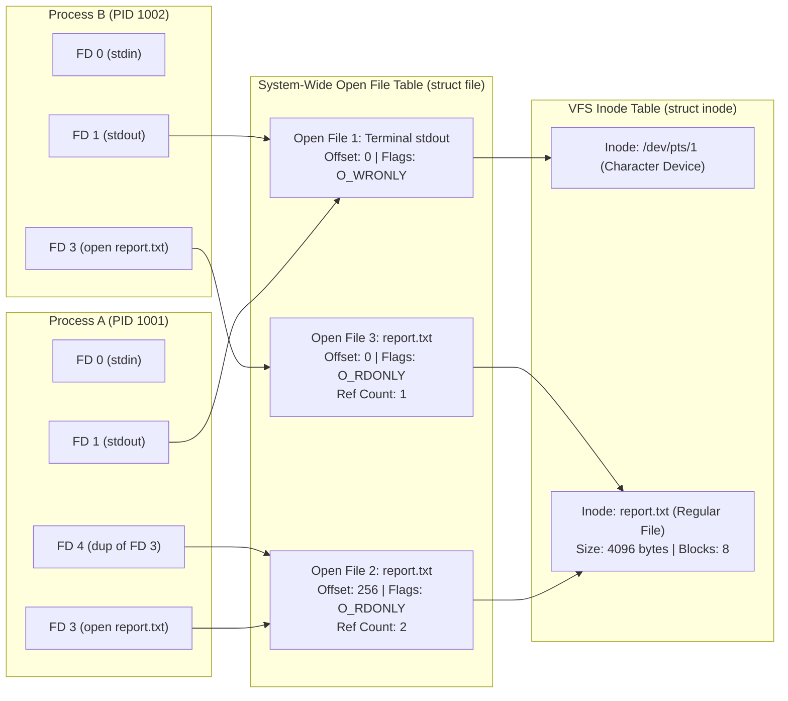
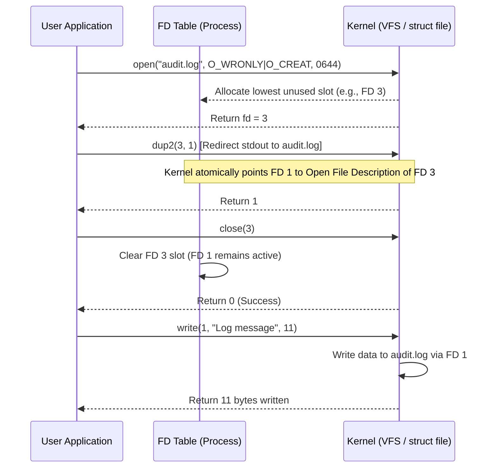

# Linux File Descriptors & Kernel I/O Abstraction

| Metadata      | Value                      |
| ------------- | -------------------------- |
| Author        | Lyzander Marciano Andrylie |
| Creation Date | Nov 8, 2026                |
| Last Updated  | Nov 8, 2026                |

## References

- [Linux Programmer's Manual: open(2)](https://man7.org/linux/man-pages/man2/open.2.html): System call flags, mode masks, and file descriptor allocation rules
- [Linux Programmer's Manual: fcntl(2)](https://man7.org/linux/man-pages/man2/fcntl.2.html): File descriptor manipulation, flag inspection, and POSIX record locking
- [Linux Programmer's Manual: dup(2)](https://man7.org/linux/man-pages/man2/dup.2.html): Duplicate an open file descriptor
- [Linux Programmer's Manual: epoll(7)](https://man7.org/linux/man-pages/man7/epoll.7.html): Scalable I/O event notification mechanism and descriptor multiplexing
- [POSIX.1-2017: File Descriptors](https://pubs.opengroup.org/onlinepubs/9699919799/basedefs/V1_chap03.html#tag_03_166): POSIX specification for file descriptor semantics, tables, and standard streams
- [directory_structure.md](./directory_structure.md): Standard filesystem hierarchy, device virtual nodes (`/dev`), and kernel runtime filesystem (`/proc`)
- [file_permissions.md](./file_permissions.md): Discretionary access control, file ownership, and inode permission bits
- [inodes.md](./inodes.md): Inode structure, block allocation, hard/symbolic links, and filesystem limits
- [file_io.md](../python/file_io.md): High-level language stream abstractions, buffered I/O, and file modes

## Description

In Linux and Unix-like operating systems, a File Descriptor (FD) is a compact, non-negative integer handle ($0, 1, 2, \dots$) managed by the kernel that uniquely references an open I/O stream for a specific process. Embodying the "everything is a file" philosophy, file descriptors unify access across physical disk storage, interactive terminals, network sockets, anonymous pipes, IPC event channels, and kernel timers behind a standardized set of system calls.

## Concepts

### 1. The Three-Tier Kernel Architecture

File descriptors are process-local indexes that resolve through two intermediate kernel abstraction layers before reaching physical data on storage media.

- **The Three Structural Layers**:
  1. **Per-Process Descriptor Table (`task_struct -> files_struct -> fdtable`)**:
     - An array of pointers private to each process, indexed directly by the integer file descriptor.
     - Each entry stores two items: a pointer to a system-wide **Open File Description** and descriptor-specific control flags (primarily `FD_CLOEXEC`).
  2. **System-Wide Open File Table (`struct file`)**:
     - A kernel-wide table of active file descriptions representing an open stream instance.
     - Tracks dynamic stream state: current read/write byte offset (`f_pos`), file status flags (`O_RDONLY`, `O_WRONLY`, `O_APPEND`, `O_NONBLOCK`), access mode, and an internal reference counter (`f_count`).
  3. **System-Wide Inode / VFS Inode Table (`struct inode`)**:
     - Represents the physical filesystem object residing in storage or virtual memory.
     - Contains static metadata: file type, file size, permissions, owner UID/GID, device ID, pointers to storage disk blocks, and active file locks.
- **Architectural Consequences & Gotchas**:
  - **Independent `open()` Calls**: Opening the same filesystem path twice creates two distinct `struct file` entries pointing to the same `struct inode`. Each descriptor has an **independent file offset**; reading from one descriptor does not advance the cursor of the other.
  - **Duplicated Descriptors (`dup()`, `fork()`)**: Duplicating a descriptor or spawning a child process copies the pointer in the descriptor table, referencing the **same `struct file` entry**. Both descriptors share the identical file cursor; reading 10 bytes from one advances the cursor for both.

#### Interaction



---

### 2. Standard Streams & Shell Redirection

Every standard POSIX process initializes with three pre-allocated file descriptors bound to standard input, standard output, and standard error.

- **Standard Descriptor Assignments**:
  - `0` (`stdin` / `STDIN_FILENO`): Default input source (typically keyboard/terminal).
  - `1` (`stdout` / `STDOUT_FILENO`): Default output stream for application results (line-buffered or block-buffered).
  - `2` (`stderr` / `STDERR_FILENO`): Default output stream for diagnostic logs and error alerts (unbuffered by default).
- **Virtual Device Nodes**:
  - `/dev/stdin` links to `/proc/self/fd/0`.
  - `/dev/stdout` links to `/proc/self/fd/1`.
  - `/dev/stderr` links to `/proc/self/fd/2`.
- **Shell Redirection Mechanics**:
  - The shell redirects streams by altering file descriptor mappings via `dup2()` prior to executing child program binaries.
  - `command > file.txt`: Closes FD 1 and reopens it targeting `file.txt` in write mode (`O_WRONLY | O_CREAT | O_TRUNC`).
  - `command >> file.txt`: Opens `file.txt` with `O_APPEND` on FD 1.
  - `command 2>&1`: Duplicates FD 1 onto FD 2 (`dup2(1, 2)`), merging error output into standard output.
  - `command1 | command2`: Instantiates a unidirectional kernel pipe (`pipe()`); binds the write end to `command1`'s FD 1, and the read end to `command2`'s FD 0.

```shell
# Standard redirection examples
# 1. Redirect stdout to file, discard stderr
command > output.log 2> /dev/null

# 2. Redirect both stdout and stderr to a single log file
command > combined.log 2>&1
# Modern bash / zsh shortcut equivalent:
command &> combined.log

# 3. Read input from a file into stdin (FD 0)
grep "ERROR" < application.log

# 4. Pipe stdout of cmd1 directly into stdin of cmd2
cat /var/log/syslog | grep "systemd" | wc -l
```

---

### 3. Core Lifecycle Syscalls (`open`, `close`, `dup`, `fcntl`)

The Linux kernel allocates, manipulates, and destroys file descriptors using a compact set of atomic system calls governed by the POSIX lowest-available-integer rule.

- **The Lowest-Numbered Allocation Rule**:
  - When allocating a new descriptor (`open`, `pipe`, `dup`, `accept`), the kernel always selects the lowest non-negative integer currently unused in the calling process's descriptor table.
  - If FD 0 is explicitly closed, the next `open()` call is guaranteed to return `0`.
- **Primary System Calls**:
  - `open(const char *path, int flags, mode_t mode)` / `openat()`: Establishes a connection between a filesystem path and a file descriptor.
  - `close(int fd)`: Detaches the integer descriptor from the process table and decrements `f_count` in the `struct file`. Once `f_count` reaches 0, the open file description is freed and file locks are released.
  - `dup(oldfd)`: Allocates the lowest free descriptor pointing to the same `struct file` as `oldfd`.
  - `dup2(oldfd, newfd)`: Atomically closes `newfd` (if currently open) and duplicates `oldfd` onto `newfd`.
  - `dup3(oldfd, newfd, flags)`: Linux-specific extension that supports setting `O_CLOEXEC` atomically during duplication.
  - `fcntl(int fd, int cmd, ...)`: Modifies properties of an established descriptor.
- **Descriptor Flags vs. File Status Flags in `fcntl`**:
  - **Descriptor Flags (`F_GETFD` / `F_SETFD`)**: Private to the process entry (currently only `FD_CLOEXEC`). Changing this flag affects _only_ that specific integer descriptor.
  - **File Status Flags (`F_GETFL` / `F_SETFL`)**: Reside inside the shared `struct file` (e.g., `O_APPEND`, `O_NONBLOCK`, `O_ASYNC`). Changing these flags affects _all_ file descriptors referencing the same open file description across all processes.

#### C POSIX Implementation Example

```c
#define _GNU_SOURCE
#include <stdio.h>
#include <stdlib.h>
#include <unistd.h>
#include <fcntl.h>
#include <string.h>

int main(void) {
    // 1. Open file with atomic close-on-exec and create/truncate flags
    int fd = open("audit.log", O_WRONLY | O_CREAT | O_TRUNC | O_CLOEXEC, 0644);
    if (fd < 0) {
        perror("open failed");
        return 1;
    }

    // 2. Redirect stdout (FD 1) to audit.log (fd)
    if (dup2(fd, STDOUT_FILENO) < 0) {
        perror("dup2 failed");
        close(fd);
        return 1;
    }
    // Close original descriptor; stdout remains open and pointing to audit.log
    close(fd);

    // 3. Modifying file status flags via fcntl: switch stdout to non-blocking mode
    int flags = fcntl(STDOUT_FILENO, F_GETFL);
    if (flags != -1) {
        fcntl(STDOUT_FILENO, F_SETFL, flags | O_NONBLOCK);
    }

    // Writes to stdout now write directly into audit.log
    printf("Redirected output written through file descriptor 1.\n");
    fflush(stdout);

    return 0;
}
```

#### Interaction



---

### 4. Process Inheritance, `FD_CLOEXEC`, and Descriptor Passing

File descriptor state across process creation boundaries directly impacts process isolation and application security.

#### a. Inheritance Across `fork()`

When a process calls `fork()`, the child receives a duplicate copy of the parent's file descriptor table.

- **Shared State**: All open descriptors in the child point to the exact same `struct file` entries as the parent.
- **Offset Sharing**: If the parent and child write to an inherited descriptor without synchronization or `O_APPEND`, output can interleave unpredictably because both modify the same `f_pos` cursor.
- **Reference Counting**: The kernel increments `f_count` for each inherited file description. Both parent and child must invoke `close()` on their respective descriptors before the underlying kernel resources and file locks are released.

#### b. Survival Across `execve()` and the `FD_CLOEXEC` Security Boundary

When a process calls `execve()` to execute a new binary, the memory space (code, stack, heap) is completely overwritten, but **file descriptors remain open by default**.

- **The Information Leak Vulnerability**:
  - If a privileged parent process opens sensitive resources (e.g., database sockets, private keys, authentication pipes) and subsequently executes an unprivileged child binary without closing them, the child inherits access to those resources.
- **The Solution: `FD_CLOEXEC` / `O_CLOEXEC`**:
  - Setting the `FD_CLOEXEC` descriptor flag instructs the kernel to automatically close the descriptor during any successful `execve()` call.
  - **Race Condition in Multi-Threaded Code**: Using `open()` followed by `fcntl(fd, F_SETFD, FD_CLOEXEC)` leaves an execution window where another thread could call `fork()` + `execve()` before the flag is set.
  - **Best Practice**: Always set the flag atomically at creation time using `O_CLOEXEC` (`open`, `openat`), `pipe2(fds, O_CLOEXEC)`, `socket(..., SOCK_CLOEXEC)`, or `accept4(..., SOCK_CLOEXEC)`.

#### c. Inter-Process Descriptor Passing (`SCM_RIGHTS`)

Unrelated processes that do not share a parent-child inheritance hierarchy can transfer file descriptors dynamically using Unix domain sockets (`AF_UNIX`).

- **Mechanism**:
  - Descriptors are passed as ancillary control data (`struct msghdr` with `msg_control`) using the `SCM_RIGHTS` protocol level.
  - The sending process passes an integer FD. The kernel translates this into a reference to the underlying `struct file`, allocates an unused descriptor integer in the receiving process's local table, and binds it to that same open file description.
  - Enables privilege separation patterns (e.g., a root process binds to privileged port 80/443 and passes the socket FD to an unprivileged worker process).

---

### 5. Inspection, Limits, and Monitoring (`/proc`, `lsof`, `ulimit`)

System administrators and developers can inspect descriptor state, diagnose descriptor leaks, and configure operational thresholds using the Linux `/proc` filesystem and standard tooling.

- **Inspection via `/proc/[pid]/fd`**:
  - `/proc/<pid>/fd/`: A directory containing symbolic links for every open file descriptor in process `<pid>`.
  - `/proc/<pid>/fdinfo/<fd>`: A read-only virtual file exposing internal kernel metadata for descriptor `<fd>`, including:
    - `pos`: Current file cursor byte offset.
    - `flags`: Octal representation of file access modes and status flags (`O_RDONLY`, `O_APPEND`, etc.).
    - `mnt_id`: Virtual filesystem mount identifier.
- **Diagnostic Commands**:
  - `ls -l /proc/$$/fd`: List all descriptors currently open in the active shell.
  - `lsof -p <PID>`: List open file paths, internet sockets, and pipes held by `<PID>`.
  - `fuser <file>`: Identify which process IDs hold active file descriptors pointing to `<file>`.

```shell
# 1. Inspect open file descriptors for the current shell
ls -la /proc/$$/fd
# Output:
# lrwx------ 1 user group 64 Nov  8 12:00 0 -> /dev/pts/2
# lrwx------ 1 user group 64 Nov  8 12:00 1 -> /dev/pts/2
# lrwx------ 1 user group 64 Nov  8 12:00 2 -> /dev/pts/2
# lr-x------ 1 user group 64 Nov  8 12:00 3 -> /proc/24512/fd

# 2. Inspect cursor position and flags for descriptor 0
cat /proc/$$/fdinfo/0
# Output:
# pos:    0
# flags:  0100002
# mnt_id: 28

# 3. Count total descriptors held by a process
ls /proc/<PID>/fd | wc -l
```

#### Descriptor Limits & Exhaustion

The Linux kernel enforces two tiers of file descriptor limits to protect system resources from exhaustion attacks and memory leaks.

| Limit Type                              | Configuration Path                                    | Inspection Command                         | Scope                   | Exhaustion Error                             |
| :-------------------------------------- | :---------------------------------------------------- | :----------------------------------------- | :---------------------- | :------------------------------------------- |
| **Per-Process Limit (`RLIMIT_NOFILE`)** | `/etc/security/limits.conf`<br>Systemd `LimitNOFILE=` | `ulimit -Sn` (Soft)<br>`ulimit -Hn` (Hard) | Single process          | `EMFILE` (_"Too many open files"_)           |
| **System-Wide Limit (`fs.file-max`)**   | `/proc/sys/fs/file-max`<br>`sysctl -w fs.file-max=`   | `sysctl fs.file-max`                       | Entire operating system | `ENFILE` (_"Too many open files in system"_) |

- **Current Kernel Allocation Status (`/proc/sys/fs/file-nr`)**:
  - Contains three integers: `allocated_fds`, `unused_allocated_fds`, and `max_fds`.
  ```shell
  cat /proc/sys/fs/file-nr
  # Output: 14208    0    9223372036854775807
  ```
- **Distinguishing Errors**:
  - `EMFILE` means _only your process_ has exhausted its configured `ulimit -n` quota. Fix by increasing `LimitNOFILE` or fixing a resource leak (unclosed files/sockets).
  - `ENFILE` means the _entire operating system_ kernel has run out of memory for `struct file` objects.

---

### 6. Specialized Descriptors & Multiplexed I/O

Linux expands the descriptor abstraction beyond files to include kernel notifications, asynchronous timers, IPC queues, and high-performance I/O multiplexing.

- **Non-File Descriptor Types**:
  - **Sockets (`socket(2)`)**: Bidirectional network and IPC endpoints (TCP, UDP, UNIX domain).
  - **Pipes & FIFOs (`pipe2(2)`, `mkfifo(3)`)**: Unidirectional streaming channels.
  - **`eventfd(2)`**: Lightweight 8-byte integer counter used for lock-free inter-thread or kernel-to-user notifications.
  - **`timerfd_create(2)`**: Kernel timer that triggers readable events on an FD upon expiration, integrating timers into standard event loops.
  - **`signalfd(2)`**: Receives POSIX signals synchronously via `read()` calls on an FD instead of asynchronous signal handlers.
  - **`pidfd_open(2)`**: Represents a process handle as a file descriptor, eliminating PID recycling race conditions when waiting on or signaling child processes.

#### I/O Multiplexing Mechanism Comparison

When managing thousands of concurrent socket descriptors, synchronous blocking calls (`read`, `write`) freeze thread execution. Linux provides multiplexing interfaces to monitor descriptor readiness.

| Mechanism    | Syscall                                              | Algorithmic Complexity |            Maximum Descriptor Limit             | Kernel-User Space Data Transfer                                                                |
| :----------- | :--------------------------------------------------- | :--------------------: | :---------------------------------------------: | :--------------------------------------------------------------------------------------------- |
| **`select`** | `select()`                                           |         $O(N)$         |     Fixed by `FD_SETSIZE` (typically 1024)      | Re-passes full descriptor bitmasks on every call.                                              |
| **`poll`**   | `poll()`                                             |         $O(N)$         |        No hard limit (bounded by memory)        | Re-passes array of `struct pollfd` on every call.                                              |
| **`epoll`**  | `epoll_create1()`<br>`epoll_ctl()`<br>`epoll_wait()` |       **$O(1)$**       | Bounded only by system memory / `RLIMIT_NOFILE` | Maintains state in-kernel via red-black tree; returns only ready descriptors in an event list. |

- **`epoll` Readiness Triggers**:
  - **Level-Triggered (Default)**: `epoll_wait` continues to notify the application as long as data remains in the descriptor's read/write buffer.
  - **Edge-Triggered (`EPOLLET`)**: `epoll_wait` notifies the application only when a state change occurs (e.g., new data arrives). The application must drain the entire buffer via non-blocking reads until `EAGAIN` or `EWOULDBLOCK` is returned.
