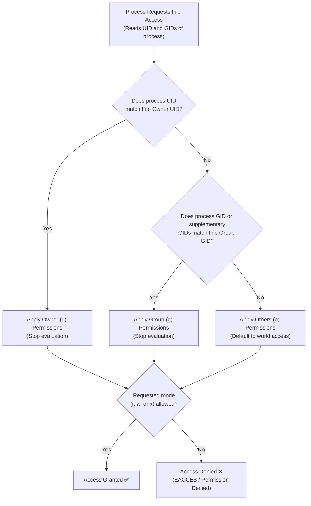
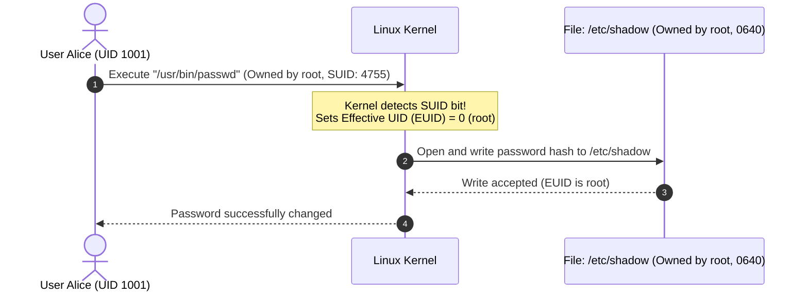

# Linux File Permissions & Access Control Modes

| Metadata      | Value                      |
| ------------- | -------------------------- |
| Author        | Lyzander Marciano Andrylie |
| Creation Date | Nov 1, 2026                |
| Last Updated  | Nov 1, 2026                |

## References

- [directory_structure.md](./directory_structure.md) — Unified filesystem hierarchy, root architecture, and standard system directory roles.
- [POSIX.1-2017 Standard: File Access Permissions](https://pubs.opengroup.org/onlinepubs/9699919799/basedefs/V1_chap04.html#tag_04_05) — Standardized POSIX discretionary access control model and mode evaluation rules.
- [GNU Coreutils: File Permissions](https://www.gnu.org/software/coreutils/manual/html_node/File-permissions.html) — Specifications for file mode manipulation, ownership management, and permission masks.

## Description

Linux File Permissions provide the foundational discretionary access control (DAC) model that governs how users and system processes read, modify, and execute files and directories. By binding every filesystem inode to a specific user, a primary group, and a set of permission bits, Linux guarantees process isolation, multi-tenant data confidentiality, and privilege separation.

## Concepts

### 1. Ownership & Identity: Users, Groups, and the Inode Triad

Every file and directory in Linux is managed by an inode that records ownership metadata alongside file contents.

- **Actors and Identifiers**:
  - **UID (User ID)**: A numeric ID representing the human or service account (e.g., `0` for `root`, `1000` for standard users).
  - **GID (Group ID)**: A numeric ID representing an access group. A user has one **Primary Group** and can belong to multiple **Supplementary Groups**.
- **The Ownership Triad**: Every file defines access rights across three distinct scopes:
  1. **Owner (`u`)**: The single user account that owns the file.
  2. **Group (`g`)**: The group assigned to the file; any user belonging to this group shares these permissions.
  3. **Others (`o`)**: All other accounts on the system that are neither the owner nor members of the assigned group.
- **First-Match Permission Evaluation**:
  - The Linux kernel checks credentials in strict order: **Owner -> Group -> Others**.
  - Once a match is found, evaluation stops immediately. If user Alice owns a file with permissions `---r--r--`, Alice is evaluated as the owner and is denied access, even though group and others have read access.

```shell
# Check current user identity, UID, GID, and supplementary groups
id

# View file ownership and groups
ls -l /etc/passwd
# Output: -rw-r--r-- 1 root root 2842 Nov  1 12:00 /etc/passwd

# Change file owner and group (requires root or sudo)
sudo chown alice:developers report.txt

# Recursively change group ownership only
sudo chgrp -R developers /srv/projects/
```

#### Interaction



---

### 2. Standard Permission Modes: Symbolic and Octal Representation

Linux permission modes are recorded as 9 individual permission bits grouped into three triplets: Owner, Group, and Others.

#### a. The 10-Character Symbolic String

Running `ls -l` prints a 10-character string detailing file type and permissions:

```text
-  r w x  r - x  r - -
┬  ──┬──  ──┬──  ──┬──
│    │      │      └─ Others permissions (Read only)
│    │      └──────── Group permissions (Read and Execute)
│    └─────────────── Owner permissions (Read, Write, and Execute)
└──────────────────── File Type Indicator
```

- **File Type Indicators**:
  - `-`: Regular file (text, binary, image).
  - `d`: Directory.
  - `l`: Symbolic link.
  - `c`: Character device node (unbuffered stream, e.g., `/dev/urandom`).
  - `b`: Block device node (buffered storage, e.g., `/dev/sda`).
  - `s`: Unix domain socket.
  - `p`: Named pipe (FIFO).

#### b. The Octal (Numeric) Representation

Each triplet is represented as a single base-8 digit (0–7) calculated by summing active bit values:

- **Read (`r`)** = $4$ ($2^2$)
- **Write (`w`)** = $2$ ($2^1$)
- **Execute (`x`)** = $1$ ($2^0$)
- **None (`-`)** = $0$

| Octal Digit | Binary Representation | Symbolic Mode | Meaning                                                  |
| :---------- | :-------------------- | :------------ | :------------------------------------------------------- |
| **`7`**     | `111`                 | `rwx`         | Full read, write, and execute permissions                |
| **`6`**     | `110`                 | `rw-`         | Read and write (standard for user data files)            |
| **`5`**     | `101`                 | `r-x`         | Read and execute (standard for programs and directories) |
| **`4`**     | `100`                 | `r--`         | Read-only access                                         |
| **`0`**     | `000`                 | `---`         | Zero access (complete denial)                            |

```shell
# Modify permissions using symbolic syntax
chmod u+x run.sh         # Add execute to Owner
chmod g-w,o=r document.md # Remove write from Group; set Others to read-only
chmod a+r public.txt     # Add read to All (u, g, o)

# Modify permissions using octal notation
chmod 755 script.sh      # rwxr-xr-x (Owner: all; Group/Others: read+exec)
chmod 644 config.yml     # rw-r--r-- (Owner: read/write; Group/Others: read-only)
chmod 600 id_rsa         # rw------- (Owner: read/write; Group/Others: none)
chmod 700 private_dir/   # rwx------ (Owner: full; Group/Others: locked out)
```

---

### 3. Files vs. Directories: Semantic Meaning of Permissions

The permissions `r`, `w`, and `x` have fundamentally different meanings depending on whether the target is a regular file or a directory.

| Mode Bit          | Meaning on Regular Files                       | Meaning on Directories                                             |
| :---------------- | :--------------------------------------------- | :----------------------------------------------------------------- |
| **`r` (Read)**    | View file contents (`cat`, `less`, `grep`).    | List file names inside the directory (`ls`).                       |
| **`w` (Write)**   | Modify, overwrite, or append file content.     | Create, delete, or rename files inside the directory.              |
| **`x` (Execute)** | Execute the file as a program or shell script. | Enter/traverse the directory (`cd`) and access file inodes inside. |

#### a. Critical Traps & Edge Cases

- **Deleting a File Does Not Require Write Permission on the File**:
  - In Linux, file deletion is a directory modification. You only need write (`w`) and execute (`x`) permissions on the **parent directory** to delete or rename any file inside it, even if the file itself is `000` (read-only or owned by another user).
- **Read without Execute on Directories (`r--`)**:
  - Allows listing filenames with `ls`, but attempting to inspect file metadata (`ls -l`), read file content (`cat dir/file`), or enter the folder (`cd dir`) fails with `Permission denied`.
- **Execute without Read on Directories (`--x`)**:
  - Hides file listings (`ls dir` returns `Permission denied`).
  - Allows direct access to files inside if the exact filename is already known (`cat dir/target.txt` works). Frequently used for secure staging directories.

```shell
# Experiment: Directory with execute only (--x)
mkdir /tmp/blind_dir
chmod 711 /tmp/blind_dir
echo "Secret Content" > /tmp/blind_dir/secret.txt
chmod 644 /tmp/blind_dir/secret.txt

# Listing fails
ls /tmp/blind_dir
# Output: ls: cannot open directory '/tmp/blind_dir': Permission denied

# Direct access to known filename succeeds
cat /tmp/blind_dir/secret.txt
# Output: Secret Content
```

---

### 4. Special Permission Bits: SUID, SGID, and the Sticky Bit

In addition to standard user, group, and other modes, Linux provides three special permission bits that modify execution privileges, group inheritance, and deletion rules.

#### a. Special Permission Definitions

- **SUID (Set User ID - Octal `4000`)**:
  - Applied to executable binary files.
  - Causes the binary to run with the privileges of the **file owner**, rather than the user invoking it.
  - Classic Example: `/usr/bin/passwd` is owned by `root`. When an unprivileged user updates their password, the process executes with effective root UID (`0`), allowing it to update `/etc/shadow`.
- **SGID (Set Group ID - Octal `2000`)**:
  - _On executable files_: Runs with the privileges of the **file's group**.
  - _On directories_: Enforces **group inheritance**. Any new file or subdirectory created within automatically inherits the parent directory's group, rather than the creator's current primary group. Standard for shared developer folders.
- **Sticky Bit (Octal `1000`)**:
  - Applied to directories.
  - Enforces **restricted deletion**: users can only delete or rename files they personally own, even if the directory itself is world-writable (`0777`).
  - Classic Example: `/tmp` and `/var/tmp` (`1777` / `drwxrwxrwt`).

| Special Bit | Octal Value | Symbol in `ls -l`           | Symbol without `x` | Primary Purpose                                        |
| :---------- | :---------- | :-------------------------- | :----------------- | :----------------------------------------------------- |
| **SUID**    | `4000`      | `s` on owner (`rwsr-xr-x`)  | `S` (`rwSr-xr-x`)  | Run executable with file owner credentials             |
| **SGID**    | `2000`      | `s` on group (`rwxr-sr-x`)  | `S` (`rwxr-Sr-x`)  | Inherit group ownership on directory creations         |
| **Sticky**  | `1000`      | `t` on others (`rwxrwxrwt`) | `T` (`rwxrwxrwT`)  | Restrict deletion in shared world-writable directories |

> [!NOTE]
> A capital letter (`S` or `T`) indicates that the special bit is set, but the underlying execute (`x`) bit is missing. This usually indicates a configuration error.

```shell
# Configure a collaborative team directory with SGID
mkdir /srv/team_project
chgrp developers /srv/team_project
chmod 2775 /srv/team_project
# Verify SGID is active (drwxrwsr-x)
ls -ld /srv/team_project

# Set sticky bit on a temporary shared directory
chmod 1777 /srv/scratch
# Equivalent to:
chmod +t /srv/scratch
```

#### Interaction



---

### 5. Default Creation Masks: The `umask` Mechanism

When applications create new files or directories, the Linux kernel determines their initial permissions by applying a bitwise filter known as the **User File Creation Mask (`umask`)**.

#### a. The Subtractive Mask Algorithm

Programs specify initial base permissions upon creation:

- **Default Base for Files**: `0666` (`rw-rw-rw-`) — Programs never request execute permissions by default.
- **Default Base for Directories**: `0777` (`rwxrwxrwx`) — Directories require execute permission for directory traversal.

The system applies the `umask` using bitwise negation and conjunction:

$$\text{Final Permissions} = \text{Base Mode} \land (\neg \text{umask})$$

For non-conflicting masks, this functions like simple octal subtraction:

| Base Type     | Base Permissions | Common Mask (`umask 022`) | Resulting Initial Mode | Symbolic Mode |
| :------------ | :--------------- | :------------------------ | :--------------------- | :------------ |
| **File**      | `666`            | `- 022`                   | **`644`**              | `rw-r--r--`   |
| **Directory** | `777`            | `- 022`                   | **`755`**              | `rwxr-xr-x`   |

```shell
# View current active creation mask in octal and symbolic form
umask
# Output: 0022
umask -S
# Output: u=rwx,g=rx,o=rx

# Set a restrictive mask for private sessions (owner-only)
umask 077
touch private.txt && mkdir private_folder/
ls -ld private.txt private_folder/
# Output:
# -rw------- 1 user group 0 private.txt
# drwx------ 2 user group 4096 private_folder/
```

---

### 6. Extended Access Control Lists (POSIX ACLs)

Standard Linux DAC limits permission assignment to exactly one user owner and one group. When complex collaboration requires distinct permissions for multiple users or groups, **POSIX Access Control Lists (ACLs)** extend standard filesystem modes.

#### a. Managing Explicit ACL Entries

- **ACL Presence Indicator**: When extended ACLs are configured on a file or directory, `ls -l` appends a trailing plus sign (`+`) to the permission string (e.g., `-rw-r--r--+`).
- **`getfacl`**: Inspects all user, group, and mask access rules.
- **`setfacl`**: Modifies, appends, or deletes specific ACL entries.

```shell
# Inspect file ACL rules
getfacl document.pdf

# Grant user Bob read and write access without changing file ownership
setfacl -m u:bob:rw document.pdf

# Grant the 'auditors' group read-only access
setfacl -m g:auditors:r document.pdf

# Set default ACLs on a directory (automatically inherited by future files)
setfacl -d -m g:developers:rwx /srv/shared/

# Strip all extended ACL entries and return to standard DAC
setfacl -b document.pdf
```
