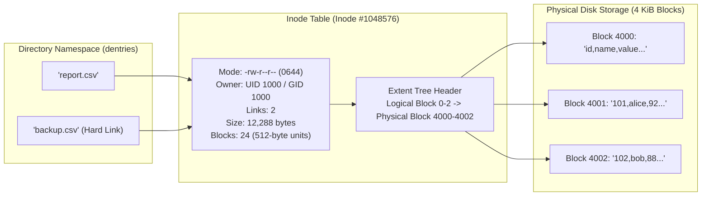
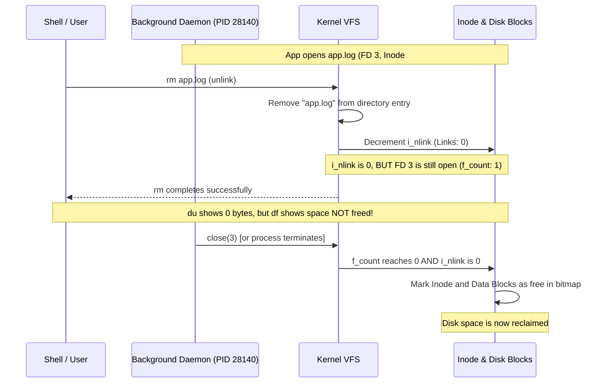

# Linux Inodes & Filesystem Storage Architecture

| Metadata      | Value                      |
| ------------- | -------------------------- |
| Author        | Lyzander Marciano Andrylie |
| Creation Date | Nov 8, 2026                |
| Last Updated  | Nov 14, 2026               |

## References

- [Linux Programmer's Manual: stat(2)](https://man7.org/linux/man-pages/man2/stat.2.html): System call interface for retrieving inode metadata
- [Linux Programmer's Manual: inode(7)](https://man7.org/linux/man-pages/man7/inode.7.html): Operating system specification for file types, timestamps, and attributes
- [ext4 Filesystem Documentation (Kernel.org)](https://www.kernel.org/doc/html/latest/filesystems/ext4/index.html): On-disk layout, extent trees, and inode structures
- [bash.md](./bash/bash.md): Bash mental model, pathname globbing, and shell test operators inspecting inode metadata
- [directory_structure.md](./directory_structure.md): Standard filesystem layout, mount points, and directory entry mechanics
- [file_permissions.md](./file_permissions.md): Discretionary access control, ownership UID/GID, and mode bits stored in the inode
- [file_descriptors.md](./file_descriptors.md): Process file descriptor tables, open file descriptions, and stream redirection
- [file_io.md](../python/file_io.md): High-level I/O streams, buffer synchronization, and storage persistence

## Description

An **inode** (index node) is the fundamental data structure used by Linux filesystems to store all metadata, attributes, and storage block locations of a filesystem object (regular file, directory, symbolic link, block/character device, socket, or FIFO). The inode deliberately excludes the file's human-readable name, establishing a strict architectural separation between directory namespace trees and physical disk storage.

## Concepts

### 1. Inode Structure & On-Disk Metadata

Every filesystem object is assigned an integer **inode number** unique to its containing filesystem. The inode holds all file properties except its name and raw file contents.

- **Stored Metadata Fields**:
  - **Inode Number (`ino_t`)**: The unique numeric primary key within the filesystem partition.
  - **File Type & Mode (`mode_t`)**: 16-bit field encoding the file type (`S_IFREG`, `S_IFDIR`, `S_IFLNK`, `S_IFSOCK`, etc.) and the 12 permission bits (SUID, SGID, Sticky bit, and User/Group/Other `rwx`).
  - **Ownership (`uid_t`, `gid_t`)**: Numeric User ID and Group ID of the file owner.
  - **File Size (`off_t`)**: Logical size of the file in bytes.
  - **Block Count (`blkcnt_t`)**: Number of 512-byte blocks physically allocated to the file on disk. In sparse files, this can be substantially smaller than `size / 512`.
  - **Hard Link Count (`nlink_t`)**: Total count of directory entries (`dentry`) that reference this inode.
  - **Timestamps**:
    - `atime` (Access Time): Last time file data was read.
    - `mtime` (Modification Time): Last time file data contents were changed.
    - `ctime` (Change Time): Last time the inode metadata itself (permissions, ownership, link count) was modified.
    - `btime`/`crtime` (Birth/Creation Time): Time of file creation (supported on `ext4`, `btrfs`, `xfs`).
  - **Extended Attributes (`xattrs`) & ACLs**: Pointers to security labels (SELinux), capabilities, and POSIX Access Control Lists.
  - **Data Addressing (Block Pointers / Extents)**: Pointers mapping logical file offsets to physical storage blocks on disk.
- **Block Addressing: Direct Pointers vs. Extents**:
  - **Legacy Block Pointers (ext2 / ext3)**: 12 direct block pointers (pointing directly to storage blocks), 1 singly indirect block pointer, 1 doubly indirect pointer, and 1 triply indirect pointer.
  - **Modern Extents (`ext4`, `XFS`, `btrfs`)**: A contiguous range of physical disk blocks stored as a compact tuple `(logical_block, length_in_blocks, physical_block)`. Extent trees eliminate massive pointer lists for large files, dramatically reducing metadata overhead and fragmentation.

#### Interaction



---

### 2. The Dentry-Inode Separation & Link Types

In Linux, directory structures are decoupled from file identity. A directory is simply a special file containing an array of directory entries (**dentries**), where each entry binds a string filename to an inode number.

#### a. Hard Links vs. Symbolic Links

| Feature               | Hard Link (`ln target link`)                                      | Symbolic Link (`ln -s target link`)                     |
| :-------------------- | :---------------------------------------------------------------- | :------------------------------------------------------ |
| **Inode Number**      | Shares the **exact same** inode number as target.                 | Allocates a **new, independent** inode.                 |
| **Target Storage**    | Points directly to the shared inode metadata and data blocks.     | Inode data stores the string path to the target file.   |
| **Cross-Filesystem**  | **No**. Inode numbers are unique only within their own partition. | **Yes**. Links via filesystem path string.              |
| **Directory Support** | **Forbidden** for users (prevents filesystem tree graph cycles).  | **Supported**. Can target any directory.                |
| **Target Deletion**   | Content remains accessible as long as link count $\ge 1$.         | Becomes a **dangling/broken** link pointing to nowhere. |
| **Inode Size**        | Identical size to target.                                         | Length of target path string (bytes).                   |

- **Fast Symlinks**:
  - In `ext4`, if the target path string is shorter than 60 bytes, the path is stored directly inside the 128/256-byte inode itself rather than allocating an external disk block.

```shell
# 1. Create a base file
echo "Database payload" > data.txt

# 2. Inspect inode number and metadata via stat or ls -i
ls -i data.txt
# Output: 1441852 data.txt

stat data.txt
# Output:
#   File: data.txt
#   Size: 17        Blocks: 8          IO Block: 4096   regular file
# Device: 8,1       Inode: 1441852     Links: 1
# Access: (0644/-rw-r--r--)  Uid: ( 1000/    user)   Gid: ( 1000/    user)

# 3. Create a hard link and observe shared inode and link count increment
ln data.txt hard_data.txt
stat hard_data.txt
# Notice: Inode is 1441852, Links: 2

# 4. Create a symbolic link and observe new inode allocation
ln -s data.txt sym_data.txt
stat sym_data.txt
# Notice: New Inode number, Links: 1, File type: symbolic link
```

---

### 3. File Deletion Mechanics & Ghost Inodes

Linux does not provide an explicit "delete file" system call; it provides `unlink(2)`. Understanding how the kernel deallocates files is critical for diagnosing disk capacity issues.

- **The Deletion Lifecycle**:
  1. A program or command invokes `rm file.txt` (internally `unlink("file.txt")`).
  2. The kernel removes the directory entry `("file.txt", inode_number)` from the parent directory.
  3. The kernel decrements the inode's hard link counter (`i_nlink`).
  4. **Deallocation Decision**:
     - If `i_nlink == 0` **and** no active process has an open file descriptor referencing the inode (`struct file`'s `f_count == 0`), the kernel marks the inode and its associated data blocks as free in the filesystem allocation bitmaps.
     - If `i_nlink == 0` **but** one or more processes still hold an open file descriptor to it, the directory entry is gone, but the **data blocks and inode remain physically allocated on disk**.

#### The "Deleted File Still Consuming Disk Space" Gotcha

When a process (e.g., an unrotated application log or database) keeps writing to or holding an unlinked file:

- `du -sh /var/log` scans directory entries and reports that disk usage is low because the filename no longer exists.
- `df -h` queries the filesystem superblock allocation bitmaps and reports that the disk is **100% full**.

```shell
# 1. Locate unlinked files held open by running processes
lsof +L1
# Output:
# COMMAND   PID USER   FD   TYPE DEVICE SIZE/OFF NLINK    NODE NAME
# python3 28140 user    3w   REG    8,1 10737418240     0 1441852 /var/log/app.log (deleted)

# 2. Reclaim disk space immediately WITHOUT restarting the service:
# Truncate the file through its procfs file descriptor entry
: > /proc/28140/fd/3
```

#### Interaction



---

### 4. Directory Inode Link Mathematics

Directories have structured link count behaviors enforced by POSIX hierarchy rules.

- **Initial Directory Creation**:
  - When an empty directory is created (`mkdir /tmp/testdir`), its link count (`i_nlink`) is immediately **2**:
    1. The entry inside the parent directory (`/tmp/testdir`).
    2. The self-referential entry inside the directory itself (`.` pointing to its own inode).
- **Subdirectory Additions**:
  - Every subdirectory created inside `/tmp/testdir` contains a parent-referential entry (`..`) pointing back to `/tmp/testdir`.
  - Therefore, the formula for a directory's hard link count is:
    $$\text{Links} = 2 + (\text{Number of Subdirectories})$$
- **Why Directories Cannot Be Hard-Linked**:
  - Linux forbids userland creation of hard links to directories to prevent **infinite circular loops** in the filesystem graph (which would break tree traversals like `find`, `du`, and recursive deletion algorithms).

```shell
# Inspect directory link counts
mkdir -p /tmp/parent_dir
stat -c "%h %n" /tmp/parent_dir
# Output: 2 /tmp/parent_dir

mkdir /tmp/parent_dir/sub1
mkdir /tmp/parent_dir/sub2
stat -c "%h %n" /tmp/parent_dir
# Output: 4 /tmp/parent_dir (2 base + 2 subdirectories)
```

---

### 5. Inode Allocation Models & Exhaustion

Filesystems manage inodes using either fixed static tables or dynamic allocation algorithms.

| Allocation Strategy    | Filesystem Types              | Characteristics                                                                                                | Resizing Behavior                                                                          |
| :--------------------- | :---------------------------- | :------------------------------------------------------------------------------------------------------------- | :----------------------------------------------------------------------------------------- |
| **Static Allocation**  | `ext2`, `ext3`, `ext4`        | Inode table size is predetermined at format time based on filesystem byte capacity (e.g., 1 inode per 16 KiB). | Cannot increase inode count without backing up, reformatting (`mkfs`), and restoring data. |
| **Dynamic Allocation** | `XFS`, `btrfs`, `ZFS`, `APFS` | Inodes are allocated dynamically on-demand out of the general disk block pool.                                 | Inodes can never be exhausted independently of raw disk storage.                           |

#### The "No Space Left on Device" Inode Exhaustion

On filesystems with static allocation (`ext4`), a disk can run out of inodes even when hundreds of gigabytes of disk space remain free.

- **The Symptoms**:
  - Applications fail with `ENOSPC` (_"No space left on device"_).
  - `df -h` shows plenty of free capacity (e.g., 80% free).
  - `df -i` reveals **100% inode utilization** (`IUse% = 100%`).
- **Common Root Causes**:
  - Massive accumulation of tiny files (e.g., millions of uncleaned PHP session files, mail queues in `/var/spool/postfix`, npm cache directories, or fine-grained microservice metrics).

```shell
# 1. Check inode utilization across mounted filesystems
df -i
# Output:
# Filesystem      Inodes  IUsed   IFree IUse% Mounted on
# /dev/nvme0n1p2 3870720 3870720      0  100% /

# 2. Locate the top directories consuming the highest number of inodes
find / -xdev -printf '%h\n' 2>/dev/null | sort | uniq -c | sort -k1 -rn | head -n 10
# Output:
# 3410291 /var/spool/clientmqueue
#   24510 /var/cache/app
```

---

### 6. In-Memory VFS Inodes & Kernel Caching

The Linux kernel maintains a high-performance in-memory cache layer to prevent repeated disk reads when resolving filesystem paths and metadata.

- **On-Disk Inode vs. In-Memory Inode**:
  - **On-Disk (`ext4_inode`)**: Packed, compact binary structure formatted according to filesystem hardware specifications.
  - **In-Memory (`struct inode`)**: Standardized Virtual Filesystem (VFS) C structure containing synchronization primitives (mutexes, rwlocks), dirty tracking flags, caching trees (`address_space`), and function pointers (`inode_operations` and `file_operations`).
- **The VFS Caching Subsystems**:
  - **Dentry Cache (`dcache`)**: Keeps recently resolved directory entries in memory. Translates string paths like `/etc/nginx/nginx.conf` into inode pointers without querying disk blocks.
  - **Inode Cache (`icache`)**: Caches active and recently accessed `struct inode` structures in kernel memory.
- **Cache Dropping and Memory Pressure**:
  - The kernel automatically reclaims inactive dentry and inode caches under memory pressure.
  - System administrators can trigger manual cache clearance for benchmarking:
  ```shell
  # Flush dirty filesystem pages to disk first
  sync

  # Instruct kernel to drop pagecache, dentries, and inodes
  echo 3 | sudo tee /proc/sys/vm/drop_caches
  ```
