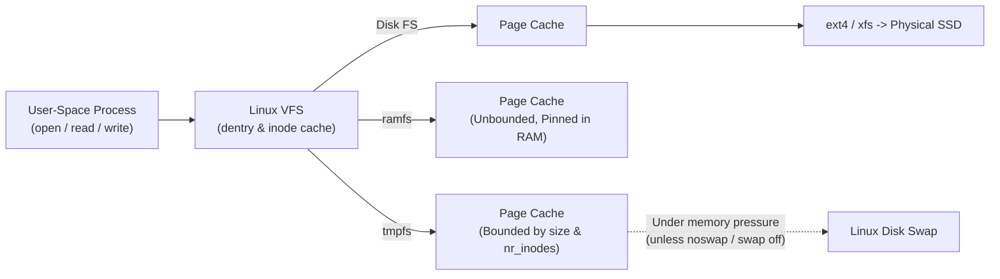

# Linux In-Memory Filesystems: tmpfs and ramfs

| Metadata      | Value                      |
| ------------- | -------------------------- |
| Author        | Lyzander Marciano Andrylie |
| Creation Date | Nov 24, 2026               |
| Last Updated  | Nov 24, 2026               |

## References

- [Linux Kernel Documentation: tmpfs](https://docs.kernel.org/filesystems/tmpfs.html): Virtual memory filesystem semantics, mount options (`size`, `nr_inodes`, `noswap`), and swap behavior
- [Linux Kernel Documentation: ramfs, rootfs and initramfs](https://docs.kernel.org/filesystems/ramfs-rootfs-initramfs.html): Page-cache-backed `ramfs`, unbounded growth behavior, and early-boot `rootfs`
- [Linux Programmer's Manual: tmpfs(5)](https://man7.org/linux/man-pages/man5/tmpfs.5.html): Mount flags, POSIX feature support, and capacity accounting
- [directory_structure.md](./directory_structure.md): Standard Linux mount points (`/run`, `/dev/shm`, `/tmp`) commonly backed by `tmpfs`
- [inodes.md](./inodes.md): Inode and dentry cache primitives underlying both disk and in-memory filesystems
- [workload_identity.md](../kubernetes/workload_identity.md): Kubernetes `tmpfs`-backed `Secret` and `projected` OIDC token volumes

## Description

**`tmpfs`** and **`ramfs`** are Linux in-memory virtual filesystems that store files directly inside the kernel's **page cache** and **dentry/inode caches** rather than on a physical block device. They provide fast, volatile POSIX file paths with zero disk I/O—useful for runtime state (`/run`), shared memory (`/dev/shm`), and short-lived secrets—while differing critically in size enforcement and Linux swap behavior.

## Concepts

### 1. Kernel Page-Cache Architecture (Not a Block RAM Disk)

Unlike legacy block RAM disks (`/dev/ram0`), which reserve a fixed slab of RAM and run a disk filesystem like `ext4` on top of it, `ramfs` and `tmpfs` live directly inside the Linux Virtual File System (VFS) caches.

- **No Double Caching**: A disk filesystem copies data between the block device and the kernel page cache. `ramfs` and `tmpfs` simply omit the backing block device and keep files directly in the page cache.
- **Dynamic Memory Growth**: Mounting a `1G` `tmpfs` consumes nearly zero RAM until files are written. Memory grows page-by-page as data is written and is reclaimed immediately when files are unlinked and all open file descriptors close.
- **Volatile Lifespan**: Because no physical disk backs the filesystem, all data vanishes instantly on unmount, reboot, or power loss.
- **Full POSIX Interface**: Applications interact with files via ordinary syscalls (`open()`, `read()`, `write()`, `mmap()`, `rename()`), unaware that the data lives in RAM.

#### Interaction



---

### 2. `ramfs`: Minimal, Unbounded, Unswappable Page-Cache FS

`ramfs` is the simplest possible in-memory filesystem—a thin wrapper around the Linux page cache with no size enforcement and no swap integration.

- **Unbounded Growth (Host Crash Risk)**: `ramfs` ignores `size=` mount options completely. A misbehaving process writing to a `ramfs` mount can consume 100% of physical RAM, starving the kernel and hanging or crashing the machine.
- **Never Swapped to Disk**: Pages allocated by `ramfs` stay pinned in physical RAM and cannot be paged out to Linux disk swap.
- **No Capacity Accounting**: `df -h` reports `0` total and `0` used space for `ramfs` mounts because `ramfs` does not track filesystem capacity.
- **Where It Is Actually Used**: The Linux kernel uses a specialized `ramfs` (or `tmpfs`) instance called `rootfs` during early boot to unpack `initramfs` before pivoting to the real root filesystem. Avoid `ramfs` for general application mounts.

> [!CAUTION]
> Never mount `ramfs` writable by untrusted users or application containers—there is no hard cap to stop a single file write from exhausting all host RAM. Use `tmpfs` with `noswap` (or host swap disabled) instead.

---

### 3. `tmpfs`: Bounded, Swappable, Production In-Memory FS

`tmpfs` adds production safety rails—enforced size/inode caps, capacity reporting (`df`), and virtual memory management—on top of the same zero-block-device architecture.

- **Enforced Size & Inode Limits**:
  - Defaults to **50% of physical RAM** (`size=50%`) and half the RAM page count for `nr_inodes`.
  - Exceeding either limit fails gracefully with `ENOSPC` (`No space left on device`) instead of crashing the host.
  - Limits can be adjusted live without unmounting via `mount -o remount,size=512M /mnt/cache`.
- **Linux Disk Swap Interaction**:
  - Under memory pressure, the Linux kernel can evict ("page out") cold `tmpfs` pages to **Linux disk swap**, freeing RAM for active processes.
  - **Secret Leakage Gotcha**: If sensitive credentials (TLS keys, OIDC tokens) live in `tmpfs` on a host with unencrypted disk swap enabled, those secrets may be written to the swap partition/file on disk.
  - **Mitigations**: Disable swap on the host (standard on Kubernetes worker nodes), use encrypted swap, or mount with `-o noswap` (available since **Linux 6.3**, combining `tmpfs` size caps with `ramfs`-style unswappability).
- **Standard Linux Mount Points**:
  - `/run`: Volatile runtime state (PID files, Unix domain sockets, systemd state).
  - `/dev/shm`: POSIX shared memory segments (`shm_open()`, inter-process communication, browser/Chrome shared buffers).
  - `/tmp`: Temporary scratch directory (mounted on `tmpfs` by default on many systemd-based distributions).

```shell
# Inspect active tmpfs mounts and their current sizes/usage
findmnt -t tmpfs
df -hT -t tmpfs

# Mount a bounded, owner-only, unswappable tmpfs for secrets (Linux 6.3+ for noswap)
sudo mount -t tmpfs -o size=64M,nr_inodes=1k,mode=0700,noswap tmpfs /mnt/secrets

# Resize an existing tmpfs mount live without losing files
sudo mount -o remount,size=128M /mnt/secrets
```

---

### 4. `tmpfs` vs `ramfs` vs Block RAM Disk (`brd`)

Choosing the right in-memory primitive comes down to quota enforcement, swap safety, and double-caching overhead.

| Property              | `tmpfs`                                      | `ramfs`                                  | Block RAM Disk (`brd` + `ext4`)         |
| :-------------------- | :------------------------------------------- | :--------------------------------------- | :-------------------------------------- |
| **Backing Mechanism** | Kernel page cache + optional Linux swap      | Kernel page cache only                   | Fixed pre-allocated RAM block device    |
| **Memory Allocation** | Dynamic (grows/shrinks with files)           | Dynamic (grows/shrinks with files)       | Static (entire size reserved upfront)   |
| **Size / Inode Cap**  | Enforced (`size=`, `nr_inodes=`, `ENOSPC`)   | None (`size=` silently ignored)          | Fixed at block device creation          |
| **Swappable?**        | Yes by default; preventable via `noswap`     | Never                                    | Never                                   |
| **`df` Reporting**    | Accurate used/available stats                | Always shows `0`                         | Accurate (via `ext4` superblock)        |
| **Double Caching**    | None                                         | None                                     | Yes (RAM disk + page cache copy)        |
| **Primary Use Case**  | `/run`, `/dev/shm`, `/tmp`, K8s secrets      | Early kernel boot (`rootfs`/`initramfs`) | Legacy testing of block-level tools     |

---

### 5. Containers, Kubernetes & cgroup Memory Gotchas

In containerized environments, `tmpfs` behaves like application RAM—not free disk space—which is a frequent source of unexpected `OOMKilled` crashes.

- **Charged to Container `limits.memory`**: Every byte written to a container's `tmpfs` mount (such as `/dev/shm` or Kubernetes `emptyDir: { medium: Memory }`) is counted as `shmem` inside the container's **cgroup v2** memory usage (`memory.current`). Filling a `tmpfs` volume past the container's memory limit triggers **`OOMKilled` (exit code 137)**.
- **Default `/dev/shm` Limit in Docker/Containerd**: Containers default to a tiny **64 MiB** `tmpfs` at `/dev/shm`. Workloads that rely heavily on POSIX shared memory (PyTorch DataLoaders, Chromium/Playwright, PostgreSQL parallel workers) fail with `No space left on device` or `SIGBUS` unless `/dev/shm` is enlarged (e.g., `docker run --shm-size=1g` or mounting a sized `emptyDir: { medium: Memory }`).
- **Kubernetes `Secret` & `projected` Volumes**: `kubelet` mounts `Secret` and `projected` ServiceAccount JWT volumes on `tmpfs` so tokens never touch physical SSD/EBS snapshots, vanish when the Pod terminates, and rotate via atomic symlink updates (`rename()`) with zero disk I/O (see [workload_identity.md](../kubernetes/workload_identity.md)).
- **Always Set `sizeLimit` on `emptyDir: Memory`**: Without `sizeLimit`, a memory-backed `emptyDir` defaults to 50% of the *node's* RAM (still bounded by the Pod's `limits.memory`, if set).

```yaml
# Kubernetes Pod mounting a bounded tmpfs volume at /dev/shm (e.g. for PyTorch / Chromium)
apiVersion: v1
kind: Pod
metadata:
  name: ml-worker
spec:
  containers:
    - name: worker
      image: ghcr.io/example/ml-worker:1.0.0
      resources:
        requests:
          memory: "2Gi"
        limits:
          memory: "4Gi" # Must cover BOTH app heap AND tmpfs usage (dshm)
      volumeMounts:
        - name: dshm
          mountPath: /dev/shm
  volumes:
    - name: dshm
      emptyDir:
        medium: Memory # Backed by tmpfs (RAM)
        sizeLimit: 1Gi
```

```shell
# Inside a cgroup v2 container: inspect how much memory is consumed by tmpfs/shmem
grep -E '^(anon|file|shmem) ' /sys/fs/cgroup/memory.stat
# Output:
# anon 134217728
# file 16777216
# shmem 67108864
```
